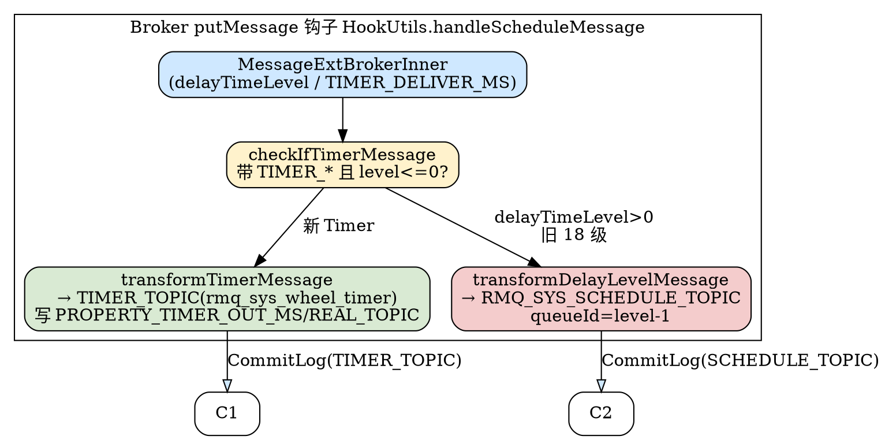
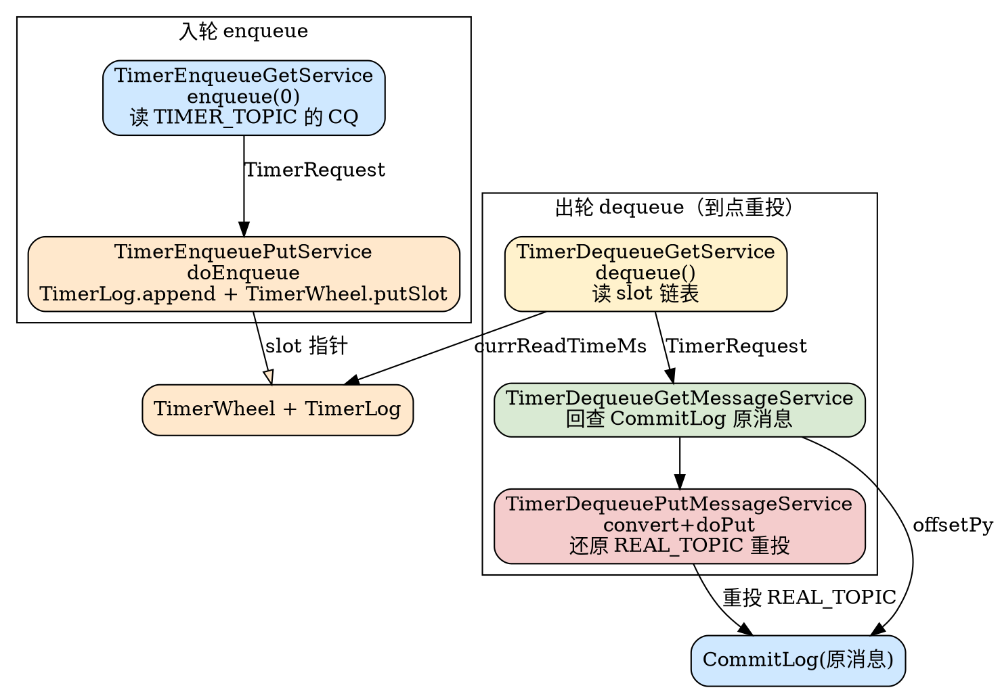

# Timer Message (延迟消息 / 时间轮机制)

## Introduction

RocketMQ 5.5.1 存在**两条**延迟消息实现路径，二者在协议入口、落盘主题、到点重投引擎上完全分离：

1. **5.x 新 Timer 机制（默认主路径）**：基于 `store/timer/` 包的时间轮（`TimerWheel`）+ 时间轮日志（`TimerLog`）+ 检查点（`TimerCheckpoint`）三件套，把延迟消息落盘到内部主题 `rmq_sys_wheel_timer`（常量 `TIMER_TOPIC`，`TimerMessageStore.java:86`），由一组 `ServiceThread` 异步完成「入轮（enqueue）→ 出轮（dequeue）→ 重投原 topic」。该机制支持**任意毫秒级**定时（`TIMER_DELIVER_MS` / `TIMER_DELAY_MS` / `TIMER_DELAY_SEC`），是 5.x 引入的精确定时器。
2. **旧 `SCHEDULE_TOPIC_XXXX` 实现（兼容保留）**：基于 `ScheduleMessageService`，仅支持 18 级固定延迟（`messageDelayLevel`，`MessageStoreConfig.java:262`），把延迟消息改写 topic 到 `RMQ_SYS_SCHEDULE_TOPIC` 并按延迟级别映射到 queueId，由每级一个的 `DeliverDelayedMessageTimerTask` 定时扫描重投。

本文基线为 **RocketMQ 5.5.1** 源码，聚焦两条路径的存储结构与到点驱动链路，与 [Store（CommitLog / ConsumeQueue 存储）](/docs/CS/MQ/RocketMQ/Store.md) 的写入/派发、[MessageProtocol（消息协议字节级详情）](/docs/CS/MQ/RocketMQ/MessageProtocol.md) 的 properties 编码、[Producer（生产端路径）](/docs/CS/MQ/RocketMQ/Producer.md) 的 `setDelayTimeLevel`/`setDelayTimeMs` 形成纵深互补；5.x 延迟消息的 POP 复活侧依赖见 [PopConsume](/docs/CS/MQ/RocketMQ/PopConsume.md)。

## 1. 协议入口分派（两条路径的十字路口）

发送端在 Broker 落盘前的 `putMessage` 钩子里统一分派（`BrokerController.java:1063-1069` 注册的 `handleScheduleMessage` 钩子）。核心逻辑在 `HookUtils.handleScheduleMessage`（`HookUtils.java:130-153`）：

- **事务消息跳过**：仅 `TRANSACTION_NOT_TYPE` / `TRANSACTION_COMMIT_TYPE` 才走延迟处理（`HookUtils.java:132-134`）。
- **新 Timer 路径**：`checkIfTimerMessage`（`:183-202`）仅当消息带 `TIMER_DELIVER_MS` / `TIMER_DELAY_MS` / `TIMER_DELAY_SEC` 且 `delayTimeLevel<=0` 时返回 `true`（`:201`）；此时若 `isTimerWheelEnable()==false` 直接拒绝（`WHEEL_TIMER_NOT_ENABLE`，`:137-140`），否则 `transformTimerMessage` 改写消息（`:141`）。
- **旧 18 级路径**：`delayTimeLevel > 0` 时调用 `transformDelayLevelMessage`（`:148-149`），改写到 `RMQ_SYS_SCHEDULE_TOPIC`。
- 注意 `checkIfTimerMessage` 第 184-195 行：若 `delayTimeLevel>0` 会**清掉** `TIMER_DELIVER_MS` 等新属性并返回 `false`，即**延迟级别优先走旧路径**；`isTimerInterceptDelayLevel` 开关（`:195` 被注释）开启后延迟级别才会改走新时间轮，5.5.1 默认该开关关闭。

### 1.1 新 Timer 改写（transformTimerMessage）

`HookUtils.transformTimerMessage`（`HookUtils.java:204-245`）把消息「重定向」到内部 wheel 主题，并记下真实目标：

- 计算目标投递时间 `deliverMs`：优先 `TIMER_DELAY_SEC`（×1000，`:210-211`）→ `TIMER_DELAY_MS`（`:212-213`）→ 否则直接用 `TIMER_DELIVER_MS` 绝对值（`:215`）；解析失败返回 `WHEEL_TIMER_MSG_ILLEGAL`（`:218`）。
- 越界/超长拒绝：超过 `getTimerMaxDelaySec()` 或超 7 天 TTL 视为非法（`:220-223`）。
- **精度对齐**：按 `timerPrecisionMs` 向下取整（`:225-230`），例如非整秒时间点会被抹到上一个精度边界。
- 写入 `PROPERTY_TIMER_OUT_MS = deliverMs`（定时触发时刻，`:235`），并把**真实 topic/queueId** 存入 `PROPERTY_REAL_TOPIC` / `PROPERTY_REAL_QUEUE_ID`（`:236-237`）。
- 最后 `msg.setTopic(TimerMessageStore.TIMER_TOPIC); msg.setQueueId(0)`（`:239-240`）——即延迟消息先以 topic=`rmq_sys_wheel_timer`、queueId=0 写入 [CommitLog](/docs/CS/MQ/RocketMQ/Store.md)，再由 Timer 引擎读取重投。

### 1.2 旧 18 级改写（transformDelayLevelMessage）

`HookUtils.transformDelayLevelMessage`（`HookUtils.java:247-260`）：

- 超限级别 clamp 到 `getMaxDelayLevel()`（`:249-250`）。
- 备份真实 topic/queueId 到 `PROPERTY_REAL_TOPIC` / `PROPERTY_REAL_QUEUE_ID`（`:254-255`）。
- `msg.setTopic(TopicValidator.RMQ_SYS_SCHEDULE_TOPIC); msg.setQueueId(ScheduleMessageService.delayLevel2QueueId(level))`（`:258-259`）——**延迟级别 → queueId 的映射**由 `delayLevel2QueueId = level-1`（`ScheduleMessageService.java:103-105`）完成。



## 2. 5.x 新 Timer 机制核心（`store/timer/`）

主类是 `TimerMessageStore`（`TimerMessageStore.java:79`），持有三大组件（`TimerMessageStore.java:120-122`）：

```
timerWheel      TimerWheel      // 内存映射的时间轮：slot → (firstPos,lastPos,num,magic)
timerLog        TimerLog        // 落盘的定时消息日志（环形复用，类似 CommitLog）
timerCheckpoint TimerCheckpoint // 持久化 lastReadTimeMs / lastTimerLogFlushPos / lastTimerQueueOffset
```

### 2.1 时间轮精度与槽位（TimerWheel）

`TimerWheel`（`TimerWheel.java:38`）是一个内存映射文件，其**槽位数量固定、与精度无关**：

- `slotsTotal = TIMER_WHEEL_TTL_DAY(7) * DAY_SECS(24*3600) = 604800` 槽（`TimerMessageStore.java:100,178`）。即时间轮覆盖 **7 天** TTL。
- `precisionMs` 来自 `storeConfig.getTimerPrecisionMs()`，默认 **1000ms**（`MessageStoreConfig.java:71`），可选精度候选 `{100,200,500,1000}`（`MessageStoreConfig.java:1861` 的 `setTimerPrecisionMs` 向上取候选）。
- **每个 slot 占 `Slot.SIZE = 32` 字节**（`Slot.java:28`），布局：`timeMs(8) + firstPos(8) + lastPos(8) + num(4) + magic(4)`（`Slot.java:20-25`）。
- 文件长度 `wheelLength = slotsTotal * 2 * Slot.SIZE`（`:67`）——**2 倍 slotsTotal 是为了环形双缓冲**，索引计算 `getSlotIndex(timeMs) = timeMs/precisionMs % (slotsTotal*2)`（`TimerWheel.java:284-286`）：把 7 天时间轴展开成 `2×604800=1,209,600` 个物理槽，写指针与读指针在环上错峰，避免读写碰撞。
- `getSlot` 会校验槽的 `timeMs` 是否与请求时刻对齐，否则返回空槽（`:269-275`）；`putSlot` 写入 first/last 链表指针（`:297-304`）。

### 2.2 时间轮日志单元（TimerLog.UNIT_SIZE）

`TimerLog`（`TimerLog.java:29`）是延迟消息的落盘载体，每个单元固定 **52 字节**（`UNIT_SIZE`，`:33-41`）：

```
size(4) + prevPos(8) + magic(4) + currWriteTime(8) + delayedTime(4) + offsetPy(8) + sizePy(4) + realTopicHash(4) + reserved(8)
```

其中 `offsetPy/sizePy` 指向 [CommitLog](/docs/CS/MQ/RocketMQ/Store.md) 中**原消息**的物理位置（`TimerMessageStore.java:872-873`），`prevPos` 把同一 slot 内的多条消息串成链表（`TimerMessageStore.java:868`）。`UNIT_PRE_SIZE_FOR_MSG = 28`（`:42`）是读取时跳过 size+prev+magic+currtime+delayedtime、直接定位 `offsetPy` 的偏移（`TimerMessageStore.java:935`）。尾部 `BLANK_MAGIC_CODE`（`:31`）用于文件剩余空间填充（类似 CommitLog 的 `BLANK_MAGIC_CODE`）。

### 2.3 入轮（enqueue）流程

入轮由两条协作线程驱动：

- **`TimerEnqueueGetService`**（`TimerMessageStore.java:1410-1434`）：循环调用 `enqueue(0)`（`:1425`），从 `TIMER_TOPIC` 的 ConsumeQueue 顺序迭代（`enqueue`，`:754`），按 offset 取出 CqUnit，用 `getMessageByCommitOffset` 还原 `MessageExt`，读取 `PROPERTY_TIMER_OUT_MS` 得到 `delayedTime`（`:793`），封装成 `TimerRequest` 投进 `enqueuePutQueue`（`:796-798`）。
- **`TimerEnqueuePutService`**（`TimerMessageStore.java:1447-1548`）：`fetchTimerRequests` 批量取请求（≤10 个，`:1457-1475`），逐个 `putMessageToTimerWheel`（`:1477`）。若消息已过期（`req.getDelayTime() < currWriteTimeMs` 且 `shouldRunningDequeue`）直接转 `dequeuePutQueue` 立即重投（`:1484-1486`）；否则 `doEnqueue`（`:1488`）。

`doEnqueue`（`TimerMessageStore.java:841-885`）是真正写盘逻辑：

1. **Roll 判定**：`needRoll = delayedTime - currWriteTimeMs >= timerRollWindowSlots * precisionMs`（`:845`）。`timerRollWindowSlot` 默认 `3600*24*2 = 172800` 槽（约 2 天，`MessageStoreConfig.java:73`），非法时取 `slotsTotal - TIMER_BLANK_SLOTS(60)`（`:216-221`）。超过 roll 窗口的消息打 `MAGIC_ROLL` 并把 `delayedTime` 前移一个窗口（`:847-854`），分多次 roll 直到落入窗口——这是时间轮**无法一次性覆盖超长延迟**时的分段策略（类似经典时间轮的「降级到最外层再逐层下沉」）。
2. **Delete 判定**：带 `TIMER_DELETE_UNIQUE_KEY` 的消息打 `MAGIC_DELETE`（`:856-862`），用于取消尚未到期的定时消息。
3. 装配 52 字节单元并 `timerLog.append`（`:865-876`），再 `timerWheel.putSlot(delayedTime, firstPos==-1?ret:firstPos, ret, num±1, magic)`（`:880-881`）把该 slot 的链表头/尾与计数更新。

### 2.4 出轮（dequeue）与重投原 topic

- **`TimerDequeueGetService`**（`TimerMessageStore.java:1550-1576`）：循环调用 `dequeue()`（`:1567`），每次推进 `precisionMs`（`:1568` 兜底等待）。
- **`dequeue()`**（`TimerMessageStore.java:1018-1127`）：取 `timerWheel.getSlot(currReadTimeMs)`（`:1029`），若槽有效（`timeMs!=-1`）则沿 `lastPos → prevPos` 链表回溯读完整条 `TimerLog` 单元（`:1045-1080`），按 `magic` 把请求分入 `deleteMsgStack` / `normalMsgStack`（`:1069-1073`），分别投入 `dequeueGetQueue` 并 `checkDequeueLatch` 等待读取完成（`:1094-1111`），最后 `moveReadTime()` 把读指针 +precisionMs（`:1119,660-663`）。
- **`TimerDequeueGetMessageService`**（`TimerMessageStore.java:1697-1778`）：从 `dequeueGetQueue` 取请求，按 `offsetPy/sizePy` 从 [CommitLog](/docs/CS/MQ/RocketMQ/Store.md) 还原 `MessageExt`（`:1721`）；对 delete 类比对 `PROPERTY_TIMER_DEL_UNIQKEY` 实现「取消」（`:1723-1741`），普通消息则投入 `dequeuePutQueue`。
- **`TimerDequeuePutMessageService`**（`TimerMessageStore.java:1591-1695`）：`convert` 还原消息（`:1647`）——`convert`（`TimerMessageStore.java:1174-1188`）打 `TIMER_ENQUEUE_MS` / `TIMER_DEQUEUE_MS` / `TIMER_ROLL_TIMES` 等属性；`convertMessage`（`:1245-1274`）关键一步：`needRoll==false` 时取出 `PROPERTY_REAL_TOPIC` / `PROPERTY_REAL_QUEUE_ID` 作为**最终 topic/queueId** 并清除这两个标记（`:1268-1272`），从而把消息**重投回用户原 topic**。随后 `doPut`（`:1191`，内部 `messageStore.putMessage`，`:1202`）写回 [CommitLog](/docs/CS/MQ/RocketMQ/Store.md) 完成「到点投递」。

### 2.5 持久化与恢复（TimerCheckpoint）

- **刷盘**由 `TimerFlushService`（`TimerMessageStore.java:1815-1883`）周期 `timerFlushIntervalMs` 执行 `flush`（`:1852`）：默认路径 `prepareTimerCheckPoint()` → `timerLog.flush` → `timerWheel.flush` → `timerCheckpoint.flush`（`:1864-1867`）；若开启 `timerWheelSnapshotFlush`（默认 `false`，`MessageStoreConfig.java:83`）则改用 `timerWheel.backup` 快照（`:1853-1862`）。
- **`prepareTimerCheckPoint`**（`TimerMessageStore.java:1945-1957`）把 `lastTimerLogFlushPos` 等写入检查点。
- **`TimerCheckpoint`**（`TimerCheckpoint.java:34`）文件布局：每个字段 `long`（8B）：`lastReadTimeMs(0) / lastTimerLogFlushPos(8) / lastTimerQueueOffset(16) / masterTimerQueueOffset(24)` + 后期追加的 `DataVersion`（`stateVersion/timestamp/counter`，`:112-121`）。
- **`recover`**（`TimerMessageStore.java:302-366`）：从 `lastTimerLogFlushPos` 起 `recoverAndRevise` 重建槽链表（`:312`）；读指针初始化为 `formatTimeMs(now) - slotsTotal*precisionMs + TIMER_BLANK_SLOTS*precisionMs`（`:343-347`），即把时间轮对齐到「7 天 TTS 减去 60 个空白槽」的边界，保证环形回溯不越界；`checkPhyPos` 还会校验槽中物理偏移不超过 TimerLog（`:351`），损坏时二次 `recoverAndRevise`（`:357`）。

### 2.6 magic 与 RocksDB 旁路

- 三个 magic：`MAGIC_DEFAULT=1`、`MAGIC_ROLL=1<<1`、`MAGIC_DELETE=1<<2`（`TimerMessageStore.java:102-104`），`needRoll`/`needDelete` 按位判定（`:1807-1813`）。
- 5.5.1 还提供 **RocksDB 驱动旁路**：当 `isTimerRocksDBEnable()` 且未停止扫描时，`TimerEnqueueGetService` 跳过时间轮、直接由 RocksDB 驱动（`:1422-1424`）；`timerRocksDBEnable` 开启时 `recover` 还会用 `getCommitOffsetInRocksDB` 校正 `currQueueOffset`（`:323-327`）。

## 3. 旧 SCHEDULE_TOPIC_XXXX 实现（18 级）

`ScheduleMessageService`（`ScheduleMessageService.java:66`，继承 `ConfigManager`）是 4.x 经典延迟实现，5.5.1 仍为 `delayTimeLevel>0` 消息的落点。

- **18 级延迟表**：`messageDelayLevel` 默认 `"1s 5s 10s 30s 1m 2m 3m 4m 5m 6m 7m 8m 9m 10m 20m 30m 1h 2h"`（`MessageStoreConfig.java:262`），`parseDelayLevel`（`:300-332`）按 `s/m/h/d` 单位表（`:301-305`）解析成 `delayLevelTable`（level → 毫秒，`:321`），共 **18 级**，`maxDelayLevel=18`。
- **级别↔队列映射**：`delayLevel2QueueId = level-1`、`queueId2DelayLevel = queueId+1`（`:99-105`）；消息按级别落入 `RMQ_SYS_SCHEDULE_TOPIC` 的不同 queue（见 §1.2）。
- **到点重投**：`start()`（`:135-166`）为每个延迟级别启动一个 `DeliverDelayedMessageTimerTask`（`:154`），线程池大小 = `maxDelayLevel`（`:138`）。该 task 的 `executeOnTimeUp`（`:400-488`）从对应 CQ 迭代：`deliverTimestamp = correctDeliverTimestamp(now, tagsCode)`（`:388-398,444`），`tagsCode` 即该消息的「应投递时刻」（`computeDeliverTimestamp = delayLevelTable[level] + storeTimestamp`，`:126-133`）；若 `countdown>0` 则 `scheduleNextTimerTask(currOffset, DELAY_FOR_A_WHILE=100ms)` 稍后重试（`:451-454`），否则 `messageTimeUp` 还原消息、`lookMessageByOffset` 读原消息并 `syncDeliver`/`asyncDeliver`（`:457-474`）。
- **`messageTimeUp`**（`ScheduleMessageService.java:334-364`）：清除 `PROPERTY_DELAY_TIME_LEVEL`/`PROPERTY_TIMER_DELIVER_MS`/`PROPERTY_TIMER_DELAY_SEC`（`:353-355`），取出 `PROPERTY_REAL_TOPIC` / `PROPERTY_REAL_QUEUE_ID` 还原为最终 topic/queueId（`:357-361`），再 `brokerController.getEscapeBridge().asyncPutMessage` 重投（`:535`）——与 §2.4 的 `convertMessage` 思路一致，只是还原发生在重投侧而非时间轮侧。
- **位点持久化**：`offsetTable`（level→offset，`:78-79`）定期 `persist`（`:158-164`），崩溃后 `correctDelayOffset`（`:235-269`）依据 CQ 的 min/max 校准。

## 4. 两条路径对照

| 维度 | 5.x 新 Timer（默认） | 旧 SCHEDULE_TOPIC_XXXX |
| --- | --- | --- |
| 入口属性 | `TIMER_DELIVER_MS` / `TIMER_DELAY_MS` / `TIMER_DELAY_SEC`（`MessageConst.java:74,108`） | `PROPERTY_DELAY_TIME_LEVEL` = `DELAY`（`MessageConst.java:25,127`） |
| 内部主题 | `rmq_sys_wheel_timer`（`TIMER_TOPIC`，`TimerMessageStore.java:86`） | `RMQ_SYS_SCHEDULE_TOPIC`（`HookUtils.java:258`） |
| 时间建模 | 时间轮 + TimerLog，槽 604800×2、精度 1s 可选 100/200/500ms | 18 级固定延迟 → 18 个 queue |
| 定时精度 | **任意毫秒级**，最长 7 天 TTL（可 roll 分段） | 仅 18 个离散档位，最长 2h |
| 到点引擎 | `TimerDequeue*Service` 异步重投（§2.4） | `DeliverDelayedMessageTimerTask` 每级定时扫描（§3） |
| 开关 | `timerWheelEnable`（默认 true，`MessageStoreConfig.java:84`） | 始终启用，`delayTimeLevel` 触发 |
| 取消能力 | 支持（`TIMER_DELETE_UNIQUE_KEY` + `MAGIC_DELETE`） | 不支持 |
| 主 Broker 行为 | 仅 Master/`shouldRunningDequeue` 才出轮（`TimerMessageStore.java:161,484`） | 每级独立 task，依赖 offset 推进 |

> 协议衔接：新 Timer 的投递时刻属性 `TIMER_OUT_MS` 与 [MessageProtocol](/docs/CS/MQ/RocketMQ/MessageProtocol.md) 的 properties 字符串编码（`NAME_VALUE_SEPARATOR=1` / `PROPERTY_SEPARATOR=2`）完全兼容——`PROPERTY_TIMER_OUT_MS`、`PROPERTY_REAL_TOPIC`、`PROPERTY_REAL_QUEUE_ID` 皆在 `MessageConst.STRING_HASH_SET` 系统键白名单内（`MessageConst.java:162,166`），不会被用户属性覆盖。延迟消息写入 [CommitLog](/docs/CS/MQ/RocketMQ/Store.md) 时与普通消息**共用同一 magic/编码格式**，区别仅在 `topic` 字段被改写成内部系统主题（§1.1/§1.2），因此 [Store](/docs/CS/MQ/RocketMQ/Store.md) 的派发、刷盘、主从复制链路对延迟消息完全透明。

## 5. 与存储/协议衔接小结

- **写入**：新 Timer 消息先以 `rmq_sys_wheel_timer` topic 落 [CommitLog](/docs/CS/MQ/RocketMQ/Store.md)（经普通 `doAppend`，编码见 [MessageProtocol](/docs/CS/MQ/RocketMQ/MessageProtocol.md)），其 ConsumeQueue 仅作「待入轮队列」被 `TimerEnqueueGetService` 消费（`enqueue`，`TimerMessageStore.java:761-773`）；`TimerLog` 是独立于 CommitLog 的**第二份持久化**（存指向原消息的指针 + magic + 延迟时间）。
- **读路径**：到点后 `TimerDequeuePutMessageService` 通过 `offsetPy` 回查 [CommitLog](/docs/CS/MQ/RocketMQ/Store.md) 原消息（`getMessageByCommitOffset`，`TimerMessageStore.java:1162-1172`），还原真实 topic 后再次 `putMessage` 写回 CommitLog，回到正常的 [Consumer](/docs/CS/MQ/RocketMQ/Consumer.md) 拉取链路——即延迟消息「**两次写 CommitLog、一次改写 topic、一次回查**」。
- **Broker 角色**：仅 Master（或 `shouldRunningDequeue` 的从 acting master）执行出轮，避免主从重复重投（`TimerMessageStore.java:161`）；从节点通过 [Broker](/docs/CS/MQ/RocketMQ/Broker.md) 的 `SlaveSynchronize` 同步 Timer 指标与 dequeue 开关（`SlaveSynchronize.java:236-262`）。
- **生命周期**：一条延迟消息从 [Producer](/docs/CS/MQ/RocketMQ/Producer.md) 的 `setDelayTimeMs` 到最终被消费，跨越「改写内部主题 → 时间轮等待 → 回查重投 → 正常消费」四阶段，完整轨迹见 [MessageLifecycle](/docs/CS/MQ/RocketMQ/MessageLifecycle.md)。



## Links

- [Store（CommitLog / ConsumeQueue 存储）](/docs/CS/MQ/RocketMQ/Store.md)
- [MessageProtocol（消息协议字节级详情）](/docs/CS/MQ/RocketMQ/MessageProtocol.md)
- [Producer（生产端路径）](/docs/CS/MQ/RocketMQ/Producer.md)
- [Broker（Broker 角色与同步）](/docs/CS/MQ/RocketMQ/Broker.md)
- [MessageLifecycle（端到端消息生命周期）](/docs/CS/MQ/RocketMQ/MessageLifecycle.md)
- [PopConsume（POP 无状态消费协议）](/docs/CS/MQ/RocketMQ/PopConsume.md)
- [RocketMQ5（5.x 总览）](/docs/CS/MQ/RocketMQ/RocketMQ5.md)

## References

- `store/src/main/java/org/apache/rocketmq/store/timer/TimerMessageStore.java`
- `store/src/main/java/org/apache/rocketmq/store/timer/TimerWheel.java`
- `store/src/main/java/org/apache/rocketmq/store/timer/TimerLog.java`
- `store/src/main/java/org/apache/rocketmq/store/timer/TimerCheckpoint.java`
- `store/src/main/java/org/apache/rocketmq/store/timer/Slot.java`
- `broker/src/main/java/org/apache/rocketmq/broker/util/HookUtils.java`
- `broker/src/main/java/org/apache/rocketmq/broker/schedule/ScheduleMessageService.java`
- `store/src/main/java/org/apache/rocketmq/store/config/MessageStoreConfig.java`
- `common/src/main/java/org/apache/rocketmq/common/message/MessageConst.java`
- `broker/src/main/java/org/apache/rocketmq/broker/BrokerController.java`
