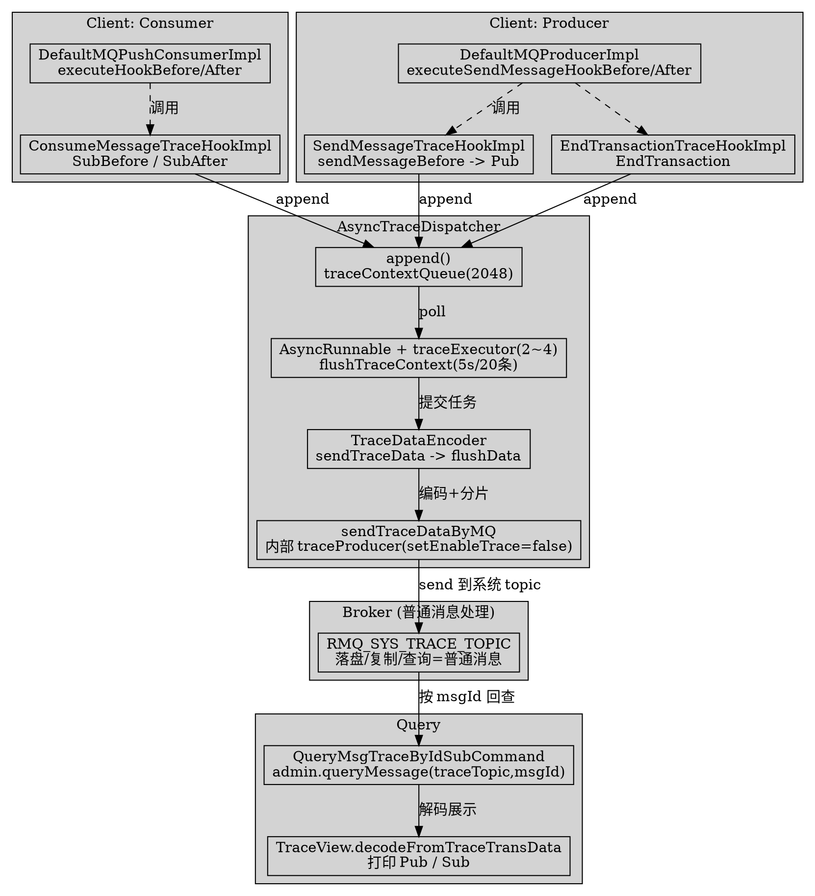

# Message Trace (Client-Side Tracing)

## Introduction

RocketMQ 的消息轨迹（Trace）是一套**纯客户端埋点**机制：生产/消费/事务回查时在客户端构造轨迹上下文，经一个内部异步 producer 批量发往系统 topic `RMQ_SYS_TRACE_TOPIC`，broker 将其当作普通消息落盘，查询端再回查该 topic 还原轨迹。本页所有 `file:line` 均基于 **RocketMQ 5.5.1** 真源码核验（codegraph 反查 + 真实文件 Read）。

> 版本基线：RocketMQ 5.5.1

**纠偏 / 反直觉点（务必先读）**：

1. **Trace 不是 broker 强制特性**。服务端对轨迹消息零特殊处理——它就是发到 `RMQ_SYS_TRACE_TOPIC` 的普通消息，复制/持久化/查询全部走既有路径。开关、埋点、上报全部在 client 侧。
2. **轨迹类型枚举里没有 `Sub`**。5.5.1 的 `TraceType` 只有 `Pub / Recall / SubBefore / SubAfter / EndTransaction`（`TraceType.java:19`）。顺序消费与并发消费**共用同一套 hook**，都生成 `SubBefore`（消费前）+ `SubAfter`（消费后）两条；所谓"顺序 vs 并发轨迹类型不同（SUB vs SubBefore+SUB）"在 5.5.1 不成立。查询命令 `queryMsgTraceById` 显示 `Sub` 标签，但实际对应 `SubAfter`（`QueryMsgTraceByIdSubCommand.java:153,178`）。
3. **开启 trace 会引入隐藏开销与隐藏 topic**。每条发送/消费都多一次 `traceContextQueue.offer`（容量 2048，满则丢弃）与后台 `traceProducer` 异步发送；轨迹 producer 自身通过 `setEnableTrace(false)` 避免递归上报（`AsyncTraceDispatcher.java:156`）。

## 1. 接口与核心类（TraceDispatcher / AsyncTraceDispatcher）

`TraceDispatcher` 是轨迹上报的顶层接口（`client/src/main/java/org/apache/rocketmq/client/trace/TraceDispatcher.java:26`），仅有 4 个方法：`start / append / flush / shutdown`：

```java
// client/src/main/java/org/apache/rocketmq/client/trace/TraceDispatcher.java:26-53
public interface TraceDispatcher {
    enum Type { PRODUCE, CONSUME }                 // 仅区分生产侧 / 消费侧 dispatcher
    void start(String nameSrvAddr, AccessChannel accessChannel) throws MQClientException;
    boolean append(Object ctx);                    // 入参实际是 TraceContext
    void flush() throws IOException;
    void shutdown();
}
```

唯一实现 `AsyncTraceDispatcher`（`AsyncTraceDispatcher.java:54`）。构造即初始化双缓冲队列与内部 producer：

```java
// client/src/main/java/org/apache/rocketmq/client/trace/AsyncTraceDispatcher.java:84-105
public AsyncTraceDispatcher(String group, Type type, int batchNum, String traceTopicName, RPCHook rpcHook) {
    this.batchNum = Math.min(batchNum, 20);                                    // 每批上限 20，默认 batchNum=10(ClientConfig.java:69)
    this.maxMsgSize = 128000;                                                  // 单条轨迹消息上限 128KB
    this.traceContextQueue = new ArrayBlockingQueue<>(2048);                    // 主缓冲：Hook 写入
    this.appenderQueue     = new ArrayBlockingQueue<>(2048);                    // 异步编码任务队列
    if (!UtilAll.isBlank(traceTopicName)) this.traceTopicName = traceTopicName;
    else this.traceTopicName = TopicValidator.RMQ_SYS_TRACE_TOPIC;              // 默认 RMQ_SYS_TRACE_TOPIC
    this.traceExecutor = new ThreadPoolExecutor(2, 4, 1000*60, TimeUnit.MILLISECONDS,
        this.appenderQueue, new ThreadFactoryImpl("MQTraceSendThread_" + traceInstanceId + "_"));
    traceProducer = getAndCreateTraceProducer(rpcHook);
}
```

内部 producer 是一个**独立 DefaultMQProducer**，producerGroup 由固定前缀拼出，并显式关闭自身 trace，防止上报轨迹又触发上报：

```java
// client/src/main/java/org/apache/rocketmq/client/trace/AsyncTraceDispatcher.java:167-182
private DefaultMQProducer getAndCreateTraceProducer(RPCHook rpcHook) {
    DefaultMQProducer p = new DefaultMQProducer(rpcHook);
    p.setProducerGroup(genGroupNameForTrace());     // "_INNER_TRACE_PRODUCER-" + group + "-" + type + "-" + COUNTER
    p.setSendMsgTimeout(5000);
    p.setVipChannelEnabled(false);
    p.setMaxMessageSize(maxMsgSize);                // 128000
    return p;
}
// start() 里进一步
traceProducer.setEnableTrace(false);                // 关键：轨迹 producer 不再产生轨迹，斩断递归
traceProducer.start();
```

## 2. 数据结构（TraceContext / TraceBean / TraceType / TraceTransferBean）

| 类 | 职责 | 关键 file:line |
| ---- | ---- | ---- |
| `TraceType` | 轨迹类型枚举 | `client/src/main/java/org/apache/rocketmq/client/trace/TraceType.java:19`（`Pub, Recall, SubBefore, SubAfter, EndTransaction`） |
| `TraceContext` | 一次轨迹的上下文（含类型、region、group、耗时、成功标志、bean 列表） | `client/src/main/java/org/apache/rocketmq/client/trace/TraceContext.java:27`（实现 `Comparable`，按 timeStamp 排序） |
| `TraceBean` | 单条消息的轨迹字段（topic、msgId、offsetMsgId、storeHost、bodyLength、retryTimes…） | 同包 `TraceBean.java` |
| `TraceTransferBean` | 编码后的传输载体：`transData`（字符串）+ `transKey`（msgId 集合，用作查询 key） | `client/src/main/java/org/apache/rocketmq/client/trace/TraceTransferBean.java:25` |

`TraceContext` 字段（节选，`TraceContext.java:29-39`）：`traceType / timeStamp / regionId / groupName / costTime / isSuccess / requestId / contextCode / accessChannel / traceBeans`。注意 `requestId` 在构造时由 `MessageClientIDSetter.createUniqID()` 生成，用于把 `SubBefore` 与 `SubAfter` 关联起来（`SubAfter` 复用 `SubBefore` 的 requestId，见 `ConsumeMessageTraceHookImpl.java:101`）。

编码在 `TraceDataEncoder.encoderFromContextBean`（`client/src/main/java/org/apache/rocketmq/client/trace/TraceDataEncoder.java:159`）：按 `TraceType` 分支，把 context + bean 拼成以 `CONTENT_SPLITOR`(char 1) 分隔、`FIELD_SPLITOR`(char 2) 结尾的字符串：

```java
// client/src/main/java/org/apache/rocketmq/client/trace/TraceConstants.java:23-27
public static final String GROUP_NAME_PREFIX = "_INNER_TRACE_PRODUCER";
public static final char   CONTENT_SPLITOR  = (char) 1;     // 字段分隔
public static final char   FIELD_SPLITOR    = (char) 2;     // 记录结尾
public static final String TRACE_TOPIC_PREFIX = TopicValidator.SYSTEM_TOPIC_PREFIX + "TRACE_DATA_";  // 混合云用
```

`Pub` 分支样例（`TraceDataEncoder.java:167-184`）：`Pub(类型)①时间戳①region①group①topic①msgId①tags①keys①storeHost①bodyLen①costTime①msgType①offsetMsgId①success②`。

## 3. 埋点 Hook（SendMessageHook / ConsumeMessageHook）

### 3.1 生产侧：SendMessageTraceHookImpl

实现 `SendMessageHook`，在 `sendMessageBefore` 建 `Pub` 上下文、`sendMessageAfter` 补全并 `append`：

```java
// client/src/main/java/org/apache/rocketmq/client/trace/hook/SendMessageTraceHookImpl.java:43-98 (节选)
public void sendMessageBefore(SendMessageContext context) {
    if (context == null || context.getMessage().getTopic()
            .startsWith(((AsyncTraceDispatcher) localDispatcher).getTraceTopicName()))
        return;                                          // 轨迹 topic 自身不上报，防递归
    TraceContext traceContext = new TraceContext();
    traceContext.setTraceType(TraceType.Pub);            // ← Pub
    traceContext.setGroupName(NamespaceUtil.withoutNamespace(context.getProducerGroup()));
    TraceBean traceBean = new TraceBean();
    traceBean.setTopic(...); traceBean.setTags(...); traceBean.setKeys(...);
    traceBean.setStoreHost(context.getBrokerAddr()); traceBean.setBodyLength(...);
    traceBean.setMsgType(context.getMsgType());
    traceContext.getTraceBeans().add(traceBean);
}
public void sendMessageAfter(SendMessageContext context) {
    ...
    if (context.getSendResult().getRegionId() == null || !context.getSendResult().isTraceOn())
        return;                                          // 单条开关：发送结果标记 traceOn=false 则跳过
    TraceContext traceContext = (TraceContext) context.getMqTraceContext();
    ...
    localDispatcher.append(traceContext);                // ← 入队列
}
```

### 3.2 消费侧：ConsumeMessageTraceHookImpl

实现 `ConsumeMessageHook`，消费前记 `SubBefore`、消费后记 `SubAfter`（**顺序与并发消费走同一逻辑，类型无差异**）：

```java
// client/src/main/java/org/apache/rocketmq/client/trace/hook/ConsumeMessageTraceHookImpl.java:47-117 (节选)
public void consumeMessageBefore(ConsumeMessageContext context) {
    TraceContext traceContext = new TraceContext();
    traceContext.setTraceType(TraceType.SubBefore);      // ← SubBefore
    ...
    for (MessageExt msg : context.getMsgList()) {
        String traceOn = msg.getProperty(MessageConst.PROPERTY_TRACE_SWITCH);
        if (traceOn != null && traceOn.equals("false")) continue;   // 单条开关
        TraceBean traceBean = new TraceBean(); ... beans.add(traceBean);
    }
    if (beans.size() > 0) { traceContext.setTraceBeans(beans); localDispatcher.append(traceContext); }
}
public void consumeMessageAfter(ConsumeMessageContext context) {
    TraceContext subBefore = (TraceContext) context.getMqTraceContext();
    TraceContext subAfter = new TraceContext();
    subAfter.setTraceType(TraceType.SubAfter);           // ← SubAfter，复用 SubBefore 的 requestId
    subAfter.setRequestId(subBefore.getRequestId());
    subAfter.setSuccess(context.isSuccess());
    subAfter.setTraceBeans(subBefore.getTraceBeans());
    ...
    localDispatcher.append(subAfter);
}
```

### 3.3 事务回查与 Recall

- `EndTransactionTraceHookImpl`（`EndTransactionTraceHookImpl.java:33`）在 `endTransaction` 写 `EndTransaction` 类型（`EndTransactionTraceHookImpl.java:56`）。
- `DefaultRecallMessageTraceHook` 通过 RPC hook 注入，产出 `Recall` 类型（用于消息撤回场景）。

## 4. Hook 注册位置（DefaultMQProducer / DefaultMQPushConsumer）

生产侧在 `DefaultMQProducer.start()` 里当 `enableTrace` 为真时装配三个 hook：

```java
// client/src/main/java/org/apache/rocketmq/client/producer/DefaultMQProducer.java:380-391
if (enableTrace) {
    AsyncTraceDispatcher dispatcher = new AsyncTraceDispatcher(producerGroup, Type.PRODUCE,
        getTraceMsgBatchNum(), traceTopic, rpcHook);
    dispatcher.setHostProducer(this.defaultMQProducerImpl);
    traceDispatcher = dispatcher;
    this.defaultMQProducerImpl.registerSendMessageHook(new SendMessageTraceHookImpl(traceDispatcher));
    this.defaultMQProducerImpl.registerEndTransactionHook(new EndTransactionTraceHookImpl(traceDispatcher));
    this.defaultMQProducerImpl.getMqClientFactory().getMQClientAPIImpl().getRemotingClient()
        .registerRPCHook(new DefaultRecallMessageTraceHook(traceDispatcher));
}
```

消费侧在 `DefaultMQPushConsumer.start()`（`DefaultMQPushConsumer.java:731-737`）与 `DefaultLitePullConsumer.start()`→`setTraceDispatcher()`（`DefaultLitePullConsumer.java:234, 596-604`）里装配 `ConsumeMessageTraceHookImpl`。注册方法实现于 Impl 层：

```java
// client/src/main/java/org/apache/rocketmq/client/impl/producer/DefaultMQProducerImpl.java:1154-1176
public void executeSendMessageHookBefore(final SendMessageContext context) {
    for (SendMessageHook hook : this.sendMessageHookList) hook.sendMessageBefore(context);   // :1158
}
public void executeSendMessageHookAfter(final SendMessageContext context) {
    for (SendMessageHook hook : this.sendMessageHookList) hook.sendMessageAfter(context);    // :1170
}
// client/src/main/java/org/apache/rocketmq/client/impl/consumer/DefaultMQPushConsumerImpl.java:161-188
public void registerConsumeMessageHook(final ConsumeMessageHook hook) { this.consumeMessageHookList.add(hook); }
public void executeHookBefore(final ConsumeMessageContext context) { ... hook.consumeMessageBefore(context); }  // :170
public void executeHookAfter(final ConsumeMessageContext context)  { ... hook.consumeMessageAfter(context);  }  // :182
```

即埋点完全由 `DefaultMQProducerImpl`/`DefaultMQPushConsumerImpl` 的 hook 链驱动，broker 侧无任何介入。

## 5. 异步批量上报通道（append → flush → sendTraceDataByMQ）

上报是典型"双队列 + 后台 worker"管线：

1. **`append`**：Hook 把 `TraceContext` 放入 `traceContextQueue`（`ArrayBlockingQueue(2048)`）。队列满 `offer` 失败即记 `discardCount` 丢弃（`AsyncTraceDispatcher.java:184-191`）。
2. **`AsyncRunnable` 后台线程**循环调用 `flushTraceContext(false)`（`AsyncTraceDispatcher.java:249-266`）。触发条件为 `forceFlush || size>=batchNum || 距上次 flush>flushTraceInterval(=5000ms)`（`AsyncTraceDispatcher.java:80, 272`），一次最多取 `batchNum`(≤20) 条：

```java
// client/src/main/java/org/apache/rocketmq/client/trace/AsyncTraceDispatcher.java:268-293
private void flushTraceContext(boolean forceFlush) throws InterruptedException {
    List<TraceContext> contextList = new ArrayList<>(batchNum);
    int size = traceContextQueue.size();
    if (size != 0) {
        if (forceFlush || size >= batchNum || System.currentTimeMillis() - lastFlushTime > flushTraceInterval) {
            for (int i = 0; i < batchNum; i++) {
                TraceContext c = traceContextQueue.poll();
                if (c != null) contextList.add(c); else break;
            }
            asyncSendTraceMessage(contextList);   // 提交到 traceExecutor(2~4 线程)
            return;
        }
    }
    Thread.sleep(5);                              // 未达阈值则短暂等待，防空转
}
```

3. **`sendTraceData`**：按 `topic + CONTENT_SPLITOR + traceTopic` 分组，逐条 `TraceDataEncoder.encoderFromContextBean` 编码成 `TraceTransferBean`（`AsyncTraceDispatcher.java:307-335`）。混合云（`AccessChannel.CLOUD`）时目标 topic 改为 `TRACE_TOPIC_PREFIX + regionId`，否则用 `traceTopicName`（`AsyncTraceDispatcher.java:319-323`）。
4. **`flushData`**：把同组编码串拼进 `StringBuilder`，一旦缓冲长度 ≥ `traceProducer.getMaxMessageSize()`(128000) 就切分发送（`AsyncTraceDispatcher.java:337-359`）。
5. **`sendTraceDataByMQ`**：真正发送——构造 `Message(traceTopic, data.getBytes())`，以 `transKey`(msgId 集合) 作为 keys，交给内部 `traceProducer` 异步发送（带 `SendCallback`，失败仅打日志，不影响业务）：

```java
// client/src/main/java/org/apache/rocketmq/client/trace/AsyncTraceDispatcher.java:368-409 (节选)
private void sendTraceDataByMQ(Set<String> keySet, final String data, String traceTopic) {
    final Message message = new Message(traceTopic, data.getBytes(StandardCharsets.UTF_8));
    message.setKeys(keySet);                                              // 用原消息 msgId 作 key，支撑按 msgId 回查
    Set<String> traceBrokerSet = tryGetMessageQueueBrokerSet(traceProducer.getDefaultMQProducerImpl(), traceTopic);
    SendCallback callback = new SendCallback() { public void onSuccess(SendResult r) {}
        public void onException(Throwable e) { log.error("send trace data failed ...", data, e); } };
    if (traceBrokerSet.isEmpty()) traceProducer.send(message, callback, 5000);
    else traceProducer.send(message, selector, traceBrokerSet, callback); // 尽量集中到同一 broker 集合
}
```

整个链路对业务透明：业务消息发出/消费后，轨迹在**后台线程**异步拼装、批量、发送；若内部 producer 发送超时或失败，仅丢轨迹、不影响主流程。

## 6. 开关、采样与查询（enableTrace / TraceView）

**开关分两层**：

- **客户端总开关**：`DefaultMQProducer` / `DefaultMQPushConsumer` 的 `enableTrace` 布尔字段（构造或 `setTraceDispatcher` 控制），为真才创建 `AsyncTraceDispatcher` 并注册 hook（见第 4 节）。自定义 topic 经 `traceTopic`/`customizedTraceTopic` 传入。
- **单条开关**：生产者发送结果带 `isTraceOn()`（`SendMessageTraceHookImpl.java:78-79`）；消费者消息带 `PROPERTY_TRACE_SWITCH="false"` 时跳过（`ConsumeMessageTraceHookImpl.java:64`）。即支持按消息粒度决定是否记录。

> 注意：5.5.1 **没有独立的采样率（sampling rate）配置**。要么全开（按消息），要么全关；"采样"仅体现在"队列满则丢弃"与"批量聚合"的被动限流上，而非主动按比例抽样。

**查询**：`QueryMsgTraceByIdSubCommand`（`tools/src/main/java/org/apache/rocketmq/tools/command/message/QueryMsgTraceByIdSubCommand.java:39`）按 `msgId` 回查轨迹 topic：

```java
// QueryMsgTraceByIdSubCommand.java:87, 116-128
String traceTopic = TopicValidator.RMQ_SYS_TRACE_TOPIC;   // 默认 RMQ_SYS_TRACE_TOPIC，可用 -t 覆盖
...
QueryResult qr = admin.queryMessage(traceTopic, msgId, maxNum, begin, end);
for (MessageExt m : qr.getMessageList())
    traceViews.addAll(TraceView.decodeFromTraceTransData(msgId, m));   // 解码轨迹字符串
```

打印时 `Pub` 与 `SubAfter` 分别成表（`QueryMsgTraceByIdSubCommand.java:134-186`）；`SubBefore` 仅用于关联、不单独展示。

## 7. 反直觉小结与运维建议

- **对业务透明但非免费**：每条消息多一次 `ArrayBlockingQueue.offer` + 后台异步发送。高吞吐场景队列(2048)或 128KB 单消息上限可能成为瓶颈，需监控 `discardCount`。
- **隐藏系统 topic**：轨迹落 `RMQ_SYS_TRACE_TOPIC`，占用存储/带宽/副本；数据量大时建议通过 `customizedTraceTopic` 指定**独立 topic 与消费组**，避免与业务 topic 争资源。
- **无 broker 介入**：broker 侧无任何 Trace 代码路径（全仓仅 client/tools 引用 `TraceType`/`TraceDispatcher`），服务端把轨迹当普通消息处理——这正是它"轻量却易丢"的根源。



## Links

- [Producer](/docs/CS/MQ/RocketMQ/Producer.md)
- [Consumer](/docs/CS/MQ/RocketMQ/Consumer.md)
- [MessageLifecycle](/docs/CS/MQ/RocketMQ/MessageLifecycle.md)
- [Broker](/docs/CS/MQ/RocketMQ/Broker.md)
- [RocketMQ5](/docs/CS/MQ/RocketMQ/RocketMQ5.md)
- [RocketMQ](/docs/CS/MQ/RocketMQ/RocketMQ.md)

## References

- `client/src/main/java/org/apache/rocketmq/client/trace/TraceDispatcher.java:26-53`（接口 + `Type{PRODUCE,CONSUME}`）
- `client/src/main/java/org/apache/rocketmq/client/trace/AsyncTraceDispatcher.java:54, 80, 84-105, 151-165, 167-182, 184-191, 249-293, 307-359, 368-409`（构造/start/append/异步发送全链路，含 maxMsgSize=128000、batchNum≤20、flushTraceInterval=5000、队列 2048、setEnableTrace(false)）
- `client/src/main/java/org/apache/rocketmq/client/trace/TraceType.java:19`（枚举：Pub/Recall/SubBefore/SubAfter/EndTransaction，**无 Sub**）
- `client/src/main/java/org/apache/rocketmq/client/trace/TraceContext.java:27-39`（上下文字段 + requestId 关联）
- `client/src/main/java/org/apache/rocketmq/client/trace/TraceBean.java`（单消息轨迹字段）
- `client/src/main/java/org/apache/rocketmq/client/trace/TraceTransferBean.java:25`（transData + transKey）
- `client/src/main/java/org/apache/rocketmq/client/trace/TraceDataEncoder.java:159-184`（encoderFromContextBean，按类型拼装）
- `client/src/main/java/org/apache/rocketmq/client/trace/TraceConstants.java:23-27`（分隔符与 TRACE_TOPIC_PREFIX）
- `client/src/main/java/org/apache/rocketmq/client/trace/hook/SendMessageTraceHookImpl.java:30, 43-98`（Pub 埋点 + isTraceOn 单条开关）
- `client/src/main/java/org/apache/rocketmq/client/trace/hook/ConsumeMessageTraceHookImpl.java:34, 47-117`（SubBefore/SubAfter 埋点 + PROPERTY_TRACE_SWITCH）
- `client/src/main/java/org/apache/rocketmq/client/trace/hook/EndTransactionTraceHookImpl.java:33, 56`（EndTransaction 埋点）
- `client/src/main/java/org/apache/rocketmq/client/producer/DefaultMQProducer.java:380-391, 382`（enableTrace 装配 PRODUCE dispatcher 与三个 hook）
- `client/src/main/java/org/apache/rocketmq/client/consumer/DefaultMQPushConsumer.java:731-751, 733, 737`（enableTrace 装配 CONSUME dispatcher 与 ConsumeMessageTraceHookImpl）
- `client/src/main/java/org/apache/rocketmq/client/consumer/DefaultLitePullConsumer.java:234, 596-609, 603-604`（LitePull 注册 ConsumeMessageTraceHookImpl）
- `client/src/main/java/org/apache/rocketmq/client/impl/producer/DefaultMQProducerImpl.java:1154-1176`（sendMessageHook 执行点）
- `client/src/main/java/org/apache/rocketmq/client/impl/consumer/DefaultMQPushConsumerImpl.java:161-188`（consumeMessageHook 注册与执行点）
- `client/src/main/java/org/apache/rocketmq/common/topic/TopicValidator.java:31`（RMQ_SYS_TRACE_TOPIC = "RMQ_SYS_TRACE_TOPIC"）
- `client/src/main/java/org/apache/rocketmq/client/ClientConfig.java:69`（traceMsgBatchNum 默认 10）
- `tools/src/main/java/org/apache/rocketmq/tools/command/message/QueryMsgTraceByIdSubCommand.java:39, 87, 116-128, 134-186`（按 msgId 回查轨迹 topic 并解码展示）
