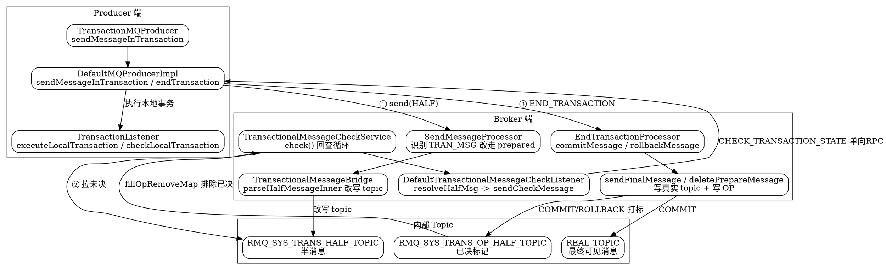

## Introduction

本文是 [Transaction](/docs/CS/MQ/RocketMQ/Transaction.md) 概念总览的**源码级链路补充**：把「半消息 → 二阶段提交/回滚 → OP 打标 → 回查补偿」每一跳的调用链、关键方法、文件行号逐一定位，串成一条可追源码的端到端链路。

> 版本基线：**5.5.1**（tag `rocketmq-all-5.5.1`）。

反直觉点（以源码为准）：

1. **半消息并非「不落盘」，而是改写 topic 写入 commitlog** —— 真实 topic/queueId 被备份进 `REAL_TOPIC`/`REAL_QUEUE_ID` 属性，topic 改成内部 `RMQ_SYS_TRANS_HALF_TOPIC`，所以普通消费者拉不到。
2. **COMMIT 不是删除半消息，而是「再发一条真实消息」到真实 topic** —— 顺序写文件无法物理删除，半消息靠 `RMQ_SYS_TRANS_OP_HALF_TOPIC` 的 OP 消息打标「已决」，回查时用 OP 排除。
3. **回查是单向 RPC（invokeOneway）+ 反向 END_TRANSACTION** —— Broker 只「敲门」，答案由 Producer 主动用 `END_TRANSACTION`（`fromTransactionCheck=true`）送回，避免 Broker 阻塞。

## Producer Side: From sendMessageInTransaction to endTransaction

入口 `TransactionMQProducer.sendMessageInTransaction` (`client/.../producer/TransactionMQProducer.java:81`) 仅做 namespace 包装后委托给 `DefaultMQProducerImpl.sendMessageInTransaction`（`client/.../impl/producer/DefaultMQProducerImpl.java:1433`）。后者是事务消息生产端的核心：

```java
// DefaultMQProducerImpl.java:1445-1448 —— 打标后按普通消息发送（broker 识别为 prepared）
MessageAccessor.putProperty(msg, MessageConst.PROPERTY_TRANSACTION_PREPARED, "true");
MessageAccessor.putProperty(msg, MessageConst.PROPERTY_PRODUCER_GROUP, this.defaultMQProducer.getProducerGroup());
sendResult = this.send(msg);

// :1466 —— 发送成功后执行本地事务
localTransactionState = localTransactionListener.executeLocalTransaction(msg, arg);

// :1496 —— 无论结果如何，都向 broker 发二阶段指令
this.endTransaction(msg, sendResult, localTransactionState, localException);
```

三个关键细节（源码事实）：

- **发送失败即抛异常**：`send(msg)` 抛异常直接抛 `MQClientException`（`:1449-1451`），不会进入本地事务。
- **存储类异常直接回滚**：`sendStatus` 为 `FLUSH_DISK_TIMEOUT` / `FLUSH_SLAVE_TIMEOUT` / `SLAVE_NOT_AVAILABLE` 时，框架强制 `ROLLBACK_MESSAGE`（`:1486-1490`），不执行本地事务。
- **事务消息与延迟互斥**：`ensureNotDelayedForTransactional`（`:1511`）检查 `PROPERTY_DELAY_TIME_LEVEL` / `PROPERTY_TIMER_*` 任一存在即抛异常。

`endTransaction`（`DefaultMQProducerImpl.java:1528`）构造 `EndTransactionRequestHeader` 并用 `endTransactionOneway` 单向发出（`:1566`）：

```java
// :1545-1559 —— 把 commitLogOffset / tranStateTableOffset / producerGroup 一起带给 broker
requestHeader.setCommitLogOffset(id.getOffset());   // 用 offsetMsgId 解出 commitlog 物理偏移
switch (localTransactionState) {
    case COMMIT_MESSAGE:  requestHeader.setCommitOrRollback(MessageSysFlag.TRANSACTION_COMMIT_TYPE);  break; // 0x8
    case ROLLBACK_MESSAGE:requestHeader.setCommitOrRollback(MessageSysFlag.TRANSACTION_ROLLBACK_TYPE);break; // 0xC
    case UNKNOW:          requestHeader.setCommitOrRollback(MessageSysFlag.TRANSACTION_NOT_TYPE);     break; // 0x0
}
```

## Producer Side: Check-back Callback (checkLocalTransaction)

当 Broker 回查时，请求经 `ClientRemotingProcessor` 落到 `DefaultMQProducerImpl.checkTransactionState`（`DefaultMQProducerImpl.java:366`），提交到 `checkExecutor` 线程池执行：

```java
// :382-387 —— 回调用户监听器
localTransactionState = transactionListener.checkLocalTransaction(message);
// :408-445 —— 构造 END_TRANSACTION（fromTransactionCheck=true）反向送回
thisHeader.setFromTransactionCheck(true);
thisHeader.setCommitLogOffset(checkRequestHeader.getCommitLogOffset());
...
DefaultMQProducerImpl.this.mQClientFactory.getMQClientAPIImpl().endTransactionOneway(brokerAddr, thisHeader, remark, 3000);
```

注意 `checkLocalTransaction` 用 `MessageExt`（单参数），而 `executeLocalTransaction` 用 `(Message, Object)` —— 两个方法签名不同（详见 [Transaction](/docs/CS/MQ/RocketMQ/Transaction.md)）。

## Broker Inbound: Half Message Routing in SendMessageProcessor

半消息的「不可见」发生在 Broker 入站。`SendMessageProcessor` 识别消息头中的 `TRAN_MSG` 标志并改走事务准备链路（`broker/.../processor/SendMessageProcessor.java:323-371`）：

```java
// :323-337 —— 识别 prepared 标志
String traFlag = oriProps.get(MessageConst.PROPERTY_TRANSACTION_PREPARED);
boolean sendTransactionPrepareMessage = Boolean.parseBoolean(traFlag) && !(...);

// :344 / :371 —— 异步/同步两条路都改走 transactionalMessageService
asyncPutMessageFuture = this.brokerController.getTransactionalMessageService().asyncPrepareMessage(msgInner);
// 或 putMessageResult = ...getTransactionalMessageService().prepareMessage(msgInner);
```

`TransactionalMessageServiceImpl.asyncPrepareMessage`（`broker/.../transaction/queue/TransactionalMessageServiceImpl.java:99`）→ `TransactionalMessageBridge.asyncPutHalfMessage`（`:215`）→ `parseHalfMessageInner`（`:219`）完成 topic 改写：

```java
// parseHalfMessageInner :224-234
MessageAccessor.putProperty(msgInner, MessageConst.PROPERTY_REAL_TOPIC, msgInner.getTopic());   // 备份真实 topic
MessageAccessor.putProperty(msgInner, MessageConst.PROPERTY_REAL_QUEUE_ID, String.valueOf(msgInner.getQueueId()));
msgInner.setSysFlag(MessageSysFlag.resetTransactionValue(msgInner.getSysFlag(), MessageSysFlag.TRANSACTION_NOT_TYPE));
msgInner.setTopic(TransactionalMessageUtil.buildHalfTopic());  // → RMQ_SYS_TRANS_HALF_TOPIC
msgInner.setQueueId(0);                                        // 强制 0 队列
```

此时消息已落 commitlog（占 20B ConsumeQueue 单元），但 topic 是内部半消息主题，普通订阅组不可见。

## Broker Two-phase: EndTransactionProcessor

`EndTransactionProcessor.processRequest`（`broker/.../processor/EndTransactionProcessor.java:59`）处理 COMMIT/ROLLBACK：

- **SLAVE 拒绝**：`BrokerRole.SLAVE` 直接返回 `SLAVE_NOT_AVAILABLE`（`:65-69`），二阶段只在 Master 执行。
- **COMMIT 流水线**（`:131-162`）：
  1. `commitMessage(requestHeader)` → `getHalfMessageByOffset`（`:583`）按 `commitLogOffset` 从 commitlog 取回半消息。
  2. `checkPrepareMessage`（`:236`）校验 `producerGroup` / `tranStateTableOffset` / `commitLogOffset` 三处一致，防止串改。
  3. `endMessageTransaction`（`:266`）从 `REAL_TOPIC`/`REAL_QUEUE_ID` 还原真实 topic/queueId，并 `clearProperty(PROPERTY_TRANSACTION_PREPARED)`。
  4. `sendFinalMessage`（`:298`）把还原后的消息 `store.putMessage` 落到真实 topic —— **此刻才建 ConsumeQueue 索引、对消费者可见**。
  5. `deletePrepareMessage`（`:192`）写 OP 消息打标「已决」。
- **ROLLBACK 流水线**（`:166-186`）：仅 `rollbackMessage` + `deletePrepareMessage` 写 OP 打标，**不投递**真实消息（顺序文件无法物理删除）。
- **免疫期保护** `rejectCommitOrRollback`（`:220-234`）：若设置了 `PROPERTY_CHECK_IMMUNITY_TIME_IN_SECONDS` 且距 born 时间已超该免疫期、却又未经回查直接提交/回滚，返回 `ILLEGAL_OPERATION`（604），防止误提交。

## OP Message: Marking the Half as Decided

`deletePrepareMessage`（`TransactionalMessageServiceImpl.java:597-630`）把半消息的 `queueOffset` 写入 OP 主题（`RMQ_SYS_TRANS_OP_HALF_TOPIC`），供回查时排除：

```java
// :608-624 —— 先尝试批量入队，超限/失败再强制写单条 OP
String data = messageExt.getQueueOffset() + TransactionalMessageUtil.OFFSET_SEPARATOR;  // OFFSET_SEPARATOR = ","
boolean res = mqContext.getContextQueue().offer(data, 100, TimeUnit.MILLISECONDS);
...
Message msg = getOpMessage(queueId, data);
this.transactionalMessageBridge.writeOp(queueId, msg);   // 落 RMQ_SYS_TRANS_OP_HALF_TOPIC
```

批量刷盘由 `TransactionalOpBatchService` 异步完成（队列堆积超 `transactionOpMsgMaxSize` 时 `wakeup()`，`:613-614`），降低 OP 小消息写入放大。OP 消息的 Topic/Queue/Tag/Body 格式、批量刷盘与回查消费的完整实现，见 [OP 消息实现原理](/docs/CS/MQ/RocketMQ/OPMessage.md)。

## Broker Check Loop: TransactionalMessageCheckService

回查调度器 `TransactionalMessageCheckService`（`extends ServiceThread`）每 `transactionCheckInterval`（默认 30s）触发（`TransactionalMessageCheckService.java:42-60`），`onWaitEnd` 调 `check(timeout, checkMax, listener)`（`TransactionalMessageServiceImpl.java:162`）。核心循环逻辑：

- **拉取未决列表**：遍历 `RMQ_SYS_TRANS_HALF_TOPIC` 各队列，同时拉 `RMQ_SYS_TRANS_OP_HALF_TOPIC` 对应 OP 队列，`fillOpRemoveMap`（`:379`）把 OP 中已决的 half offset 填入 `removeMap` 排除（`:207-213`）。
- **次数/时效控制**：`needDiscard`（`:108`）读 `PROPERTY_TRANSACTION_CHECK_TIMES`，`>= transactionCheckMax`（默认 15）即 `resolveDiscardMsg` 丢弃；`needSkip`（`:123`）超 `fileReservedTime`（默认 72h）跳过。
- **免疫期**：`PROPERTY_CHECK_IMMUNITY_TIME_IN_SECONDS` 设置的免疫期内（`getImmunityTime` `:356`）即使无 OP 也不回查。
- **触发回查**：`isNeedCheck`（`:295`）成立时 `putBackHalfMsgQueue`（`:135`，重新落半消息以保证可重试）+ `listener.resolveHalfMsg(msgExt)`（`:309`）。

`AbstractTransactionalMessageCheckListener.resolveHalfMsg`（`broker/.../transaction/AbstractTransactionalMessageCheckListener.java:72`）→ `sendCheckMessage`（`:51`）构造 `CheckTransactionStateRequestHeader` 并经 `broker2Client.checkProducerTransactionState` 以 **invokeOneway** 发给 Producer 对应 channel（`:64-66`）。

超限丢弃的默认实现 `DefaultTransactionalMessageCheckListener.resolveDiscardMsg`（`:41`）把半消息搬到 `TRANS_CHECK_MAX_TIME_TOPIC`，同时 `transactionMetrics.addAndGet(topic, -1)` 扣减半消息计数。

## End-to-end Call Graph



## Links

- [RocketMQ](/docs/CS/MQ/RocketMQ/RocketMQ.md)
- [Transaction (概念总览)](/docs/CS/MQ/RocketMQ/Transaction.md)
- [Producer](/docs/CS/MQ/RocketMQ/Producer.md)
- [Consumer](/docs/CS/MQ/RocketMQ/Consumer.md)
- [MessageLifecycle (端到端链路枢纽)](/docs/CS/MQ/RocketMQ/MessageLifecycle.md)
- [Broker](/docs/CS/MQ/RocketMQ/Broker.md)
- [MessageProtocol（消息协议字节级详情）](/docs/CS/MQ/RocketMQ/MessageProtocol.md)
- [BatchEncoding（批量消息不支持事务的协议级印证）](/docs/CS/MQ/RocketMQ/BatchEncoding.md)

## References

1. [RocketMQ 5.5.1 Release](https://github.com/apache/rocketmq/releases/tag/rocketmq-all-5.5.1)
2. [DefaultMQProducerImpl.java (5.5.1)](https://github.com/apache/rocketmq/blob/rocketmq-all-5.5.1/client/src/main/java/org/apache/rocketmq/client/impl/producer/DefaultMQProducerImpl.java)
3. [SendMessageProcessor.java (5.5.1)](https://github.com/apache/rocketmq/blob/rocketmq-all-5.5.1/broker/src/main/java/org/apache/rocketmq/broker/processor/SendMessageProcessor.java)
4. [TransactionalMessageBridge.java (5.5.1)](https://github.com/apache/rocketmq/blob/rocketmq-all-5.5.1/broker/src/main/java/org/apache/rocketmq/broker/transaction/queue/TransactionalMessageBridge.java)
5. [EndTransactionProcessor.java (5.5.1)](https://github.com/apache/rocketmq/blob/rocketmq-all-5.5.1/broker/src/main/java/org/apache/rocketmq/broker/processor/EndTransactionProcessor.java)
6. [TransactionalMessageServiceImpl.java (5.5.1)](https://github.com/apache/rocketmq/blob/rocketmq-all-5.5.1/broker/src/main/java/org/apache/rocketmq/broker/transaction/queue/TransactionalMessageServiceImpl.java)
7. [RocketMQ 官方 Design_Transaction 文档](https://github.com/apache/rocketmq/blob/rocketmq-all-5.5.1/docs/en/Design_Transaction.md)
