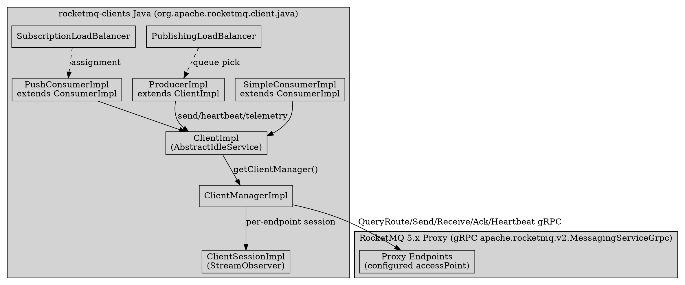

# rocketmq-clients gRPC SDK (Java)

## Introduction

`apache/rocketmq-clients` 是 RocketMQ 5.x 的「多语言客户端 SDK 家族」，Java 实现位于 `java/client` 模块（包 `org.apache.rocketmq.client.java`），对外公开 API 位于独立模块 `client-apis`（包 `org.apache.rocketmq.client.apis`）。它与 5.x 的 **Proxy** 之间只走 gRPC（protobuf 契约 `apache.rocketmq.v2`），**不再直连 Broker、不再使用 RemotingCommand**。本页所有 `file:line` 均基于 GitHub **真源码**核验。

> 版本基线：RocketMQ 5.5.1 / rocketmq-clients **java-5.2.2**（注：`clients` 仓为独立版本线，无 5.5.x tag；`java-5.2.2` 是 GitHub 可核验的最新 tag，下文 file:line 全部来自该 tag 的 `blob` 源码，本地主仓库 `client` 模块仅用于「老 SDK」对照）。

**纠偏 / 反直觉点（先读）**：
1. 新 SDK **完全不连 Broker**，只连配置里的 `endpoints`（即 Proxy，或 Local 模式的本地 Broker gRPC）。`ClientImpl.endpoints = new Endpoints(clientConfiguration.getEndpoints())`（`ClientImpl.java:136`）就是唯一通信端点；所有 RPC（`queryRoute`/`sendMessage`/`receiveMessage`/`ackMessage`/`heartbeat`/`telemetry`）都由 `ClientManagerImpl` 经按端点的 `RpcClientImpl` 发出（`ClientManagerImpl.java:188-216`）。网络拓扑是 **client ↔ Proxy**，与老 SDK 的 client ↔ NameServer/Broker 完全不同。
2. 任务假设的类 `ProducerLoadBalancer` **不存在**，真名是 `PublishingLoadBalancer`（`PublishingLoadBalancer.java:42`）；消费侧对应 `SubscriptionLoadBalancer`（`SubscriptionLoadBalancer.java:32`）。且发布选队列**不是按 key 哈希**，普通消息是 round-robin，仅 FIFO 用 `messageGroup` 的 `sipHash24` 一致性哈希（`PublishingLoadBalancer.java:72-76`）。
3. 负载均衡策略、消费限流、`validateMessageType`、最大 body、重试退避等**全部由服务端通过 Telemetry 的 `Settings` 下发**，客户端被动 `sync`（`ClientImpl.java:343-347` → `PublishingSettings.sync`，`PublishingSettings.java:82-95`）。客户端 SDK 与 Proxy 共用同一份 protobuf 契约（`apache.rocketmq.v2.MessagingServiceGrpc`，`RpcClientImpl.java:30`）。

## 1. Client Architecture and Package Layout

新 SDK 两大模块，与老 `client` 模块正交：

| 维度 | 老 SDK（`E:/Projects/rocketmq-rocketmq-all-5.5.1/client`） | 新 gRPC SDK（`apache/rocketmq-clients` java） |
| ---- | ---- | ---- |
| 通信 | `RemotingCommand` + Netty，直连 NameServer/Broker | gRPC（`MessagingServiceGrpc`），只连 Proxy |
| 生产者类 | `DefaultMQProducer` / `DefaultMQProducerImpl` | `Producer`(api) / `ProducerImpl`（`ProducerImpl.java:97`） |
| 消费者类 | `DefaultMQPushConsumer` / `DefaultLitePullConsumer` | `PushConsumer`/`SimpleConsumer`(api) / `PushConsumerImpl`/`SimpleConsumerImpl`（均 `extends ConsumerImpl`，`ConsumerImpl.java:68`） |
| 队列分配 | **客户端** rebalance（`RebalanceService.java:24`，`DefaultMQPushConsumer.java:286 clientRebalance=true`） | 发布端客户端选队列 + 消费端**服务端** `QueryAssignment` 下发 |
| 消费位点 | 本地 `offsetStore` + Pull | 服务端托管，按 `receiptHandle` 的 Pop 语义 ack（`ConsumerImpl.java:127-141`） |

公开 API 接口 `Producer` 在 `org.apache.rocketmq.client.apis.producer.Producer`（`ProducerImpl.java:60`），实现 `ProducerImpl extends ClientImpl implements Producer`（`ProducerImpl.java:97`）。`ProducerImpl` 持有 `publishingRouteDataCache: ConcurrentMap<String, PublishingLoadBalancer>`（`ProducerImpl.java:106`）。

`ClientImpl extends AbstractIdleService implements Client, ClientSessionHandler, MessageInterceptor`（`ClientImpl.java:98-99`），是所有客户端的公共基类，内部持有 `clientManager = new ClientManagerImpl(this)`（`ClientImpl.java:151`）与 `sessionsTable`（每端点一个 telemetry 会话，`ClientImpl.java:129, 394-416`）。

## 2. Message Construction (MessageBuilder / PublishingMessageImpl)

`MessageBuilderImpl implements MessageBuilder`（`MessageBuilderImpl.java:35`），字段即公开 API 的 setter：`topic/body/tag/messageGroup/liteTopic/deliveryTimestamp/priority/keys/properties`（`MessageBuilderImpl.java:38-46`）。

```java
// message/MessageBuilderImpl.java:55-63,77-82,160-163
public MessageBuilder setTopic(String topic) {            // 正则 ^[%a-zA-Z0-9_-]+$  (:36,:57)
    checkNotNull(topic, "topic should not be null");
    checkArgument(TOPIC_PATTERN.matcher(topic).matches(), ...);
    this.topic = topic; return this;
}
public MessageBuilder setTag(String tag) {                // tag 禁止包含 '|'  (:79)
    checkArgument(!tag.contains("|"), "tag should not contain \"|\"");
    this.tag = tag; return this;
}
public Message build() {                                   // 产出 MessageImpl
    checkNotNull(topic, "topic has not been set yet");
    checkNotNull(body, "body has not been set yet");
    return new MessageImpl(this);
}
```

**互斥约束（反直觉之一）**：`messageGroup`、`deliveryTimestamp`、`liteTopic`、`priority` 四者两两互斥（`MessageBuilderImpl.java:102-104 / 125-127 / 136-141`）。即 **FIFO 与 定时/延迟、Lite、优先级不能共存**。

`PublishingMessageImpl extends MessageImpl`（`PublishingMessageImpl.java:36`）在发送前推断 `MessageType`：

```java
// message/PublishingMessageImpl.java:50-72
if (!messageGroup && !liteTopic && !priority && !deliveryTimestamp && !tx) messageType = NORMAL;
else if (messageGroup.isPresent() && !tx) messageType = FIFO;
else if (liteTopic.isPresent() && !tx)     messageType = LITE;
else if (deliveryTimestamp.isPresent() && !tx) messageType = DELAY;   // 定时/延迟
else if (priority.isPresent() && !tx)      messageType = PRIORITY;
// 事务需 txEnabled 且其余均未设置 -> TRANSACTION
```

body 上限默认 `4MB`（`PublishingSettings.java:46`），超限抛 `IOException`（`PublishingMessageImpl.java:44-47`）。`toProtobuf(namespace, mq)`（`PublishingMessageImpl.java:105-145`）把字段映射进 `apache.rocketmq.v2.Message` 的 `SystemProperties`（keys/tag/deliveryTimestamp/messageGroup/liteTopic/priority/queueId/messageType/bornTimestamp/bornHost），并设置 `topic=Resource`、`body`、`userProperties`。

Producer 侧把它包成 Proxy 的 `SendMessageRequest`：

```java
// impl/producer/ProducerImpl.java:446-451
private SendMessageRequest wrapSendMessageRequest(List<PublishingMessageImpl> pubMessages, MessageQueueImpl mq) {
    final List<apache.rocketmq.v2.Message> messages = pubMessages.stream()
        .map(pm -> pm.toProtobuf(clientConfiguration.getNamespace(), mq)).collect(toList());
    return SendMessageRequest.newBuilder().addAllMessages(messages).build();
}
```

即 `SendMessageRequest.messages[]` 里的每个 `apache.rocketmq.v2.Message` 与 [ProxyGrpcConverter](/docs/CS/MQ/RocketMQ/ProxyGrpcConverter.md) 解码的目标结构一致——客户端与 Proxy 共用 `apis/` 里的 protobuf 契约。

## 3. Queue Selection and Load Balancing (PublishingLoadBalancer)

路由由 `QueryRoute` gRPC 获取：`ProducerImpl.getPublishingLoadBalancer(topic)`（`ProducerImpl.java:593-600`）优先取缓存，否则 `getRouteData(topic)` → `ClientImpl.fetchTopicRoute0` 构造 `QueryRouteRequest` 并 `clientManager.queryRoute(endpoints, ...)`（`ClientImpl.java:669-685`），响应被包成 `TopicRouteData`（`TopicRouteData.java:44, 61-63`，`getMessageQueues()` 返回 `MessageQueueImpl` 列表）。

选队列在 **`PublishingLoadBalancer`** 内完成（注意：不是 `ProducerLoadBalancer`）：

```java
// impl/producer/PublishingLoadBalancer.java:56-65  —— 仅保留可写 + master 队列
private PublishingLoadBalancer(AtomicInteger index, TopicRouteData topicRouteData) {
    this.index = index;
    final List<MessageQueueImpl> mqs = topicRouteData.getMessageQueues().stream()
        .filter(mq -> mq.getPermission().isWritable()
            && Utilities.MASTER_BROKER_ID == mq.getBroker().getId())
        .collect(toList());
    if (mqs.isEmpty()) throw new IllegalArgumentException("No writable message queue found ...");
    this.messageQueues = ImmutableList.copyOf(mqs);
}

// :72-76  —— FIFO：messageGroup 一致性哈希到固定队列（保序）
public MessageQueueImpl takeMessageQueueByMessageGroup(String messageGroup) {
    long h = Hashing.sipHash24().hashBytes(messageGroup.getBytes(UTF_8)).asLong();
    return messageQueues.get(LongMath.mod(h, messageQueues.size()));
}

// :78-111 —— 普通消息：round-robin 跨 broker 取候选队列
public List<MessageQueueImpl> takeMessageQueues(Set<Endpoints> excluded, int count) {
    int next = index.getAndIncrement();
    for (int i = 0; i < messageQueues.size(); i++) {
        MessageQueueImpl mq = messageQueues.get(IntMath.mod(next++, messageQueues.size()));
        Broker broker = mq.getBroker();
        if (!excluded.contains(broker.getEndpoints()) && !seenBroker.contains(broker.getName())) {
            seenBroker.add(broker.getName());
            candidates.add(mq);
        }
        if (candidates.size() >= count) return candidates;   // count == maxAttempts
    }
    ...
}
```

**关键结论**：
- 普通发送：`takeMessageQueues` 以 `index.getAndIncrement()` 为起点 round-robin，且尽量**跨 broker**（同一 broker 只取一个作为候选），候选数 = `maxAttempts`（`ProducerImpl.java:435`）。
- 重试跨队列：`send0` 内部按 `candidates.get(IntMath.mod(attempt-1, candidates.size()))` 取队列（`ProducerImpl.java:469`），失败则 `isolate(endpoints)`（`ProducerImpl.java:551`）后续 attempt 跳过该端点。
- **没有「按 message key 哈希」路径**；有序性完全靠 `messageGroup` → `sipHash24`。

与老 SDK 的 `MessageQueueSelector` 差异：老 SDK 在客户端做 rebalance 后直接持有队列并 producer 自选 queueId；新 SDK 的发布端仅做客户端「选队列」，而**消费端的队列分配是服务端 `QueryAssignment` 下发**（见第 5 节），二者职责切分不同。

## 4. Long Connection and Telemetry (ClientSessionImpl / Settings)

`ClientManagerImpl` 在 `startUp` 里用 `scheduler` 周期驱动四类任务（`ClientManagerImpl.java:529-588`）：

| 任务 | 周期 | 实现 |
| ---- | ---- | ---- |
| 清理空闲 RpcClient | 1min（初始 5s） | `clearIdleRpcClients`（`ClientManagerImpl.java:156-179`，`RPC_CLIENT_MAX_IDLE_DURATION=30min`） |
| 心跳 `doHeartbeat` | **10s**（初始 1s） | `ClientImpl.doHeartbeat`（`ClientManagerImpl.java:97-98`, `ClientImpl.java:572-578`） |
| 统计 `doStats` | 60s | `ClientImpl.doStats` |
| 同步设置 `syncSettings` | 5min（初始 1s） | `ClientImpl.syncSettings`（`ClientManagerImpl.java:103-104`） |

**心跳**：`ProducerImpl.wrapHeartbeatRequest()` → `HeartbeatRequest.newBuilder().setClientType(ClientType.PRODUCER)`（`ProducerImpl.java:206-208`）；消费者覆写为带 group 的 `HeartbeatRequest`（`ConsumerImpl.java:282-285`）。

**Telemetry（双向流 gRPC）**：`MessagingServiceGrpc.telemetry` 是一个 `StreamObserver<TelemetryCommand>` 双向流。`RpcClientImpl.telemetry`（`RpcClientImpl.java:254-261`）用 `stub.telemetry(responseObserver)` 返回「请求侧」observer；`ClientManagerImpl.telemetry`（`ClientManagerImpl.java:512-521`）转发。`ClientImpl.telemetry` 以 `TELEMETRY_TIMEOUT = 365*60 天`（`ClientImpl.java:105`）建立**长连接**。

`ClientSessionImpl implements StreamObserver<TelemetryCommand>`（`ClientSessionImpl.java:45`），**每个 Proxy 端点一个会话**（`sessionsTable`，`ClientImpl.java:394-416`）。构造时即打开流：

```java
// impl/ClientSessionImpl.java:67
this.requestObserver = sessionHandler.telemetry(endpoints, this);  // this = 响应侧 observer
```

`onNext` 处理服务端下发的命令（`ClientSessionImpl.java:164-219`）：`SETTINGS`（→ `onSettingsCommand`）、`RECOVER_ORPHANED_TRANSACTION_COMMAND`、`VERIFY_MESSAGE_COMMAND`、`PRINT_THREAD_STACK_TRACE_COMMAND`、`RECONNECT_ENDPOINTS_COMMAND`、`NOTIFY_UNSUBSCRIBE_LITE_COMMAND`。客户端上行用 `write(command)` → `requestObserver.onNext(command)`（`ClientSessionImpl.java:128-137`）。

**Settings 同步（最反直觉点）**：`ClientImpl.syncSettings()`（`ClientImpl.java:353-364`）把本地 `Settings.toProtobuf()` 装进 `TelemetryCommand` 上报；服务端也可主动下发 `SETTINGS`，客户端在 `onSettingsCommand` 里 `this.getSettings().sync(settings)`（`ClientImpl.java:343-347`）。`PublishingSettings.sync`（`PublishingSettings.java:82-95`）据此**覆盖** `retryPolicy`(退避)、`validateMessageType`、`maxBodySize`。即**负载均衡/消费限流/重试策略由服务端说了算，客户端只是执行者**。`Settings` 抽象基类定义 `toProtobuf()`/`sync()` 两个钩子（`Settings.java:55-57`）。

## 5. Consumption Model (ConsumerImpl / Push / Simple / Pop 对接)

消费端两个实现，均 `extends ConsumerImpl`（`ConsumerImpl.java:68`）：
- `PushConsumerImpl extends ConsumerImpl implements PushConsumer`（`PushConsumerImpl.java:90`）
- `SimpleConsumerImpl extends ConsumerImpl implements SimpleConsumer`（`SimpleConsumerImpl.java:59`）

`ConsumerImpl` 封装三个 gRPC 调用：`receiveMessage`（`ConsumerImpl.java:79-125`）、`ackMessage`（`ConsumerImpl.java:163-195`）、`changeInvisibleDuration`（`ConsumerImpl.java:197-237`）；`wrapAckMessageRequest` 用 `receiptHandle` 标识消息（`ConsumerImpl.java:127-141`）——这正是 **Pop 消费语义**（对比 [PopConsume](/docs/CS/MQ/RocketMQ/PopConsume.md)）。`wrapReceiveMessageRequest` 支持长轮询（`longPollingTimeout` + `autoRenew`）或显式 `invisibleDuration`（`ConsumerImpl.java:263-279`）。

### 5.1 PushConsumer：服务端分配 + 本地 ProcessQueue

类注释直接点破反直觉（`PushConsumerImpl.java:84-86`）：**服务端并不会主动 push 消息，是客户端主动去服务端拉**。`scanAssignments` 每 5s 触发（`PushConsumerImpl.java:186-192`）→ `queryAssignment(topic)`（`PushConsumerImpl.java:313-329`）发 `QueryAssignmentRequest` gRPC 到 Proxy，服务端返回该消费者**被授权的 MessageQueue 集合**（即**服务端做负载均衡**）。`syncProcessQueue`（`PushConsumerImpl.java:365-407`）按最新分配创建/丢弃 `ProcessQueueImpl`（`processQueueTable`，`PushConsumerImpl.java:117, 154`）。每个 `ProcessQueue` 调 `fetchMessageImmediately()` → `ConsumerImpl.receiveMessage`（长轮询 `ReceiveMessage`）→ 经 `ConsumeService`（`StandardConsumeService`/`FifoConsumeService`，`PushConsumerImpl.java:250-261`）交给用户的 `MessageListener`。重试耗尽则 `forwardMessageToDeadLetterQueue`（`PushConsumerImpl.java:558-590`）。

### 5.2 SimpleConsumer：显式 receive / ack / changeInvisibleDuration

`SimpleConsumerImpl.receive0`（`SimpleConsumerImpl.java:148-177`）round-robin 选 topic → `getSubscriptionLoadBalancer(topic)` → `SubscriptionLoadBalancer.takeMessageQueue()`（**round-robin**，`SubscriptionLoadBalancer.java:69-72`，仅保留可读 master 队列 `:61-63`）→ `wrapReceiveMessageRequest` + `receiveMessage`。用户手动 `ack`（`SimpleConsumerImpl.java:183-217` → `ConsumerImpl.ackMessage` → `clientManager.ackMessage` gRPC，`ConsumerImpl.java:172`）与 `changeInvisibleDuration`（`SimpleConsumerImpl.java:223-260` → `ConsumerImpl.changeInvisibleDuration` → gRPC，`ConsumerImpl.java:207`，并在响应里刷新 `receiptHandle`）。

**消费位点的关键差异**：新 SDK 客户端**不维护本地 offset**——消息可见性由 Proxy 用 `invisibleDuration` + `receiptHandle` 管控（Pop 模型），ack 按 handle 归还、超时/失败由服务端重新投递、重试次数由 `getRetryPolicy().getMaxAttempts()` 决定（`PushConsumerImpl.java:551`）。这与老 `DefaultMQPushConsumer` 的本地 `offsetStore` + Pull 完全不同（对照 [Consumer](/docs/CS/MQ/RocketMQ/Consumer.md)）。

```dot
digraph client_server_flow {
  rankdir = LR;
  subgraph cluster_pub {
    label = "Producer publish path";
    style = filled;
    P1 [label="ProducerImpl.send()", shape=box];
    P2 [label="getPublishingLoadBalancer\nQueryRoute(gRPC, cached)", shape=box];
    P3 [label="PublishingLoadBalancer\ntakeMessageQueues(RR) /\ntakeMessageQueueByMessageGroup(sipHash)", shape=box];
    P4 [label="wrapSendMessageRequest\nSendMessageRequest{Message[]}", shape=box];
    P5 [label="ClientManagerImpl.sendMessage\ngRPC to Proxy", shape=box];
  }
  subgraph cluster_con {
    label = "PushConsumer consume path";
    style = filled;
    C1 [label="scanAssignments(5s)\nQueryAssignment(gRPC)", shape=box];
    C2 [label="syncProcessQueue\ncreate ProcessQueueImpl", shape=box];
    C3 [label="ProcessQueueImpl.fetch\nReceiveMessage(gRPC, long-poll)", shape=box];
    C4 [label="ConsumeService\n(Standard/Fifo)", shape=box];
    C5 [label="ackMessage /\nchangeInvisibleDuration (gRPC)", shape=box];
  }
  subgraph cluster_tel {
    label = "Telemetry (bidirectional gRPC)";
    style = filled;
    T1 [label="ClientSessionImpl\nopen stream + onNext", shape=box];
    T2 [label="Server pushes Settings\n(onSettingsCommand->sync)", shape=box];
    T3 [label="Heartbeat(10s)\nover telemetry", shape=box];
    PROXYX [label="Proxy", shape=box];
  }
  P1 -> P2 -> P3 -> P4 -> P5;
  C1 -> C2 -> C3 -> C4 -> C5;
  T1 -> T2;
  T1 -> T3 [style=dashed];
  P5 -> PROXYX;
  C5 -> PROXYX;
}
```





## Links

- [ProxyProtocol](/docs/CS/MQ/RocketMQ/ProxyProtocol.md)
- [ProxyGrpcConverter](/docs/CS/MQ/RocketMQ/ProxyGrpcConverter.md)
- [RocketMQ5](/docs/CS/MQ/RocketMQ/RocketMQ5.md)
- [Producer](/docs/CS/MQ/RocketMQ/Producer.md)
- [Consumer](/docs/CS/MQ/RocketMQ/Consumer.md)
- [PopConsume](/docs/CS/MQ/RocketMQ/PopConsume.md)

## References

- `java/client/src/main/java/org/apache/rocketmq/client/java/impl/producer/ProducerImpl.java:97,106,206-208,432-440,446-461,469,551,593-600`（ProducerImpl 结构、心跳、选队列、SendMessageRequest 映射）— https://github.com/apache/rocketmq-clients/blob/java-5.2.2/java/client/src/main/java/org/apache/rocketmq/client/java/impl/producer/ProducerImpl.java
- `java/client/src/main/java/org/apache/rocketmq/client/java/impl/producer/PublishingLoadBalancer.java:42,46,56-65,72-76,78-111`（发布负载均衡：可写+master 过滤、RR、messageGroup sipHash）— https://github.com/apache/rocketmq-clients/blob/java-5.2.2/java/client/src/main/java/org/apache/rocketmq/client/java/impl/producer/PublishingLoadBalancer.java
- `java/client/src/main/java/org/apache/rocketmq/client/java/message/MessageBuilderImpl.java:35-46,55-63,77-82,102-141,160-163`（MessageBuilder 字段与互斥约束）— https://github.com/apache/rocketmq-clients/blob/java-5.2.2/java/client/src/main/java/org/apache/rocketmq/client/java/message/MessageBuilderImpl.java
- `java/client/src/main/java/org/apache/rocketmq/client/java/message/PublishingMessageImpl.java:36,44-47,50-88,105-145`（MessageType 推断与 toProtobuf 映射）— https://github.com/apache/rocketmq-clients/blob/java-5.2.2/java/client/src/main/java/org/apache/rocketmq/client/java/message/PublishingMessageImpl.java
- `java/client/src/main/java/org/apache/rocketmq/client/java/route/TopicRouteData.java:32,44,61-63`（QueryRoute 响应包装）— https://github.com/apache/rocketmq-clients/blob/java-5.2.2/java/client/src/main/java/org/apache/rocketmq/client/java/route/TopicRouteData.java
- `java/client/src/main/java/org/apache/rocketmq/client/java/impl/ClientImpl.java:98-99,105,129,136,151,183-216,279-288,343-347,353-364,394-416,572-578,669-685`（ClientImpl 基类、端点、Telemetry、Settings 同步、QueryRoute）— https://github.com/apache/rocketmq-clients/blob/java-5.2.2/java/client/src/main/java/org/apache/rocketmq/client/java/impl/ClientImpl.java
- `java/client/src/main/java/org/apache/rocketmq/client/java/impl/ClientManagerImpl.java:97-98,156-179,188-216,243-255,356-368,386-413,512-521,529-588`（ClientManager：心跳周期、RpcClient 表、各 gRPC 调用、Telemetry）— https://github.com/apache/rocketmq-clients/blob/java-5.2.2/java/client/src/main/java/org/apache/rocketmq/client/java/impl/ClientManagerImpl.java
- `java/client/src/main/java/org/apache/rocketmq/client/java/rpc/RpcClientImpl.java:30,78-79,137-158,169-193,254-261`（gRPC stub、unary 调用、telemetry 双向流）— https://github.com/apache/rocketmq-clients/blob/java-5.2.2/java/client/src/main/java/org/apache/rocketmq/client/java/rpc/RpcClientImpl.java
- `java/client/src/main/java/org/apache/rocketmq/client/java/impl/ClientSessionImpl.java:45,67,128-137,164-219,226-269`（ClientSessionImpl 双向流 observer）— https://github.com/apache/rocketmq-clients/blob/java-5.2.2/java/client/src/main/java/org/apache/rocketmq/client/java/impl/ClientSessionImpl.java
- `java/client/src/main/java/org/apache/rocketmq/client/java/impl/Settings.java:30,55-57` 与 `impl/producer/PublishingSettings.java:46-47,65-79,82-95`（Settings 抽象与同步逻辑）— https://github.com/apache/rocketmq-clients/blob/java-5.2.2/java/client/src/main/java/org/apache/rocketmq/client/java/impl/Settings.java 与 https://github.com/apache/rocketmq-clients/blob/java-5.2.2/java/client/src/main/java/org/apache/rocketmq/client/java/impl/producer/PublishingSettings.java
- `java/client/src/main/java/org/apache/rocketmq/client/java/impl/consumer/ConsumerImpl.java:68,79-125,127-141,163-237,263-285`（ConsumerImpl：receive/ack/changeInvisibleDuration、心跳、Pop 语义）— https://github.com/apache/rocketmq-clients/blob/java-5.2.2/java/client/src/main/java/org/apache/rocketmq/client/java/impl/consumer/ConsumerImpl.java
- `java/client/src/main/java/org/apache/rocketmq/client/java/impl/consumer/PushConsumerImpl.java:84-86,90,117,154,186-192,250-261,313-329,365-407,558-590`（PushConsumer：服务端 QueryAssignment、ProcessQueue、DLQ）— https://github.com/apache/rocketmq-clients/blob/java-5.2.2/java/client/src/main/java/org/apache/rocketmq/client/java/impl/consumer/PushConsumerImpl.java
- `java/client/src/main/java/org/apache/rocketmq/client/java/impl/consumer/SimpleConsumerImpl.java:59,148-177,183-217,223-260` 与 `impl/consumer/SubscriptionLoadBalancer.java:32,61-63,69-72`（SimpleConsumer 与订阅负载均衡）— https://github.com/apache/rocketmq-clients/blob/java-5.2.2/java/client/src/main/java/org/apache/rocketmq/client/java/impl/consumer/SimpleConsumerImpl.java 与 https://github.com/apache/rocketmq-clients/blob/java-5.2.2/java/client/src/main/java/org/apache/rocketmq/client/java/impl/consumer/SubscriptionLoadBalancer.java
- 公开 API（模块 `client-apis`）：`org.apache.rocketmq.client.apis.producer.Producer`、`consumer.SimpleConsumer`/`PushConsumer`、`message.MessageBuilder`/`Message` — https://github.com/apache/rocketmq-clients/blob/java-5.2.2/java/client-apis/src/main/java/org/apache/rocketmq/client/apis/
- 老 SDK 对照（本地仓库 `E:/Projects/rocketmq-rocketmq-all-5.5.1/client`）：`impl/producer/DefaultMQProducerImpl.java:738,1047`（RemotingCommand 直连 Broker）、`impl/consumer/RebalanceService.java:24`（客户端 rebalance）、`consumer/DefaultMQPushConsumer.java:286 clientRebalance=true`。
