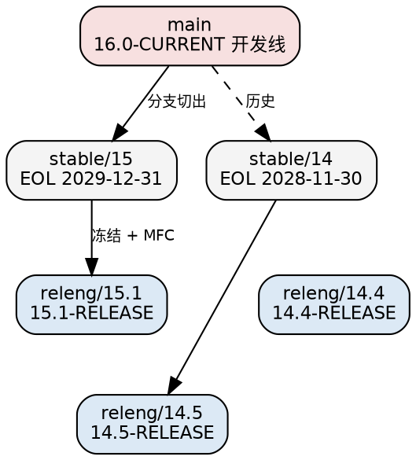

## Introduction

本页写的是**正在发布的 FreeBSD**，不是它的家谱。4.4BSD-Lite 之后四支如何分裂、为什么 FreeBSD 从未通过 The Open Group 的 UNIX 商标认证，这些在 [Unix](/docs/CS/OS/unix/Unix.md) 里已经核实过；本页只回答一个问题：**这一支 BSD 现在是怎么组织的，它的哪些机制与 Linux 的形状不同**。

FreeBSD 与本库主线 Linux 最根本的差别不在任何单个子系统，而在**发布单元**。Linux 侧的"一个系统"是内核、发行版、包管理器三层拼装的产物；FreeBSD 侧是**一个源码仓库、一个版本号、一次 `make buildworld` 产出的 base system**（内核 + libc + 全部基础工具 + man pages 一起构建、一起发布、一起打安全补丁），第三方软件另放在 Ports Collection。这个选择解释了后面所有看起来奇怪的事情：`freebsd-update(8)` 为什么能直接给"整个系统"打补丁、为什么官方**不承诺内核 ABI 稳定**、为什么 GPU 驱动要靠 `linuxkpi(4)` 去编译 Linux 的代码、以及为什么"把 base 拆成包"这件事（pkgbase）会成为一个持续十年、官方计划到 FreeBSD 16 才收尾的工程。

三条贯穿本页的主线：

1. **一体化 base 既是资产也是负债**。资产是版本自洽：`cc_cubic(4)` 的默认切换、`kasan(9)` 的可用性、`nda(4)` 取代 `nvd` 这类变更，都不需要等某个发行版去适配。负债是每一个决定都必须由一个中心团队拍板，而它拍板的节奏比宣传慢（见下面关于发布节奏的口径差异）。
2. **15.0 把 32 位平台一次性退役**，这是当代主流 BSD/OS 家族里最干净的一次架构收缩：不是降级为"尽力支持"，而是从发布清单里删除，只保留 64 位平台上的 32 位应用兼容层。
3. **pkgbase 正在把 base 重新拆进包管理器**，方向与第 1 条相反。15.0 是转折点（公告原话："In FreeBSD 15.0, pkgbase is offered as a technology preview, but it is expected to become the standard method"），15.1 让 `bsdinstall` 默认走 pkgbase，而同一份 15.0 公告写明 "Support for distribution sets is planned for removal in FreeBSD 16, but will continue (along with freebsd-update support) for the lifetime of the FreeBSD 15 stable branch"。读 FreeBSD 的运维资料时，"现在到底是哪一种"这个问题必须按分支回答，不能给通用答案。

**事实基线**：15.1-RELEASE（2026-06-16 发布），核实日期 2026-10-21。接口层断言以 15.1 的 man pages 为准（`man.freebsd.org` 默认视图即 FreeBSD 15.1-RELEASE 与 Ports.quarterly），版本与日期断言以 freebsd.org 的发布页、安全页与季度状态报告为准。**核实不上的东西一条都没写进正文**，全部落在 `## Unverified`。

## Release Lifecycle

FreeBSD 的分支模型是三层，官方对每一层的定位写得很硬：`main` 是 16.0-CURRENT 的开发分支，`stable/N` 是下一分钟的 STABLE 分支，`releng/N.M` 是**已冻结**的 errata 分支，归 `security-officer@FreeBSD.org` 所有，往冻结分支的提交必须先过评审。每个 RELEASE 都有一条对应的 Security Branch，补丁版本名如 `FreeBSD 14.4-RELEASE-p4`。



**2026-10-21 现役分支**（安全页的支持矩阵原样）：

| 分支 | 版本 | 发布日 | EOL |
| :--- | :--- | :--- | :--- |
| releng/15.1 | 15.1-RELEASE | 2026-06-16 | 2027-03-31 |
| releng/14.5 | 14.5-RELEASE | 2026-09-08 | 2027-06-30 |
| releng/14.4 | 14.4-RELEASE | 2026-03-10 | 2026-12-31 |
| stable/15 | — | — | 2029-12-31 |
| stable/14 | — | — | 2028-11-30 |

13.x 与 12.x 已从支持表消失（13.5 与 stable/13 同于 2026-04-30 退役）。这里有两个容易读错的细节：**14.5 的支持期比 15.1 长三个月**（2027-06-30 vs 2027-03-31），因为 14.x 是被保留的保守升级路线，而不是被淘汰的旧线；同时安全页的口径是"每个小版本只在下一个小版本发布后继续支持三个月"，两个数字并不矛盾——长的那段是留给不愿跨大版本升级的人。

**已公布的路线图**（releng 页）：2026-12 → 15.2，2027-03 → 14.6，2027-06 → 15.3，**2027-12 → 16.0**，2028-03 → 15.4，2028-06 → 16.1，2028-09 → 15.5，2028-12 → 16.2。15.2 与 14.6 的日程连 BETA/RC 的具体日期都已挂出（15.2：BETA1 2026-11-06、RC1 11-27、RELEASE 构建 12-04、公告 12-08）。

> [!WARNING]
>
> FAQ §2.5 的口径是"平均每 18 个月一个大版本、每 8 个月一个小版本"，但把已公布的路线图摊开算，大版本节奏是 **13.0(2021-04) → 14.0(2023-11) → 15.0(2025-12) → 16.0(2027-12)，约 24 个月一个**，小版本是约 6 个月一个。引用节奏数字时要说明引用的是"文档口径"还是"实际路线图"，两者已经不是同一个数。2026 年第一季度的状态报告开头自己写了："This is the first status report since we changed the schedule and started enforcing it."——节奏正在被制度化，而 FAQ 那段还没跟上。

发布工程由 `re@FreeBSD.org` 负责（当前 11 人），流程文档在《FreeBSD Release Engineering》一文里，MFC（Merge From Main）审批是其中关键一环。一次小版本发布的实际执行序列可以从 14.5 的 schedule 页看到全貌：4-15 公布日程 → 7-24 code slush → 8-07 切 `releng/14.5` 并出 BETA1 → 每周一版 BETA → 8-28 RC1 → 9-04 构建 RELEASE → 9-08 公告。

## Architectures

平台分级表是官方页里少见的"按版本列 tier"结构，因此**同一架构在 14.x 与 15.x 的 tier 不同**，这张表比任何叙述都准确：

| 平台 | TARGET_ARCH | 14.x | 15.x | 16.x（预测） |
| :--- | :--- | :--- | :--- | :--- |
| 64 位 x86 | amd64 | Tier 1 | Tier 1 | Tier 1 |
| 64 位 ARMv8 | aarch64 | Tier 1 | Tier 1 | Tier 1 |
| 32 位 ARMv7 | armv7 | Tier 2 | Tier 2 | Tier 2 |
| 64 位 PowerPC 大端 | powerpc64 | Tier 2 | Tier 2 | Tier 2 |
| 64 位 PowerPC 小端 | powerpc64le | Tier 2 | Tier 2 | Tier 2 |
| 64 位 RISC-V | riscv64 | Tier 2 | Tier 2 | Tier 2 |
| **32 位 x86** | **i386** | Tier 2 | **Unsupported** | Unsupported |
| 32 位 ARMv6 | armv6 | Tier 3 | Unsupported | Unsupported |
| 32 位 PowerPC | powerpc | Tier 2 | Unsupported | Unsupported |
| 32 位 PowerPC SPE | powerpcspe | Tier 2 | Unsupported | Unsupported |

Tier 1 / Tier 2 / Tier 3 的差别不是"能不能跑"，而是发布工程**是否承诺为其出二进制包**、以及 errata 是否覆盖它。15.1-RELEASE 的公告口径是六个架构出镜像：amd64、aarch64、armv7、powerpc64、powerpc64le、riscv64；14.5 仍出 i386、powerpc、powerpcspe。

### The 32-bit Retirement

15.0 的发布说明只有一句话，但它是这一支 BSD 历史上最重要的一次删除：**"The venerable 32-bit hardware platforms i386, armv6, and 32-bit powerpc have been retired."** 同一句后面紧跟着**"32-bit application support lives on via the 32-bit compatibility mode in their respective 64-bit platforms."** 退役的是"32 位内核 + 32 位 world"，不是 32 位二进制能力——`linuxulator` 与原生 32 位兼容层都还在，`i386` 只是不再作为一个被构建、被打补丁的架构存在。

15.1 里仍能看见这条决定的余波：`asmc(4)`（Intel Mac 温度/风扇驱动）**不再支持 32 位 Intel Mac**。i386 的二进制支持寿命由此被 14.x 线钉死：按当前日程，最晚到 14.5 的 EOL（2027-06-30）为止。

被退役的架构在官方页上有一张"最后支持版本"的表，是判断旧资料是否过时的最快工具：alpha 6.4、arm（v4/v5）12.4、armeb 11.4、ia64 10.4、mips / mipsel / mipsn32 / mips64 全族 13.5、pc98 11.4、riscv64sf 13.5、sparc64 12.4。**看到 13.5 之后仍在讲 mips 或 sparc64 的资料，可以直接判定过时。**

### amd64 与 arm64 的新硬件面

| 能力 | 起始版本 | 说明 |
| :--- | :--- | :--- |
| LA57（>4 TB 内存） | 15.0 | 原文：amd64 现在支持拥有 LA57 CPU 特性的机器使用超过 4 TB 内存；官方措辞不用"5 级分页" |
| `%fsbase` / `%gsbase` 与 TLS 基址重做 | 15.0 | Foundation 资助 |
| LASS（Linear Address Space Separation） | 15.1 | 分支预测侧信道缓解 |
| FRED（Flexible Return and Event Delivery） | 开发中 | 出现在 2026 Q1 状态报告，尚未写进 RELEASE 发布说明 |
| bhyve / vmm 支持 arm64 与 riscv64 | 15.0 | 配套 `sysutils/u-boot-bhyve-arm64`、`u-boot-bhyve-riscv` 两个 port 提供引导 |
| `ena(4)` 中断分散到多核 | 15.1 | Graviton 实例上原本全部落在 CPU 0，改后网络性能显著提升（Amazon 资助） |
| LinuxKPI 无线驱动上 riscv64 | 15.1 | `iwlwifi(4)` 等可编译；该架构 ACPI 支持尚不完整 |
| `local-unbound` 进 base | 14.x 起，15.0 升到 12.4.1 | 曾出过缓存投毒公告 SA-25:10.unbound |

## The Base System Model

FreeBSD 的项目模型文档写得很直白：整个系统由 **base system + Ports Collection** 两部分构成，Core Team 的角色相当于"董事会"。落到工程上就是三条命令：

```console
# make buildworld buildkernel
# make installkernel installworld
# etcupdate -B
```

`build(7)` 给的就是这套升级配方，`etcupdate` 负责 `/etc` 下配置文件的合并——这是"整台机器是一个构建产物"的直接后果，Linux 侧没有对应物（发行版各自决定 `/etc` 怎么合并）。

base 里捆绑的第三方组件版本是**可查的、随分支固定的**，这也是 FreeBSD 与 Linux 在"我的 openssl 到底几点几"这类问题上体验差别的原因。15.0 基线（发布说明逐项列出）：

| 组件 | 版本 | 备注 |
| :--- | :--- | :--- |
| LLVM / clang | 19.1.7 | base 工具链默认，`gcc(1)` 在 15.1 man 目录中已不可解析 |
| OpenSSL | 3.5.4 → 15.1 为 3.5.6 | base 是 OpenSSL，LibreSSL 时代已结束 |
| MIT KRB5 | 1.22.1（15.1 为 1.22.2） | **15.0 起默认 Kerberos 从 Heimdal 换成 MIT**（15.0 发布说明逐字："MIT KRB5 1.22.1 Kerberos replaces Heimdal 1.5.2 by default… Heimdal Kerberos will be entirely removed in FreeBSD 16"）；Heimdal 可用 `WITHOUT_MITKRB5` 继续构建。**"in FreeBSD 16"是计划，不是已完成** |
| jemalloc | 5.3.0 | libc 的 `malloc(3)` 后端 |
| unbound | 1.24.1 | DNS 验证解析器 |
| zlib / zstd | 1.3.2 / 1.5.7 | zstd 在 15.1 被拆成独立的 `FreeBSD-zstd` 包 |
| bmake | 20250804 | 构建系统 |

值得注意的两条：**`lpr` 套件在 15.1 被列进 Deprecated Applications**，**`bsnmpd(1)` 在 15.0 取消 legacy UDP transport**（旧配置需把 `begemotSnmpdPortStatus` 改成 `begemotSnmpdTransInetStatus`）。同一份 15.1 发布说明还宣布 **`bsdlabel(8)` 与 `fdisk(8)` 将在 16.0 移除**，官方给的替代都是 `gpart(8)`（`fdisk` 也可用 `bsdinstall`）。base 的淘汰机制是真的在删东西，不是只加。

Ports 侧的获取方式在 14.0 变了：`portsnap(8)` **被移除**，官方给的替代是 `pkg install git` 然后 `git clone https://git.FreeBSD.org/ports.git /usr/ports`。任何还在写 `portsnap fetch update` 的教程，都停在 13.x 之前。包管理器 `pkg(8)` 当前是 2.x 系列，仓库签名走 `/usr/share/keys/pkg/trusted/` 下的信任密钥指纹（`pkg.conf(5)` 的 `FINGERPRINTS`），批量构建用 `ports-mgmt/poudriere`。

## pkgbase

pkgbase 是 FreeBSD 十年来的第一次"发布形态"改写：**把 base system 切成一组 `pkg(8)` 可以管理的包**（`FreeBSD-pam`、`FreeBSD-zstd` 这类单组件包，加上 `FreeBSD-set-minimal` / `FreeBSD-set-minimal-jail` 这类**包集合**），放进与 ports 同一条 `pkg.freebsd.org` 基础设施上的 `FreeBSD-base` 仓库，从此 base 也能 `pkg upgrade`。

15.0 是转折点。公告对它的定性很克制——"In FreeBSD 15.0, pkgbase is offered as a **technology preview**, but it is expected to become the standard method for managing base system installations and upgrades in future releases"，同时给出并存期的边界："Support for distribution sets is planned for removal in FreeBSD 16, but will continue (along with freebsd-update support) for the lifetime of the FreeBSD 15 stable branch"。安装时 `bsdinstall` 让用户在两种方法里选：**Distribution Sets（传统，继续用 `freebsd-update`）** 与 **Packages（pkgbase，全部用 `pkg` 管理）**，并明确后者是"VM 镜像与公有云镜像默认使用的方式"。可核实的落地证据：

- 新增 `freebsd-base(7)` man page，专门讲 base 包的布局与升级方法；
- `FreeBSD-base` 仓库**定义在 `/etc/pkg/FreeBSD.conf` 里、默认关闭**，早期版本写在 `/usr/local/etc/pkg/repos/` 的配置需要收敛成一行 `FreeBSD-base: { enabled: yes }`；
- 引导包形如 `https://pkg.freebsd.org/FreeBSD:15:amd64/base_release_0/FreeBSD-pkg-bootstrap-15.0.pkg`，信任锚是 `/usr/share/keys/pkgbase-15/trusted/` 下的 `awskms-15` 与 `backup-signing-15`——**base 的签名密钥与 ports 的分离，且其中一把在 AWS KMS 里**；
- 15.0 的发布说明里升级章节被拆成 **"Upgrading from Distribution Sets"** 与 **"Upgrading from Packages"** 两节，这是"两条轨道并存"最硬的证据。

15.1 继续推进：`bsdinstall` 脚本**默认执行 pkgbase 安装**，组件由 `COMPONENTS` 变量指定，旧的 distset 安装只在定义了 `DISTRIBUTIONS` 时才走（提交 `7781f5e09ffc`，Foundation 资助）；云镜像里加了 firstboot 自动升级——首次开机就把 base 包更新到当前补丁级别（`10c4498f93d2`，Amazon 资助）。与此同时 EC2 的 "small" flavors **不再默认跑 `firstboot_pkgs`**，在 user-data 里设过 `firstboot_pkgs_list` 的用户还得额外设 `firstboot_pkgs_enable="YES"`（`b9ee42d7712b`）——两条方向相反的动作同时发生，说明这套机制仍在调整期。发布形态的粒度也在继续变：15.1 把 OpenPAM 拆成独立的 `FreeBSD-pam` 包、把 Zstandard 与 `zstd(1)` 拆成 `FreeBSD-zstd`，装了 `FreeBSD-set-minimal*` 的机器会自动补上，**没装这两个集合的机器要手工装 `FreeBSD-pam`，否则 `login(1)` 与 `sshd(8)` 的 PAM 认证直接坏掉**——这就是"切包"这件事的真实代价。

同时它也还在长毛病：`FreeBSD-EN-23:19:pkgbase`（14.0 的 base 包版本号算错）、`FreeBSD-EN-26:07:pkgbase`（新版 libucl 下 base 包构建失败）两条 errata 都在官方列表里。`freebsd-update(8)` 自己也进了 errata（`EN-26:13.freebsd-update`：试图合并一个生成文件）。**读 FreeBSD 升级资料时必须先确定分支**：14.x 是 freebsd-update 为主、pkgbase 试验，15.x 是 pkgbase 已进安装器、freebsd-update 仍是经典路径，而 distribution sets 官方只承诺"计划于 FreeBSD 16 移除、但在 15 稳定分支生命周期内继续支持"——**注意这是"planned"，不是"已移除"**。

## Kernel Mechanisms

### Scheduling

`sched_ule(4)` 仍是 15.1 文档里的默认调度器（`kern.sched.name` 只读，报告当前实例），它 5.1 由 Jeff Roberson 引入，作者信息至今留在 man page 上。14BSD（`sched_4bsd(4)`）仍在树内。15.1 做了两件结构性的事：**`sched_ule` 被改写成"scheduler instance"**，并**新增一个通过 boot tunable 在启动时选择调度器的框架**，发布说明明确称它为"future scheduler implementations 的地基"。实时类走 `chrt(1)` / `rtprio(1)`（0–31）与 `sched_setscheduler(2)` 的 `SCHED_FIFO` / `SCHED_RR` / `SCHED_OTHER`。替换 ULE 的工作还在设计阶段（2026 Q2 状态报告：针对 ULE 的公平性与 nice 值弱点"勾勒一个新设计"，并处理混合 CPU），**不要写成"新调度器已经替换 ULE"**。

### Locking and Reclamation

FreeBSD 的锁家族在 man 层面是并列的，选用哪种是个真正的工程决策，而不是风格问题：

| 接口 | 语义 | 要点 |
| :--- | :--- | :--- |
| `mutex(9)` | `MTX_DEF` / `MTX_SPIN` | 默认互斥锁会自适应自旋后睡眠；对中断线程的死锁场景**总是**允许挂起当前线程 |
| `sx(9)` | 共享/排他睡眠锁 | 读多写少的数据；**不传播优先级** |
| `rwlock(9)` | 读写锁 | 7.0 引入；与 `sx(9)` 看似相同但使用模式不同 |
| `rmlock(9)` | 读为主锁 | **向读者与写者都传播优先级**（`RM_SLEEPABLE` 除外），排他获取很少时优于 `sx(9)` |
| `epoch(9)` | 宽限期延迟回收 | FreeBSD 的 RCU 类比物，11.0 进入；`epoch_enter/exit/wait/call` |

`epoch(9)` 是理解现代 FreeBSD 网络栈的钥匙：它的存在只为解决"读侧要快、写侧要改链表"这一类问题，默认不允许段内抢占，而**可抢占 epoch 段内只能持非睡眠锁**。它的 man page 里有一条很实的坑：`epoch_wait_preempt()` 要小心，**段内线程是被 pin 在当前 CPU 上的**，若被更高优先级的计算型线程抢占就会出问题。文档给的示例消费者就是 `net_epoch` 保护 `ifp->if_addrhead`。

其余装配件：`callout(9)` 用每 CPU 的 `softclock` 线程加时间轮（`callout_reset_sbt()` 系），旧的 `timeout(9)` 已不在 15.1 文档里；`taskqueue(9)` 提供 `taskqueue_create_fast()` 给中断上下文；`intr_event(9)` 明确区分**filter 函数（中断上下文，返回值决定是否排队给线程处理）与 thread handler**，注册标志有 `INTR_EXCL`、`INTR_MPSAFE`、`INTR_ENTROPY`、`INTR_SLEEPABLE`；睡眠队列在文档层面是一族 `sleepq_*(9)` 页面，不再有单一 `sleepqueues(9)`。

### Correctness Tooling

| 工具 | 状态 | 出处 |
| :--- | :--- | :--- |
| `witness(4)` | 锁序校验，`WITNESS_SKIPSPIN` 等选项，`debug.witness.watch` | 15.1 man |
| `LOCK_PROFILING(9)` | 按获取点统计持有/等待时间，`debug.lock.prof.*` | 15.1 man |
| `kasan(9)` | **从 NetBSD 移植，13.1 首次出现**；14.0 起 amd64 内核可用 LLVM AddressSanitizer（Stormshield 资助） | 15.1 man + 14.0 relnotes |
| `syzkaller` + `wtap(4)` | 无线栈 fuzzing 工具链（2025 Q1 状态报告） | freebsd.org/status |
| 外部安全审计 | Capsicum 与 bhyve 审计报告由 **Synacktiv** 执行、Google Alpha-Omega 项目出资，2024-11-18 发布 | Foundation 公告 |

这里有一个被广泛误传的点：FreeBSD 的 KASAN **不是自研也不是 Google 直接开发的成果**，man page 的 HISTORY 只有一句"ported from NetBSD"。

### Memory

内核对象分配统一在 `uma(9)` 之下（"general-purpose kernel object allocator"，按 zone 管理 item），`malloc(9)` 是 UMA 之上的一层，`vmstat -z` 看 zone、`vmstat -m` 看 malloc 类型；mbuf 分配器自 5.3 起也是 UMA 的包装（`mbuf(9)`）。用户态 `malloc(3)` 就是 jemalloc 5.3.0，调优入口 `/etc/malloc.conf` 与 `MALLOC_CONF`（本库的 allocator 侧细节见 [jemalloc](/docs/CS/memory/jemalloc/jemalloc.md)）。swap 侧的 FreeBSD 特色是**一次性密钥加密交换区**：`geli(8) onetime -d ada0s1b`；`swapon(8)` 的 man 里还留了一句有用的警告——对交换设备启用 `BIO_DELETE` 可能**把崩溃转储一起擦掉**。

## Storage and ZFS

OpenZFS 的版本随分支明确：14.3 是 2.2.7，15.0 是 `zfs-2.4.0-rc4`，15.1 是 **2.4.2**，同时 15.1 把 `libzfs` / `libzpool` 的 SONAME 推到 7。Boot Environment 由 `bectl(8)` 管理（"bootable ZFS clones"），15.1 给它加了 `-E`：**创建一个空 BE 而不克隆当前运行环境**，用于手工安装新系统。

Root-on-ZFS 的安装路径在 Handbook 里是标准形态：`zroot/ROOT/default` 带 `canmount=off`，`/var` 等单独数据集，升级靠切 BE。这里有条容易踩的硬约束来自 14.0 发布说明：**根在 ZFS 上时，若要升级池就必须先更新引导加载器，顺序不可颠倒**，且官方对"根文件系统做池升级"持不推荐态度。

存储侧的另一件大事是 NVMe 换了驱动的默认路径。`nda(4)`（CAM/GEOM 系的 Direct Access 驱动，**12.0 引入，作者 Warner Losh**）与旧的 `nvme(4)`/`nvd` 并存，切换开关是 loader 里的 `hw.nvme.use_nvd`；`UPDATING` 的 20230612 条目记录 x86 默认块设备从 `nvd` 翻到 `nda`（并默认建 nvd 兼容别名），Foundation 的 14.2 说明把它写成面向用户的变化。**`nvme(4)` 的 man page 到今天仍以"如何选 nda"的口吻在写**，是 man 落后于代码的典型案例。15.0/15.1 又给 NVMe 加了 NVMe-oF TCP 远程控制器、命名空间动态改大小通知 GEOM、以及 BAR5 的 Table/PBA BIR 支持。

其余文件系统层：GEOM（`geom(4)` 的 mirror / concat / raid 等 class）、`geli(4)`/`geli(8)` 磁盘加密、`ctld(8)` 与 `ctladm(8)` 的 iSCSI/CAM Target Layer、`tmpfs(4)`、`devfs(4)`、`nullfs(4)`、`unionfs(4)`、`ext2fs(4)`、用户态文件系统是 `fusefs(4)`（模块名 `fusefs`，不是 `fuse`）。**15.0 把所有文件系统的 man page 从第 5 节移到第 4 节（Kernel Interfaces Manual）**，因此旧链接 `nullfs(5)` 形态的引用现在都指不到东西。安全侧值得一提：2026 年的补丁里既有内核 FUSE 的堆溢出（`SA-26:20.fusefs`，`FUSE_LISTXATTR`），也有 `geli`、`hastd`（`EN-26:26`）这类存储组件。

## The Network Stack

包路径的主干框架是 `iflib(4)`——一个"替驱动作者抹掉样板代码"的框架，per-driver tunable 前缀 `dev.X.Y.iflib.` 必须在加载驱动前设置。它不是"一次转换全栈生效"的东西：转换以驱动为单位（`iavf(4)` 10.1 时叫 `ixlv`，12.4 才改名并转成 iflib），框架之上又叠了一层 **IfAPI**（accessor / iterator，目的是把 `struct ifnet` 藏起来）。Intel 100 G 的 `ice(4)` 在 15.0 以内核驱动形态提供（1.43.2-k，Intel 资助），取代此前的 out-of-tree kmod 路线。

真正改变并发性质的是 `epoch(9)` 进网络栈：`inpcb` 数据库改由 network epoch 保护（2021-12 的 "SMR protection for inpcbs" 提交），把过去靠 `IFNET_WLOCK` 串起来的读路径变成宽限期语义。这件事没有一次性做完——2026 年 5 月的 bug 276294 里，`netgraph(4)` 仍被描述为"网络栈转向 epoch 之后确实留下了问题"。读 FreeBSD 网络代码时，"这个结构由 epoch 还是由锁保护"是第一个要回答的问题。

数据面其余部件：`mbuf(9)` 的簇尺寸 `MCLBYTES` 与 jumbo 的 `MJUMPAGESIZE` / `MJUM9BYTES` / `MJUM16BYTES`，`MGET` / `MGETHDR` / `m_getcl` 配 `M_WAITOK` / `M_NOWAIT`，外部存储 `MEXTADD`，以及承载未映射页数组（可带 TLS 记录）的 `M_EXTPG`；`netmap(4)` 用共享内存环做到"物理网卡 / VALE 虚拟交换机 / host_stack"三种端口，man 页自己在 10 Gbps 链路上给出 14.88 Mpps 的数字，不支持的网卡也能跑 emulated 模式；`bpf(4)` 的过滤血统可追到 1980 年 CMU 的 Enet packet filter。

防火墙是**两个都在 base 且都在维护**：`pf(4)` 与 `ipfw(4)`。`pf(4)` 的 HISTORY 明确了出处——机制**先出现在 OpenBSD 3.0，FreeBSD 5.2 才引入，当前实现派生自 OpenBSD 4.5**，anchor 与地址表是它的两个结构性特点，内核选项 `PF_DEFAULT_TO_DROP` 决定默认动作。`ipfw(4)` 没有任何弃用痕迹，它的 `table(...)`、`keep-state` 动态规则，以及 `pipe` / `queue`（WF2Q+）配合 `dummynet(4)` 与 `dnctl(8)` 做链路与延迟仿真，是 TCP 拥塞控制研究的传统工具（dummynet 本身就是 Luigi Rizzo 为测 CC 写的）。2026 年的 pf errata（`EN-26:08.pf`：自动表的重复规则判定错误）说明它确实还在被动。

## TCP and Alternate Stacks

默认拥塞控制是 **CUBIC**：`tcp(4)` 在 15.1 直接写"The default congestion control algorithm for TCP is `cc_cubic(4)`"，而 `cc_cubic(4)` 的 HISTORY 把两件事分得很清——模块 **9.0 就进入 FreeBSD**，但**到 14.0 才取代 `cc_newreno(4)` 成为默认**。模块本身是 Lawrence Stewart 2009 年在 Swinburne CAI 读博期间发布的。任何"FreeBSD 默认 newreno"的说法在 14.0 之后就不成立了，而这个数字在 14.3 时代的 man 快照里还残留着——**同一事实的不同快照会互相打脸，以 15.1 视图为准**。

更 FreeBSD 特色的是**同一个内核里并存多套完整 TCP 栈**。`sys/netinet/tcp_stacks` 下有 `rack.c` 与 `bbr.c`，它们是**可加载的内核模块**（`kldload tcp_rack`），不是用户态协议栈，也不是 ports 里的 `cc_chd`（`cc_chd` 本身已在 base 的 `sys/netinfo/cc`）。选择方式有两种粒度：连接级用 `TCP_FUNCTION_BLK` 套接字选项，系统级用 `net.inet.tcp.functions_default`，`net.inet.tcp.functions_available` 列出可用函数块；14.0 还给了一个很有工程味的工具——`tcpsso(8)`（Netflix 资助）**对已存在的 TCP 端点套用套接字选项**，包括中途换 CC 模块、换 TCP 栈。`TCP_FASTOPEN` 的客户端开关、`net.inet.tcp.blackhole`、`SO_REUSEPORT_LB`（带 `TCP_REUSPORT_LB_NUMA` 做 NUMA 亲和过滤）都在 `tcp(4)` 里。

`tcp(4)` 自己的 HISTORY 顺手把这条栈钉在家谱上："The TCP protocol appeared in 4.2BSD"，RFC 1323 的窗口缩放与时间戳是 4.4BSD 加的，而 `TCP_INFO` 选项"introduced in Linux 2.6 and is subject to change"——一页 man 里同时承认了血统来源与借用来源，这类细节在 [Unix](/docs/CS/OS/unix/Unix.md) 的 API 契约一节里是主线。

传输层之下：RSS（Receive Side Scaling）用 Toeplitz 哈希，`net.inet.rss.*` 控制，UDP 路径的 RSS 感知是仍在推进的收尾工作（wiki 页 2025-12 更新）。`kTLS` 自 **13.0** 起在 base（`ktls(4)`），有软件、网卡卸载、TOE 三种模式，OpenSSL 3.x 直接对接——Netflix 的 Open Connect 把 TLS 记录切分放进内核正是这条路径，也是他们给 FreeBSD 提交代码的主战场之一。TLS 卸载本身会出错：`SA-26:26.ktls`（通过 KTLS 覆盖任意文件）是 2026-06 的补丁主题。

## Jails and Capsicum

`jail` 的归属链在 `jail(8)` 的 AUTHORS 里写得完整：**Poul-Henning Kamp 为 R&D Associates 写出该特性并捐给 FreeBSD**，Robert Watson 补文档、找 bug、加功能并清理用户态环境，Bjoern A. Zeeb 加多 IP 支持（IPv4/IPv6，基于 Pawel Jakub Dawidek 的 IPv4 补丁），James Gritton 加可扩展 jail 参数、层次化 jail 与配置文件。时间线同样来自 man：**工具出现在 4.0，层次化/可扩展 jail 在 8.0，`jail.conf(5)` 在 9.1**。系统调用层是 `jail(2)` 的 `JAIL_CREATE` / `JAIL_UPDATE` / `JAIL_ATTACH` 三态（2026 年仍有 jail 引用计数下溢的公告 `SA-26:38.jail`）。

语义上 jail 不是"给进程戴一个 namespace 面具"，而是内核里的一个 **prison 对象 + 一套命名参数**。可核实的几条硬规则：可见性隔离强于 `chroot`；`allow.*` 布尔量逐项放行特权操作（如 `allow.raw_sockets`）；**jail 的 securelevel 永远不会低于父系统**；`vnet` 让 jail 拥有独立网络栈；`mount.devfs` 给 jail 一套裁剪过的 `/dev`（Handbook 用 ruleset 4 / 5 即 `devfsrules_jail` 与 `devfsrules_jail_vnet`）。Handbook 还有一节 **Linux jails**——Linux 二进制跑在 jail 里，这是 `linuxulator` 与 jail 的组合用法。

| 维度 | FreeBSD jail | Linux namespace + cgroup |
| :--- | :--- | :--- |
| 隔离建模 | 单一 prison 对象，参数是命名键值 | 每种资源一个 namespace 类型 |
| 与调度/内存限额 | 无内建配额（靠 `login.conf` 资源类与 rctl） | cgroup 控制器负责配额 |
| 网络 | `vnet` = 独立协议栈实例 | netns + veth/bridge |
| 逃逸面 | securelevel、`allow.*`、`devfs` ruleset | seccomp、capability、AppArmor/SELinux |
| 层次化 | 8.0 起父子 jail | cgroup v2 / userns 支持嵌套 |
| 生态接口 | appjail、`daemonless`（OCI 镜像）等项目 | CRI / containerd / K8s 原生 |

与容器生态的差距是真的，但方向不是"没有能力"：2026 年的状态报告里同时有 **appjail**、**`daemonless`: Native FreeBSD OCI Containers**、以及 Cloud Native Buildpacks 三项在册工作。这部分语境见 [云原生](/docs/CS/Container/Container.md)。

**Capsicum** 走的是另一条路：`cap_enter(2)` 进入 capability mode 后进程被限制在"自己持有的文件描述符"之内，`cap_rights_limit(2)` 进一步收窄某个 fd 能做什么，PID 全局命名空间被换成进程描述符——**man 的原话是"Processes can only act upon their own process ID"**。它 9.0 进入 FreeBSD，由 Cambridge 的 Robert Watson 与 Jonathan Anderson 开发。进程描述符的原生 API 到 15.1 **仍未发布**：`pidfs(4)` / `pidfd_open(2)` 在 FreeBSD 文档里查不到，正在进行的工作是 `pdopenid(2)` / `pddupfd(2)` / `pdwait(2)` / `pdrfork(2)`（2025 Q4 与 2026 Q1 状态报告，kib@ 负责），而 `kqueue(2)` 里的 `EVFILT_PROCDESC` 已经先到位。把 Capsicum 讲成"FreeBSD 版 seccomp"是简化，它的表达单位是 fd 权限而不是系统调用白名单。

强制访问控制是 `mac(4)` 框架，**5.0 由 TrustedBSD 项目引入**（捐赠方是 Network Associates Labs）。框架的定位在 man 开头就被钉死：MAC 策略**只能相对基础策略收紧**，"cannot override traditional Unix security provisions such as file permissions and superuser checks"。15.1 随 base 发布的模块是 14 个：`mac_biba`、`mac_bsdextended`（文件系统防火墙）、`mac_ddb`、`mac_do`、`mac_ifoff`、`mac_ipacl`、`mac_lomac`、`mac_mls`、`mac_ntpd`、`mac_partition`、`mac_portacl`（`bind(2)` 端口限制）、`mac_priority`、`mac_seeotheruids`、`mac_test`，并区分"是否支持标签"与"能否运行时加载"（如 `mac_biba` / `mac_lomac` / `mac_mls` 只能 boot 时加载）。旧资料里的 `mac_multilevel`、`mac_statem`、`mac_taklal` 不在 15.1 的清单上。

Casper / `libcasper`（服务访问的进程封装）是 Capsicum 生态里的实用层，也是 2026 年两个漏洞的主体：`SA-26:22.libcasper`（`select(2)` 描述符集合溢出导致栈溢出）与 `EN-26:14.syslogd`（`casper_ttymsg()` 内存泄漏）。

## kqueue and the Event Interface

FreeBSD 在这一层对外输出的东西比它引进的多：`kqueue(2)` / `kevent(2)` **首次出现在 FreeBSD 4.1**，作者是 Jonathan Lemon，`kqueuex()` 与 `kqueue1()` 到 14.0 才补上。15.1 的 filter 清单是最完整的公开答案：`EVFILT_READ`、`WRITE`、`EMPTY`、`AIO`、`VNODE`、`PROC`、`PROCDESC`、`SIGNAL`、`JAIL`、`JAILDESC`、`TIMER`、`USER`——其中 `JAIL` / `JAILDESC` / `PROCDESC` / `EMPTY` 都是 Linux `epoll` 语义里没有的。内核侧注册接口在 `kqueue(9)`。

对照 Linux 时的两条易错断言：其一，**`poll(2)` 的 man 页面并未声明它由 kqueue 实现**，所以"poll 走 kqueue 上层"不能当文档事实写；其二，**15.1 的 man 目录里查不到 `epoll`**，15.0 与 15.1 的发布说明也没有 epoll 条目——"FreeBSD 已有原生内核 epoll"目前没有一手文档支撑，需要 epoll 的软件走的仍是 `devel/epoll-shim` 这类用户态兼容库。同理，`io_uring` 在 FreeBSD base 无文档记载，2026 Q2 的 Linux 兼容侧新动作是 **`ntsync(4)`**（为 Wine 加速写的驱动，man 页与驱动同时从零写出）。事件接口的横向对比见 [Linux 的 I/O 多路复用](/docs/CS/OS/Linux/IO/epoll.md)，系统调用层的家族差异见 [Calls](/docs/CS/OS/Linux/Calls.md)。

## bhyve

`bhyve(8)` 是 base 里的 BSD 许可型 hypervisor（type-2 形态），man 页列出的设备模型是 virtio-net / virtio-blk / virtio-rnd、ahci、e1000、nvme，串口用 `-l com1,stdio`，客户机引导可用 `bhyveload(8)` 或 UEFI 加 `BHYVE_UEFI.fd` 固件；FreeBSD、Linux、Windows 三种客户机都在 Handbook 里。15.0 起 **`bhyve(4)` 与 `vmm(4)` 支持 arm64 与 riscv**（配套 u-boot ports 提供引导），这是它能作为"非 x86 虚拟化宿主"的起点。2026 年在册的改进是 **完整的 CPUID 控制**（含 hypervisor 签名覆盖）与 **libvirt 对 bhyve 的支持改善**。

安全侧 bhyve 是需要盯的组件：`SA-24:01.bhyveload`（宿主文件访问）与 `SA-24:12.bhyve`（USB 控制器导致的特权客户机逃逸）在 14.x，2026-10-14 又出了 `SA-26:72.bhyve`。2024 年那份由 Alpha-Omega 出资、Synacktiv 执行的公开审计，审计对象之一就是 bhyve（另一件是 Capsicum）。QEMU 并未被取代，Handbook 仍并列介绍两者，bhyve 的价值在于与 jail、ZFS、`ctladm`、`ktls` 同在一棵 base 树里。

## Observability

`dtrace(1)` **自 7.1 起就在 base**（这是 man 页自己的 HISTORY 口径），15.1 把 SDT 静态探针开到 powerpc64 与 powerpc64le，使这两档也能用 DTrace。与 Linux 侧对照见 [DTrace](/docs/CS/OS/Tools/DTrace.md)。系统调用与进程侧是 `ktrace` / `truss` / `procstat(1)`，硬件事件计数是 `pmc(3)` / `pmcstat(1)` 加 `hwpmc(4)`（需内核选项 `HWPMC_HOOKS`）。

FreeBSD 在"给机器读的输出"这件事上比多数系统早：`libxo(3)` 让 base 命令用 `--libxo` 产出 **TEXT / XML / JSON / HTML** 四种形态，`-F json` 是最常用的那个开关；配合 `sysctl(8)`、`vmstat -z/-m`、`systat(1)`（14.0 新增 `iolat` 命令，读 CAM I/O 调度器算出的 I/O 延迟，Netflix 资助）能拼出一套不需 agent 的观测面。

崩溃与调试链路是 `ddb(4)` + `savecore(8)` 的传统组合，Developers Handbook 有专门一节；更新的一条路是用 **lldb 加 Lua 脚本读崩溃转储**（Foundation 的开发工作流期刊）。测试与验证基础设施：内核 sanitizer（`kasan(9)`）、`syzkaller` 配 `wtap(4)` 的无线模糊测试、`net/tcptestsuite`（基于 Packetdrill 的 TCP 回归套件，ports 形态）。ATF 是 port（`devel/atf`），**"kyua 是否在 base" 未能从一手文档确认**，不要当事实写。

## Governance and Infrastructure

**Core Team 由项目内的活跃开发者选举产生**，administration 页给它的定位是项目的"董事会"，负责目标与方向，同时也管理若干具体领域。章程（bylaws）写的是至多 7 名投票成员加 2 名候补，而 2026-06-24 选出的第十四届 core 实际坐了 **9 人**：Adam Weinberger、Adrian Chadd、Baptiste Daroussin、Gleb Smirnoff、Hiroki Sato、Warner Losh、Joseph Mingrone、Kyle Evans、Olivier Cochard-Labbé。**章程数字与在座人数不一致这件事官方页未做调和**，两处都要引，不要取平均。

分工上可核实的关键角色：安全官（Security Officer）Gordon Tetlow，负责 `SA`/`EN` 的发布与 PGP 签名，报告渠道是 `secteam@`（需要保密时走 `security-officer@`）；发布工程 lead 是 Colin Percival、副手 Ed Maste；Ports 管理委员会（portmgr）由 Baptiste Daroussin 牵头；另有 Bugmeister、Cluster Administration、Git Administration、GitHub 镜像自动化等团队，以及"Packages Management Team"与"Vendor Relations"这两个相对新的组。FreeBSD Foundation 是项目的**法律主体**（合同、商标、版权）并出资开发，但按其自己的说法**不指挥技术方向**。

基础设施上最容易被旧资料误导的是版本控制：**`svn` 早已不是工作分支**。`src`、`ports`、`doc` 现在是自建 cgit（`cgit.freebsd.org`，页脚可见 "generated by cgit v1.3 (git 2.53.0)"），GitHub 上的 `freebsd/freebsd-src` 自我描述是 **publish-only 镜像**，代码评审走 Phabricator（`reviews.freebsd.org`），缺陷跟踪**仍是 Bugzilla**（`bugs.freebsd.org`，实例升到 5.x 系列，未迁往 GitHub issues）。`freebsd-update` 的 errata、`tcpsso` 的提交、`inpcb` 的 epoch 化，我在这页引的都是 cgit 上的真实对象。

发布与工程节奏的**一手编年史是季度状态报告**（`freebsd.org/status`，2017Q4–2022Q4 已归档到 GitHub 仓库），它是本页"某能力何时开始存在"这类断言的主要来源：pkgbase 进安装器、`ntsync(4)` 从零写起、进程描述符 API 收尾、FRED 实现、LinuxKPI 无线驱动同步到更新的 Linux 内核版本，都出自这里。CI/构建基础设施由 Foundation 出资的自建集群承载（2024-03 芝加哥新集群启用，2026 年 Q1 报告称 146 台物理机、Q2 称 142 台）；资助结构本身有个可查的侧面：Colin Percival 用"被赞助提交"的方法统计过一年里谁在为 FreeBSD 的开发买单（2025-06 博文）。

## Security Pipeline

`SA`（Security Advisory）与 `EN`（Errata Notice）两条线，STABLE 与安全分支才收 SA，**-CURRENT 不发公告**；每个小版本在下一个小版本发布后仅支持三个月；ports 树的漏洞不进 SA，走 **VuXML**，用 `pkg audit` 比对本地安装清单。2026 年 VuXML 还在迁移到 OSV 格式。

按官方公告列表的 ID 数（2026-10-21 现场解析该页）：

| 年份 | SA 数量 | 说明 |
| :--- | :--- | :--- |
| 2024 | 19 | `SA-24:01.bhyveload` … `SA-24:19` |
| 2025 | 12 | `SA-25:01.openssh`(01-29) … `SA-25:12.rtsold`(12-16) |
| 2026 | **72** | `SA-26:01.openssl`(01-27) … `SA-26:72.bhyve`(10-14) |

2026 年前十个月 72 条，是 2025 全年的六倍，覆盖 jail（四条）、kqueue（两条）、Capsicum / `libcasper` / `cap_net`、pf、ZFS、bhyve、sound、ktls、Linuxulator、posixshm、libnv、`bsdinstall`（`SA-26:23`：**安装器扫描 Wi-Fi 热点即导致远程代码执行**）等。Errata 也在同一量级（2026 已到 `EN-26:27.tcp`，2025 全年 20 条）。**官方没有任何一页解释数量为何跳升**，所以这页只给数字不给原因——把它归因成"审计成果"或"漏洞潮"都是编。

XZ 后门（CVE-2024-3094）值得单独记，因为它是"base 一体化"这个结构优势最干净的示例。安全官 Gordon Tetlow 2024-03-29 的原文给了**四条独立理由**：所有受支持的发布版包含的都是早于受影响版本的 xz；`main`、`stable/14`、`stable/13` 确实含 5.6.0，但**后门组件在 vendor import 时被剔除**；FreeBSD **不使用上游的构建工具链**，而那是攻击的必要环节；攻击本身针对的是"glibc 上的 x86_64 Linux"；且 ports collection 根本不收录 `xz/liblzma`。这段措辞常被二手资料简化成"因为我们没传 `--enable-sys-api`"，那不是 FreeBSD 说的话。另外要分清：2025-07-02 的 `SA-25:06.xz` 是另一件真实的事（多线程 xz 解码器的 use-after-free，影响 13.5 与 14.2），与后门无关。

2026 年还有一条治理层面的动向：Foundation 正在跑一个贯穿 2026 的项目，为 FreeBSD Foundation、Project 与社区**应对欧盟《网络弹性法案》（CRA）** 做准备——一体化发布的系统对 SBOM 与漏洞披露义务的响应方式与拼装的发行版不同。

## Who Ships FreeBSD

判断"谁在用 FreeBSD"要区分**厂商自己说的**与二手转述的。下面每一条都指向厂商自己的页面：

| 使用者 | 说法 | 一手出处 |
| :--- | :--- | :--- |
| Netflix Open Connect | 操作系统一栏写 **"FreeBSD -CURRENT (HEAD)"**，理由是"balance of stability and features"，并声明 bug 修复由团队里的 FreeBSD committer 直接回馈上游 | Open Connect 设备页 |
| Sony PS4 / PS Vita | 官方开源门户有独立的 **"FreeBSD Kernel"** 条目，PS4 清单里另列 "BSD libc"（未标注 FreeBSD 版本） | playstation.com/oss |
| Juniper Junos | "based on an **upgraded FreeBSD kernel**"，且文档区分 FreeBSD 6.1 基线与升级后的基线 | Junos 安装升级文档 |
| Dell PowerScale / Isilon | OneFS 是 **"A distributed operating system based on FreeBSD"**；技术概览补充 8.2 起底层为 FreeBSD 11 | Dell 手册与 TechConnect |
| QNAP QTS / QuTS hero | 自家安全公告写"使用 FreeBSD 内核与 ZFS 文件系统" | QSA-24-19 |
| pfSense | "based on FreeBSD"；Netgate 的《Why FreeBSD?》写清传承（m0n0wall 基于 FreeBSD，pfSense 从 m0n0wall 分叉）与选型理由（"Network performance in FreeBSD is significantly better"） | docs.netgate.com |
| OPNsense | "FreeBSD based" 防火墙发行版；"从 pfSense 分叉"这条在官方 docs 首页未明说 | docs.opnsense.org |
| iXsystems TrueNAS | **TrueNAS CORE（FreeBSD）转入仅维护状态，新功能全部给基于 Linux 的 SCALE** | truenas.com/history |

两条需要显式否定的流行说法：**Fortinet FortiOS 现在不是 FreeBSD**（官方 Technical Tip 写"modified Linux kernel"），**Nintendo Switch 的操作系统是否基于 FreeBSD 仍有争议**——任天堂的知识产权声明页有一行以 "FreeBSD Kernel" 开头，但抓取时文本错乱，而社区有明确的反方意见；这一点放在下面，不当事实用。

Netflix 那条线还解释了 FreeBSD 网络栈为什么长这样：OCA 论文写的是 FreeBSD 10.2 + Nginx 上做的内核 TLS 与异步 `sendfile()`，而 14.0 的发布说明里 `tcpsso(8)` 新增、`telnetd(8)` 移除（替代是 `net/freebsd-telnetd` 端口，客户端不受影响）都署着 Netflix 资助。

## FreeBSD and Linux Side by Side

| 维度 | FreeBSD（15.1） | Linux 发行版 |
| :--- | :--- | :--- |
| 发布单元 | 一个仓库、一个版本、base + ports 两层 | 内核 + 发行版 + 包管理器三层拼装 |
| 内核接口文档 | man 第 2/4/9 节，随 base 发布 | 分散在 kernel doc、`man-pages` 包与发行版 |
| 内核 ABI 承诺 | **不保证**大版本间稳定，小版本也未完全保证；linuxkpi(4) 与 drm-kmod 是主要的应对手段 | 各发行版自行维护 kmod 接口承诺 |
| 事件接口 | `kqueue(2)`（4.1 起） | `epoll` |
| 容器原语 | jail（4.0/8.0/9.1）+ Capsicum + `vnet` | namespace + cgroup |
| TLS 卸载 | `ktls(4)`（13.0） | kTLS |
| 防火墙 | `pf(4)`（源自 OpenBSD）与 `ipfw(4)` 都在 base | nftables / iptables |
| 观测 | `dtrace(1)`（7.1）、`pmcstat`、`libxo` JSON | eBPF / perf / tracepoints |
| 用户态分配器 | jemalloc 5.3.0（base 决定） | glibc malloc / 各发行版选 jemalloc 或 mimalloc |
| 升级方式 | `build(7)` 源码 / `freebsd-update` / `pkg upgrade`（pkgbase 中） | `apt` / `dnf` / `pacman` |
| 许可证 | BSD-2-clause 风格 base（4.4BSD 的广告条款 1999 年已由伯克利移除） | GPL-2.0 内核 + 混合用户态 |
| UNIX 商标认证 | **无**（BSD 四支都不在册） | 无（内核不在册，发行版个别认证） |

`base` 与 `ports` 的分工、"同一结论只在归属页展开"的写法，与本页组织方式一致；家谱层面的对照回到 [Unix](/docs/CS/OS/unix/Unix.md)。

## Unverified

以下条目在二手资料里流传度不低，但**这次没有一手来源支撑，一条都没写进正文**：

1. **Nintendo Switch / Switch 2 基于 FreeBSD**：任天堂声明页文本抓取异常，反方意见明确存在。
2. **FreeBSD 32 位平台弃用公告的具体日期**（传闻 2024-02 的 `freebsd-announce` 邮件）：未取回原件。
3. **Bugzilla 未关闭 PR 的具体数量**（Q1 2026 报告口径）与集群机器数的精确措辞：只在二手摘要里见过。
4. **Capsicum 论文发表场所**（USENIX ATC 2010 与 BSDCan 2010 两种说法并存，USENIX 页面对本主机 404）。
5. **jemalloc 的 FreeBSD 起源叙事**（Jason Evans 在 5.x 引入的说法）：未找到一手页；`malloc(3)` 只能证明"当前是 jemalloc 5.3.0"。
6. **"FreeBSD 默认 Root-on-ZFS"**：只有安装路径与数据集布局的文档，没有"默认"的官方措辞。
7. **jail 原始动机是"多站点 PHP 托管"**：PHK 的 SANE 2000 论文 PDF 无法解析正文。
8. **KSE / SMPng 的归属与合并状态**（含"John Birrell 的 GSoC 内核扩展工作"这一表述——GSoC 始于 2005，与 KSE/SMPng 时间线不符）。
9. **`aipt` devfs ruleset**：在当前 Handbook 的 jail 章节与 15.1 man 目录里都查不到该词。
10. **`topo(1)` 硬件拓扑查看器已进入 base**：man 数据库无结果，`FreeBSD 40th 周年` 之类说法亦不成立（名字始于 1993-06-19，30 周年是 2023 年）。
11. **原生 `epoll` / `io_uring` 已进入内核**：15.1 无任何文档痕迹。
12. **`swappager(4)`、`timeout(9)`、`sleepqueues(9)`、`vfs(9)` 这些 man 页仍作为单一页面存在**：13.4–15.1 均查不到，引用旧页面名会让链接指空。

## Links

- [UNIX 家族](/docs/CS/OS/unix/Unix.md)
- [Operating Systems](/docs/CS/OS/OS.md)
- [Linux](/docs/CS/OS/Linux/Linux.md)
- [Darwin 与 XNU](/docs/CS/OS/mac/Darwin.md)
- [Socket 编程接口](/docs/CS/CN/Socket.md)
- [DTrace](/docs/CS/OS/Tools/DTrace.md)

## References

- [FreeBSD Release Information](https://www.freebsd.org/releases/)
- [FreeBSD Security Information](https://www.freebsd.org/security/)
- [FreeBSD Security Advisories](https://www.freebsd.org/security/advisories/)
- [FreeBSD Errata Notices](https://www.freebsd.org/security/notices/)
- [FreeBSD Release Engineering](https://www.freebsd.org/releng/)
- [FreeBSD Platforms and tiers](https://www.freebsd.org/platforms/)
- [FreeBSD Administration (teams and roles)](https://www.freebsd.org/administration/)
- [FreeBSD Core Team Bylaws](https://www.freebsd.org/internal/bylaws/)
- [FreeBSD 15.1-RELEASE Release Notes](https://www.freebsd.org/releases/15.1R/relnotes/)
- [FreeBSD 15.0-RELEASE Release Notes](https://www.freebsd.org/releases/15.0R/relnotes/)
- [FreeBSD 14.0-RELEASE Release Notes](https://www.freebsd.org/releases/14.0R/relnotes/)
- [FreeBSD 15.1-RELEASE Hardware Notes](https://www.freebsd.org/releases/15.1R/hardware/)
- [FreeBSD 15.1-RELEASE Errata](https://www.freebsd.org/releases/15.1R/errata/)
- [FreeBSD 15.2 Release Process](https://www.freebsd.org/releases/15.2R/schedule/)
- [FreeBSD 14.5 Release Process](https://www.freebsd.org/releases/14.5R/schedule/)
- [FreeBSD FAQ](https://docs.freebsd.org/en/books/faq/)
- [FreeBSD Release Engineering article](https://docs.freebsd.org/en/articles/freebsd-releng/)
- [FreeBSD Development Model](https://docs.freebsd.org/en/books/dev-model/)
- [FreeBSD Handbook — Updating and Upgrading](https://docs.freebsd.org/en/books/handbook/cutting-edge/)
- [FreeBSD Handbook — Jails](https://docs.freebsd.org/en/books/handbook/jails/)
- [FreeBSD Handbook — ZFS](https://docs.freebsd.org/en/books/handbook/zfs/)
- [FreeBSD Handbook — Virtualization](https://docs.freebsd.org/en/books/handbook/virtualization/)
- [FreeBSD Status Report 2026 January–March](https://www.freebsd.org/status/report-2026-01-2026-03/)
- [FreeBSD Status Report 2026 April–June](https://www.freebsd.org/status/report-2026-04-2026-06/)
- [FreeBSD Status Report 2025 October–December](https://www.freebsd.org/status/report-2025-10-2025-12/)
- [FreeBSD Status Report 2024 October–December: Foundation Security Audit](https://www.freebsd.org/status/report-2024-10-2024-12/foundation-security-audit/)
- [FreeBSD Status Report 2021 April–June: Kernel Sanitizers](https://www.freebsd.org/status/report-2021-04-2021-06/kernel-sanitizers/)
- [FreeBSD src repository on cgit](https://cgit.freebsd.org/src/)
- [FreeBSD src UPDATING](https://cgit.freebsd.org/src/tree/UPDATING)
- [SMR protection for inpcbs](https://cgit.freebsd.org/src/commit/?id=de2d47842e880281)
- [FreeBSD Foundation releases Capsicum and bhyve security audit](https://freebsdfoundation.org/news-and-events/latest-news/freebsd-foundation-releases-bhyve-and-capsicum-security-audit-funded-by-alpha-omega-project/)
- [Netflix Open Connect Appliances](https://openconnect.netflix.com/en/appliances/)
- [Improving High-Bandwidth TLS in the FreeBSD kernel](https://openconnect.netflix.com/publications/asiabsd_tls_improved.pdf)
- [FreeBSD 14.2: What's new and how did we get here](https://freebsdfoundation.org/blog/freebsd-14-2-whats-new-and-how-did-we-get-here/)
- [Disclosed backdoor in xz releases — FreeBSD not affected](https://lists.freebsd.org/archives/freebsd-security/2024-March/000248.html)
- [FreeBSD receive side scaling (wiki)](https://wiki.freebsd.org/Networking/ReceiveSideScaling)
- [FreeBSD Graphics (wiki)](https://wiki.freebsd.org/Graphics)
- [Capsicum: practical capabilities for UNIX](https://papers.freebsd.org/2010/rwatson-capsicum/)
- [Netgate — Why FreeBSD?](https://docs.netgate.com/pfsense/en/latest/general/why-freebsd.html)
- [TrueNAS history](https://www.truenas.com/history/)
- [Sony PlayStation 4 open source notices: FreeBSD Kernel](https://www.playstation.com/en-us/oss/ps4/freebsd-kernel/)
- [Dell PowerScale OneFS operating system](https://www.dell.com/support/manuals/en-us/isilon-onefs/ifs-pub-91000-administration-guide-cli/the-onefs-operating-system)
- [Juniper Junos OS overview](https://www.juniper.net/documentation/us/en/software/junos/junos-install-upgrade/topics/topic-map/junos-os-overview.html)
- [QNAP security advisory QSA-24-19](https://www.qnap.com/en-ca/security-advisory/qsa-24-19)
- [FreeBSD Core Team elected 2026-06-24](https://lists.freebsd.org/archives/freebsd-announce/2026-June/000278.html)
- [FreeBSD 15.1-RELEASE announcement](https://www.freebsd.org/releases/15.1R/announce/)
- [FreeBSD 15.0-RELEASE announcement](https://www.freebsd.org/releases/15.0R/announce/)
