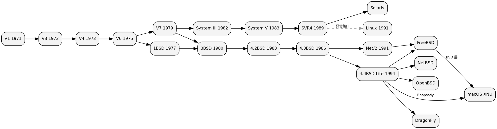

## Introduction

"这是不是 Unix" 有三个互不等价的判据，而把它们当成一个是全库（也是整个中文技术圈）最高频的事实错误来源：**Linux 到底算不算 Unix** 这个问题，答案会因为问的是哪一个判据而完全不同。

| 判据 | 它在问什么 | 通过的例子 | 不通过的例子 |
| :--- | :--- | :--- | :--- |
| **血统** | 源码是否派生自贝尔实验室的 Research Unix | BSD 四支、macOS、Solaris / illumos | **Linux（一行 Unix 源码都没有）**、Windows |
| **接口符合性** | 是否实现 POSIX / Single UNIX Specification 描述的系统接口 | 几乎所有 Unix 与类 Unix 系统 | 裸机 RTOS、Windows 原生 API |
| **商标与认证** | 是否通过 The Open Group 的测试并注册到 UNIX 品牌 | AIX 7、HP-UX 11i v3、macOS、z/OS、华为 EulerOS 2.0 | **FreeBSD / OpenBSD / NetBSD 均不在册**，Android 也不在 |

三条判据的分离不是学术洁癖，而有明确的历史节点：**1993 年底 Novell 把 UNIX 商标与 Single UNIX Specification 交给 X/Open，The Open Group 的编年表把这件事描述为 "separating the trademark from any code stream"** —— 从这一年起，"Unix" 指的是一组接口加一个品牌，不再指任何一份代码。于是"Unix 家族"成了一个以**接口契约**为边界的家族，而不是以源码血缘为边界的家族，本页就按这个边界组织。



本页是 UNIX 家族的枢纽：家谱、标准与认证、API 契约、现代分支对照，以及 Linux 在这个家族里的准确位置。各子系统的机制细节都在别的页面上，本页只负责把它们归到同一条血脉上——Linux 侧的实现见 [Linux](/docs/CS/OS/Linux/Linux.md)，"一切皆文件"在 Linux 里如何落地见 [文件系统机制](/docs/CS/OS/Linux/fs/README.md)。

## Genealogy

### Research Unix

版本年份以 The Open Group 的编年表为基准，机制归位以现存手册与源码树为准（`dspinellis/unix-history-repo` 保留了各版的 `usr/src/` 与 `usr/man/`，可以直接查证某个系统调用在哪一版第一次出现）。

| 版本 | 年份 | 可核实的证据 |
| :--- | :--- | :--- |
| First Edition (V1) | 1971 | 编年表：PDP-11/20 的汇编器、文件系统、`fork()`、`roff`、`ed`；用于专利文档的文本处理 |
| Second Edition (V2) | 1972 | — |
| Third Edition (V3) | 1973-02 | 手册里已同时有 `pipe.2`、`fork.2`、`kill.2`/`intr.2`/`quit.2`，以及目录与 inode 系统调用 `chdir.2`/`makdir.2`/`mount.2`/`link.2`/`stat.2`，`ed.1` 带正则 |
| Fourth Edition (V4) | 1973-11 | 编年表原话 "It was rewritten in C"；`grep.1` 首次出现在 man1 |
| Fifth Edition (V5) | 1974 | — |
| Sixth Edition (V6) | 1975-05 | 编年表：第一版在贝尔实验室之外被广泛提供；1BSD 由 V6 派生 |
| Seventh Edition (V7) | 1979 | 编年表：有 C、UUCP 与 Bourne shell，移植到 VAX；手册新增 `signal.2`/`alarm.2`、`ioctl.2` 与 `stdio`/`printf`/`fopen` 的 man3 |

两个容易被二手资料写错的点：

- **"用 C 重写"发生在第四版（1973-11），不是第三版**；而重写完成也不等于可移植——第一个把 Unix 搬到非 DEC 硬件的移植是 1977-78 年的 Interdata 8/32，VAX 上的 32V 要到 1979 年。**"1973 年就成了第一个可移植操作系统"是把"用 C 写的"与"能跨硬件编译"混为一谈**。
- **`grep` 不在第七版**，它 1973 年就在第四版的 man1 里；第三版的 man1 只有 `ed`、`fed`、`sh`。

### The BSD Line

BSD 线的日期用 FreeBSD 项目自己维护的年表 `share/misc/bsd-family-tree`（更新至 2026-10），它是这条线上少数带逐条出处的清单。

```
V6 ──> 1BSD(1977 末) ──> 2BSD ──┐
V7 ──> 32V ───────────────────┴─> 3BSD ──> 4.0BSD ──> 4.1BSD ──> 4.2BSD ──> 4.3BSD
                                                                    │
                    386BSD / BSD/386 <──── Net/2 (1991) ────> 4.4BSD-Lite (1994)
                                                                  │
                                              FreeBSD / NetBSD / OpenBSD / DragonFly
```

- **1BSD 不是一整个操作系统**。它晚 1977 年成形（年表记 late 1977，磁带日期 1978-01-16），内容只有伯克利自研的软件——Pascal 系统、`ex`、新的 shell 等——使用者必须另外持有授权的 V6。今天"1978 年伯克利做了个 BSD"的说法会漏掉这一层。
- **4.2BSD（1983-09）是 BSD 变成另一种 Unix 的那一版**：手册里第一次出现完整的 `socket.2`/`socketpair.2`/`select.2`/`getsockopt.2`/`setsockopt.2`（没有 `poll`），并带来 FFS 与 TCP/IP。The Open Group 的编年表把它记在 1984，两份清单对不上时以带出处的年表为准。
- **诉讼的真实结果比流行说法窄**。USL 1992 年起诉 BSDi，但**初步禁令被法院拒绝**，BSD/386 1.0 照常在 1993-03 发布；1994 年 Novell 与伯克利和解，**承认 Net/2 中只有 3 个文件确属受约束代码**（需移除），其余部分解除约束并"强烈建议用户切换"到 4.4BSD-Lite。年表据此能对上：FreeBSD 最后一个基于 Net/2 的发行是 1.1.5.1（1994-07-05），两个月后的 FreeBSD 2.0（1994-11-23）已建在 4.4BSD-Lite 上。CSRG 的最后一份发布是 4.4BSD-Lite Release 2（1995-06），随后解散。
- ⚠️ **"Berkeley 只输了 186 行"这类精确数字本轮未能核实到任何一手来源**，属于不可复述的流行说法。

这一支的**当代形态**——发布节奏、平台分层、base system 与 pkgbase、内核机制、治理与安全流水线——单独成篇，见 [FreeBSD](/docs/CS/OS/unix/FreeBSD.md)。本页只管血统与接口契约，不重复那些机制。

### The System V Line

- 演进：System III（1982，贝尔实验室之外第一个公开发布）→ System V（1983，第一个带支持的发布）→ SVR2（1984）→ SVR3（1987，STREAMS / TLI / RFS）→ **SVR4（1989，编年表原话 "unifying System V, BSD and Xenix"）** → SVR4.2（1992）→ SVR4.2MP（1993 底）。
- **合流对象是 Xenix，不是 SunOS**。SVR4 由 AT&T 与 Sun 自 1988 年起联合开发，但 Sun 当时的 SunOS 1–4 本身是 BSD 底子（编年表记 SunOS 1.0 于 1982 年发布）；**Sun 的产品线切换到 System V 底子发生在 1992 年的 Solaris 2.x（即 SunOS 5.x）**。所以"AIX、HP-UX、SunOS、Solaris 都继承 SysV"这句流行概括在 Solaris 上必须以 1992 为界，对 AIX 与 HP-UX 的早期成分则不应一概而论。
- 产权流转：USL 1991 年独立成公司 → 1993 年被 Novell 收购 → 同年年底商标与规范交给 X/Open → 1995 年 Novell 把 UnixWare 业务线卖给 SCO → 2000 年 Caldera 从 SCO 手里买走 UnixWare。

## Standards and Certification

### POSIX

- **POSIX 的名字是 Richard Stallman 提议的**，而 POSIX 本身是 **IEEE 的商标**（Austin Group 的 POSIX FAQ 原文如此）。这决定了它和 UNIX 品牌永远是两套体系：POSIX 认证由 The Open Group 作为认证机构执行，商标许可方是 IEEE。
- 时间线：POSIX.1 在 **1988 年出版**（编年表），1990/1996/2001 修订；现行版本是 **IEEE 1003.1-2024**，2024-05-20 批准、2024-06-14 发布；上一版 1003.1-2017 批准于 2017-12-06 却**拖到 2018-01-31 才发布**——引用它时"2017 版 / 2018 出版"两个写法都出现过，并不矛盾。
- **范围**：POSIX 标准化了 C 语言系统接口，**也标准化了 shell 与工具**（原 1003.2 自 2001 版并入）；它**明确不涵盖**系统管理、超级用户专属功能、硬件约束与系统维护。换句话说：**没有 `init`，没有设备驱动模型，没有包管理**。它是接口标准，保证的是**源码可移植**，不是二进制可移植。

### Single UNIX Specification 与品牌

| 品牌 | 对应规范 | 目前在册的产品（TOG 注册页） |
| :--- | :--- | :--- |
| UNIX 93 | 未能核实其对应规范 | SCO OpenServer 5 / 6 |
| UNIX 95 | 最初的 SUS（1994，前身是 COSE 的 "Spec 1170"） | IBM z/OS 3.1 与 V2R1、SCO UnixWare 7.1.3+ |
| UNIX 98 | SUSv2（1997，加入实时、线程与 64 位） | Solaris 9 |
| **UNIX 03** | **SUSv3（2001）**；核心卷 2003 年成为 ISO/IEC 9945:2003 | AIX 7（7.1 TL5+ / 7.2 TL2+）、HP-UX 11i v3 B.11.31+、**华为 EulerOS 2.0**；Solaris 10/11 与 AIX 5L/6 已标为 superseded |
| **UNIX V7** | **SUSv4 的 2018 版**（= Issue 7，2008 年首发）；2018 年首次发证 | AIX 7.2 TL5+ |

> [!WARNING]
>
> 这一节有两个几乎人人写错的点：**（1）不存在 "UNIX 17" 这个标记**，The Open Group 的注册索引里只有 UNIX 93 / 95 / 98 / 98 Server / 03 / V7；对 SUSv4 的标记叫 **UNIX V7**。**（2）UNIX 03 对应的是 SUSv3，不是 SUSv4**——名字里的 "03" 来自 2003 年的 ISO 化，而不是 2003 年发布。另：SUS 是 POSIX 的**超集**（XSI 加上六个强制的 POSIX 选项），SUSv5（2024）= Base Specifications Issue 8 = POSIX.1-2024。

认证不是走形式：**UNIX 03 要求跑 VSX5 + VSX4 + VSU5 + VSTH + VSRT + VSC5，再加 Plum Hall 或 Perennial CVSA** 的完整套件（Spec 1170 时代的套件代号 Eastwood，2003 年为 UNIX 03 交付的是 Westwood），厂商还要承诺持续符合。

### 谁在册，谁不在

- **macOS**：Apple 的注册从 **Mac OS X 10.5 开始（2007-05-18）**，而注册项的环境字段明写着 **"on Intel-based Macintosh computers"**——**PowerPC 时代的 Mac OS X 从未通过认证**，这条经常被"Mac 一直是 UNIX"的说法抹平。Apple 自己的技术简报写的是"OS X version 10.7 Lion is an Open Brand UNIX 03 Registered Product"。**iOS / iPadOS / watchOS / tvOS 不在 UNIX 认证库里。**
- **BSD 没有任何一支持有 UNIX 品牌**。FreeBSD 自述"derived from BSD, the version of UNIX developed at Berkeley"、OpenBSD 自述"4.4BSD-based UNIX-like"——它们主张血统与 `Unix-like`，都不主张商标。
- **Linux 内核系统反倒可以认证**：华为 EulerOS 2.0 于 2016-09-09 拿到 UNIX 03，浪潮 K-UX 是中国第一次。所以"Linux 从没被认证过 Unix"也不成立——被认证的是带着 glibc 的**发行版**，而内核本身从不声称是 Unix。
- **POSIX 认证是另一条独立线**，在册的清一色是嵌入式 RTOS：Green Hills INTEGRITY、Wind River VxWorks 7、中兴汽车 OS、**小米 Vela OS V5.0（2025-12-01 首次注册）**。
- Linux 世界自己搞过的标准化尝试 **LSB 最后一版是 5.0（2015-06-03）**，此后规范与测试都进入维护模式，项目自己都写"很可能就是最后一份"。

## The API Contract

Unix 的家族边界不在目录结构而在接口。Ritchie 与 Thompson 1974 年的论文是这条契约最早的一手文本，值得注意的恰恰是：**"everything is a file" 这个短语在论文里一次都没出现**——它是后来的口号。论文给的是更精确的三分：ordinary disk files、directories、special files，并且把 special files 称为 "the most unusual feature of the UNIX filesystem"，理由是同一套接口带来三重好处（文件与设备 I/O 尽可能一致、名字语法与含义一致、保护机制一致）。写机制时引用这个分类比引用口号准确。

### 三类文件与设备抽象

普通文件、目录、特殊文件共用 `open / read / write / close` 与同一套权限位，目录仍是树形约束下的文件（这正是 `..` 与链接计数存在的原因）。设备节点用主/次号定位驱动，**"没有 Unix 系统级分区也能装新硬件"这件事，靠的是 /dev 加设备表这一层薄抽象**。Linux 侧把同一思路推到内核状态（`/proc`、`sysfs`），见 [文件系统机制](/docs/CS/OS/Linux/fs/README.md)。

### fork 与 exec 为什么是两个调用

1974 论文的说法是"新进程只能通过 `fork` 产生"。而 fork 与 exec 被拆成两个调用才是关键设计：**在 fork 之后、exec 之前的那几行用户态代码里，父进程可以任意改写文件描述符表、uid 与信号处理，而这些改动会随 exec 存活下来**。shell 的重定向、管道、setuid 与容器化全都寄生在这个窗口上：

```c
pid_t pid = fork();
if (pid == 0) {
    int fd = open("out.txt", O_WRONLY | O_CREAT | O_TRUNC, 0644);
    dup2(fd, STDOUT_FILENO);   /* 替换子进程的 1 号描述符 */
    close(fd);
    execvp(argv[0], argv);     /* 上面的改动对新程序依然有效 */
    _exit(127);                /* exec 只在失败时返回 */
}
```

Linux 的 `clone()` 与线程模型把这套语义改写过（内核不再区分进程与线程，统一为 `task_struct`），展开在 [进程知识地图](/docs/CS/OS/Linux/proc/README.md)。

### 可分离的 shell

九要素里最容易被低估的一条是 **separable shell**：shell 从来不是内核的一部分——V1 的源码树根目录里 `sh.s` 与 `init.s` 就并排放在内核旁边，论文把"每条用户可选一种命令语言"当作系统特性列出。因为 shell 只是一个普通进程，管道、重定向、脚本与 `csh`/`zsh` 之争才可能发生在用户态。Bourne shell 到 V7（1979）才进 Research Unix；**C shell 从未出现在 V7 的手册里，是从 3BSD 一线进入 BSD 支的**——"Unix 有两个 shell 传统"这件事其实是家谱上的分裂，不是同一份系统里的两个选项。

### 管道、grep 与正则

管道在 V3（1973-02）就有 `pipe.2`，1974 论文当时还写明一条限制：**"the pipe must be set up by a common ancestor of the processes involved"**（管道必须由相关进程的共同祖先建立）——这句话正是上面 fork 语义的直接推论。`grep` 在 V4 的 man1 里，由 Thompson 从 `ed` 的正则解析器改造而成、McIlroy 提出并实现为工具。正则本身不是 Unix 的发明（Kleene 的形式语言 → Thompson 在 QED 里的实现），Unix 的贡献是把它塞进 `ed` 又塞进 `grep`，从此每个文本处理程序都自带一套模式匹配。

### 信号：从不可靠到不可靠的两种定义

V3 手册里只有 `kill.2`、`intr.2`、`quit.2`；`signal.2` 与 `alarm.2` 要到 V7。真正的问题不是"没有信号 API"而是**System V 与 BSD 对同一件事给了两种语义**：System V 风格的信号处理函数装一次就跑掉、慢速系统调用被打断后直接返回失败；BSD 改成处理函数保持安装、慢调用自动重启。**POSIX 最终同时保留两种语义**（`sigaction` 与 `signal` 的差别就来自这里），直到今天写跨平台代码仍要显式选一种。Linux 侧的中断与信号实现见 [Interrupt](/docs/CS/OS/Linux/Interrupt.md) 与 [进程知识地图](/docs/CS/OS/Linux/proc/README.md)。

### ioctl 的越界与事件多路复用的编年

- **`ioctl` 出现在第七版 AT&T Unix**——FreeBSD 与 OpenBSD 的 man 页都写 "appeared in Version 7 AT&T UNIX"，`usr/man/man2/ioctl.2` 在 V7 源码树里可查。**"ioctl 是 4.2BSD 发明的"是错的**；4.2BSD 只是重新定义了请求的编码约定。它是这家族里唯一一处公认的坏设计：一个塞满设备私有语义的逃生舱，正说明"三类文件"的统一抽象在小数点级别的硬件差异面前会漏。
- 事件通知的编年（各 man 页的 HISTORY 段可查，两处仍存分歧）：`select` 4.2BSD（**OpenBSD 的 man 页把它记在 4.1cBSD**）→ `poll` Linux 2.1.23 → **`kqueue` FreeBSD 4.1（作者 Jonathan Lemon），OpenBSD 自 2.9 起提供** → `epoll` Linux 2.5.44（Davide Libenzi）。所以"kqueue 早于 epoll"成立，但把 epoll 说成"kqueue 的 Linux 仿制品"没有依据可循。

## Where the Descendants Diverge

同一份接口契约在各家分头长出了不兼容的实现，而这些差异正是跨平台代码真正的坑：

| 需要做的事 | BSD 与 macOS | Linux | Solaris / illumos |
| :--- | :--- | :--- | :--- |
| 等待多个 fd 上的事件 | `kqueue`（FreeBSD 4.1 起） | `epoll`（2.5.44 起） | `select`/`poll` 加 event ports |
| 内核状态与调参入口 | `sysctl` 为主 | 额外有 `/proc` 与 `/sys` 两套伪文件系统 | `sysctl` 为主 |
| 生产环境动态插桩 | 曾内置 DTrace（macOS 多年后移除） | ftrace 与 eBPF（`bpf()` 自 3.18 起被描述为"通用内核虚拟机"） | **DTrace 是它的原生机制**，见 [DTrace](/docs/CS/OS/DTrace.md) |
| 服务与启动管理 | `launchd`（macOS）、`rc.d`（BSD） | 早期 SysV `init`，后为 systemd，见 [启动链](/docs/CS/OS/Linux/boot/README.md) | SMF |
| 系统级分区 | 无（靠 jail 做容器） | `namespace` + `cgroup`，见 [namespace](/docs/CS/OS/Linux/namespace.md) 与 [cgroup](/docs/CS/OS/Linux/cgroup/README.md) | Zones（Global / Non-Global） |
| 进程间通信 | 管道、Unix domain socket、共享内存 | 同前，另加 netlink | 同前 |

macOS 那一列还多一层：**XNU 里同时住着 Mach 与 BSD**，原生 IPC 是 Mach 的消息队列（`osfmk/kern/ipc_*.c`），BSD 只提供文件与网络那半边。这使它在 Unix 家族里成了唯一"接口是 POSIX、内核机制却是 Mach"的成员，展开见 [Darwin](/docs/CS/OS/mac/Darwin.md)。

## Modern Descendants

现状均为 2026-10 核实；"血统"指可核实的最近上游，不等于逐行相同。

| 系统 | 血统 | 当前发布 | 持有 UNIX 品牌 |
| :--- | :--- | :--- | :--- |
| [FreeBSD](/docs/CS/OS/unix/FreeBSD.md) | 4.4BSD-Lite（2.0 起，1994-11-23；此前 1.x 基于 Net/2） | 15.1（2026-06-16），14.5（2026-09-08） | 否 |
| NetBSD | 4.4BSD-Lite2，1993 年起步 | 11.0（2026-07-30） | 否 |
| OpenBSD | 4.4BSD 系，首个带日期的发布是 2.0（1996-10-18） | 8.0（2026-10-19） | 否 |
| DragonFly BSD | FreeBSD 一支，1.0 发布于 2004-07-12 | 6.4.2（2025-05-09） | 否 |
| macOS | Rhapsody（1997）→ XNU：Mach + FreeBSD 派生的 BSD 层 + I/O Kit | 持续注册 UNIX 03，最新到 macOS Tahoe 26.0 | **是** |
| Solaris / illumos | SVR4（1992 年的 Solaris 2.x 起）；OpenSolaris 2010 年终止后社区分支 illumos | Oracle Solaris 11.x；illumos 分支 | Solaris 10/11 曾在册，现为 superseded |
| AIX | System V 一脉（1986 年公布） | 7.3，TL4 于 2025-12 发布 | **是**（UNIX 03 与 UNIX V7 双在册） |
| HP-UX | System V 一脉（1982 年引入） | 11i v3 B.11.31，仍在出季度补丁 | **是** |
| Linux | 无 Unix 源码；Torvalds 1991 年自述 "Free UNIX for 386"、"0.11 已具备一个 unix 内核的大部分内容"、"不含任何 minix 代码" | — | 内核否；发行版可（EulerOS 2.0） |
| Android | Linux 内核 + 自研 BSD 许可的 bionic libc | — | 否（且无 SUS/POSIX 声称） |

## The Good, the Bad, and the Ugly

上面全是"Unix 是什么"，这一节是它自己那位最早的作者之一怎么看它的。以下内容是 Rob Pike 的演讲 *The Good, the Bad, and the Ugly: The Unix Legacy* 的正文，幻灯片标题页写明 **"Copenhagen, Sept 8-9 2001, +1000000000s"**——这是 Unix 第十亿秒（Unix 时间 1000000000 = 2001-09-09 01:46:40 UTC）的纪念报告，PDF 由 Pike 本人托管在 herpolhode.com，即正式版本。

### What makes Unix Unix

What is Unix?

A generous definition: Those operating systems derived from or inspired by the Research Unix systems of the 1970s.
Includes commercial Unix systems, Research Unix, NetBSD, OpenBSD, [Linux](/docs/CS/OS/Linux/Linux.md), even Plan 9 and others.

> [!Note]
>
> Those who do not understand Unix are condemned to reinvent it, poorly.    -- Henry Spencer

（此语出自 Henry Spencer 的 **Usenet 签名档**，1987 年 11 月，常被误传成论文或演讲；Spencer 本人是正则表达式库、C News 与 RFC 1849 的作者。）

Today, Unix runs everywhere (except a few PCs).

What makes Unix Unix ?
Something like the combination of:

- high-level programming language
- hierarchical file system
- uniform, unformatted files (text)
- separable shell
- distinct tools
- pipes
- regular expressions
- portability
- security

Not all these ideas originate in Unix, but their combination does.

> [!TIP]
>
> Keep It Simple, Stupid!

To get to 2001, you need to add networking and graphics, but those are not definitive of Unix.
Quite the opposite: these were added later and badly, with models taken largely from other systems.

### Strengths are also weaknesses

The Good things about Unix are also its Bad things. The things that made it successful also limited its success.
Its strengths are also its weaknesses.

- C
- Tools
- Text files
- Portability
- Open source

The irony is Ugly.
A simple example: flat text files.

One of Unix's greatest contributions; unused outside.
Almost no visibility beyond the Unix community!

Once, the commonest Unix program was grep. Today, it's emacs or mozilla.
**People prefer integrated environments and browsers.**

The tyranny of forced interaction:

- No ability to step beyond the model.
- No programmability. (E.g.: Fetching maps, NYT)
- Wasting human time.
  The irony:
- Most web pages are synthesized dynamically by Unix tools.
- But the result hides that completely from the user.

The weird solution: programs that interpret HTML to drive web interactions automatically.

- Simple examples: stock, weather.
- Text-only browsing.

Flat text files are easy to use (Good) but don't scale well (Bad).

### Portability's unintended consequence

Unix did portability first and, still, best: (Good)

- Sources in high-level language
- Operating system runs independent of hardware
- Interfaces don't change (much) between platforms.

Unintended consequences: (Bad)

- Machine became irrelevant
- Therefore cost was only factor
- Therefore hardware got lousy, widely variable
- Therefore software had to cope, became non-portable.

The success of PCs is in large part due to the fact that, by making all hardware equivalent, good software enabled bad hardware.

### Community

1. What is the best thing about Unix?
   A: The community.
2. What is the worst thing about Unix?
   A: That there are so many communities.

Pike 这篇讲的是"为什么这些优点同时构成了它的天花板"：文本文件让工具可组合，也让状态无处安放；可移植让 Unix 摆脱硬件，也让硬件反过来定义了成本下限。上面几节里那些日期与版本，只是这套论证的家谱注脚——**Unix 真正被继承下来的不是任何一份源码，而是这组取舍**。

## Unverified

本轮（2026-10）未能核实到一手来源的问题，**正文一条都没写进去**：

- `stdio` 是否由 4.2BSD 引入（V7 手册确有 `stdio.3s`，"更早不存在"未查）；`fork` 在 V2 是否已存在（论文与 V3 手册都有，V1/V2 只有编年表的间接说法）。
- 主/次设备号的分裂出现在哪一版（1974 论文只描述 special files 的概念，未提编码方式）。
- `poll` 是否源自 SVR3（Linux man 只标 POSIX.1-2001，System V 出处未证）。
- 诉讼的"186 行 / Berkeley 完胜"流行说法；CSRG 解散的具体月份。
- Coward 1966 作为正则的学术源头；Ritchie 对 `ioctl` 的批评原文（他的《Evolution of the Unix Time-Sharing System》与《Reflections on the Unix Operating System》本轮所有镜像均 410/403，读不到）。
- Ritchie 或 McIlroy 是否认可 "everything is a file" 这一表述。
- OpenBSD 从 NetBSD-current 分叉、DragonFly 从 FreeBSD 4.8 分叉这两个具体说法（只核到各自首个带日期的发布）。
- DTrace 论文的完整作者名单与 Solaris 10 的发布月份；event ports 是否随 Solaris 10 引入；Solaris Doors 与"JPDS"这一缩写的所指。
- UNIX 93 对应的规范版本（TOG 品牌页只映射 95 / 98 / 03 / V7）；SUSv1 的准确年份（TOG 编年表 1994 与其宣传材料 1995 并存）；TOG 编年表把 SUSv4 写成 2015 而 Issue 7 有 2008 版。
- Torvalds 是否说过"Linux is not Unix"（1991-92 原始发帖里只有"Free UNIX for the 386"这一类表述，后者是事后转述）。

## Links

- [Operating Systems](/docs/CS/OS/OS.md)
- [Mac](/docs/CS/OS/mac/mac.md)
- [系统调用的实现](/docs/CS/OS/Linux/Calls.md)
- [xv6](/docs/CS/OS/xv6/xv6.md)
- [Socket](/docs/CS/CN/Socket.md)

## References

1. [The UNIX Time-Sharing System](https://dsf.berkeley.edu/cs262/unix.pdf)
2. [The Good, the Bad, and the Ugly: The Unix Legacy](http://herpolhode.com/rob/ugly.pdf)
3. [History of UNIX](https://www.unix.org/unix_history.html)
4. [UNIX Certification Brand](https://www.unix.org/the_brand.html)
5. [The Single UNIX Specification V5 (2024) - Introduction](https://www.unix.org/overview.html)
6. [The Open Brand Register — UNIX 03 products](https://www.opengroup.org/openbrand/register/xy.htm)
7. [The Open Brand Register — UNIX V7 products](https://www.opengroup.org/openbrand/register/xv7.htm)
8. [POSIX.1 FAQ](https://www.opengroup.org/austin/papers/posix_faq.html)
9. [POSIX.1 Backgrounder](https://www.opengroup.org/austin/papers/backgrounder.html)
10. [The Open Group Base Specifications Issue 8](https://pubs.opengroup.org/onlinepubs/9799919799/)
11. [The UNIX system family tree: Research and BSD](https://cgit.freebsd.org/src/plain/share/misc/bsd-family-tree)
12. [UNIX Chronology](https://landley.net/history/mirror/unix/unix-history.html)
13. [ioctl(2) - OpenBSD manual pages](https://man.openbsd.org/ioctl.2)
14. [kqueue(2) - OpenBSD manual pages](https://man.openbsd.org/kqueue)
15. [socket(2) - Linux manual page](https://man7.org/linux/man-pages/man2/socket.2.html)
16. [Oracle Solaris Dynamic Tracing Guide](https://docs.oracle.com/cd/E23824_01/html/E22973/index.html)
17. [OS X for UNIX Users (Technical Brief, July 2011)](https://images.apple.com/media/us/osx/2012/docs/OSX_for_UNIX_Users_TB_July2011.pdf)
18. [AIX support lifecycle information](https://www.ibm.com/support/pages/aix-support-lifecycle-information)
19. [illumos: Overview](https://illumos.org/docs/about/history/)
20. [Regular Expression Matching Can Be Simple And Fast](https://swtch.com/~rsc/regexp/regexp1.html)
21. [LINUX's History by Linus Torvalds](https://www.cs.cmu.edu/~awb/linux.history.html)
22. [dspinellis/unix-history-repo](https://github.com/dspinellis/unix-history-repo)
