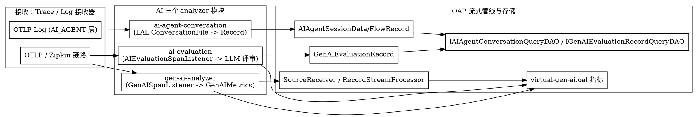

# SkyWalking AI Pipeline (LLM Observability)

## Introduction

本页深挖 Apache SkyWalking 在 10.x 形态下新增的 **AI 管线（AI Pipeline，即 LLM 可观测性）** 子系统。该子系统是 analyzer 族在 LLM 时代的新成员，由三个独立的 analyzer 模块组成，分别覆盖「AI Agent 长会话落盘」「GenAI 链路指标」「LLM-as-Judge 评审」三类遥测语义。

本页与 Note 仓库既有 SkyWalking 页的关系：

- 与 [Analyzer_Family](/docs/CS/SE/SkyWalking/Analyzer_Family.md) 的关系：ai-agent-conversation、ai-evaluation、gen-ai-analyzer 是 analyzer 目录下与 trace-analyzer / log-analyzer 并列的独立 Module，是 analyzer 族的「AI 新成员」。
- 与 [Module_System](/docs/CS/SE/SkyWalking/Module_System.md) 的关系：三者各自定义 `*Module extends ModuleDefine` 并暴露专属服务（IConversationQueryService / IAIEvaluationService / IGenAIMeterAnalyzerService），由各自 `*Provider extends ModuleProvider` 装载。
- 与 [Storage_Abstraction](/docs/CS/SE/SkyWalking/Storage_Abstraction.md) 的关系：两个「落盘型」AI 数据（会话文件、评审结果）以 `Record` 子类经流式管线写入存储，并在 `StorageModule` 中登记了 `IAIAgentConversationQueryDAO` 与 `IGenAIEvaluationRecordQueryDAO` 两个查询 DAO。
- 与 [Streaming_Pipeline](/docs/CS/SE/SkyWalking/Streaming_Pipeline.md) 的关系：gen-ai-analyzer 产出 `Source` 走标准 `SourceReceiver`；会话文件与评审结果则直接走 `RecordStreamProcessor`。

> 代码基线：`12ff4613c8`（HEAD，Add HTTP alarm hook delivery so11y metrics on telemetry Prometheus #14190）。下文所有 `file:line` 均来自该 commit 的真实源码核验。

## AI 三个 analyzer 模块总览

### 1. ai-agent-conversation（AI Agent 长会话落盘）

职责：把 **AI Sessionizer** 通过 OTLP Log（落在 `AI_AGENT` 层）推送的「会话 Session Data（`.sd`）」与「会话流 Session Flow（`.sf`）」两类文件，原样校验后落盘，供前端以一份 `asz.view` 文档折叠回放整段对话。

- 模块定义：`AIAgentConversationModule.java:33` 中 `NAME = "ai-agent-conversation"`，`AIAgentConversationModule.java:40-44` 仅暴露 `IConversationQueryService`（读侧服务）。
- 装载者：`AIAgentConversationProvider.java:42` `extends ModuleProvider`；`AIAgentConversationProvider.java:138-144` 依赖 `CoreModule / StorageModule / TelemetryModule`。
- 接入方式（非标准 Source）：它是一个 **LAL 输出构造器（LALOutputBuilder）**。`ingest/ConversationFileBuilder.java:59` `implements LALOutputBuilder`，`ConversationFileBuilder.java:60` `NAME = "ConversationFile"`，由 `server-starter/src/main/resources/lal/ai-agent.yaml:28-29` 的 `outputType: ConversationFile` + `layer: AI_AGENT` 规则命名触发。
- 接收路径：每条 OTLP Log 经 LAL 抽取 `asz.format / asz.digest / asz.lines / asz.session / asz.seq` 等属性后，调用 `ConversationFileBuilder.complete(SourceReceiver)`（`ConversationFileBuilder.java:227-269`）：先校验 body 的 sha256 与行数是否与声明一致，再按 `format` 分流。
- sink：构造 `AIAgentSessionDataRecord`（`.sd`，`ConversationFileBuilder.java:280-295`）或 `AIAgentSessionFlowRecord`（`.sf`，`ConversationFileBuilder.java:297-324`），经 `ConversationFileBuilder.java:276-278` 的 `RecordStreamProcessor.getInstance().in(record)` 进入 P0-2 流式管线。
- 读侧：`AIAgentConversationProvider.java:105-106` 注册 `ConversationViewHandler` 与 `ConversationFilesHandler` 两个 HTTP 端点，由 `ConversationQueryService` 折叠多轮对话并解析引用。

### 2. gen-ai-analyzer（GenAI 链路指标）

职责：从 trace 中识别符合 GenAI 语义约定（携带 `gen_ai.response.model`）的 span（OTLP / Zipkin / 原生 OTLP），抽取 token 用量、延迟、TTFT、估算成本，并以 **虚拟服务 / 虚拟实例** 形态（`Layer.VIRTUAL_GENAI`）注入 OAP 标准指标流。

- 模块定义：`module/GenAIAnalyzerModule.java:26` `NAME = "gen-ai-analyzer"`，`GenAIAnalyzerModule.java:33-37` 暴露 `IGenAIMeterAnalyzerService`。
- 装载者：`GenAIAnalyzerModuleProvider.java:37` `extends ModuleProvider`；`GenAIAnalyzerModuleProvider.java:85` 在 `start()` 中 `load(GenAIOALDefine.INSTANCE)`（加载 `oal/virtual-gen-ai.oal`）；`GenAIAnalyzerModuleProvider.java:100-104` 仅依赖 `CoreModule`。
- 接入方式（标准 SpanListener）：`listener/GenAISpanListener.java:50` `implements SpanListener`，由 `gen-ai-analyzer/src/main/resources/META-INF/services/org.apache.skywalking.oap.server.core.trace.SpanListener:17` 登记，被标准 trace 接收器在 phase 1/2 回调。其 `onZipkinSpan` / `onNativeOTLPSpan` 调用 `IGenAIMeterAnalyzerService`（`GenAISpanListener.java:71,80`），再把 `transferToSources` 产生的 `Source` 直接 `sourceReceiver.receive(source)`（`GenAISpanListener.java:89-90`）。
- 抽取逻辑：`service/GenAIMeterAnalyzer.java:54` `implements IGenAIMeterAnalyzerService`。`extractMetricsFromSWSpan`（`:81`）/ `extractMetricsFromZipkinSpan`（`:129`）/ `extractMetricsFromOTLPSpan`（`:147`）统一产出中间结构 `genai/core/source/GenAIMetrics.java:24`；`transferToSources`（`:215-226`）转成 4 个 `Source`：`ServiceMeta`（虚拟 GenAI 服务）、`ServiceInstance`（虚拟 GenAI 实例）、`GenAIProviderAccess`（`core/source/GenAIProviderAccess.java:30,32`，`extends Source`）、`GenAIModelAccess`（`core/source/GenAIModelAccess.java:30,32`，`extends Source`）。
- 指标定义：`config/GenAIOALDefine.java:29` 指向 `oal/virtual-gen-ai.oal`，其中定义 `gen_ai_provider_resp_time`、`gen_ai_provider_input_tokens_sum`、`gen_ai_model_ttft_avg`、`gen_ai_model_latency_percentile` 等面向 provider / model 维度的指标。

### 3. ai-evaluation（LLM-as-Judge 评审）

职责：对 GenAI span 做采样，用外部「评审模型」（默认 OpenAI 兼容接口，即 LLM-as-Judge）按任务（task）打分/判定，结果以 `Record` 落盘，并把分数以 ppm 指标回灌指标流。这是对 LLM 输出质量的「第二层观测」。

- 模块定义：`AIEvaluationModule.java:25` `NAME = "ai-evaluation"`，`AIEvaluationModule.java:33-35` 暴露 `IAIEvaluationService`。
- 装载者：`AIEvaluationProvider.java:56` `extends ModuleProvider`。若评审裁判（judge）配置不完整，则注册 `InactiveAIEvaluationService` 并置 `active=false`（`AIEvaluationProvider.java:104-118`）；否则创建 `AIEvaluationService` 并接 `OpenAICompatibleProvider`（`AIEvaluationProvider.java:177-184`）。`AIEvaluationProvider.java:145-151` 依赖 `CoreModule / AnalyzerModule / TelemetryModule`。
- 接入方式（双 listener）：
  - `listener/AIEvaluationSpanListener.java:42` `implements SpanListener`（登记于 `META-INF/services/org.apache.skywalking.oap.server.core.trace.SpanListener`），在 `onZipkinSpan` / `onNativeOTLPSpan` 中识别 GenAI span 并 `evaluationService.sample(...)`（`AIEvaluationSpanListener.java:150`）。
  - `analyzer/provider/trace/parser/listener/GenAIEvaluationAnalysisListener$Factory`（登记于 analyzer 的 `SegmentParserListener` 服务文件）作为段解析监听器，二者协作把 span 上下文送入评审流水线。
- 评审流水线（planner / prompt builder / result parser / level resolver）：`AIEvaluationProvider.java:186-199` 装配 `SpanAIEvaluationStrategy`，由 `service/strategy/span/SpanAIEvaluationStrategy.java:164` 经 `RecordStreamProcessor.getInstance().in(record)` 写入 `GenAIEvaluationRecord`。
- sink 数据模型：`core/analysis/manual/genai/GenAIEvaluationRecord.java:52-56` `@Stream(name = "gen_ai_evaluation_record", ... RecordStreamProcessor.class)`，`extends Record`，记录 trace/span 引用、provider/model、task、分值（数值按 `SCORE_SCALE=1_000_000` 缩放）或字符串结论。
- 指标回灌：`service/AIEvaluationMetricReporter.java:36` 定义样本名 `gen_ai_model_evaluation_score_ppm`，`reportScore`（`:48-78`）通过 `IMeterProcessService`（来自 AnalyzerModule）把分数以 ppm 形态汇入 MAL 指标流，供 `virtual-gen-ai.oal` 之外的指标体系消费。

## 数据模型与 Source

| 模块 | 数据形态 | 核心类 | 接入方式 | 流式通道 |
| --- | --- | --- | --- | --- |
| ai-agent-conversation | 会话文件（原样） | `AIAgentSessionDataRecord` / `AIAgentSessionFlowRecord` | `Record` 子类 | `RecordStreamProcessor` |
| gen-ai-analyzer | 指标 Source | `GenAIMetrics` → `GenAIProviderAccess` / `GenAIModelAccess` / `ServiceMeta` / `ServiceInstance` | 标准 `Source` | `SourceReceiver` → OAL |
| ai-evaluation | 评审结果 Record + ppm 指标 | `GenAIEvaluationRecord` | `Record` 子类 + `IMeterProcessService` | `RecordStreamProcessor` + MAL |

- `AIAgentSessionDataRecord.java:56-60`：`@Stream(name = "ai_agent_session_data", scopeId = AI_AGENT_SESSION_DATA, processor = RecordStreamProcessor.class)`，`@SuperDataset`，`@BanyanDB.Group(streamGroup = RECORDS_AI_AGENT)`。`AIAgentSessionFlowRecord` 同构。
- `GenAIProviderAccess` / `GenAIModelAccess` 为 `@ScopeDeclaration` 标注的 `Source` 子类，是 OAL 指标（`virtual-gen-ai.oal`）的输入源。
- `GenAIEvaluationRecord.java:58` `INDEX_NAME = "gen_ai_evaluation_record"`，属于普通 `RECORDS` group。

## 接收与 sink 路径

三个模块都不是新的「receiver 插件」，而是复用既有 trace / log 接收器，通过 **SpanListener / LAL 输出构造器 / SegmentParserListener** 三个既有扩展点挂入：

- gen-ai-analyzer 与 ai-evaluation 都实现 `SpanListener`，由标准 trace 接收器（OTLP gRPC、Zipkin HTTP/Kafka、原生 OTLP）在 span 解析阶段回调。
- ai-agent-conversation 复用 log 接收器 + LAL 引擎，`lal/ai-agent.yaml` 把 `AI_AGENT` 层的 OTLP Log 导向 `ConversationFile` 输出构造器。
- 三者最终汇入 [Streaming_Pipeline](/docs/CS/SE/SkyWalking/Streaming_Pipeline.md)：`Source` 走 `SourceReceiver`，`Record` 走 `RecordStreamProcessor`，指标由 OAL 在 CoreModule 的 OAL 引擎中聚合。

## 与存储 / 查询的衔接

两个「落盘型」AI 数据在 `StorageModule` 中显式登记了查询 DAO（印证 [Storage_Abstraction](/docs/CS/SE/SkyWalking/Storage_Abstraction.md) 已提及的存在性）：

- `core/storage/StorageModule.java:43-44` 引入 `IAIAgentConversationQueryDAO` 与 `IGenAIEvaluationRecordQueryDAO`。
- `core/storage/StorageModule.java:87-88` 在 `services()` 中声明二者，作为 StorageModule 向其他模块提供的查询服务。
- `core/query/GenAIEvaluationRecordQueryService.java:50` 通过 `moduleManager.find(StorageModule.NAME).provider().getService(IGenAIEvaluationRecordQueryDAO.class)` 取得 DAO 并对外提供 `queryGenAIEvaluationRecord(...)`。
- 三个存储实现均已提供对应 DAO：
  - BanyanDB：`storage-banyandb-plugin/.../stream/BanyanDBAIAgentConversationQueryDAO.java`、`.../BanyanDBGenAIEvaluationRecordQueryDAO.java`
  - Elasticsearch：`storage-elasticsearch-plugin/.../query/AIAgentConversationQueryEsDAO.java`、`.../GenAIEvaluationRecordQueryEsDAO.java`
  - JDBC（HikariCP）：`storage-jdbc-hikaricp-plugin/.../dao/JDBCAIAgentConversationQueryDAO.java`、`.../JDBCGenAIEvaluationRecordQueryDAO.java`

会话文件的「折叠回放」由 `IConversationQueryService`（`ConversationQueryService` 实现）直接读取 `AIAgentSessionDataRecord` / `AIAgentSessionFlowRecord` 完成，经前述两个 HTTP Handler 暴露。

## 关键设计点（LLM 时代可观测性的新范式）

1. **复用而非新建接收器**：AI 遥测不是另起一套 receiver，而是以 `SpanListener`（gen-ai-analyzer、ai-evaluation）与 LAL `LALOutputBuilder`（ai-agent-conversation）挂入既有 trace / log 管线，最小化侵入。
2. **虚拟拓扑**：gen-ai-analyzer 把「模型供应商 / 具体模型」建模成 `Layer.VIRTUAL_GENAI` 下的虚拟服务与虚拟实例（`GenAIMeterAnalyzer.java:271-312`），使 LLM 调用在 SkyWalking 拓扑图中拥有独立节点，与真实服务解耦。
3. **双轨数据模型**：高频的指标走 OAL（`GenAIProviderAccess` / `GenAIModelAccess` + `virtual-gen-ai.oal`）；低频、大体积、需回放的会话原文与评审结论则走 `Record`（`AIAgentSessionData/FlowRecord`、`GenAIEvaluationRecord`），并用 `@SuperDataset` 与独立 BanyanDB group 隔离。
4. **LLM-as-Judge 闭环**：ai-evaluation 把「评审模型」当作可插拔裁判（默认 OpenAI 兼容），将评审分数回灌为 ppm 指标，使「模型输出质量」成为可量化、可告警的一等观测信号——这是传统 APM 不具备的能力。
5. **校验前置**：ai-agent-conversation 在 ingest 即校验 `digest` 与 `lines`，拒绝被篡改或截断的文件（`ConversationFileBuilder.java:236-243`），保证落盘会话的完整性。

> 结论：AI Pipeline 是 SkyWalking 10.x 中最新、最独特的子系统——它以「三个独立 analyzer Module + 既有扩展点 + 虚拟拓扑 + Record/OAL 双轨存储 + LLM 评审闭环」的组合，把 LLM 可观测性无缝并入既有的流式与存储体系，而不破坏 analyzer 族的既有结构。

## Links

- /docs/CS/SE/SkyWalking/Module_System.md
- /docs/CS/SE/SkyWalking/Analyzer_Family.md
- /docs/CS/SE/SkyWalking/Storage_Abstraction.md
- /docs/CS/SE/SkyWalking/Streaming_Pipeline.md
- /docs/CS/SE/SkyWalking/SkyWalking.md
- /docs/CS/SE/APM.md

## References

- 代码基线 commit：`12ff4613c8`（HEAD，Add HTTP alarm hook delivery so11y metrics on telemetry Prometheus #14190），仓库 `E:/Projects/skywalking`。
- 关键源码路径：
  - `oap-server/analyzer/ai-agent-conversation/src/main/java/org/apache/skywalking/oap/server/ai/agent/conversation/`（`AIAgentConversationModule.java`、`AIAgentConversationProvider.java`、`ingest/ConversationFileBuilder.java`）
  - `oap-server/analyzer/gen-ai-analyzer/src/main/java/org/apache/skywalking/oap/analyzer/genai/`（`module/GenAIAnalyzerModule.java`、`GenAIAnalyzerModuleProvider.java`、`service/GenAIMeterAnalyzer.java`、`listener/GenAISpanListener.java`、`config/GenAIOALDefine.java`）
  - `oap-server/analyzer/ai-evaluation/src/main/java/org/apache/skywalking/oap/server/ai/evaluation/`（`AIEvaluationModule.java`、`AIEvaluationProvider.java`、`listener/AIEvaluationSpanListener.java`、`service/AIEvaluationMetricReporter.java`、`service/strategy/span/SpanAIEvaluationStrategy.java`）
  - `oap-server/server-core/src/main/java/org/apache/skywalking/oap/server/core/source/`（`GenAIMetrics.java`、`GenAIProviderAccess.java`、`GenAIModelAccess.java`）
  - `oap-server/server-core/src/main/java/org/apache/skywalking/oap/server/core/analysis/manual/`（`aiagent/AIAgentSessionDataRecord.java`、`aiagent/AIAgentSessionFlowRecord.java`、`genai/GenAIEvaluationRecord.java`）
  - `oap-server/server-core/src/main/java/org/apache/skywalking/oap/server/core/storage/StorageModule.java` 与 `core/storage/query/IAIAgentConversationQueryDAO.java`、`IGenAIEvaluationRecordQueryDAO.java`
  - `oap-server/server-starter/src/main/resources/lal/ai-agent.yaml`、`oap-server/.../oal/virtual-gen-ai.oal`
- 官方文档：AI Monitoring 设计说明 https://skywalking.apache.org/docs/main/latest/en/concepts-and-designs/ai-monitoring/
