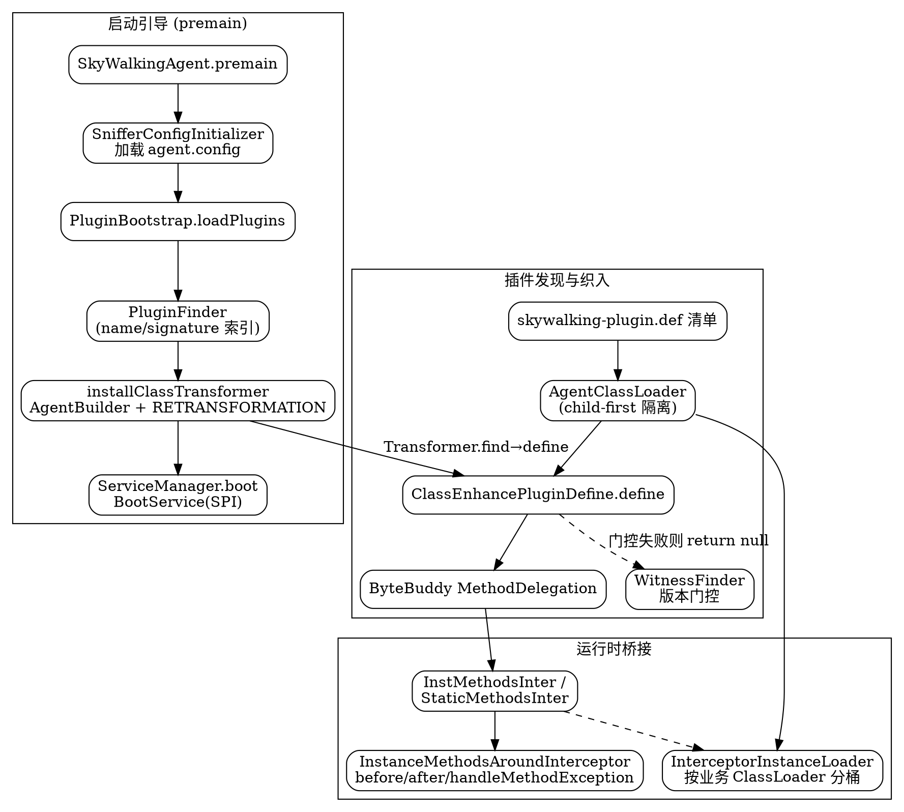

## Introduction

SkyWalking Java Agent（探针）是"埋点"的底座：它随应用 JVM 以 `-javaagent` 方式挂载，在启动期用 ByteBuddy 完成字节码织入，把创建 span 的逻辑插进目标类的方法前后。本文聚焦**启动引导**与**插件机制**：Agent 如何用 `premain` 串起配置加载、插件发现、字节码 transform 与核心服务启动；插件如何声明要增强的类与方法；以及隔离类加载与版本门控如何保证织入既不过度也不出错。

> 版本基线：源码仓库 `E:/Projects/skywalking-java`，HEAD `6840d74`，见 [SkyWalking](/docs/CS/SE/SkyWalking/SkyWalking.md)。Agent 侧运行时 span 模型与 Context 传播不在本文范围，见 Agent 侧 ContextManager/Span 模型、Context 传播相关笔记。

理解 Agent 插件机制有三个反直觉的关键点：

1. **织入靠 ByteBuddy + 自定义 `AgentBuilder`，不是手写 ASM**。所有增强逻辑都落在一个 `ClassEnhancePluginDefine` 里，通过 `MethodDelegation` 把字节码调用桥接到插件拦截器的 `beforeMethod/afterMethod/handleMethodException`。
2. **插件靠 `skywalking-plugin.def` 清单 + Java SPI 式发现**，而非 Spring 之类的 DI。每个插件 jar 在 `resources/skywalking-plugin.def` 写一行 `pluginName=PluginDefine全限定名`。
3. **插件类与拦截器由专属的 `AgentClassLoader` 以 child-first 加载**，与业务应用的 classpath 完全隔离，从根上避免依赖冲突（如插件依赖的 ByteBuddy 版本与业务冲突）。

## 启动引导全流程（premain）

Agent 的入口是 `SkyWalkingAgent.premain`，它由 JVM 的 `-javaagent` 机制在应用 `main` 之前调用。整条流水线严格分四步：

```java
// SkyWalkingAgent.java:75 —— premain 入口
public static void premain(String agentArgs, Instrumentation instrumentation) throws PluginException {
    // 1. 加载 agent.config（核心配置 + 插件可扩展配置）
    SnifferConfigInitializer.initializeCoreConfig(agentArgs);          // :78
    if (!Config.Agent.ENABLE) {                                        // :89
        LOGGER.warn("SkyWalking agent is disabled."); return;
    }
    // 2. 发现并加载所有插件 Define
    pluginFinder = new PluginFinder(new PluginBootstrap().loadPlugins());// :95
    // 3. 安装 ByteBuddy 字节码 transform
    installClassTransformer(instrumentation, pluginFinder);            // :105
    // 4. 启动核心 BootService（与插件体系并列的另一套）
    ServiceManager.INSTANCE.boot();                                    // :111
    // 注册关闭钩子，保证服务优雅下线
    Runtime.getRuntime().addShutdownHook(
        new Thread(ServiceManager.INSTANCE::shutdown, ...));           // :116-117
}
```

`installClassTransformer` 用定制的 `AgentBuilder` 完成织入：先 `.ignore(...)` 排除 ByteBuddy/Slf4J/Javassist/ASM 等自身与基础设施类（`SkyWalkingAgent.java:123-133`），再对 `pluginFinder.buildMatch()` 命中的类型调用 `Transformer` 做 `transform`，并开启 `RETRANSFORMATION` 策略允许已加载类被重新定义（`SkyWalkingAgent.java:148-155`）。

```java
// SkyWalkingAgent.java:148 —— 只对插件声明的类做 transform
agentBuilder.type(pluginFinder.buildMatch())
            .transform(new Transformer(pluginFinder))                  // :149
            .with(AgentBuilder.RedefinitionStrategy.RETRANSFORMATION)  // :150
            .with(new RedefinitionListener())
            .with(new Listener())
            .installOn(instrumentation);                               // :153
PluginFinder.pluginInitCompleted();                                   // :155
```

`Transformer.transform` 是 ByteBuddy 回调：对每个匹配类型，先 `pluginFinder.find(typeDescription)` 取出所有要增强它的插件，再逐个调用 `define(...)` 织入（`SkyWalkingAgent.java:182-209`）。注意这里把"是否增强过"记在 `EnhanceContext` 上，避免对同一类型重复织入。

## 插件发现与插件清单（skywalking-plugin.def + SPI）

插件发现由 `PluginBootstrap.loadPlugins` 完成，核心是**扫描所有插件 jar 里的 `skywalking-plugin.def` 清单，再用 `AgentClassLoader` 实例化 Define 类**：

```java
// PluginBootstrap.java:50 —— 加载全部插件
public List<AbstractClassEnhancePluginDefine> loadPlugins() throws AgentPackageNotFoundException {
    AgentClassLoader.initDefaultLoader();                              // :51 建隔离类加载器
    PluginResourcesResolver resolver = new PluginResourcesResolver();
    List<URL> resources = resolver.getResources();                     // :54 扫描所有 skywalking-plugin.def
    for (URL pluginUrl : resources) {
        PluginCfg.INSTANCE.load(pluginUrl.openStream());               // :63 解析清单行
    }
    List<PluginDefine> pluginClassList = PluginCfg.INSTANCE.getPluginClassList(); // :69
    for (PluginDefine pluginDefine : pluginClassList) {
        // 用隔离类加载器实例化 Define 类（SPI 式：类名 → newInstance）
        AbstractClassEnhancePluginDefine plugin =
            (AbstractClassEnhancePluginDefine) Class.forName(
                pluginDefine.getDefineClass(), true,
                AgentClassLoader.getDefault()).newInstance();          // :75-76
        plugin.setPluginName(pluginDefine.getName());                  // :77
        plugins.add(plugin);
    }
    plugins.addAll(DynamicPluginLoader.INSTANCE.load(AgentClassLoader.getDefault())); // :84 动态插件
    return plugins;
}
```

清单格式就是 `name=全限定Define类`，逐行解析（`PluginDefine.build` 用 `split("=")` 拆成 name 与 class，`PluginDefine.java:40-52`），空行与 `#` 注释被跳过（`PluginCfg.java:46`）。`PluginSelector` 还会按 `Config.Plugin.EXCLUDE_PLUGINS` 过滤掉用户想禁用的插件（`PluginSelector.java:39-47`）。

`PluginResourcesResolver` 直接借 `AgentClassLoader.getDefault().getResources("skywalking-plugin.def")` 一次性拿到所有插件 jar 内同名资源（`PluginResourcesResolver.java:40`）——这正是 `skywalking-plugin.def` 作为"资源名约定"而非"类名约定"的关键：每个插件 jar 各放一份同名文件，Java 资源机制天然合并。

动态插件 `DynamicPluginLoader` 则走另一条 SPI：`ServiceLoader.load(InstrumentationLoader.class, classLoader)`，允许通过 `InstrumentationLoader` 接口在运行时注入额外插件 Define（`DynamicPluginLoader.java:36-45`）。

一个真实清单示例（dubbo 插件）：

```text
# apm-sdk-plugin/dubbo-2.7.x-plugin/src/main/resources/skywalking-plugin.def
dubbo-2.7.x=org.apache.skywalking.apm.plugin.asf.dubbo.DubboInstrumentation
dubbo-threadpool-2.7.x=org.apache.skywalking.apm.plugin.asf.dubbo.AbstractServerInstrumentation
```

其 `DubboInstrumentation` 继承 `ClassInstanceMethodsEnhancePluginDefine`，实现 `enhanceClass()` 返回 `NameMatch.byName("org.apache.dubbo.monitor.support.MonitorFilter")`，并声明拦截 `invoke` 方法、指定拦截器 `DubboInterceptor`，还用 `witnessMethods()` 做版本门控（见下文）。

## PluginFinder 索引与匹配分派

`PluginFinder` 把一长串插件 Define 建成两类索引，做到"给一个类，秒级反查该增强它的全部插件"：

```java
// PluginFinder.java:43-45 —— 两类索引
private final Map<String, LinkedList<AbstractClassEnhancePluginDefine>> nameMatchDefine;   // 按类名精确索引
private final List<AbstractClassEnhancePluginDefine> signatureMatchDefine;                  // 按签名/结构间接匹配
private final List<AbstractClassEnhancePluginDefine> bootstrapClassMatchDefine;             // 需注入 bootstrap 的插件
```

构造时遍历插件：若 `enhanceClass()` 是 `NameMatch`（精确类名），就按类名塞进 `nameMatchDefine`；否则归入 `signatureMatchDefine`（结构匹配，如继承关系、注解、多类名，`PluginFinder.java:56-66`）。查询时先查精确表，再遍历"间接匹配"表逐个 `isMatch`（`PluginFinder.java:74-89`）。

`buildMatch()` 为 ByteBuddy 提供整个 Agent 的"该不该织入这个类"的总判定：精确匹配用 `AbstractJunction` 命中 `nameMatchDefine` 的 key，间接匹配把每个 `IndirectMatch.buildJunction()` 用 `or` 拼起来，最后统一 `not(isInterface())` 排除纯接口（`PluginFinder.java:91-107`）。这正是 Agent 不为接口织入的原因。

## 字节码织入：AbstractClassEnhancePluginDefine.define

织入的总入口是 `AbstractClassEnhancePluginDefine.define`。它先跑版本门控（见 Witness 一节），门控通过后才进入 `enhance`：

```java
// AbstractClassEnhancePluginDefine.java:72 —— define 是织入总闸
public DynamicType.Builder<?> define(TypeDescription typeDescription, DynamicType.Builder<?> builder,
    ClassLoader classLoader, EnhanceContext context) throws PluginException {
    WitnessFinder finder = WitnessFinder.INSTANCE;
    String[] witnessClasses = witnessClasses();                       // :86 版本门控（类级）
    if (witnessClasses != null) {
        for (String witnessClass : witnessClasses) {
            if (!finder.exist(witnessClass, classLoader)) {            // :89 缺失则整插件跳过
                LOGGER.warn("... Witness class {} does not exist.", ...); return null;
            }
        }
    }
    List<WitnessMethod> witnessMethods = witnessMethods();             // :95 版本门控（方法级）
    if (!CollectionUtil.isEmpty(witnessMethods)) {
        for (WitnessMethod witnessMethod : witnessMethods) {
            if (!finder.exist(witnessMethod, classLoader)) { return null; } // :98
        }
    }
    DynamicType.Builder<?> newClassBuilder = this.enhance(typeDescription, builder, classLoader, context); // :108
    context.initializationStageCompleted();                           // :110
    return newClassBuilder;
}
```

`enhance` 拆分为 `enhanceClass`（静态方法）与 `enhanceInstance`（构造器 + 实例方法）两步（`AbstractClassEnhancePluginDefine.java:123-130`）。具体逻辑在 `ClassEnhancePluginDefine`（继承抽象类）里：

- **实例方法 / 构造器织入**：`enhanceInstance` 先给目标类加一个 `Object` 字段 `_$EnhancedClassField_ws` 并 `implement EnhancedInstance`，附带 `getSkyWalkingDynamicField/setSkyWalkingDynamicField` 存取器，用于在实例上暂存上下文（`ClassEnhancePluginDefine.java:101-112`）。
- **构造器**：`newClassBuilder.constructor(matcher).intercept(SuperMethodCall.INSTANCE.andThen(MethodDelegation.to(new ConstructorInter(...))))`——先调原构造逻辑，再委托给拦截器（`ClassEnhancePluginDefine.java:124-133`）。
- **实例方法**：`junction = not(isStatic()).and(getMethodsMatcher())`；若是 `DeclaredInstanceMethodsInterceptPoint` 再加 `isDeclaredBy(typeDescription)` 仅限本类声明的方法，避免把父类方法也织入（`ClassEnhancePluginDefine.java:146-160`）。
- **静态方法**：`enhanceClass` 里 `isStatic().and(getMethodsMatcher())` 直接 `MethodDelegation.to(new StaticMethodsInter(...))`（`ClassEnhancePluginDefine.java:204-222`）。

若 `isBootstrapInstrumentation()` 为真（目标类在 bootstrap 类加载器里、无法注入普通拦截器），则改用 `BootstrapInstrumentBoost.forInternalDelegateClass(...)` 的特殊委托（`ClassEnhancePluginDefine.java:123-127,163-166`）。

三种织入点由抽象方法 `getConstructorsInterceptPoints()` / `getInstanceMethodsInterceptPoints()` / `getStaticMethodsInterceptPoints()` 提供（`AbstractClassEnhancePluginDefine.java:185,192,206`），插件只需返回拦截点数组即可声明"要增强哪些方法"。

## 拦截器桥接：ByteBuddy MethodDelegation → before/after/handle

`MethodDelegation.to(...)` 把字节码方法调用桥接到 SkyWalking 自己的"拦截器委托类"，再由委托类调用插件写的 `InstanceMethodsAroundInterceptor`。以实例方法为例：

```java
// ClassEnhancePluginDefine.java:168-170 —— 把织入桥接到 InstMethodsInter
newClassBuilder.method(junction)
    .intercept(MethodDelegation.withDefaultConfiguration()
        .to(new InstMethodsInter(getPluginName(), interceptor, classLoader),
            delegateNamingResolver.resolve(instanceMethodsInterceptPoint)));
```

`InstMethodsInter` 是 ByteBuddy 侧的真正拦截器：它在构造时用 `InterceptorInstanceLoader.load(interceptor, classLoader)` 把插件的 `InstanceMethodsAroundInterceptor` 按名字加载出来（`InstMethodsInter.java:54-61`），然后在 `intercept` 里用 `@This/@AllArguments/@SuperCall/@Origin` 注解拿到目标对象、参数、原调用与 Method，按固定顺序串起三段逻辑（`InstMethodsInter.java:74-120`）：

```java
interceptor.beforeMethod(targetObject, method, allArguments, types, result);  // :83 方法前
ret = zuper.call();                                                          // :95 原方法（可被 result 短路）
interceptor.handleMethodException(...);                                      // :100 异常时
ret = interceptor.afterMethod(...);                                          // :110 方法后（可改返回值）
```

这三段正是所有插件"创建/结束 span"的落点。注意拦截器实例**只以 `String` 形式保存在委托类里**，真正加载发生在运行时——这是隔离类加载能成立的先决条件（见下节）。`InstMethodsInterWithOverrideArgs` 与之几乎一致，只是用 `@Morph OverrideCallable` 把修改后的参数传回原调用（`InstMethodsInterWithOverrideArgs.java:73-95`）。

## 隔离类加载：AgentClassLoader 与 InterceptorInstanceLoader

`AgentClassLoader` 是整套隔离机制的基石：它**不委派给业务类加载器去加载插件类**，而是 child-first 直接从插件 jar 里读 `.class` 与资源，从而让插件依赖（如另一份 ByteBuddy/Guava）与业务 classpath 互不污染。

```java
// AgentClassLoader.java:47 —— 继承 ClassLoader（非 URLClassLoader 体系）
public class AgentClassLoader extends ClassLoader {
    static { registerAsParallelCapable(); }                 // :49 缓解类加载死锁（PR #2016）
    private static AgentClassLoader DEFAULT_LOADER;           // :60 全局单例
    public static void initDefaultLoader() throws AgentPackageNotFoundException {
        if (DEFAULT_LOADER == null) {
            DEFAULT_LOADER = new AgentClassLoader(
                PluginBootstrap.class.getClassLoader());      // :79 父加载器 = agent 自身加载器
        }
    }
    // 构造时把 agent 包下的 plugins / activations 目录当作 classpath
    public AgentClassLoader(ClassLoader parent) throws AgentPackageNotFoundException {
        super(parent);
        File agentDictionary = AgentPackagePath.getPath();    // :87 定位 agent.jar 所在目录
        Config.Plugin.MOUNT.forEach(m -> classpath.add(new File(agentDictionary, m))); // :89
    }
}
```

关键在 `findClass`：它遍历所有插件 jar，按 `name → path.class` 找 `JarEntry`，读出字节后用 `defineClass` 直接定义（`AgentClassLoader.java:92-118`）。由于**没有重写 `loadClass` 走双亲委派**，插件类优先从插件 jar 解析，实现 child-first。`AgentPackagePath.getPath()` 通过"beacon class 资源 URL 反推 agent.jar 位置"来定位插件目录（`AgentPackagePath.java:49-82`）；`doGetJars` 扫描 `classpath` 目录下所有 `.jar`（`AgentClassLoader.java:187-205`）。此外 `processLoadedClass` 会在插件类带 `@PluginConfig` 注解时触发该插件的配置初始化（`AgentClassLoader.java:160-170`）——这也是插件配置如何接入 `agent.config` 的入口。

`InterceptorInstanceLoader` 则解决**"插件拦截器要感知业务类加载器"**的问题：同一个拦截器，针对不同业务 `ClassLoader` 应是不同实例（因为拦截器可能引用业务类）。它为每个 `targetClassLoader` 建一个**以它为父**的 `AgentClassLoader` 扩展加载器，并按 `className + targetClassLoader` 做单例缓存：

```java
// InterceptorInstanceLoader.java:50 —— 按业务类加载器隔离地实例化拦截器
public static <T> T load(String className, ClassLoader targetClassLoader) throws ... {
    if (targetClassLoader == null) targetClassLoader = InterceptorInstanceLoader.class.getClassLoader(); // :52
    String instanceKey = className + "_OF_" + targetClassLoader.getClass().getName()
        + "@" + Integer.toHexString(targetClassLoader.hashCode());        // :55 按类加载器分桶
    Object inst = INSTANCE_CACHE.get(instanceKey);
    if (inst == null) {
        ClassLoader pluginLoader = EXTEND_PLUGIN_CLASSLOADERS.get(targetClassLoader);
        if (pluginLoader == null) {
            pluginLoader = new AgentClassLoader(targetClassLoader);       // :65 以业务加载器为父
            EXTEND_PLUGIN_CLASSLOADERS.put(targetClassLoader, pluginLoader);
        }
        inst = Class.forName(className, true, pluginLoader).newInstance(); // :71
        INSTANCE_CACHE.put(instanceKey, inst);                            // :73
    }
    return (T) inst;
}
```

这样拦截器既能由 `AgentClassLoader` 加载（拿到插件依赖），又能通过父加载器看到业务类型，且每个业务上下文一份实例，互不串扰。

## 版本门控：WitnessClass / WitnessMethod

同一个目标库的不同版本常"同名类、不同方法签名"。插件若盲目织入，会在缺方法/字段的版本上抛 `NoSuchMethodError`。SkyWalking 用 **Witness（见证人）** 解决：插件声明"只有目标库里存在某个类/方法时我才激活"，校验失败则整插件跳过（`AbstractClassEnhancePluginDefine.java:86-103`）。

```java
// WitnessFinder.java:39 —— 按给定类加载器判定 witness 是否存在
public boolean exist(String witnessClass, ClassLoader classLoader) {
    return getResolution(witnessClass, classLoader).isResolved();        // :40-41
}
private TypePool.Resolution getResolution(String witnessClass, ClassLoader classLoader) {
    ClassLoader mappingKey = classLoader == null ? NullClassLoader.INSTANCE : classLoader;
    // 每个类加载器缓存一份 TypePool（不真正加载类，仅描述类型）
    TypePool typePool = classLoader == null ? TypePool.Default.ofBootLoader()
                                            : TypePool.Default.of(classLoader); // :55
    return typePool.describe(witnessClass);                              // :61 只描述，不加载
}
```

`exist(WitnessMethod, ...)` 进一步在已解析的类上过滤"是否存在满足 matcher 的声明方法"（`WitnessFinder.java:68-77`）。`WitnessMethod` 把"声明类 + 方法 matcher"打包，并强制排除 synthetic 方法（`WitnessMethod.java:34-50`）。注意它用 `TypePool` **仅描述类型、不实际加载类**，因此对应用零侵入。

Dubbo 插件即典型用例——它要求目标库存在 `org.apache.dubbo.rpc.RpcContext.getServerContext()` 且返回 `RpcContext`，否则不织入 `MonitorFilter`：

```java
// DubboInstrumentation.java —— 版本门控示例
@Override
protected List<WitnessMethod> witnessMethods() {
    return Collections.singletonList(new WitnessMethod(
        "org.apache.dubbo.rpc.RpcContext",                 // 声明类
        named("getServerContext").and(returns(named("org.apache.dubbo.rpc.RpcContext")))));
}
```

## BootService 体系（与插件体系对比）

除插件体系外，Agent 还有一套**核心服务** `BootService`，负责 GRPC 通道、数据上报、JVM 指标采集等"与埋点并列"的运行时能力。它同样基于 Java SPI（`ServiceLoader`），但与插件发现完全独立：

```java
// ServiceManager.java:36 —— 基于 ServiceLoader 加载所有 BootService 实现
public enum ServiceManager {
    private Map<Class, BootService> bootedServices = Collections.emptyMap(); // :40
    public void boot() {
        bootedServices = loadAllServices();                  // :45 扫描 SPI
        prepare(); startup(); onComplete();                  // :47-49 三阶段启动
    }
    void load(List<BootService> allServices) {
        for (final BootService s : ServiceLoader.load(BootService.class, AgentClassLoader.getDefault()))
            allServices.add(s);                              // :148 用隔离类加载器扫 SPI
    }
}
```

`loadAllServices` 用 `@DefaultImplementor` / `@OverrideImplementor` 处理"默认实现 vs 覆盖实现"：默认实现只能有一条；带 `@OverrideImplementor(X)` 的实现会替换掉 X 的默认实现，若存在多个覆盖或覆盖非默认实现则抛 `ServiceConflictException`（`ServiceManager.java:68-99`）。启动严格分 `prepare → boot → onComplete` 三阶段，且按 `priority()` 排序——高优先级先启动、后关闭（`ServiceManager.java:105-134`，`BootService.java:25-42`）。

**与插件体系的关键区别**：`BootService` 是 Agent 自身的固定基础设施，数量少、由 `ServiceManager` 统一启动并通过 `findService(Class)` 按类型取出；插件则是"增强业务类的织入规则"，由 `PluginFinder` 索引、ByteBuddy 在类加载时按匹配触发，二者启动时机也不同——`premain` 先装 transform（`SkyWalkingAgent.java:105`），再 `ServiceManager.INSTANCE.boot()`（`:111`）。

## 插件类匹配策略

插件通过 `enhanceClass()` 返回的 `ClassMatch` 声明"要增强哪些类"，分为精确匹配与间接匹配两类：

```java
// ClassMatch.java:21 —— 顶层空接口
public interface ClassMatch {}

// IndirectMatch.java:27 —— 无法像 NameMatch 那样直接比名字，需结构判定
public interface IndirectMatch extends ClassMatch {
    ElementMatcher.Junction buildJunction();   // 供 ByteBuddy 总匹配用
    boolean isMatch(TypeDescription typeDescription); // 供 PluginFinder.find 逐个判定
}
```

各策略适用场景：

- **`NameMatch`**（`NameMatch.java:24-37`）：精确全限定类名，性能最好，走 `nameMatchDefine` 直接查表。适用于目标类名稳定、无继承关系的类（如 dubbo 的 `MonitorFilter`）。
- **`HierarchyMatch`**（`HierarchyMatch.java:37-101`）：按父类/接口匹配（`hasSuperType(named(...))`），`buildJunction` 排除接口。适用于"某接口/抽象类的所有实现都要织入"（如所有 `javax.servlet.Filter` 实现）。`isMatch` 递归遍历继承树（`HierarchyMatch.java:66-97`）。
- **`ClassAnnotationMatch`**（`ClassAnnotationMatch.java:37-78`）：按类上的注解匹配（`isAnnotatedWith(named(...))`），同样排除接口。适用于"带某框架注解的类"（如 Spring `@Controller`）。
- **`MultiClassNameMatch`**（`MultiClassNameMatch.java:31-63`）：一组类名用 `named(name).or(...)` 拼成匹配，适合"同一插件要增强若干个不相关的具体类"。
- **`DeclaredInstanceMethodsInterceptPoint`** 虽然属于拦截点而非匹配策略，但与匹配相关：它让实例方法织入**仅限本类声明的方法**（`DeclaredInstanceMethodsInterceptPoint.java:25`），避免 `HierarchyMatch` 命中父类后把父类方法也一并织入引发意外。

## 设计取舍

- **为何用 ByteBuddy 而非手写 ASM**：ASM 直接操作字节码要求作者精确理解 JVM 指令与栈帧，易错且难维护；ByteBuddy 用 `MethodDelegation`、`SuperMethodCall` 等声明式 API 描述"方法前后插入什么"，并把类型安全、参数绑定（`@This/@AllArguments/@SuperCall`）、命名策略等都封装好。Agent 还在其上定制了 `SWAgentBuilderDefault`、`SWMethodNameTransformer`、`SWImplementationContextFactory` 等，统一解决辅助类命名、native 方法、JDK9 模块 `open/read` 边缘等问题（`SkyWalkingAgent.java:160-173`）。
- **为何插件用 `skywalking-plugin.def` 清单 + SPI 式发现**：清单作为"资源名约定"可被 `ClassLoader.getResources` 天然合并（每个 jar 一份同名文件），比"扫描包下所有类"廉价得多；Define 类再通过类名反射实例化，既解耦又便于 `PluginSelector` 按配置排除。
- **隔离类加载的代价与收益**：收益是彻底隔离插件依赖、避免与应用 classpath 冲突，且能按业务 `ClassLoader` 分桶实例化拦截器；代价是每个插件/拦截器都经 `AgentClassLoader` 解析，多一层类加载器层级，需要小心处理父委派（如 `InterceptorInstanceLoader` 以业务加载器为父）与死锁（`registerAsParallelCapable`，`AgentClassLoader.java:49`），并在 bootstrap 类场景改用特殊委托。

## Architecture



## Links

- /docs/CS/SE/SkyWalking/SkyWalking.md
- /docs/CS/SE/SkyWalking/Module_System.md
- /docs/CS/SE/SkyWalking/Receiver_Protocol.md
- /docs/CS/SE/SkyWalking/Agent_Context_Span.md
- /docs/CS/SE/SkyWalking/Agent_Context_Propagation.md
- /docs/CS/SE/SkyWalking/Agent_Plugin_Interceptor.md
- /docs/CS/SE/SkyWalking/Agent_Telemetry_Config.md
- /docs/CS/SE/APM.md
- /docs/CS/Distributed/Tracing/Tracing.md

## References

- https://github.com/apache/skywalking-java/blob/6840d74/apm-sniffer/apm-agent/src/main/java/org/apache/skywalking/apm/agent/SkyWalkingAgent.java
- https://github.com/apache/skywalking-java/blob/6840d74/apm-sniffer/apm-agent-core/src/main/java/org/apache/skywalking/apm/agent/core/plugin/PluginBootstrap.java
- https://github.com/apache/skywalking-java/blob/6840d74/apm-sniffer/apm-agent-core/src/main/java/org/apache/skywalking/apm/agent/core/plugin/PluginFinder.java
- https://github.com/apache/skywalking-java/blob/6840d74/apm-sniffer/apm-agent-core/src/main/java/org/apache/skywalking/apm/agent/core/plugin/AbstractClassEnhancePluginDefine.java
- https://github.com/apache/skywalking-java/blob/6840d74/apm-sniffer/apm-agent-core/src/main/java/org/apache/skywalking/apm/agent/core/plugin/interceptor/enhance/ClassEnhancePluginDefine.java
- https://github.com/apache/skywalking-java/blob/6840d74/apm-sniffer/apm-agent-core/src/main/java/org/apache/skywalking/apm/agent/core/plugin/loader/AgentClassLoader.java
- https://github.com/apache/skywalking-java/blob/6840d74/apm-sniffer/apm-agent-core/src/main/java/org/apache/skywalking/apm/agent/core/plugin/loader/InterceptorInstanceLoader.java
- https://github.com/apache/skywalking-java/blob/6840d74/apm-sniffer/apm-agent-core/src/main/java/org/apache/skywalking/apm/agent/core/plugin/WitnessFinder.java
- https://github.com/apache/skywalking-java/blob/6840d74/apm-sniffer/apm-agent-core/src/main/java/org/apache/skywalking/apm/agent/core/boot/ServiceManager.java
- https://github.com/apache/skywalking-java/blob/6840d74/apm-sniffer/apm-agent-core/src/main/java/org/apache/skywalking/apm/agent/core/plugin/match/NameMatch.java
