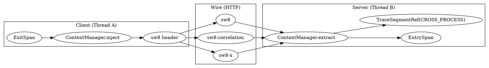
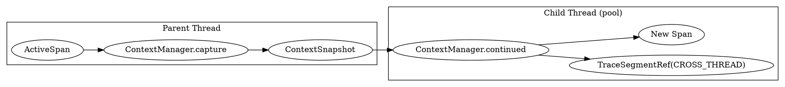

## Introduction

分布式追踪之所以能把一次请求在多个服务、多个线程里"串成一条线"，依赖的不是魔法，而是**上下文传播（Context Propagation）**：一端把链路上下文序列化进传输载体，另一端再反序列化恢复，从而建立父子引用关系。Apache SkyWalking Java Agent 用两类载体分别解决两类场景——`ContextCarrier` 解决**跨进程**（如 HTTP 调用）传播，`ContextSnapshot` 解决**跨线程**（如线程池异步任务）传播。本笔记以仓库 HEAD `6840d74` 的源码为准，逐文件核实 SW8 头格式、`inject/extract`、`capture/continued/asyncFinish` 的真实实现，并明确指出当前版本跨线程机制**不是**早期那种仅靠 `RunnableWrapper`/`CallableWrapper` 的隐式包裹，而是以 `ContextManager.capture()` + `ContextSnapshot` + `continued()` 为核心，Wrapper 只是其上层工具封装。

> 版本基线：源码仓库 `E:/Projects/skywalking-java`，HEAD `6840d74`，见 [SkyWalking](/docs/CS/SE/SkyWalking/SkyWalking.md)。

## 两类载体与总体模型

SkyWalking 的上下文实体是 `TraceSegment`（一个线程一个 segment，内含一串按栈结构组织的 span）。跨进程时两个 segment 分属不同进程，跨线程时两个 segment 仍分属不同线程（但往往共享同一个 `traceId`）。`TracingContext` 用 `ThreadLocal` 维护当前线程的上下文（见 [ContextManager.java:45] 的 `CONTEXT`），所以上下文变量**不会**随 `Runnable` 自动迁移到另一个线程——这正是必须显式 `capture/continued` 的根本原因。

- **跨进程**：`ContextCarrier` 把"父 segment 的指纹"写进协议头（如 HTTP `sw8` 头），对端 `extract` 后生成 `TraceSegmentRef`，类型是 `CROSS_PROCESS`。
- **跨线程**：`ContextSnapshot` 把当前活跃 span 的"指针"打包，新线程 `continued` 后生成 `TraceSegmentRef`，类型是 `CROSS_THREAD`。

## 跨进程传播：ContextCarrier 与 SW8 头格式

`ContextCarrier` 持有父 segment 的若干字段，并通过一组 `CarrierItem` 链式串联成多个协议头（[ContextCarrier.java:36-71]）。

```java
// ContextCarrier.java:36-71 —— 跨进程载体携带的字段
@Getter private String traceId;                 // 全局 trace id
@Getter private String traceSegmentId;          // 父 segment id
@Getter private int spanId = -1;                // 父 segment 中的 span id
@Getter private String parentService;           // 父服务名
@Getter private String parentServiceInstance;   // 父服务实例名
@Getter private String parentEndpoint;          // 父入口 endpoint
@Getter private String addressUsedAtClient;     // 客户端访问本服务用的网络地址
@Getter(AccessLevel.PACKAGE) private ExtensionContext extensionContext = new ExtensionContext();
@Getter(AccessLevel.PACKAGE) private CorrelationContext correlationContext = new CorrelationContext();
```

载体不是单一字符串，而是由三个 `CarrierItem` 组成的链（[ContextCarrier.java:76-82]）。`items()` 的构造顺序决定了遍历顺序：`SW8CarrierItem` → `SW8CorrelationCarrierItem` → `SW8ExtensionCarrierItem`，它们分别落到三个 HTTP 头。

```java
// ContextCarrier.java:76-82 —— 三个 header 串成一条 CarrierItem 链
public CarrierItem items() {
    SW8ExtensionCarrierItem sw8ExtensionCarrierItem = new SW8ExtensionCarrierItem(extensionContext, null);
    SW8CorrelationCarrierItem sw8CorrelationCarrierItem = new SW8CorrelationCarrierItem(
        correlationContext, sw8ExtensionCarrierItem);
    SW8CarrierItem sw8CarrierItem = new SW8CarrierItem(this, sw8CorrelationCarrierItem);
    return new CarrierItemHead(sw8CarrierItem);
}
```

三个头的名字与编码规则如下：

| Header | 常量 | 内容 |
| :--- | :--- | :--- |
| `sw8` | `SW8CarrierItem.HEADER_NAME` ([SW8CarrierItem.java:22]) | 主上下文，8 段 `-` 分隔，核心字段 base64 |
| `sw8-correlation` | `SW8CorrelationCarrierItem.HEADER_NAME` ([SW8CorrelationCarrierItem.java:21]) | 业务 KV 关联上下文（base64 `key:value` 逗号分隔） |
| `sw8-x` | `SW8ExtensionCarrierItem.HEADER_NAME` ([SW8ExtensionCarrierItem.java:22]) | 扩展上下文（追踪模式等） |

**`sw8` 头的编码**（`serialize`，[ContextCarrier.java:114-129]）：以 `-` 连接，共 8 段，第 0 段固定为版本标志 `1`，后续 7 个字段中除了 `spanId` 是十进制整数外，其余（`traceId`、`traceSegmentId`、`parentService`、`parentServiceInstance`、`parentEndpoint`、`addressUsedAtClient`）一律做 **base64 编码**。

```java
// ContextCarrier.java:114-129 —— sw8 头 = "1-" + base64(traceId) + "-" + base64(segmentId)
//   + "-" + spanId + "-" + base64(parentService) + "-" + base64(parentInstance)
//   + "-" + base64(parentEndpoint) + "-" + base64(addressUsedAtClient)
String serialize(HeaderVersion version) {
    if (this.isValid(version)) {
        return StringUtil.join(
            '-', "1",
            Base64.encode(this.getTraceId()),
            Base64.encode(this.getTraceSegmentId()),
            this.getSpanId() + "",
            Base64.encode(this.getParentService()),
            Base64.encode(this.getParentServiceInstance()),
            Base64.encode(this.getParentEndpoint()),
            Base64.encode(this.getAddressUsedAtClient()));
    }
    return "";
}
```

因此线上真实报文形如 `sw8: 1-<b64trace>-<b64seg>-0-<b64svc>-<b64inst>-<b64ep>-<b64peer>`。反方向 `deserialize`（[ContextCarrier.java:136-158]）用 `split("-", 8)` 还原（注意 `limit=8` 保证末尾含 base64 的段不被继续切分），并把段 `[1..7]` 逐一 `Base64.decode2UTFString`。这里第 0 段（"1"）是采样标志——官方注释说明"只要 header 存在就视为采样"（[ContextCarrier.java:144]）。

`isValid`（[ContextCarrier.java:169-180]）要求 v3 下上述 7 个字段全部非空且 `spanId > -1`，否则该 carrier 视为无效、不参与传播。

## ContextManager.inject / extract 流程

`ContextManager` 是插件调用的门面，它把调用委托给当前线程的 `AbstractTracerContext`（默认实现 `TracingContext`）。

**ExitSpan 注入（客户端）**：`createExitSpan(operationName, carrier, remotePeer)` 内部先建 ExitSpan，再自动调 `inject` 把当前上下文填进 carrier（[ContextManager.java:129-138]）。

```java
// ContextManager.java:129-138 —— 创建 ExitSpan 并立即注入 carrier
public static AbstractSpan createExitSpan(String operationName, ContextCarrier carrier, String remotePeer) {
    if (carrier == null) { throw new IllegalArgumentException("ContextCarrier can't be null."); }
    AbstractTracerContext context = getOrCreate(operationName, false);
    AbstractSpan span = context.createExitSpan(operationName, remotePeer);
    context.inject(carrier);   // 关键：把当前上下文写入 carrier
    return span;
}
```

`TracingContext.inject` 真正填充字段，并强制"当前活跃 span 必须是 ExitSpan 且含 peer"（[TracingContext.java:148-183]）。它把 traceId、segmentId、当前活跃 spanId、服务名、实例名、入口 endpoint、客户端所用网络地址写进 carrier，最后再 `correlationContext.inject` / `extensionContext.inject` 把关联与扩展上下文一并写入。

```java
// TracingContext.java:173-182 —— inject 由当前 ExitSpan 填充 carrier
carrier.setTraceId(getReadablePrimaryTraceId());
carrier.setTraceSegmentId(this.segment.getTraceSegmentId());
carrier.setSpanId(exitSpan.getSpanId());
carrier.setParentService(Config.Agent.SERVICE_NAME);
carrier.setParentServiceInstance(Config.Agent.INSTANCE_NAME);
carrier.setParentEndpoint(primaryEndpoint.getName());
carrier.setAddressUsedAtClient(peer);
this.correlationContext.inject(carrier);
this.extensionContext.inject(carrier);
```

插件随后遍历 `carrier.items()`，把每个 `CarrierItem` 的 `headKey/headValue` 写进真实请求头。HTTP 客户端插件 `HttpClientExecuteInterceptor` 即如此（[HttpClientExecuteInterceptor.java:76,85-89]）：

```java
// HttpClientExecuteInterceptor.java:76,85-89 —— 建 ExitSpan + 把 carrier 写入 HTTP header
AbstractSpan span = ContextManager.createExitSpan(operationName, contextCarrier, remotePeer);
...
CarrierItem next = contextCarrier.items();
while (next.hasNext()) {
    next = next.next();
    httpRequest.setHeader(next.getHeadKey(), next.getHeadValue());  // 写入 sw8 / sw8-correlation / sw8-x
}
```

`OkHttp 2.x` 插件则显式调用 `ContextManager.inject(contextCarrier)` 后写头（[RealCallInterceptor.java:79-94]），本质一致。

**EntrySpan 提取（服务端）**：`createEntrySpan(operationName, carrier)` 在 carrier 有效时会强制采样并 `extract`（[ContextManager.java:106-121]）。`TracingContext.extract` 用 carrier 构造 `TraceSegmentRef(CROSS_PROCESS)`，把它同时挂在 segment 与当前 EntrySpan 上，并把父 `traceId` 关联为本次全局 trace（[TracingContext.java:190-202]）。

```java
// TracingContext.java:190-202 —— extract：用 carrier 建跨进程引用并挂到 segment/entrySpan
public void extract(ContextCarrier carrier) {
    TraceSegmentRef ref = new TraceSegmentRef(carrier);
    this.segment.ref(ref);
    this.segment.relatedGlobalTrace(new PropagatedTraceId(carrier.getTraceId()));
    AbstractSpan span = this.activeSpan();
    if (span instanceof EntrySpan) { span.ref(ref); }
    carrier.extractExtensionTo(this);
    carrier.extractCorrelationTo(this);
}
```

服务端插件示例：`Armeria085ServerInterceptor` 在收到请求时直接 `ContextManager.createEntrySpan(path, carrier)`（[Armeria085ServerInterceptor.java:51]），由门面自动完成 `extract`；消息队列类插件（如 `RocketMQ`、`Kafka`、`RabbitMQ`）则常显式 `ContextManager.extract(contextCarrier)` 从消息属性还原上下文。

`ContextManager.extract` 本身对无效 carrier 做防呆（[ContextManager.java:150-157]）：null 抛异常，无效则静默跳过，避免脏数据破坏本地 segment。

## 跨线程传播（异步）：capture / ContextSnapshot / continued

**核实结论**：当前仓库的跨线程传播核心是 `ContextManager.capture()` → `ContextSnapshot` → `continued(snapshot)`，早期那种"仅靠 `RunnableWrapper`/`CallableWrapper` 隐式包裹"的模型已经不再是底层机制。证据如下：

- 核心 API 已在 `AbstractTracerContext` 暴露：`ContextSnapshot capture()` 与 `void continued(ContextSnapshot snapshot)`（[AbstractTracerContext.java:48,56]），并由 `TracingContext` 实现。
- `ContextManager` 提供静态门面 `capture()`（[ContextManager.java:159-161]）与 `continued()`（[ContextManager.java:163-177]）。`continued` 还做了"快照是否来自当前 segment"的判断（`isFromCurrent`）——若快照属于别的 segment 且有效就 `continued`，若来自被忽略的上下文则强制进入忽略模式（[ContextManager.java:167-176]）。
- `RunnableWrapper`/`CallableWrapper` 仍然存在，但它们只是**带 `@TraceCrossThread` 注解的薄包装**（[RunnableWrapper.java:20-35]，其 `run()` 仅调用内部 runnable），真正的 capture/continue 由字节码增强插件 `CallableOrRunnableActivation` 注入：它在 `run/call` 入口调用 `ContextManager.continued(cachedObjects)`（[CallableOrRunnableInvokeInterceptor.java:32-36]），快照则由构造拦截器在创建时 `capture` 后存入 `SkyWalkingDynamicField`。也就是说，**Wrapper 是 capture/continued 的上层工具封装，底层统一走 ContextSnapshot**。

`ContextSnapshot` 携带的内容（[ContextSnapshot.java:31-54]）：`traceId`（分布式 trace id）、`traceSegmentId`（父 segment id）、`spanId`（父 segment 中活跃 span 的 id）、`parentEndpoint`，以及克隆出来的 `correlationContext`、`extensionContext`、`profileStatusContext`。`isValid` 要求 `traceSegmentId != null && spanId > -1 && traceId != null`（[ContextSnapshot.java:64-66]）。

`TracingContext.capture` 在父线程把"当前活跃 span 指针 + 各上下文"打包（[TracingContext.java:209-222]）；`continued` 在子线程恢复：用 snapshot 构造 `TraceSegmentRef(CROSS_THREAD)`，挂到 segment 与当前活跃 span，关联全局 trace，并合并 correlation/extension 上下文（[TracingContext.java:229-243]）。

```java
// TracingContext.java:230-243 —— continued：在新线程恢复上下文并建立跨线程引用
public void continued(ContextSnapshot snapshot) {
    if (snapshot.isValid()) {
        TraceSegmentRef segmentRef = new TraceSegmentRef(snapshot);  // 类型 CROSS_THREAD
        this.segment.ref(segmentRef);
        this.activeSpan().ref(segmentRef);
        this.segment.relatedGlobalTrace(snapshot.getTraceId());
        this.correlationContext.continued(snapshot);
        this.extensionContext.continued(snapshot);
        this.extensionContext.handle(this.activeSpan());
        if (this.profileStatus.continued(snapshot)) {
            PROFILE_TASK_EXECUTION_SERVICE.continueProfiling(this, this.segment.getTraceSegmentId());
        }
    }
}
```

因为 `ContextSnapshot` 携带的是**同一个 `traceSegmentId`**（跨线程共享同一 segment、不同线程各自向它追加 span），所以子线程新创建的 span 会被正确挂到**同一个 segment**，只是通过 `TraceSegmentRef(CROSS_THREAD)` 标记"此处由另一线程延续"——这正是异步链路在 OAP 侧能拼回一条 trace 的原因。

**异步收尾 `asyncFinish`**：当主线程的 span 提前结束时，子线程的 span 可能还未完成，segment 不能立即上报。`TracingContext` 用 `asyncSpanCounter`（`AtomicIntegerFieldUpdater`，[TracingContext.java:96-101]）做引用计数。`awaitFinishAsync()` 在开启异步模式后把计数 +1（[TracingContext.java:392-405]），每个异步 span 结束时 `asyncStop` 把计数 -1（[TracingContext.java:407-411]）。`finish()` 只在"主线程栈已空 且（非异步模式 或 计数归零）"时才真正结束并上报 segment（[TracingContext.java:450-478]），并用 `asyncFinishLock` 保证并发安全。门面对应入口是 `ContextManager.awaitFinishAsync(span)`（[ContextManager.java:179-186]）。

## TraceSegmentRef：为什么这条 span 是那条 span 的子

`TraceSegmentRef` 是"指针"式的引用实体，指向另一个 segment 中的具体 span（[TraceSegmentRef.java:34-58]）。它有两种构造来源，对应两种 `SegmentRefType`：

- 来自 `ContextCarrier`（跨进程，[TraceSegmentRef.java:49-58]）：记录父的 `traceId / segmentId / spanId / service / instance / endpoint / addressUsedAtClient`，类型 `CROSS_PROCESS`。
- 来自 `ContextSnapshot`（跨线程，[TraceSegmentRef.java:60-68]）：同样记录 traceId/segmentId/spanId，但 `parentService`/`parentServiceInstance` 直接用**本机**的 `Config.Agent.SERVICE_NAME`/`INSTANCE_NAME`（因为是同进程不同线程），类型 `CROSS_THREAD`。

`transform()`（[TraceSegmentRef.java:70-88]）把它转成上报给 OAP 的 `SegmentReference` 协议对象（`RefType.CrossProcess` / `RefType.CrossThread`），并最终映射为 OAP 端的 `TraceSegmentRef`（见 [Receiver_Protocol.md](/docs/CS/SE/SkyWalking/Receiver_Protocol.md)）。`equals/hashCode`（[TraceSegmentRef.java:90-109]）仅以 `traceSegmentId + spanId` 去重，因此"同段同 span"不会重复产生引用。

## 关联上下文 CorrelationContext（sw8-correlation）

`CorrelationContext` 允许业务在链路中透传自定义 KV（如订单号），跨进程经 `sw8-correlation` 头传播（[CorrelationContext.java:37-53]）。`put`（[CorrelationContext.java:62-94]）有长度上限（`VALUE_MAX_LENGTH`）与数量上限（`ELEMENT_MAX_NUMBER`），并支持 `AUTO_TAG_KEYS` 自动把特定 key 转成 span tag。`serialize`（[CorrelationContext.java:113-121]）把每项编码为 `base64(key):base64(value)`，多个以逗号拼接；`deserialize`（[CorrelationContext.java:126-142]）反向还原。

跨进程时 `CorrelationContext.inject(carrier)` 把数据并入 `carrier.getCorrelationContext()`（[CorrelationContext.java:148-150]），`extract` 再搬运到对端（[CorrelationContext.java:155-165]）；跨线程时 `clone()`（[CorrelationContext.java:180-184]）随快照复制、`continued` 合并（[CorrelationContext.java:191-193]）。`SW8CorrelationCarrierItem` 的 getter/setter 直接调用这两个 `serialize/deserialize`（[SW8CorrelationCarrierItem.java:25,31]）。

## 设计取舍

- **SW8 用单一 header 携带全部主上下文**：把 trace/segment/span/服务/实例/endpoint/peer 压进一个 `sw8` 头，好处是"一眼可见、一次传输、便于代理透传"，且除 spanId 外全部 base64，避免 `-` 分隔符与业务内容冲突；关联/扩展上下文则拆到 `sw8-correlation`/`sw8-x`，做到"主链路必带、可选上下文按需"。
- **跨线程必须显式 capture/continued**：上下文存于 `ThreadLocal`（[ContextManager.java:45]），`Runnable` 提交到线程池时，线程局部变量**不会**自动跟随任务迁移；不显式 capture 再 continued，子线程就拿不到父上下文，链路会断裂。这正是 `ContextSnapshot` 存在的根本理由。
- **跨进程 vs 跨线程的引用差异**：两者都生成 `TraceSegmentRef`，但跨进程类型是 `CROSS_PROCESS`、service/instance 取自对端、带网络地址；跨线程类型是 `CROSS_THREAD`、service/instance 取本机、共享同一 segment（[TraceSegmentRef.java:49-68]）。
- **与 W3C TraceContext 的差异（简要对比）**：W3C 用 `traceparent`（`version-traceid-spanid-traceflags`，全部十六进制、固定 32+16 字符）加可选 `tracestate`（KV 列表）表达父子关系；SkyWalking 的 `sw8` 额外内联了服务名、实例名、endpoint、网络地址等**服务拓扑信息**，使 OAP 端无需额外查询即可直接画出依赖拓扑，代价是 header 更长、且自有一套 base64 编码规则而非纯 hex。





## Links

- [SkyWalking](/docs/CS/SE/SkyWalking/SkyWalking.md)
- [Receiver_Protocol](/docs/CS/SE/SkyWalking/Receiver_Protocol.md)
- [Streaming_Pipeline](/docs/CS/SE/SkyWalking/Streaming_Pipeline.md)
- [Agent 启动引导与字节码织入](/docs/CS/SE/SkyWalking/Agent_Bootstrap_Plugin.md)
- [Agent ContextManager 与 Span 模型](/docs/CS/SE/SkyWalking/Agent_Context_Span.md)
- [Agent 插件拦截器范式（Plugin Define 与 Span 创建）](/docs/CS/SE/SkyWalking/Agent_Plugin_Interceptor.md)
- [Agent 遥测上报与配置（gRPC 上行 / 注册 / agent.config）](/docs/CS/SE/SkyWalking/Agent_Telemetry_Config.md)
- [APM](/docs/CS/SE/APM.md)
- [Distributed Tracing](/docs/CS/Distributed/Tracing/Tracing.md)

## References

- [ContextCarrier.java](https://github.com/apache/skywalking-java/blob/6840d74/apm-sniffer/apm-agent-core/src/main/java/org/apache/skywalking/apm/agent/core/context/ContextCarrier.java)
- [ContextSnapshot.java](https://github.com/apache/skywalking-java/blob/6840d74/apm-sniffer/apm-agent-core/src/main/java/org/apache/skywalking/apm/agent/core/context/ContextSnapshot.java)
- [ContextManager.java](https://github.com/apache/skywalking-java/blob/6840d74/apm-sniffer/apm-agent-core/src/main/java/org/apache/skywalking/apm/agent/core/context/ContextManager.java)
- [TracingContext.java](https://github.com/apache/skywalking-java/blob/6840d74/apm-sniffer/apm-agent-core/src/main/java/org/apache/skywalking/apm/agent/core/context/TracingContext.java)
- [TraceSegmentRef.java](https://github.com/apache/skywalking-java/blob/6840d74/apm-sniffer/apm-agent-core/src/main/java/org/apache/skywalking/apm/agent/core/context/trace/TraceSegmentRef.java)
- [CorrelationContext.java](https://github.com/apache/skywalking-java/blob/6840d74/apm-sniffer/apm-agent-core/src/main/java/org/apache/skywalking/apm/agent/core/context/CorrelationContext.java)
- [SW8CarrierItem.java](https://github.com/apache/skywalking-java/blob/6840d74/apm-sniffer/apm-agent-core/src/main/java/org/apache/skywalking/apm/agent/core/context/SW8CarrierItem.java)
- [CallableOrRunnableInvokeInterceptor.java](https://github.com/apache/skywalking-java/blob/6840d74/apm-sniffer/apm-toolkit-activation/apm-toolkit-trace-activation/src/main/java/org/apache/skywalking/apm/toolkit/activation/trace/CallableOrRunnableInvokeInterceptor.java)
