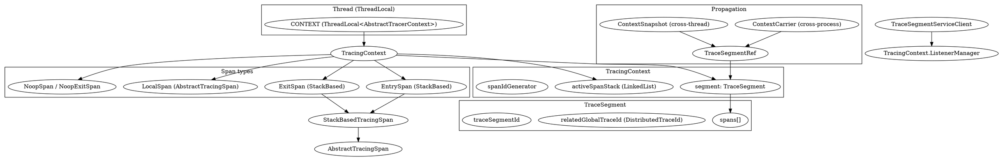

## Introduction

本篇深挖 Apache SkyWalking Java Agent 的埋点核心：`ContextManager`（对外门面）与 `TracingContext` / `TraceSegment`（真正持有上下文的对象），以及支撑它们的 Span 模型、ID 体系与采样机制。插件拦截器并不直接操作底层对象，而是调用 `ContextManager` 的静态方法（`createEntrySpan` / `createExitSpan` / `createLocalSpan` / `stopSpan` / `inject` / `extract` / `capture` / `continued` / `awaitFinishAsync` 等），由门面把调用委托给线程级 `AbstractTracerContext` 实现，从而在一个 `TraceSegment` 内拼出一棵 span 树。

> 版本基线：源码仓库 `E:/Projects/skywalking-java`，HEAD `6840d74`，见 [SkyWalking](/docs/CS/SE/SkyWalking/SkyWalking.md)。Agent 侧的启动与插件加载机制、跨进程/跨线程上下文传播细节，分别在兄弟笔记「Agent 启动/插件机制」与「Context 传播」中展开（本文侧重 Span 模型本身）。

三个贯穿全文的关键点：

1. **一个 `TracingContext` 绑定一个 `TraceSegment`，且只在一条线程内存活**。跨进程/跨线程靠 `ContextCarrier` / `ContextSnapshot` 把引用（`TraceSegmentRef`）传出去，而不是传递整个上下文。
2. **Span 只有三种语义类型**：`EntrySpan`（接收端）、`ExitSpan`（发起端）、`LocalSpan`（进程内）。其中 Entry/Exit 是**栈式**（`StackBasedTracingSpan`），Local 不是。
3. **采样在「首个 span 创建、即上下文创建」那一刻决定**，不命中采样则整条链路退回 `IgnoredTracerContext`，后续 span 全部是零成本 `NoopSpan`，且不会产生/上报任何 `TraceSegment`。

## ContextManager 门面与线程局部上下文（Facade & ThreadLocal）

`ContextManager` 是一个 `BootService`，本身不存任何 tracing 状态，所有状态都放在两个 `ThreadLocal` 上：当前 `AbstractTracerContext` 与 `RuntimeContext`。

```java
// ContextManager.java:45-46
private static ThreadLocal<AbstractTracerContext> CONTEXT = new ThreadLocal<AbstractTracerContext>();
private static ThreadLocal<RuntimeContext> RUNTIME_CONTEXT = new ThreadLocal<RuntimeContext>();
```

`getOrCreate` 是「惰性创建上下文」的唯一入口：若 `CONTEXT` 为空且 `operationName` 为空，则直接返回一个 `IgnoredTracerContext`（这条链路被整体忽略）；否则通过 `ContextManagerExtendService.createTraceContext` 创建真正的 `TracingContext`（或基于采样/忽略规则返回 `IgnoredTracerContext`）。

```java
// ContextManager.java:49-68
private static AbstractTracerContext getOrCreate(String operationName, boolean forceSampling) {
    AbstractTracerContext context = CONTEXT.get();
    if (context == null) {
        if (StringUtil.isEmpty(operationName)) {
            ...
            context = new IgnoredTracerContext();
        } else {
            if (EXTEND_SERVICE == null) {
                EXTEND_SERVICE = ServiceManager.INSTANCE.findService(ContextManagerExtendService.class);
            }
            context = EXTEND_SERVICE.createTraceContext(operationName, forceSampling);
        }
        CONTEXT.set(context);
    }
    return context;
}
```

三个 `createXxxSpan` 只是「先 `getOrCreate` 再委托给 context」的薄封装，区别在于传播动作：

- `createEntrySpan`：若传入的 `ContextCarrier` 合法，先 `forceSampled()` 再 `extract(carrier)`，把上游 `TraceSegmentRef` 接进来（`ContextManager.java:106-121`）。
- `createExitSpan`：创建后立即 `inject(carrier)`，把本端的 segment/span 信息写入 carrier 供下游 `extract`（`ContextManager.java:129-144`）。
- `createLocalSpan`：不带 carrier，纯进程内逻辑块（`ContextManager.java:123-127`）。

`stopSpan` 的两条重载最终都走到私有 `stopSpan(span, context)`：仅当 context 报告「栈已空」时，才 `CONTEXT.remove()` / `RUNTIME_CONTEXT.remove()`，把线程局部清理掉，避免线程池复用导致的上下文串味。

```java
// ContextManager.java:210-215
private static void stopSpan(AbstractSpan span, final AbstractTracerContext context) {
    if (context.stopSpan(span)) {
        CONTEXT.remove();
        RUNTIME_CONTEXT.remove();
    }
}
```

## TracingContext 与 TraceSegment 的关系（Context & Segment）

`TracingContext` 实现 `AbstractTracerContext`，是真正干活的控制器。它持有一个 `TraceSegment`，以及一个用 `LinkedList` 模拟的「ActiveSpan 栈」和一个自增的 `spanIdGenerator`。

```java
// TracingContext.java:74-91
private TraceSegment segment;
private LinkedList<AbstractSpan> activeSpanStack = new LinkedList<>();
...
private int spanIdGenerator;
```

构造函数在创建第一个 span 之前就会 **提前 new 出 `TraceSegment`**——即 segment 的诞生时刻早于任何 span：

```java
// TracingContext.java:122-139
TracingContext(String firstOPName, SpanLimitWatcher spanLimitWatcher) {
    this.segment = new TraceSegment();
    this.spanIdGenerator = 0;
    ...
}
```

`TraceSegment` 的 id 与全局 trace id 在构造时由 `GlobalIdGenerator` / `NewDistributedTraceId` 生成（见下文）；segment 内部用 `List<AbstractTracingSpan> spans` 收纳已结束的 span。

**结束时机**：`stopSpan` 调用 `AbstractTracingSpan.finish(segment)` 把 span 归档到 segment（出栈），随后调 `finish()`。`finish()` 在「主线程栈空且未处于异步模式（或异步计数器归零）」时，把 segment 标记为 finished 并触发 `TracingContext.ListenerManager.notifyFinish(finishedSegment)`。

```java
// TracingContext.java:450-478 (节选)
if (isFinishedInMainThread && (!isRunningInAsyncMode || asyncSpanCounter == 0)) {
    ...
    TraceSegment finishedSegment = segment.finish(limitMechanismWorking);
    TracingContext.ListenerManager.notifyFinish(finishedSegment);
    running = false;
}
```

`TraceSegmentServiceClient` 作为 `TracingContextListener` 的 `afterFinished` 实现，把 segment 投入 `DataCarrier` 缓冲，由消费者 `consume` 时 `segment.transform()` 成 `SegmentObject` 经 gRPC 上报。

```java
// TraceSegmentServiceClient.java:169-178
public void afterFinished(TraceSegment traceSegment) {
    if (traceSegment.isIgnore()) {
        return;
    }
    if (!carrier.produce(traceSegment)) { ... }
}
// TraceSegmentServiceClient.java:123-125 (consume)
for (TraceSegment segment : data) {
    SegmentObject upstreamSegment = segment.transform();
```

**Span id 的分配**由 context 的 `spanIdGenerator` 在 `createXxxSpan` 时 `spanIdGenerator++` 完成（如 `TracingContext.java:293-298` 的 `new EntrySpan(spanIdGenerator++, parentSpanId, ...)`）；它从 0 递增，仅在本 segment 内唯一，与全局 segment id 是两回事。

## Span 三种类型与栈式模型（Span Types & Stack Model）

`AbstractTracerContext` 接口只暴露三种创建方法，对应三种语义 span：

| 类型 | 类 | 基类 | 是否栈式 | 典型场景 |
| :--- | :--- | :--- | :--- | :--- |
| Entry | `EntrySpan` | `StackBasedTracingSpan` | 是 | Tomcat / MQ 消费入口 |
| Exit | `ExitSpan` | `StackBasedTracingSpan` | 是 | Feign / OkHttp 客户端 |
| Local | `LocalSpan` | `AbstractTracingSpan` | 否 | 进程内方法块 |

`LocalSpan` 直接继承 `AbstractTracingSpan`，`isEntry`/`isExit` 均为 false，`setPeer` 是空实现（`LocalSpan.java:26-45`）。

**为何 Entry/Exit 必须是栈式？** 一条线程内可能多次进入同类 span（例如一个请求在 Tomcat 入口后又经过 Dubbo 入口，或多次调用下游 HTTP），且异步场景下同一 span 会被多次 start/finish。栈式由 `StackBasedTracingSpan` 用一个 `stackDepth` 计数实现：`finish` 时 `--stackDepth`，**只有减到 0 才真正归档**，否则只是退栈。

```java
// StackBasedTracingSpan.java:56-62
@Override
public boolean finish(TraceSegment owner) {
    if (--stackDepth == 0) {
        return super.finish(owner);
    } else {
        return false;
    }
}
```

`EntrySpan.start()` 只在 `++stackDepth == 1`（即最外层）时记录 `startTime`，其余嵌套层只增加深度，并通过 `clearWhenRestart()` 把上一层可能残留的 component/layer/logs/tags 清空，保证最终保留的是**最深层**入口的信息（`EntrySpan.java:48-54, 107-112`）。同理，`EntrySpan`/`ExitSpan` 的 `tag`/`setLayer`/`setComponent`/`setOperationName` 都被 `stackDepth == currentMaxDepth`（或异步模式）保护，避免内层覆盖外层（`EntrySpan.java:57-89`、`ExitSpan.java:59-105`）。

`TracingContext.createEntrySpan` / `createExitSpan` 内部也做了「**同类型复用**」：若栈顶已是同类 span（如嵌套的两次 HTTP 调用），直接复用并 `start()`，不再 new，避免生成多余 span（`TracingContext.java:283-291, 340-348`）。

**Noop 实现**：当 `isLimitMechanismWorking()`（span 数超过 `span_limit_per_segment`）时，`createEntrySpan`/`createLocalSpan` 返回 `NoopSpan`、`createExitSpan` 返回 `NoopExitSpan`；`IgnoredTracerContext` 则对所有创建返回同一个静态 `NOOP_SPAN`。这些实现的所有方法都是空操作，`getSpanId()` 返回 0，`isExit()` 在 `NoopExitSpan` 中返回 true 以便 `inject` 不报错（`NoopSpan.java:30-139`、`NoopExitSpan.java:23-44`）。

## DistributedTraceId 与全局 trace id（Global Trace Id）

SkyWalking 同时维护两个层级的 id，必须区分：

- **segment id**：由 `GlobalIdGenerator.generate()` 在 `TraceSegment` 构造时生成，只标识「一条线程的一次请求处理片段」，格式为 `processId.threadId.seq`（`TraceSegment.java:72`、`GlobalIdGenerator.java:45-52`）。

```java
// GlobalIdGenerator.java:45-52
public static String generate() {
    return StringUtil.join(
        '.',
        PROCESS_ID,                                   // UUID，进程级唯一
        String.valueOf(Thread.currentThread().getId()),
        String.valueOf(THREAD_ID_SEQUENCE.get().nextSeq()) // 时间戳*10000 + 线程内序号
    );
}
```

- **global trace id**：跨 segment、跨进程、跨线程的全局链路 id，类型是 `DistributedTraceId`。它有两种来源：本地新建的 `NewDistributedTraceId`（内部就是一次 `GlobalIdGenerator.generate()`），以及从上游传播来的 `PropagatedTraceId`（直接持有对方传来的字符串）。

```java
// TraceSegment.java:74
this.relatedGlobalTraceId = new NewDistributedTraceId();
// NewDistributedTraceId.java:24-28
public NewDistributedTraceId() { super(GlobalIdGenerator.generate()); }
// PropagatedTraceId.java:24-28
public PropagatedTraceId(String id) { super(id); }
```

`TraceSegment` 在构造时用 `NewDistributedTraceId` 占位；一旦 `extract`/`continued` 接到了上游引用，就替换为 `PropagatedTraceId`，从而把整个 segment 挂到上游那条全局 trace 上。`relatedGlobalTrace` 的设计是「只替换一次」——若已是传播来的 id 就保持不动（`TraceSegment.java:92-96`）。

```java
// TraceSegment.java:92-96
public void relatedGlobalTrace(DistributedTraceId distributedTraceId) {
    if (relatedGlobalTraceId instanceof NewDistributedTraceId) {
        this.relatedGlobalTraceId = distributedTraceId;
    }
}
```

`TracingContext.extract`（跨进程）与 `continued`（跨线程）都走这条路径；`TraceSegment.transform()` 上报时 `setTraceId(getRelatedGlobalTrace().getId())` 写的是**全局 trace id**，而 `setTraceSegmentId` 写的是**本 segment id**（`TraceSegment.java:146-164`）——这正是 OAP 侧把多个 segment 聚合成一条 trace 的依据。

## Span 生命周期与字段（Span Lifecycle & Fields）

一个 `AbstractTracingSpan` 的核心字段集中在 `AbstractTracingSpan`：

```java
// AbstractTracingSpan.java:44-106 (节选)
protected int spanId;
protected int parentSpanId;          // -1 表示无父 span
protected String operationName;
protected SpanLayer layer;
protected final TracingContext owner;
protected long startTime;
protected long endTime;
protected boolean errorOccurred;
protected int componentId = 0;
protected List<LogDataEntity> logs;
protected List<TraceSegmentRef> refs;
protected boolean skipAnalysis;
protected boolean ignored;
```

生命周期由 `start()` / `finish()` 夹住：

```java
// AbstractTracingSpan.java:159-162
public AbstractTracingSpan start() {
    this.startTime = System.currentTimeMillis();
    return this;
}
// AbstractTracingSpan.java:152-156
public boolean finish(TraceSegment owner) {
    this.endTime = System.currentTimeMillis();
    owner.archive(this);
    return true;
}
```

`parentSpanId` 在 `TracingContext` 创建 span 时由「当前栈顶（parentSpan）的 spanId」决定，从而在同一 segment 内形成严格的父子（栈式）关系（`TracingContext.java:281-282`）。`refs` 用于挂载**跨** segment 的引用（上游 `TraceSegmentRef`），与段内 `parentSpanId` 是两个维度（`AbstractTracingSpan.java:313-326`）。

`SpanLayer` 描述 span 的技术层（DB / RPC_FRAMEWORK / HTTP / MQ / CACHE / GEN_AI），以整型 code 序列化；`tags` 通过 `Tags` 中预先编号的 `StringTag` / `IntegerTag` 写入，支持按 key 覆盖（`Tags.java:38-277`、`AbstractTag.java:24-55`、`AbstractTracingSpan.java:122-144`）。`setComponent` 写入 `componentId`（对应 ComponentsDefine 字典）。错误与日志分别由 `errorOccurred()` 和 `log(Throwable)` 收集，`log` 会自动用 `StatusCheckService` 判断异常是否算错误，并受 `LOG_LIMIT_PER_SPAN` 限制条数（`AbstractTracingSpan.java:170-211`）。

最终 `transform()` 把 span 序列化为 gRPC 的 `SpanObject.Builder`，并据 `isEntry/isExit` 设置 `SpanType`（Entry/Exit/Local），附上 layer、component、tags、logs、refs（`AbstractTracingSpan.java:270-310`）。

**异步 span**：`prepareForAsync()` 调 `ContextManager.awaitFinishAsync(this)` 让 context 进入异步模式并递增异步计数器（span 出栈但 segment 不结束），`asyncFinish()` 在别的线程收尾并 `owner.asyncStop(this)` 递减计数器，`finish()` 在异步计数归零后才真正结束 segment（`AbstractTracingSpan.java:328-354`、`TracingContext.java:393-411`）。

## 采样：SamplingService 与 IgnoredTracerContext（Sampling）

该版本没有 `SampleStatus` 枚举，采样决策完全由 `SamplingService` 完成。核心方法 `trySampling`：当采样开关 `on` 时，用 `AtomicInteger` 累加因子并与 `samplingRate` 比较，未达上限则 CAS 自增并返回 true；否则返回 false。`forceSampled()` 则无条件自增因子——用于"上游已经采样、本端必须跟"的强一致场景（如 `createEntrySpan` 遇到合法 carrier 时先 `forceSampled()`）。

```java
// SamplingService.java:90-100
public boolean trySampling(String operationName) {
    if (on) {
        int factor = samplingFactorHolder.get();
        if (factor < samplingRateWatcher.getSamplingRate()) {
            return samplingFactorHolder.compareAndSet(factor, factor + 1);
        } else {
            return false;
        }
    }
    return true; // 采样关闭时全部放行
}
```

因子每 3 秒由 `handleSamplingRateChanged` 注册的定时任务重置，因此 `samplingRate` 表示「每 3 秒采样多少条」（`SamplingService.java:119-139`）。

**关键点：采样判定发生在「创建首个 span / 创建上下文」时，而非 segment 结束时**。`ContextManagerExtendService.createTraceContext` 在此刻综合三件事：后端 gRPC 是否连接、operationName 命中忽略后缀、以及 `trySampling` 结果。只要有任一条件不满足（且非 `forceSampling`），就返回 `IgnoredTracerContext`——后续所有 span 都是 `NoopSpan`，且 `IgnoredTracerContext` 根本不持有 `TraceSegment`，也**不会**触发 `TracingContext.ListenerManager` 的 `afterFinished`，因此没有任何 segment 被序列化上报。

```java
// ContextManagerExtendService.java:94-102
SamplingService samplingService = ServiceManager.INSTANCE.findService(SamplingService.class);
if (forceSampling || samplingService.trySampling(operationName)) {
    context = new TracingContext(operationName, spanLimitWatcher);
} else {
    AgentSo11y.measureLeakedTracingContext(true);
    context = new IgnoredTracerContext();
}
```

这就实现了「未采样链路零成本跳过」：被忽略的链路既不分配 segment、也不归档 span、更不上报，只在 `IgnoredTracerContext` 里维护一个 `stackDepth` 整数以正确匹配 `stopSpan` 的嵌套调用（`IgnoredTracerContext.java:34-124`）。

## 设计取舍（Design Trade-offs）

- **为何区分 trace 与 segment？** 分布式追踪天然跨进程、跨线程。若把整条链路塞进一个对象，上下文就必须随每次 RPC 在网络上整体传递，既昂贵又难处理异步/批量（一个 segment 面对多个父 segment）。SkyWalking 让每个线程只持有自己的 `TraceSegment`，段间通过轻量的 `TraceSegmentRef`（仅含 traceId / segmentId / spanId / 服务信息等）串联；全局 `DistributedTraceId` 作为跨段聚合键，段内 `spanIdGenerator` 各自从 0 计数。这样「段内栈式、段间引用」的二分法天然契合 CALL 树与 MQ / 异步场景（`TraceSegmentRef.java:49-68`）。
- **为何 Entry/Exit 做成栈式？** 真实调用常出现同类型 span 嵌套（网关入口 + RPC 入口；串行 HTTP 调用）或异步复用同一个出口。纯「一个 span 一座栈帧」会在嵌套时产生语义错误（外层 startTime 被内层覆盖、refs 错挂）。`stackDepth` 让同一 span 在嵌套/异步中安全地多次 start/finish，只有真正的最外层才决定生命周期，且内层 tag 受 `stackDepth == currentMaxDepth` 保护不污染外层（`EntrySpan.java:48-89`、`ExitSpan.java:51-105`、`StackBasedTracingSpan.java:56-62`）。
- **为何用 Noop 实现而非 if 分支？** 若在每个插件拦截器里写 `if (sampled) {...}`，不仅散落易错，还会让「未采样」路径仍参与对象分配。SkyWalking 把判定收敛到 `createTraceContext` 一处，命中忽略即返回 `IgnoredTracerContext`，后续所有 API 落到 `NoopSpan` 的空方法——调用方代码完全不变，却几乎零开销（`ContextManagerExtendService.java:79-106`、`NoopSpan.java:30-139`）。
- **ThreadLocal 的代价与注意点**：上下文绑在线程上，线程池复用必须保证 `stopSpan` 后 `CONTEXT.remove()`，否则下一个任务会「继承」上一个请求的 segment。`ContextManager.stopSpan` 的 `CONTEXT.remove()` 正是为此（`ContextManager.java:210-215`）；跨线程传播则必须显式 `capture()` / `continued()`。



## Links

- [SkyWalking](/docs/CS/SE/SkyWalking/SkyWalking.md)
- [Streaming Pipeline（OAP 侧 segment → Source 流处理）](/docs/CS/SE/SkyWalking/Streaming_Pipeline.md)
- [Analyzer Family（trace 分析）](/docs/CS/SE/SkyWalking/Analyzer_Family.md)
- [Agent 启动引导与字节码织入](/docs/CS/SE/SkyWalking/Agent_Bootstrap_Plugin.md)
- [Agent Context 传播（跨进程/跨线程）](/docs/CS/SE/SkyWalking/Agent_Context_Propagation.md)
- [Agent 插件拦截器范式（Plugin Define 与 Span 创建）](/docs/CS/SE/SkyWalking/Agent_Plugin_Interceptor.md)
- [Agent 遥测上报与配置（gRPC 上行 / 注册 / agent.config）](/docs/CS/SE/SkyWalking/Agent_Telemetry_Config.md)
- [APM](/docs/CS/SE/APM.md)
- [Distributed Tracing](/docs/CS/Distributed/Tracing/Tracing.md)

## References

- [ContextManager.java](https://github.com/apache/skywalking-java/blob/6840d74/apm-sniffer/apm-agent-core/src/main/java/org/apache/skywalking/apm/agent/core/context/ContextManager.java)
- [TracingContext.java](https://github.com/apache/skywalking-java/blob/6840d74/apm-sniffer/apm-agent-core/src/main/java/org/apache/skywalking/apm/agent/core/context/TracingContext.java)
- [AbstractTracerContext.java](https://github.com/apache/skywalking-java/blob/6840d74/apm-sniffer/apm-agent-core/src/main/java/org/apache/skywalking/apm/agent/core/context/AbstractTracerContext.java)
- [TraceSegment.java](https://github.com/apache/skywalking-java/blob/6840d74/apm-sniffer/apm-agent-core/src/main/java/org/apache/skywalking/apm/agent/core/context/trace/TraceSegment.java)
- [AbstractTracingSpan.java](https://github.com/apache/skywalking-java/blob/6840d74/apm-sniffer/apm-agent-core/src/main/java/org/apache/skywalking/apm/agent/core/context/trace/AbstractTracingSpan.java)
- [StackBasedTracingSpan.java](https://github.com/apache/skywalking-java/blob/6840d74/apm-sniffer/apm-agent-core/src/main/java/org/apache/skywalking/apm/agent/core/context/trace/StackBasedTracingSpan.java)
- [EntrySpan.java](https://github.com/apache/skywalking-java/blob/6840d74/apm-sniffer/apm-agent-core/src/main/java/org/apache/skywalking/apm/agent/core/context/trace/EntrySpan.java)
- [ExitSpan.java](https://github.com/apache/skywalking-java/blob/6840d74/apm-sniffer/apm-agent-core/src/main/java/org/apache/skywalking/apm/agent/core/context/trace/ExitSpan.java)
- [NoopSpan.java](https://github.com/apache/skywalking-java/blob/6840d74/apm-sniffer/apm-agent-core/src/main/java/org/apache/skywalking/apm/agent/core/context/trace/NoopSpan.java)
- [GlobalIdGenerator.java](https://github.com/apache/skywalking-java/blob/6840d74/apm-sniffer/apm-agent-core/src/main/java/org/apache/skywalking/apm/agent/core/context/ids/GlobalIdGenerator.java)
- [SamplingService.java](https://github.com/apache/skywalking-java/blob/6840d74/apm-sniffer/apm-agent-core/src/main/java/org/apache/skywalking/apm/agent/core/sampling/SamplingService.java)
- [ContextManagerExtendService.java](https://github.com/apache/skywalking-java/blob/6840d74/apm-sniffer/apm-agent-core/src/main/java/org/apache/skywalking/apm/agent/core/context/ContextManagerExtendService.java)
- [TraceSegmentServiceClient.java](https://github.com/apache/skywalking-java/blob/6840d74/apm-sniffer/apm-agent-core/src/main/java/org/apache/skywalking/apm/agent/core/remote/TraceSegmentServiceClient.java)
