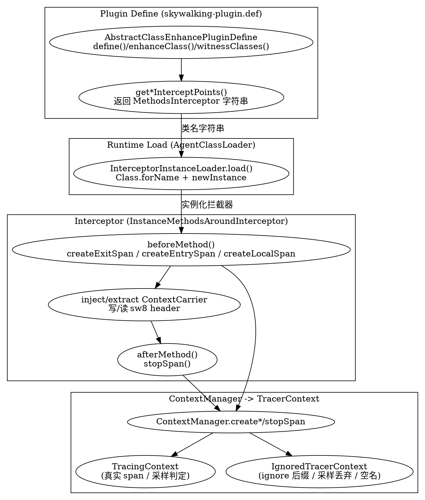

## Introduction

SkyWalking Java Agent 的"最后一公里"埋点，发生在由 `skywalking-plugin.def` 声明的各个**插件（plugin）**里。本篇深挖：一个插件如何声明"要增强哪个类的哪个方法"（ `AbstractClassEnhancePluginDefine` 体系），其拦截器（ `InstanceMethodsAroundInterceptor` 等）如何在方法前后调用 `ContextManager` 创建 `EntrySpan` / `ExitSpan` / `LocalSpan` ，以及配套的 ignore 路径机制与 AgentConfig / PluginConfig 配置体系。

> 版本基线：源码仓库 `E:/Projects/skywalking-java`，HEAD `6840d74`。核心配置体系与此前 OAP 后端篇是**两个独立仓库**，本文档所有引用均来自探针仓库。

三个反直觉的关键点：

1. **插件 = "声明式 Define + 拦截器" 一对组合**：Define 类只负责"匹配哪个类 / 哪些方法"，真正的业务织入（建 span、inject/extract 头）写在独立的 Interceptor 类里。两者通过**字符串类名**在运行时经 `AgentClassLoader` 实例化拼装。
2. **匹配是"按类名、按父类/接口、按注解"而非按字节码特征**：`NameMatch` / `HierarchyMatch` / `ClassAnnotationMatch` / `MultiClassNameMatch` 决定增强范围，框架升级时 `HierarchyMatch` 最鲁棒。
3. **ignore 与采样是两条独立的"丢弃"路径**：ignore 是**基于 operationName 后缀的配置/规则驱动**的链路级跳过（走零成本的 `IgnoredTracerContext`）；采样是**概率性**的整段丢弃。二者在 `ContextManagerExtendService.createTraceContext` 里分别判定。

## Plugin Define 与拦截器成对范式

每个插件是一个 `AbstractClassEnhancePluginDefine` 子类（最终落到 `ClassEnhancePluginDefine` 做真正的字节码增强），它声明两类信息：

- **增强目标**：通过 `enhanceClass()` 返回的 `ClassMatch` 决定增强哪个类；`witnessClasses()` 决定该版本是否生效（见下）。
- **拦截点列表**：`getConstructorsInterceptPoints()` / `getInstanceMethodsInterceptPoints()` / `getStaticMethodsInterceptPoints()` 各自返回一个拦截点数组，每个拦截点给出"方法匹配器" + "拦截器类名字符串"。

`AbstractClassEnhancePluginDefine.define` 是字节码增强的总入口，先做 witness 校验再派发到 `enhance`（`AbstractClassEnhancePluginDefine.java:72-114`）：

```java
// AbstractClassEnhancePluginDefine.java:86-94 —— witness 类不存在则整插件不激活
String[] witnessClasses = witnessClasses();
if (witnessClasses != null) {
    for (String witnessClass : witnessClasses) {
        if (!finder.exist(witnessClass, classLoader)) {
            LOGGER.warn("enhance class {} by plugin {} is not activated. Witness class {} does not exist.", ...);
            return null;
        }
    }
}
```

`ClassEnhancePluginDefine.enhanceInstance` 把"拦截器类名字符串"变成 ByteBuddy 的 `MethodDelegation` 目标（`ClassEnhancePluginDefine.java:140-174`）：

```java
// ClassEnhancePluginDefine.java:142,168-170 —— 取拦截点里的字符串类名，实例化 InstMethodsInter
String interceptor = instanceMethodsInterceptPoint.getMethodsInterceptor();
...
newClassBuilder.method(junction)
    .intercept(MethodDelegation.withDefaultConfiguration()
        .to(new InstMethodsInter(getPluginName(), interceptor, classLoader), ...));
```

### 拦截器字符串如何被实例化（呼应 A0 字节码织入篇）

`InstMethodsInter` 在每次方法调用时持有该字符串，经 `InterceptorInstanceLoader.load` 实例化（`InterceptorInstanceLoader.java:50-78`）：

```java
// InterceptorInstanceLoader.java:60-71 —— 为 targetClassLoader 造一个 AgentClassLoader 子类，再 Class.forName
pluginLoader = new AgentClassLoader(targetClassLoader);
EXTEND_PLUGIN_CLASSLOADERS.put(targetClassLoader, pluginLoader);
...
inst = Class.forName(className, true, pluginLoader).newInstance();
```

这样拦截器与业务类处在**不同的 ClassLoader 命名空间**，既能被插件 jar 加载、又能访问被增强类的类型，这正是 A0 篇" `AgentClassLoader` 双亲委派破坏"要解决的问题。

### 匹配策略如何选择

`enhanceClass()` 返回四种 `ClassMatch` 之一，插件按"被增强类的稳定程度"选择：

- **`NameMatch.byName("全限定名")`**：精确匹配一个类，用于类全限定名稳定的客户端（如 `httpclient-4.x` 的 `InternalHttpClient`）。
- **`HierarchyMatch.byHierarchyMatch("父类/接口名")`**：匹配该父类/接口的所有子类，框架升级改包名/加子类也照样增强，最鲁棒。
- **`ClassAnnotationMatch.byClassAnnotationMatch("注解名")`**：按类上是否有某注解匹配（如 Spring `@Controller`）。
- **`MultiClassNameMatch.byMultiClassMatch(...)`**：一次匹配多个并列类。

```java
// InternalHttpClientInstrumentation.java:35-40 —— NameMatch，精确匹配单个类
private static final String ENHANCE_CLASS = "org.apache.http.impl.client.InternalHttpClient";
@Override
public ClassMatch enhanceClass() {
    return NameMatch.byName(ENHANCE_CLASS);
}
```

```java
// HttpServiceInstrumentation.java:36 —— HierarchyMatch，匹配所有 HttpHandler 子类
return byHierarchyMatch("org.glassfish.grizzly.http.server.HttpHandler");
```

witness 机制与匹配互补：匹配锁定"要增强谁"，witness 锁定"在哪个版本生效"。例如 SpringMVC 4.x 用 witness 类确认 Spring 版本（不同版本拦截点方法签名不同）：

```java
// AbstractSpring4Instrumentation.java:27-32 —— witness 类决定插件在该 Spring 版本是否激活
@Override
protected String[] witnessClasses() {
    return new String[] {
        "org.springframework.cache.interceptor.SimpleKey",
        "org.springframework.cache.interceptor.DefaultKeyGenerator"
    };
}
```

## 三种 Span 在插件里的真实用法

`ContextManager` 提供 `createEntrySpan` / `createExitSpan` / `createLocalSpan` 三对 API（`ContextManager.java:106-144`），插件拦截器在 `beforeMethod` 建 span、`afterMethod` 调 `stopSpan`，严格配对。

### ExitSpan：HTTP 客户端（必须 inject 写 header）

以 `httpclient-4.x` 为例，`HttpClientInstrumentation` 声明拦截器类名（ `HttpClientInstrumentation.java:26` 的 `INTERCEPT_CLASS` = `...HttpClientExecuteInterceptor` ），`InternalHttpClientInstrumentation` 把它挂到 `InternalHttpClient#doExecute`（`InternalHttpClientInstrumentation.java:48`）。拦截器在 `beforeMethod` 建 ExitSpan 并注入链路头：

```java
// HttpClientExecuteInterceptor.java:69-89 —— 建 ExitSpan + 把 sw8 链路头写进请求 header
final ContextCarrier contextCarrier = new ContextCarrier();
String remotePeer = httpHost.getHostName() + ":" + port(httpHost);
AbstractSpan span = ContextManager.createExitSpan(requestURI, contextCarrier, remotePeer);
...
CarrierItem next = contextCarrier.items();
while (next.hasNext()) {
    next = next.next();
    httpRequest.setHeader(next.getHeadKey(), next.getHeadValue()); // inject
}
```

对应 `afterMethod` 收尾（`HttpClientExecuteInterceptor.java:120`）：

```java
// HttpClientExecuteInterceptor.java:120
ContextManager.stopSpan();
```

注意 `createExitSpan(operationName, carrier, remotePeer)` 内部已自动 `inject`（`ContextManager.java:129-138`），但 httpclient 这里因为 header 写法是 `setHeader` 而非通用 setter，所以用 `createExitSpan` 的 3 参重载拿到 carrier 后手动遍历 `items()` 写入——两种写法都能把上下文注入到下游请求。

### EntrySpan：服务端入口（必须 extract 读 header）

以 SpringMVC 为例，`AbstractMethodInterceptor.beforeMethod` 先从请求里读出上游传来的 `sw8` 头填进 `ContextCarrier`，再建 EntrySpan（建 span 时 `ContextManager` 会感知 carrier 有效并 `extract`）：

```java
// AbstractMethodInterceptor.java:130-138 —— 从请求 header 抽取上游上下文，再建 EntrySpan
CarrierItem next = contextCarrier.items();
while (next.hasNext()) {
    next = next.next();
    next.setHeadValue(httpServletRequest.getHeader(next.getHeadKey())); // extract
}
...
AbstractSpan span = ContextManager.createEntrySpan(operationName, contextCarrier);
```

`ContextManager.createEntrySpan` 的 extract 触发点（`ContextManager.java:110-119`）：当 carrier 有效时强制采样并 `context.extract(carrier)`。嵌套调用（controller 调 service）则退化为 `LocalSpan`（`AbstractMethodInterceptor.java:120`）。收尾同样是 `ContextManager.stopSpan()`（`AbstractMethodInterceptor.java:220`）。

### DB / RPC：ExitSpan + peer 设为 JDBC URL 主机

DB 插件把 `ExitSpan` 的 `remotePeer` 设为 JDBC URL 的主机:端口（来自连接时缓存的 `ConnectionInfo`），operationName 设为 `DBType/JDBC/Statement/method`，并打 `DB_TYPE` / `DB_INSTANCE` / `DB_STATEMENT` 标签：

```java
// StatementTracing.java:36-49 —— DB ExitSpan：peer=数据库主机，operation=DBType/JDBC/Statement/<method>
AbstractSpan span = ContextManager.createExitSpan(
    connectInfo.getDBType() + "/JDBC/Statement/" + method, connectInfo.getDatabasePeer());
Tags.DB_TYPE.set(span, connectInfo.getDBType());
Tags.DB_INSTANCE.set(span, connectInfo.getDatabaseName());
Tags.DB_STATEMENT.set(span, SqlBodyUtil.limitSqlBodySize(sql));
span.setComponent(connectInfo.getComponent());
SpanLayer.asDB(span);
...
ContextManager.stopSpan();
```

连接创建时，`ConnectionCreateInterceptor` 把解析出的 `ConnectionInfo`（含 host/port/database）塞进被增强连接的 `EnhancedInstance` 动态字段，后续 statement 执行时取回作为 peer（`ConnectionCreateInterceptor.java:43-44`）：

```java
// ConnectionCreateInterceptor.java:43-44
ConnectionInfo connectionInfo = ConnectionCache.get(hostInfo.getHostPortPair(), hostInfo.getDatabase());
((EnhancedInstance) ret).setSkyWalkingDynamicField(connectionInfo);
```

## 异步与 asyncFinish（跨线程传播）

异步客户端不能在当前线程 `stopSpan`——真正的响应在回调线程到达。SkyWalking 用 `ContextManager.capture()` 在发起线程快照上下文、`continued(snapshot)` 在回调线程恢复，呼应 A2 跨线程传播篇。以 okhttp 异步为例：

```java
// EnqueueInterceptor.java:41,53 —— 发起线程：建 LocalSpan，capture 快照存入回调对象
ContextManager.createLocalSpan("Async" + request.httpUrl().uri().getPath());
callbackInstance.setSkyWalkingDynamicField(new EnhanceRequiredInfo(objInst, ContextManager.capture()));
```

```java
// AsyncCallInterceptor.java:54-55 —— 回调/执行线程：恢复上下文再建 span
ContextManager.createLocalSpan("Async/execute");
ContextManager.continued(enhanceRequiredInfo.getContextSnapshot());
```

`capture` / `continued` 的实现位于 `ContextManager.java:159-177`（ `continued` 还会处理"来自被忽略上下文的非法快照"——见下节 ignore）。此外对真正异步完成的场景，Reactive WebFlux 等拦截器用 `span.prepareForAsync()` 把 span 挂起、等响应线程 `asyncStop`（`AbstractMethodInterceptor.java:193` 调用 `span.prepareForAsync()`），`ContextManager.awaitFinishAsync` 在 `ContextManager.java:179-186` 提供对应支持。

## ignore 路径机制

本版本**没有** `trace.ignore_path` / `AntPathMatcher` / `TraceIgnorePattern` 这类路径匹配器。ignore 是基于 **operationName 后缀** 的精确集合匹配，配置项名为 `agent.ignore_suffix`（默认值在 `Config.java:93`）：

```java
// Config.java:93 —— 默认忽略后缀集合
public static String IGNORE_SUFFIX = ".jpg,.jpeg,.js,.css,.png,.bmp,.gif,.ico,.mp3,.mp4,.html,.svg";
```

### 判定位置与逻辑

判定发生在 `ContextManagerExtendService.createTraceContext`：把 operationName 按最后一个 `.` 切开取后缀，若落在 `ignoreSuffixSet` 里则直接返回 `IgnoredTracerContext`（`ContextManagerExtendService.java:79-106`）：

```java
// ContextManagerExtendService.java:89-93 —— 后缀命中即走 IgnoredTracerContext（零成本）
int suffixIdx = operationName.lastIndexOf(".");
if (suffixIdx > -1 && ignoreSuffixSet.contains(operationName.substring(suffixIdx))) {
    AgentSo11y.measureTracingContextCreation(forceSampling, true);
    context = new IgnoredTracerContext();
} else {
    SamplingService samplingService = ...;
    if (forceSampling || samplingService.trySampling(operationName)) {
        context = new TracingContext(operationName, spanLimitWatcher);
    } else {
        context = new IgnoredTracerContext(); // 采样丢弃也走 IgnoredTracerContext
    }
}
```

`ignoreSuffixSet` 在 boot 阶段由 `Config.Agent.IGNORE_SUFFIX` 切分初始化（`ContextManagerExtendService.java:57`）。此外还有一种"空 operationName 直接忽略"的入口：`ContextManager.getOrCreate` 在 operationName 为空时返回 `IgnoredTracerContext`（`ContextManager.java:52-57`）。

### IgnoredTracerContext：零成本实现

被忽略的链路不创建任何真实 span，只用一个整型 `stackDepth` 维持进出栈平衡，`createEntrySpan/LocalSpan/ExitSpan` 一律返回同一个 `NoopSpan`（`IgnoredTracerContext.java:34-124`）：

```java
// IgnoredTracerContext.java:94-109 —— 所有 create*Span 返回 NOOP_SPAN，仅维护深度
@Override
public AbstractSpan createExitSpan(String operationName, String remotePeer) {
    stackDepth++;
    return NOOP_SPAN;
}
// IgnoredTracerContext.java:117-124 —— stopSpan 仅递减深度，归零才通知监听器
public boolean stopSpan(AbstractSpan span) {
    stackDepth--;
    if (stackDepth == 0) {
        AgentSo11y.measureTracingContextCompletion(true);
        ListenerManager.notifyFinish(this);
    }
    return stackDepth == 0;
}
```

### ignore 与采样的双轨区别

- **ignore（配置/规则驱动）**：基于 `agent.ignore_suffix` 后缀规则，确定性地跳过整条链路（如静态资源 `.js` / `.png`），由运维显式配置，结果可预期。
- **采样（概率驱动）**：基于 `agent.sample_n_per_3_secs` 的概率性整段丢弃（`SamplingService.trySampling`，A1 篇已讲清无 `SampleStatus` 枚举），用于降负载。
- 二者的最终归宿都是 `IgnoredTracerContext`，但触发条件与语义完全不同：ignore 是"这类请求我不关心"，采样是"这类请求太多我抽一部分"。

### 动态配置

`agent.ignore_suffix` 支持后端动态下发： `IgnoreSuffixPatternsWatcher` 的默认值即 `Config.Agent.IGNORE_SUFFIX`（`IgnoreSuffixPatternsWatcher.java:65-67`），收到变更时重建集合（`IgnoreSuffixPatternsWatcher.java:48` → `ContextManagerExtendService.handleIgnoreSuffixPatternsChanged` 在 `ContextManagerExtendService.java:113-117` 重新 `split(",")` 赋值 `ignoreSuffixSet`）。

## 配置优先级与 PluginConfig

### 四种来源的覆盖顺序

核心配置由 `SnifferConfigInitializer.initializeCoreConfig` 加载（`SnifferConfigInitializer.java:70-132`），按"后写覆盖先写"的顺序叠加：

1. **`agent.config` 文件**（base）：`loadConfig()` 读取 `/config/agent.config`，并用占位符替换（`SnifferConfigInitializer.java:72-77`）。
2. **系统属性 `-Dskywalking.xxx`**：`overrideConfigBySystemProp` 扫描 `System.getProperties()`，凡以 `skywalking.` 开头的 key，去掉前缀后作为真实 key 覆盖（`SnifferConfigInitializer.java:83-87, 201-210`）。
3. **`-javaagent` 选项字符串**：`overrideConfigByAgentOptions` 解析 `key=value`（逗号分隔、支持引号）覆盖，最后生效、优先级最高（`SnifferConfigInitializer.java:89-99, 155-162`）。
4. **默认值**：写在 `Config` 各静态字段的初始赋值（如 `Config.java:93` 的 `IGNORE_SUFFIX`）。

```java
// SnifferConfigInitializer.java:201-210 —— -Dskywalking.agent.service_name 覆盖 agent.service_name
private static void overrideConfigBySystemProp() {
    Properties systemProperties = System.getProperties();
    for (final Map.Entry<Object, Object> prop : systemProperties.entrySet()) {
        String key = prop.getKey().toString();
        if (key.startsWith(ENV_KEY_PREFIX)) { // "skywalking."
            String realKey = key.substring(ENV_KEY_PREFIX.length());
            AGENT_SETTINGS.put(realKey, prop.getValue());
        }
    }
}
```

`agent.config` 模板里大量使用 `${SW_xxx:默认值}` 环境占位符，例如 `agent.ignore_suffix=${SW_AGENT_IGNORE_SUFFIX:.jpg,.jpeg,...}`（`apm-sniffer/config/agent.config:47`），把环境变量也纳入覆盖链。

最终 `initializeConfig(Config.class)`（`SnifferConfigInitializer.java:101`）委托 `ConfigInitializer.initialize` 把 `Properties` 反射写入 `Config` 的静态字段（`ConfigInitializer.java:45-117`）：key 由"父级类名链.字段名"小写拼接（`:53`），再 `field.set(null, value)`（`:105`）。

### PluginConfig：插件级配置自动绑定

每个插件用一个带 `@PluginConfig(root=...)` 注解的静态嵌套类声明自己的配置，key 前缀为 `plugin.<子类链>.*`。加载该插件的某个拦截器时，`AgentClassLoader` 发现其上的 `@PluginConfig` 注解，立即对该 root 类执行 `initializeConfig`，从而完成绑定（`AgentClassLoader.java:161,166`）：

```java
// AgentClassLoader.java:161,166 —— 拦截器类被加载时，顺带初始化其 @PluginConfig 配置
final PluginConfig pluginConfig = loadedClass.getAnnotation(PluginConfig.class);
...
SnifferConfigInitializer.initializeConfig(pluginConfig.root());
```

以 httpclient 为例，类链为 `HttpClientPluginConfig → Plugin → HttpClient`，于是字段 `COLLECT_HTTP_PARAMS` 绑定到 `plugin.httpclient.collect_http_params`：

```java
// HttpClientPluginConfig.java:24-30 —— 注解 root 指向自身，字段名映射为 plugin.httpclient.*
public static class Plugin {
    @PluginConfig(root = HttpClientPluginConfig.class)
    public static class HttpClient {
        public static boolean COLLECT_HTTP_PARAMS = false;
        public static String PROPAGATION_EXCLUDE_PORTS = "";
    }
}
```

该 key 在 `agent.config:222` 即 `plugin.httpclient.collect_http_params=${SW_PLUGIN_HTTPCLIENT_COLLECT_HTTP_PARAMS:false}`，拦截器里直接读 `HttpClientPluginConfig.Plugin.HttpClient.COLLECT_HTTP_PARAMS`（`HttpClientExecuteInterceptor.java:90`）。同理 JDBC 插件 `plugin.jdbc.trace_sql_parameters`（`JDBCPluginConfig.java:31`，`agent.config:202`）就是常被问到的"是否采集 SQL 参数"开关。

## 设计取舍

- **声明式 Define + 拦截器分离**：增强目标（Define）与业务逻辑（Interceptor）解耦，同一套拦截器可被多个 Define 复用（如 httpclient-4.x 的 `HttpClientInstrumentation` 被 `InternalHttpClientInstrumentation` / `MinimalHttpClientInstrumentation` 等多子类继承复用），新增框架只需新增一对文件、在 `skywalking-plugin.def` 注册，无需改动内核。
- **`HierarchyMatch` 的鲁棒性**：按父类/接口而非精确类名匹配，框架改包名、加子类都不会让插件失效，代价是可能增强到预期外的实现类（靠 witness 类与拦截点方法签名兜底）。
- **ignore 与采样双轨**：ignore 保证"按规则确定性跳过特定链路"的配置可控性，采样保证"随机降负载"的性能可控性；二者都收敛到 `IgnoredTracerContext` 的零成本实现，避免被丢弃链路仍产生 span 对象与内存开销。
- **配置四来源 + 插件级 `@PluginConfig`**：核心配置用静态字段 + 反射一次性绑定，插件配置按需（拦截器首次加载时）惰性绑定，既统一了 `agent.config / -D / 环境变量 / 默认值` 的覆盖语义，又避免加载全部插件配置带来的启动开销。

## Plugin Define -> Interceptor -> ContextManager 调用链



## Links

- /docs/CS/SE/SkyWalking/Agent_Bootstrap_Plugin.md
- /docs/CS/SE/SkyWalking/Agent_Context_Span.md
- /docs/CS/SE/SkyWalking/Agent_Context_Propagation.md
- /docs/CS/SE/SkyWalking/Receiver_Protocol.md
- /docs/CS/SE/APM.md
- /docs/CS/Distributed/Tracing/Tracing.md

## References

- https://github.com/apache/skywalking-java/blob/6840d74/apm-sniffer/apm-agent-core/src/main/java/org/apache/skywalking/apm/agent/core/plugin/AbstractClassEnhancePluginDefine.java
- https://github.com/apache/skywalking-java/blob/6840d74/apm-sniffer/apm-agent-core/src/main/java/org/apache/skywalking/apm/agent/core/plugin/interceptor/enhance/ClassEnhancePluginDefine.java
- https://github.com/apache/skywalking-java/blob/6840d74/apm-sniffer/apm-agent-core/src/main/java/org/apache/skywalking/apm/agent/core/plugin/loader/InterceptorInstanceLoader.java
- https://github.com/apache/skywalking-java/blob/6840d74/apm-sniffer/apm-agent-core/src/main/java/org/apache/skywalking/apm/agent/core/context/ContextManager.java
- https://github.com/apache/skywalking-java/blob/6840d74/apm-sniffer/apm-agent-core/src/main/java/org/apache/skywalking/apm/agent/core/context/ContextManagerExtendService.java
- https://github.com/apache/skywalking-java/blob/6840d74/apm-sniffer/apm-agent-core/src/main/java/org/apache/skywalking/apm/agent/core/context/IgnoredTracerContext.java
- https://github.com/apache/skywalking-java/blob/6840d74/apm-sniffer/apm-agent-core/src/main/java/org/apache/skywalking/apm/agent/core/conf/SnifferConfigInitializer.java
- https://github.com/apache/skywalking-java/blob/6840d74/apm-sniffer/apm-agent-core/src/main/java/org/apache/skywalking/apm/agent/core/conf/Config.java
- https://github.com/apache/skywalking-java/blob/6840d74/apm-sniffer/apm-agent-core/src/main/java/org/apache/skywalking/apm/agent/core/boot/PluginConfig.java
- https://github.com/apache/skywalking-java/blob/6840d74/apm-sniffer/apm-sdk-plugin/httpClient-4.x-plugin/src/main/java/org/apache/skywalking/apm/plugin/httpClient/v4/HttpClientExecuteInterceptor.java
- https://github.com/apache/skywalking-java/blob/6840d74/apm-sniffer/apm-sdk-plugin/spring-plugins/mvc-annotation-commons/src/main/java/org/apache/skywalking/apm/plugin/spring/mvc/commons/interceptor/AbstractMethodInterceptor.java
- https://github.com/apache/skywalking-java/blob/6840d74/apm-sniffer/apm-sdk-plugin/jdbc-commons/src/main/java/org/apache/skywalking/apm/plugin/jdbc/trace/StatementTracing.java
- https://github.com/apache/skywalking-java/blob/6840d74/apm-sniffer/apm-sdk-plugin/okhttp-2.x-plugin/src/main/java/org/apache/skywalking/apm/plugin/okhttp/v2/AsyncCallInterceptor.java
- https://github.com/apache/skywalking-java/blob/6840d74/apm-sniffer/apm-sdk-plugin/httpClient-4.x-plugin/src/main/java/org/apache/skywalking/apm/plugin/httpClient/v4/define/InternalHttpClientInstrumentation.java
- https://github.com/apache/skywalking-java/blob/6840d74/apm-sniffer/apm-sdk-plugin/grizzly-2.3.x-4.x-plugin/src/main/java/org/apache/skywalking/apm/plugin/grizzly/v2/define/HttpServiceInstrumentation.java
