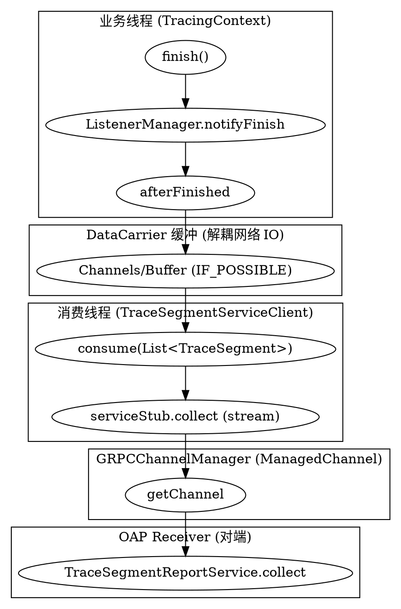

## Introduction

本篇承接前三篇（Agent 启动/字节码织入、ContextManager 与 Span 模型、Context 跨进程/跨线程传播），聚焦 SkyWalking Java Agent 的**出口与配置**：采集到的 `TraceSegment`、JVM 指标如何通过 gRPC 上行到 OAP；服务/实例如何在 OAP 注册；以及 `agent.config` 如何被加载、覆盖优先级如何。这是"埋点产物"到达 OAP 接收端（`Receiver_Protocol.md` 已覆盖的 `TraceSegmentReportService` / `JVMMetricReportService` / `ManagementService`）的最后一公里。

> 版本基线：源码仓库 `E:/Projects/skywalking-java`，HEAD `6840d74`。Agent 与 OAP 是两个独立仓库——本篇只讲探针侧。

核心数据面与配置面可概括为三条独立的 gRPC 流（均由 `GRPCChannelManager` 提供的同一 `ManagedChannel` 承载）：

1. **Trace 上报流**：`TracingContext` 完成 segment → `DataCarrier` 队列 → `TraceSegmentServiceClient` → `TraceSegmentReportServiceStub.collect`（流式）。
2. **JVM 指标流**：`JVMService` 周期采集 → `JVMMetricsSender` → `JVMMetricReportService`（阻塞式批量）。
3. **注册/心跳/动态配置流**：`ServiceManagementClient`（`ManagementService`）+ `ConfigurationDiscoveryService`（`ConfigurationDiscoveryService`）。



## agent.config 加载与覆盖优先级

配置的入口是 `SnifferConfigInitializer.initializeCoreConfig`。它先把 `agent.config` 读进一个 `Properties`，再依次用三类来源覆盖，最后调用 `ConfigInitializer` 把 `Properties` 反射绑定到 `Config` 类的静态字段。

**文件来源与重定向**：默认读 agent 包内 `/config/agent.config`，可用 `-Dskywalking.config` 重定向到任意路径。

```java
// SnifferConfigInitializer.java:53-55 —— 关键常量
private static final String SPECIFIED_CONFIG_PATH = "skywalking_config";
private static final String DEFAULT_CONFIG_FILE_NAME = "/config/agent.config";
private static final String ENV_KEY_PREFIX = "skywalking.";

// SnifferConfigInitializer.java:245-248 —— 重定向优先，否则取 agent 包内默认文件
String specifiedConfigPath = System.getProperty(SPECIFIED_CONFIG_PATH);
File configFile = StringUtil.isEmpty(specifiedConfigPath) ? new File(
    AgentPackagePath.getPath(), DEFAULT_CONFIG_FILE_NAME) : new File(specifiedConfigPath);
```

**加载与覆盖顺序**：`loadConfig()` 先载入文件，随后 `overrideConfigBySystemProp()` 用系统属性覆盖，最后 `overrideConfigByAgentOptions()` 用 `-javaagent` 的 `key=value` 选项覆盖。注意每条 override 都是 `AGENT_SETTINGS.put`，后写入者胜出。

```java
// SnifferConfigInitializer.java:70-101 —— 加载主线
public static void initializeCoreConfig(String agentOptions) {
    AGENT_SETTINGS = new Properties();
    try (final InputStreamReader configFileStream = loadConfig()) {
        AGENT_SETTINGS.load(configFileStream);                 // ① 文件
        ...
    }
    overrideConfigBySystemProp();                              // ② -Dskywalking.* 系统属性
    ...
    overrideConfigByAgentOptions(agentOptions);                // ③ -javaagent key=value 选项
    ...
    initializeConfig(Config.class);                            // ④ 反射绑定到 Config 静态字段
}

// SnifferConfigInitializer.java:201-210 —— 系统属性覆盖：前缀 skywalking. 去掉前缀即为配置键
private static void overrideConfigBySystemProp() {
    Properties systemProperties = System.getProperties();
    for (final Map.Entry<Object, Object> prop : systemProperties.entrySet()) {
        String key = prop.getKey().toString();
        if (key.startsWith(ENV_KEY_PREFIX)) {
            String realKey = key.substring(ENV_KEY_PREFIX.length());
            AGENT_SETTINGS.put(realKey, prop.getValue());
        }
    }
}
```

**绑定**：`ConfigInitializer` 用反射遍历 `Config` 的所有 `public static` 字段（含静态内部类），把配置键（父级类名 + 字段名，全部小写）映射到值，并做类型转换（`String/int/long/boolean/float/double/enum/Collection/Map`）。

```java
// ConfigInitializer.java:49-53 —— 配置键 = "父级.字段名" 转小写
for (Field field : recentConfigType.getFields()) {
    if (Modifier.isPublic(field.getModifiers()) && Modifier.isStatic(field.getModifiers())) {
        String configKey = (parentDesc + "." + field.getName()).toLowerCase();
        ...
// ConfigInitializer.java:77-107 —— 命中即覆盖代码默认值；未命中则保留 Config 里的默认值
} else if (properties.containsKey(configKey)) {
    String propertyValue = properties.getProperty(configKey, "");
    ... Object convertedValue = convertToTypicalType(type, propertyValue);
    if (convertedValue != null) { field.set(null, convertedValue); }
}
```

**覆盖优先级（以真源码实证）**：本仓库 HEAD 的 `SnifferConfigInitializer` **没有** `SW_xxx` 环境变量的覆盖逻辑（Grep 全 `conf` 目录仅 `RuntimeContextConfiguration` 用到 `SW_*` 且那是运行时上下文键，非配置覆盖）。因此实测优先级从高到低为：

> **④ `-javaagent` 选项（`-javaagent:...=k=v`）> ③ `-Dskywalking.*` 系统属性 > ② `agent.config` 文件 > ① `Config` 类静态字段的代码默认值。**

这与常见文档描述的"环境变量 `SW_xxx`"不同，本版本改用"系统属性"而非"环境变量"，以真源码为准。另外 OAP 后端还能通过 `ConfigurationDiscoveryService` 下发动态配置覆盖部分项（见末节）。

## gRPC 通道管理 GRPCChannelManager

`GRPCChannelManager` 是一个 `BootService`（`priority()` 返回 `Integer.MAX_VALUE`，即最先启动），负责维护到 OAP 的 `ManagedChannel`、断线重连、按 `GRPC_CHANNEL_CHECK_INTERVAL` 周期健康检查，并向所有注册的 `GRPCChannelListener` 广播 `CONNECTED` / `DISCONNECT` 状态。

```java
// GRPCChannelManager.java:67-82 —— boot：解析 BACKEND_SERVICE，起定时重连检查
public void boot() {
    if (Config.Collector.BACKEND_SERVICE.trim().length() == 0) {
        LOGGER.error("Collector server addresses are not set.");
        return;                                                 // 未配后端地址则完全不上行
    }
    grpcServers = Arrays.asList(Config.Collector.BACKEND_SERVICE.split(","));
    connectCheckFuture = Executors.newSingleThreadScheduledExecutor(...)
        .scheduleAtFixedRate(this, 0, Config.Collector.GRPC_CHANNEL_CHECK_INTERVAL, TimeUnit.SECONDS);
}

// GRPCChannelManager.java:128-151 —— run：随机选一个后端，建新通道并通知 CONNECTED
if (reconnect) {
    int index = Math.abs(random.nextInt()) % grpcServers.size();
    if (index != selectedIdx) {
        selectedIdx = index;
        ...
        managedChannel = GRPCChannel.newBuilder(ipAndPort[0], Integer.parseInt(ipAndPort[1]))
                                    .addManagedChannelBuilder(new StandardChannelBuilder())
                                    .addManagedChannelBuilder(new TLSChannelBuilder())
                                    .addChannelDecorator(new AgentIDDecorator())
                                    .addChannelDecorator(new AuthenticationDecorator())
                                    .build();
        reconnect = false;
        notify(GRPCChannelStatus.CONNECTED);                    // 通知所有 listener 重建 stub
    }
}
```

通道断开时由上报方捕获网络异常后回告：`reportError` 把 `reconnect` 置 `true` 并广播 `DISCONNECT`，下一轮 `run` 重建通道。

```java
// GRPCChannelManager.java:185-190 —— 网络异常触发重连
public void reportError(Throwable throwable) {
    if (isNetworkError(throwable)) {                            // UNAVAILABLE/PERMISSION_DENIED/...
        reconnect = true;
        notify(GRPCChannelStatus.DISCONNECT);
    }
}
```

各上报客户端（`TraceSegmentServiceClient` / `ServiceManagementClient` / `JVMMetricsSender` / `ConfigurationDiscoveryService`）都在 `prepare()` 里 `addChannelListener(this)`，通道就绪后于 `statusChanged(CONNECTED)` 中拿 `getChannel()` 重建各自的 gRPC stub。

## TraceSegment 批量上报

`TraceSegmentServiceClient` 同时是 `BootService`、`IConsumer<TraceSegment>`（DataCarrier 消费者）、`TracingContextListener`（segment 完成监听器）、`GRPCChannelListener`（通道监听器）——典型的"四合一"角色。

**入队**：`TracingContext.finish()` 在 segment 完成时通过 `ListenerManager.notifyFinish` 通知所有 listener；本客户端在 `onComplete()` 阶段向 `ListenerManager` 注册自己，segment 完成时 `afterFinished` 把 segment 投入 `DataCarrier`。

```java
// TracingContext.java:469-470 —— 业务线程内 segment 完成即通知
TraceSegment finishedSegment = segment.finish(limitMechanismWorking);
TracingContext.ListenerManager.notifyFinish(finishedSegment);

// TraceSegmentServiceClient.java:73-75,169-178 —— 注册监听器并投队
public void onComplete() { TracingContext.ListenerManager.add(this); }
public void afterFinished(TraceSegment traceSegment) {
    if (traceSegment.isIgnore()) { return; }
    if (!carrier.produce(traceSegment)) {                       // 队列满返回 false → 丢弃本条
        LOGGER.debug("One trace segment has been abandoned, cause by buffer is full.");
    }
}
```

**消费与流式上报**：`boot()` 创建 `DataCarrier`（策略 `IF_POSSIBLE`，即队列满直接丢弃而非阻塞业务线程），并启动 1 个消费线程。`consume` 在通道就绪时，用 `TraceSegmentReportServiceStub.collect` 建立一个 streaming 双向流，把整批 segment `transform()` 后 `onNext` 逐个发送，`onCompleted` 结束流。

```java
// TraceSegmentServiceClient.java:64-70 —— 创建缓冲队列 + 单消费者线程
carrier = new DataCarrier<>(CHANNEL_SIZE, BUFFER_SIZE, BufferStrategy.IF_POSSIBLE);
carrier.consume(this, 1);

// TraceSegmentServiceClient.java:89-131 —— 流式上报核心
public void consume(List<TraceSegment> data) {
    if (CONNECTED.equals(status)) {
        StreamObserver<SegmentObject> upstream = serviceStub.withDeadlineAfter(
            Config.Collector.GRPC_UPSTREAM_TIMEOUT, TimeUnit.SECONDS)
            .collect(new StreamObserver<Commands>() {            // 对端即 OAP 的 TraceReceiver 入口
                public void onError(Throwable t) {
                    ...; GRPCChannelManager.findService...reportError(t);  // 触发重连
                }
                public void onCompleted() { status.finished(); }
            });
        for (TraceSegment segment : data) {
            upstream.onNext(segment.transform());               // SegmentObject 序列化后上行
        }
        upstream.onCompleted();
    } else {
        segmentAbandonedCounter += data.size();                 // 通道不可用 → 整批丢弃
    }
}
```

**对接点**：`TraceSegmentReportServiceStub` 对应的 proto 服务即 OAP `Receiver_Protocol.md` 中描述的 `TraceSegmentReportService.collect`——客户端 `onNext(SegmentObject)` 正是 OAP `TraceSegmentReportServiceHandler` 的入参。OAP 侧的接收端在 `Receiver_Protocol.md` 已覆盖，本篇只讲 agent 侧。

**背压/丢弃策略**：缓冲采用 `BufferStrategy.IF_POSSIBLE`（见 DataCarrier 一节），队列满时 `produce` 返回 `false` 直接丢弃该 segment，绝不阻塞业务线程——这是"探针不能拖慢业务"的硬约束。

## 服务/实例注册与心跳

`ServiceManagementClient` 是一个 `BootService + Runnable + GRPCChannelListener`，通过 `ManagementServiceGrpc`（阻塞 stub）完成**注册**与**心跳**。它在 `boot()` 时按 `HEARTBEAT_PERIOD` 周期执行 `run()`：每 `PROPERTIES_REPORT_PERIOD_FACTOR` 次发一次 `reportInstanceProperties`（注册/带属性的全量上报），其余次数发 `keepAlive`（`InstancePingPkg` 轻量心跳）。

```java
// ServiceManagementClient.java:58-66 —— 通道就绪后建阻塞 stub
public void statusChanged(GRPCChannelStatus status) {
    if (CONNECTED.equals(status)) {
        Channel channel = ...getChannel();
        managementServiceBlockingStub = ManagementServiceGrpc.newBlockingStub(channel);
    }
}

// ServiceManagementClient.java:98-127 —— 注册 / 心跳二选一
if (Math.abs(sendPropertiesCounter.getAndAdd(1)) % Config.Collector.PROPERTIES_REPORT_PERIOD_FACTOR == 0) {
    managementServiceBlockingStub...reportInstanceProperties(
        InstanceProperties.newBuilder()
            .setService(Config.Agent.SERVICE_NAME)
            .setServiceInstance(Config.Agent.INSTANCE_NAME)
            .addAllProperties(OSUtil.buildOSInfo(...))
            .addAllProperties(SERVICE_INSTANCE_PROPERTIES)
            .addAllProperties(LoadedLibraryCollector.buildJVMInfo()).build());
} else {
    final Commands commands = managementServiceBlockingStub...keepAlive(
        InstancePingPkg.newBuilder()
            .setService(Config.Agent.SERVICE_NAME)
            .setServiceInstance(Config.Agent.INSTANCE_NAME).build());
    ...receiveCommand(commands);
}
```

注册/心跳返回的 `serviceId` / `instanceId` 概念上被后续 segment / JVM 上报引用（消息体携带 `service`/`serviceInstance` 名，OAP 侧据此归并）。OAP 侧的注册接收端在 `Receiver_Protocol.md` 已覆盖，本篇讲 agent 侧。

## JVM 指标采集 JVMService

`JVMService` 是 `BootService + Runnable`，在 `boot()` 起**两条**定时线程：

- `collectMetricFuture`：每 `METRICS_COLLECT_PERIOD` 秒（默认 2s，`Config.Jvm.METRICS_COLLECT_PERIOD`）采集一次；
- `sendMetricFuture`：每 1 秒把积攒的指标批量上报一次。

采集动作在 `run()` 中聚合 CPU / 内存 / 内存池 / GC / 线程 / ClassLoader 六类指标，统一打包成 `JVMMetric` 交给 `JVMMetricsSender.offer`。

```java
// JVMService.java:59-82 —— 采集周期与发送周期解耦
collectMetricFuture = ...scheduleAtFixedRate(this, 0, Config.Jvm.METRICS_COLLECT_PERIOD, TimeUnit.SECONDS);
sendMetricFuture    = ...scheduleAtFixedRate(sender, 0, 1, TimeUnit.SECONDS);

// JVMService.java:99-109 —— 六类 Provider 聚合
jvmBuilder.setCpu(CPUProvider.INSTANCE.getCpuMetric());
jvmBuilder.addAllMemory(MemoryProvider.INSTANCE.getMemoryMetricList());
jvmBuilder.addAllMemoryPool(MemoryPoolProvider.INSTANCE.getMemoryPoolMetricsList());
jvmBuilder.addAllGc(GCProvider.INSTANCE.getGCList());
jvmBuilder.setThread(ThreadProvider.INSTANCE.getThreadMetrics());
jvmBuilder.setClazz(ClassProvider.INSTANCE.getClassMetrics());
sender.offer(jvmBuilder.build());
```

`JVMMetricsSender`（`BootService + Runnable + GRPCChannelListener`）用 `LinkedBlockingQueue`（`Config.Jvm.BUFFER_SIZE`）做二级缓冲，队列满时**丢弃最旧的一条再入队**（`offer` 先 `poll` 后 `offer`），通过 `JVMMetricReportServiceGrpc` 阻塞 stub 的 `collect` 周期性批量上报——这是与 TraceSegment 流**完全独立**的第二条 gRPC 流。

```java
// JVMMetricsSender.java:62-68 —— 队满丢旧保新
public void offer(JVMMetric metric) {
    if (!queue.offer(metric)) { queue.poll(); queue.offer(metric); }
}
// JVMMetricsSender.java:74-83 —— 批量上报
JVMMetricCollection.Builder builder = JVMMetricCollection.newBuilder();
queue.drainTo(buffer);
builder.addAllMetrics(buffer).setService(...).setServiceInstance(...);
stub.withDeadlineAfter(GRPC_UPSTREAM_TIMEOUT, TimeUnit.SECONDS).collect(builder.build());
```

## DataCarrier 解耦设计

`DataCarrier` 是 SkyWalking 自研的进程内**生产者/消费者**队列，位于 `apm-commons/apm-datacarrier`，把"业务线程产生 span/segment 完成事件"与"网络 IO 线程上报"彻底隔离。

- **分片（Channels）**：由 `channelSize` 个 `QueueBuffer` 组成，按 `IDataPartitioner`（默认 `SimpleRollingPartitioner` 轮询）把数据散列到不同分片，降低锁竞争。
- **缓冲策略 `BufferStrategy`**：`BLOCKING`（满则阻塞）或 `IF_POSSIBLE`（满则直接失败）。TraceSegment 上报选用 `IF_POSSIBLE`，保证探针绝不因后端慢/断而卡住业务线程。
- **消费者线程**：`consume(consumer, num)` 起 `num` 个消费线程，周期从分片 `obtain` 批量数据交给 `IConsumer.consume`。

```java
// DataCarrier.java:51-56,79-87 —— 构造与 produce
public DataCarrier(String name, String envPrefix, int channelSize, int bufferSize, BufferStrategy strategy) {
    bufferSize = EnvUtil.getInt(envPrefix + "_BUFFER_SIZE", bufferSize);
    channelSize = EnvUtil.getInt(envPrefix + "_CHANNEL_SIZE", channelSize);
    channels = new Channels<>(channelSize, bufferSize, new SimpleRollingPartitioner<T>(), strategy);
}
public boolean produce(T data) {
    if (driver != null && !driver.isRunning(channels)) return false;
    return this.channels.save(data);
}

// Channels.java:48-63 —— 分片保存 + 重试；Buffer.java:44-55 —— IF_POSSIBLE 满即返回 false
public boolean save(T data) {
    int index = dataPartitioner.partition(bufferChannels.length, data);
    ...
    if (bufferChannels[index].save(data)) return true;
    return false;                                               // 失败 → 上层丢弃
}
```

> 注意：`DataCarrier` 与 `JVMMetricsSender` 用的是两套不同缓冲——前者是无锁分片的 `Buffer`（ring queue，配合 `IF_POSSIBLE`），后者是 JDK `LinkedBlockingQueue`。二者都是为了"解耦业务与网络"，但 segment 走 DataCarrier、JVM 走 LinkedBlockingQueue，是两条独立路径。

## 后端动态配置覆盖（ConfigurationDiscoveryService）

除本地四种来源外，OAP 还能通过 `ConfigurationDiscoveryService` 下发动态配置，覆盖**部分**可热更新项（如采样率、日志级别等注册了 `AgentConfigChangeWatcher` 的项）。它同样是一个 `GRPCChannelListener`，`boot()` 按 `GET_AGENT_DYNAMIC_CONFIG_INTERVAL` 周期调用 `fetchConfigurations` 拉取，收到 `ConfigurationDiscoveryCommand` 后逐个通知对应 watcher（`MODIFY` / `DELETE` 事件）。

```java
// ConfigurationDiscoveryService.java:91-103 —— 周期拉取动态配置
getDynamicConfigurationFuture = ...scheduleAtFixedRate(
    this::getAgentDynamicConfig,
    Config.Collector.GET_AGENT_DYNAMIC_CONFIG_INTERVAL,
    Config.Collector.GET_AGENT_DYNAMIC_CONFIG_INTERVAL, TimeUnit.SECONDS);

// ConfigurationDiscoveryService.java:141-184 —— 下发覆盖已注册 watcher 的值
public void handleConfigurationDiscoveryCommand(ConfigurationDiscoveryCommand cmd) {
    ...
    config.forEach(property -> {
        List<WatcherHolder> holderList = register.get(propertyKey);
        for (WatcherHolder holder : holderList) {
            ... watcher.notify(new ConfigChangeEvent(newPropertyValue, EventType.MODIFY));
        }
    });
}
```

因此完整的"运行时生效优先级"是：**OAP 动态配置（MODIFY）> `-javaagent` 选项 > `-Dskywalking.*` > `agent.config` > 代码默认值**——但动态配置只作用于注册了 watcher 的特定键，并非全量覆盖。

## 设计取舍

- **为何用 gRPC 而非 HTTP/JSON 上行**：Trace 数据量大、对延迟敏感且需流式吞吐；gRPC（HTTP/2 + Protobuf）二进制序列化体积小、支持 server-streaming / 双向流（如 segment 上报后 OAP 可反向下发 `Commands`），连接可由 `GRPCChannelManager` 统一托管、自动重连与 TLS/认证装饰（`AgentIDDecorator` / `AuthenticationDecorator`），远胜 JSON over HTTP 的每次建连开销。
- **DataCarrier 缓冲 vs 同步上报**：同步上报会把网络抖动直接传导到业务线程；缓冲 + 独立消费线程把 IO 隔离，配合 `IF_POSSIBLE` 在极端压力下**丢弃**而非阻塞——可观测探针的首要原则是"自己不能成为业务瓶颈"。
- **注册/心跳与数据上报分离**：`ManagementService`（注册/心跳/属性）与 `TraceSegmentReportService` / `JVMMetricReportService` 是不同的 gRPC 服务与 stub，心跳轻量、高频，`reportInstanceProperties` 低频但带全量属性；分离后 OAP 可独立伸缩接收端，也避免"数据通道拥塞时连心跳都发不出"导致实例被误判离线。

## Links

- [Agent Bootstrap 与插件织入](/docs/CS/SE/SkyWalking/Agent_Bootstrap_Plugin.md)
- [Agent Context 与 Span 模型](/docs/CS/SE/SkyWalking/Agent_Context_Span.md)
- [OAP Receiver 协议（对端接收端）](/docs/CS/SE/SkyWalking/Receiver_Protocol.md)
- [OAP 流式处理管线](/docs/CS/SE/SkyWalking/Streaming_Pipeline.md)
- [APM 总览](/docs/CS/SE/APM.md)
- [分布式追踪](/docs/CS/Distributed/Tracing/Tracing.md)

## References

- [SnifferConfigInitializer.java (commit 6840d74)](https://github.com/apache/skywalking-java/blob/6840d74/apm-sniffer/apm-agent-core/src/main/java/org/apache/skywalking/apm/agent/core/conf/SnifferConfigInitializer.java)
- [ConfigInitializer.java](https://github.com/apache/skywalking-java/blob/6840d74/apm-commons/apm-util/src/main/java/org/apache/skywalking/apm/util/ConfigInitializer.java)
- [GRPCChannelManager.java](https://github.com/apache/skywalking-java/blob/6840d74/apm-sniffer/apm-agent-core/src/main/java/org/apache/skywalking/apm/agent/core/remote/GRPCChannelManager.java)
- [TraceSegmentServiceClient.java](https://github.com/apache/skywalking-java/blob/6840d74/apm-sniffer/apm-agent-core/src/main/java/org/apache/skywalking/apm/agent/core/remote/TraceSegmentServiceClient.java)
- [ServiceManagementClient.java](https://github.com/apache/skywalking-java/blob/6840d74/apm-sniffer/apm-agent-core/src/main/java/org/apache/skywalking/apm/agent/core/remote/ServiceManagementClient.java)
- [JVMService.java](https://github.com/apache/skywalking-java/blob/6840d74/apm-sniffer/apm-agent-core/src/main/java/org/apache/skywalking/apm/agent/core/jvm/JVMService.java)
- [JVMMetricsSender.java](https://github.com/apache/skywalking-java/blob/6840d74/apm-sniffer/apm-agent-core/src/main/java/org/apache/skywalking/apm/agent/core/jvm/JVMMetricsSender.java)
- [DataCarrier.java](https://github.com/apache/skywalking-java/blob/6840d74/apm-commons/apm-datacarrier/src/main/java/org/apache/skywalking/apm/commons/datacarrier/DataCarrier.java)
- [ConfigurationDiscoveryService.java](https://github.com/apache/skywalking-java/blob/6840d74/apm-sniffer/apm-agent-core/src/main/java/org/apache/skywalking/apm/agent/core/conf/dynamic/ConfigurationDiscoveryService.java)
- [TracingContext.java](https://github.com/apache/skywalking-java/blob/6840d74/apm-sniffer/apm-agent-core/src/main/java/org/apache/skywalking/apm/agent/core/context/TracingContext.java)
