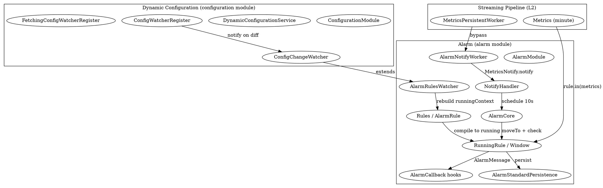

# SkyWalking Alarm and Dynamic Configuration

## Introduction

本页深挖 Apache SkyWalking OAP 中两块密切相关、却又各自独立成 Module 的能力：**告警（Alarm）** 与 **动态配置（Dynamic Configuration）**。

- **从 Module System 视角看**：二者都是 OAP 模块化体系下的一等公民。`alarm` 模块（`AlarmModule.java:29`）声明了 `MetricsNotify` / `AlarmRulesWatcherService` / `AlarmStatusWatcherService` / `AlarmKernelService` 四个服务（`AlarmModule.java:36-43`）；`configuration` 模块（`ConfigurationModule.java:31`）只暴露一个服务 `DynamicConfigurationService`（`ConfigurationModule.java:38-40`）。二者均按 [Module System](/docs/CS/SE/SkyWalking/Module_System.md) 描述的"Module / Provider / Service"三元模型与四阶段生命周期启动。
- **从 Streaming Pipeline 视角看**：告警是流式管线 L2 落库后的**旁路消费者**。L2 的 `MetricsPersistentWorker` 在把分钟级指标刷盘时，会经 `AlarmNotifyWorker`（`AlarmNotifyWorker.java:30-43`）把 `Metrics` 转发给告警入口，告警由此派生于 Metrics 流——这正是 [Streaming Pipeline](/docs/CS/SE/SkyWalking/Streaming_Pipeline.md) 提到的"AlarmNotifyWorker（旁路）"。
- **从 Analyzer Family 视角看**：动态配置是 analyzer 各类规则（MAL / LAL / 采样率 / 慢阈值……）**热更新的底座**。例如 `MalConverterRegistry`（`meter-analyzer` 模块服务，见 [Analyzer Family](/docs/CS/SE/SkyWalking/Analyzer_Family.md)）就是 runtime-rule 热换 MAL 规则的实现出口，而它的"何时重编译"正由动态配置的 `ConfigChangeWatcher` 触发（无 runtime-rule 时规则来自磁盘，有则来自配置中心）。

> 版本基线：源码仓库 HEAD `12ff4613c8`，见 [SkyWalking](/docs/CS/SE/SkyWalking/SkyWalking.md)。

三个反直觉的关键点：

1. **告警不从原始 Source 求值，而是消费已落库的分钟级 Metrics**：`NotifyHandler.notify` 收到的已经是 `WithMetadata` 的 `Metrics`（`NotifyHandler.java:136-138`），告警表达式（MQE）在这些 Metrics 上求值。
2. **告警规则本身也是"配置项"，可被配置中心热更新**：`AlarmRulesWatcher` 直接 `extends ConfigChangeWatcher`（`AlarmRulesWatcher.java:54`），在 `AlarmModuleProvider.start()` 里被注册进动态配置服务（`AlarmModuleProvider.java:98`）。因此改 `alarm-settings` 无需重启。
3. **动态配置的核心是"注册Watcher + 周期/监听比对 + 回调 apply"**：所有需要热更新的子系统（告警、MAL、采样、慢阈值……）都只是注册了一个 `ConfigChangeWatcher`，配置中心后端只负责把值拉下来、比对差异、调用 `watcher.notify(...)`。

## 告警模块架构（规则 / 求值 / 通知）

告警模块代码位于 `oap-server/server-alarm-plugin`（运行时类在 `…/core/alarm/provider` 包下），`AlarmModule` 定义在 `oap-server/server-core/…/alarm/AlarmModule.java`。

### 1. 启动与装配（AlarmModuleProvider）

`AlarmModuleProvider` 在四个生命周期阶段完成装配（`AlarmModuleProvider.java:46`）：

- `prepare()`（`AlarmModuleProvider.java:80-90`）：创建 `AlarmRulesWatcher`（持有默认 `Rules`）、`NotifyHandler`，并注册四个服务：`MetricsNotify`（实现即 `NotifyHandler`）、`AlarmRulesWatcherService`、`AlarmStatusWatcherService`、`AlarmKernelService`。
- `start()`（`AlarmModuleProvider.java:93-99`）：从 `ConfigurationModule` 取出 `DynamicConfigurationService`，把 `alarmRulesWatcher` 注册为配置变更监听器——这是告警规则能热更新的关键一步。
- `notifyAfterCompleted()`（`AlarmModuleProvider.java:102-115`）：读取 `alarm-settings.yml`（`ResourceUtils.read("alarm-settings.yml")`），用 `RulesReader` 解析为 `Rules`，调用 `alarmRulesWatcher.initConfig(rules)` 初始化；随后 `notifyHandler.init(new AlarmStandardPersistence(getManager()))` 装载持久化回调并启动 `AlarmCore`。

其 `requiredModules()` 声明依赖 `CoreModule` / `ConfigurationModule` / `TelemetryModule`（`AlarmModuleProvider.java:136-142`），其中 `ConfigurationModule` 的强依赖印证了"动态配置是告警规则热更新底座"。

### 2. 规则模型（AlarmRule / Rules）

`AlarmRule`（`AlarmRule.java:53`）是单条规则的数据模型，关键字段有：

- `expression`：告警表达式，使用 **MQE（Metrics Query Expression）** 语法。`setExpression`（`AlarmRule.java:75-109`）会先用 `MQELexer`/`MQEParser` 解析，再用 `AlarmMQEVerifyVisitor` 校验：表达式必须返回**布尔结果**且为 `SINGLE_VALUE`（`AlarmRule.java:93-100`），同时校验表达式里引用的指标属于**同一 scope**（`verifyIncludeMetrics`，`AlarmRule.java:111-120`）。
- `includeMetrics`：表达式实际引用的指标名集合（由校验 visitor 反填，`AlarmRule.java:104`）。
- `period` / `silencePeriod` / `recoveryObservationPeriod`：窗口长度、静默期、恢复观察期。
- `hooks`：该规则命中后要触发的通知渠道集合（webhook / slack / wechat / feishu …）。

多条 `AlarmRule` 被 `Rules`（`Rules.java`）聚合；`RulesReader` 负责从 YAML 解析并实例化。

### 3. 求值：从 Metrics 派生告警（NotifyHandler → AlarmCore → RunningRule）

告警的消费入口是 `AlarmNotifyWorker`（`AlarmNotifyWorker.java:39-43`），它把落库后的 `Metrics` 经 `AlarmEntrance.forward`（`AlarmEntrance.java:32-40`）转交 `MetricsNotify.notify`。

`NotifyHandler.notify`（`NotifyHandler.java:136-251`）做两件事：

1. **按 scope 把 Metrics 映射成 `MetaInAlarm`**：仅处理 service / service-instance / endpoint 及其 relation 六大类 catalog 的 scope（`NotifyHandler.java:141-143`），通过 `IDManager` 还原出可读的实体名与 layer 信息。
2. **查找并喂给 RunningRule**：`core.findRunningRule(meta.getMetricsName())`（`NotifyHandler.java:245`）按指标名反查匹配的规则，然后 `rule.in(metaInAlarm, metrics)`（`NotifyHandler.java:250`）。

`RunningRule`（`RunningRule.java:76`）是"运行态的某条规则"，为每个匹配的实体维护一个滑动时间窗 `Window`：

- `in()`（`RunningRule.java:135-156`）：先过滤 `includeMetrics` 与 include/exclude 名单/正则，再按 `AlarmEntity`（`scope/name/id0/id1/layers`）建/取 `Window`，把该分钟 `Metrics` 放进窗口。
- `Window.checkAlarm()`（`RunningRule.java:375-397`）：调用 `isMatch()` 用 `AlarmMQEVisitor` 对窗口内若干分钟的 Metrics 表达式求值（`RunningRule.java:418-474`）——`isMatch==1` 表示命中。命中后驱动内嵌的 `AlarmStateMachine`（`RunningRule.java:522-639`，状态 `NORMAL/FIRING/SILENCED_FIRING/OBSERVING_RECOVERY/RECOVERED`）产生 `AlarmMessage` 或 `AlarmRecoveryMessage`。`silencePeriod` 控制连发静默，`recoveryObservationPeriod` 控制恢复确认。
- `Window` 缓冲区大小为 `period + additionalPeriod`（`RunningRule.java:294`），`additionalPeriod` 来自表达式里的趋势（`maxTrendRange`）。

定时驱动在 `AlarmCore`（`AlarmCore.java:41`）：`start()` 起一个单线程调度（`scheduleAtFixedRate(..., 10, 10, SECONDS)`，`AlarmCore.java:73-121`），每分钟推进所有 `RunningRule.moveTo(checkTime)` 并把 `check()` 产出的 `AlarmMessage` 分发给全部 `AlarmCallback`。注意它刻意避开每分钟前 15 秒（`checkTime.getSecondOfMinute() > 15`，`AlarmCore.java:85`）以避免假告警。

### 4. 通知（AlarmMessage → AlarmCallback 子类）

`AlarmCallback` 接口（`AlarmCallback.java:30`）定义 `doAlarm(...)` 与 `doAlarmRecovery(...)`。所有通知渠道都在 `NotifyHandler.buildCallbacks`（`NotifyHandler.java:257-270`）里被实例化为 `List<AlarmCallback>`：

- `WebhookCallback`（`webhook/WebhookCallback.java:41`）：按 hook 名分组，`doAlarmCallback` 把消息 JSON 化并 `post` 到配置的 URL（`WebhookCallback.java:52-76`，支持 `recoveryUrls` 区分恢复通知）。
- `GRPCCallback`：通过 gRPC 推送到远端。
- `SlackhookCallback` / `WechatHookCallback` / `DingtalkHookCallback` / `FeishuHookCallback` / `WeLinkHookCallback` / `PagerDutyHookCallback` / `DiscordHookCallback`：各自对应一个 IM/运维平台的 Webhook 渠道。

此外 `notifyHandler.init(new AlarmStandardPersistence(...))`（`AlarmModuleProvider.java:114`）注入 `AlarmStandardPersistence`，负责把告警消息本身**落库**（OAP 的 `alarm` Record），使告警消息可在 UI 查询。`HttpAlarmCallback`（各 HTTP 渠道的基类）还接入 `AlarmHttpDeliveryMetrics`（`AlarmModuleProvider.java:117-122`）做投递可观测，即本基线 commit `12ff4613c8` 的 so11y 增强。

## 动态配置架构（多后端 + ConfigWatcher 机制 + runtime-rule 热更新）

动态配置模块代码位于 `oap-server/server-configuration`，由 `configuration-api`（抽象与契约）与各后端 provider（`configuration-none` / `grpc-configuration-sync` / `configuration-zookeeper` / `configuration-kubernetes` / `configuration-nacos` / `configuration-etcd` / `configuration-consul` / `configuration-apollo`）组成。

### 1. 契约：ConfigurationModule 与 DynamicConfigurationService

`ConfigurationModule`（`ConfigurationModule.java:30`）只暴露一个服务 `DynamicConfigurationService`（`ConfigurationModule.java:38-40`），其唯一方法就是"注册一个 watcher"（`DynamicConfigurationService.java:32`）：

```java
public interface DynamicConfigurationService extends Service {
    void registerConfigChangeWatcher(ConfigChangeWatcher watcher);
}
```

`ConfigChangeWatcher`（`ConfigChangeWatcher.java:30`）是被监听项的抽象：

- 构造时给定 `module` / `provider` / `itemName`，由此拼出全局唯一的监听 key（`module.provider.itemName`）；
- 抽象方法 `notify(ConfigChangeEvent)`（`ConfigChangeWatcher.java:48`）在值变化时回调，`value()`（`ConfigChangeWatcher.java:53`）返回当前值；
- 事件类型 `EventType.ADD/MODIFY/DELETE`（`ConfigChangeWatcher.java:72-74`），监听类型 `WatchType.SINGLE/GROUP`（`ConfigChangeWatcher.java:76-78`，GROUP 对应 `GroupConfigChangeWatcher`）。

### 2. 注册中心：ConfigWatcherRegister 与多后端 provider

`AbstractConfigurationProvider`（`AbstractConfigurationProvider.java:30`）是各后端的公共基类：`prepare()` 里 `initConfigReader()`（抽象，`AbstractConfigurationProvider.java:44`）造出具体的 `ConfigWatcherRegister`，并把它注册为 `DynamicConfigurationService` 实现（`AbstractConfigurationProvider.java:39-42`）；`notifyAfterCompleted()` 调 `configWatcherRegister.start()`（`AbstractConfigurationProvider.java:52-54`）。

`ConfigWatcherRegister`（`ConfigWatcherRegister.java:31`）`implements DynamicConfigurationService`，提供差异比对助手：

- `notifySingleValue`（`ConfigWatcherRegister.java:35-63`）：新值 null→派发 `DELETE`；新值与旧值不等→派发 `MODIFY`。值相同则静默。
- `notifyGroupValues`（`ConfigWatcherRegister.java:65-116`）：GROUP 类型的逐项 diff，新增/修改/删除分别派发。
- `WatcherHolder` 的 key 恰为 `module.provider.itemName`（`ConfigWatcherRegister.java:123-129`）。

后端分两类拉取策略：

- **拉取型（Fetching）**：`FetchingConfigWatcherRegister`（`FetchingConfigWatcherRegister.java:36`）。`registerConfigChangeWatcher`（`FetchingConfigWatcherRegister.java:54-76`）在 `start()` 前收集所有 watcher 到 `Register`；`start()`（`FetchingConfigWatcherRegister.java:79-97`）起一个 `ConfigWatcherSync` 定时任务（默认 `syncPeriod=60s`），周期调用 `configSync` → `readConfig`/`readGroupConfig`（抽象，`FetchingConfigWatcherRegister.java:155,157`）向具体后端（Nacos/ZK/etcd/Consul/Apollo/K8s…）拉取，再经 `notifySingleValue`/`notifyGroupValues` 回调。例如 `NacosConfigWatcherRegister`（`configuration-nacos/…/NacosConfigWatcherRegister.java`）就实现这两个 `read` 方法。
- **监听型（Listening）**：`ListeningConfigWatcherRegister`（`ListeningConfigWatcherRegister.java:30`），由 gRPC 等推送后端使用，收到推送即比对派发。

`configuration-none`（默认 provider）的 `registerConfigChangeWatcher` 是空实现（`NoneConfigurationProvider.java:49`），即"无配置中心"时所有默认值来自本地 YAML。

### 3. runtime-rule 热更新：配置驱动规则无需重启

"runtime-rule"是动态配置能力的集中体现——任何想热更新的规则，只需把它做成 `ConfigChangeWatcher` 并注册，配置中心一改就回调 `apply`。两条典型链路：

- **告警规则热更新**：`AlarmRulesWatcher extends ConfigChangeWatcher`（`AlarmRulesWatcher.java:54`），itemName 为 `"alarm-settings"`（`AlarmRulesWatcher.java:67`）。其 `notify(ConfigChangeEvent)`（`AlarmRulesWatcher.java:79-95`）在收到 DELETE 时清空、收到 MODIFY 时用 `RulesReader` 重新解析并调用 `notify(Rules)`（`AlarmRulesWatcher.java:112-139`）以 **volatile 替换** `runningContext` / `exprMetricsMap`——运行中规则即时生效，且会尽量复用已有 `RunningRule` 以保留历史窗口（`AlarmRulesWatcher.java:118-122`）。`initConfig`（`AlarmRulesWatcher.java:97-107`）用 `notifiedByDynamicConfig` 标志保证"配置中心推送优先于本地 YAML"。
- **Analyzer 规则热更新（MAL 等）**：`AnalyzerModuleProvider.start()` 注册了 `DBLatencyThresholdsAndWatcher`、`TraceSamplingPolicyWatcher`、`CacheRead/WriteLatencyThresholdsAndWatcher` 等 watcher（`AnalyzerModuleProvider.java:138-142`）。更广义的 MAL/LAL 规则热换由 runtime-rule 插件完成——`MalConverterRegistry`（`meter-analyzer` 模块服务，`MalConverterRegistry.java:48`，`extends Service`）即 runtime-rule 的注册出口：动态配置中心把 `mal-rules` / `otel-rules` 等目录下的规则文件推送下来，analyzer 据此用 `MALClassGenerator` / `MALBytecodeHelper` 重新编译单条 MAL 转换器并 `addOrUpdate`，**无需重启**即可生效（`MalConverterRegistry.java:25-48` 注释详述了 copy-on-write 的 registry 语义）。这与 [LAL/MAL Script](/docs/CS/SE/SkyWalking/LAL_MAL_Script.md) 描述的脚本编译体系直接衔接。

## 二者衔接：配置驱动告警与 analyzer 规则热更

动态配置与告警不是并列的两块，而是**底座与消费者**：

- 告警模块在 `start()` 阶段主动 `find(ConfigurationModule.NAME).getService(DynamicConfigurationService.class)` 并 `registerConfigChangeWatcher(alarmRulesWatcher)`（`AlarmModuleProvider.java:94-98`）——没有动态配置，告警规则就只能来自静态 `alarm-settings.yml`。
- analyzer 家族（`agent-analyzer` / `log-analyzer` / `meter-analyzer`）同样通过注册 `ConfigChangeWatcher` 把阈值、采样率、MAL/LAL 脚本挂到配置中心，实现 runtime-rule 热更。
- 二者都遵循同一套 Module 生命周期与 SPI 装配（见 [Module System](/docs/CS/SE/SkyWalking/Module_System.md)），且告警实际消费的是 [Streaming Pipeline](/docs/CS/SE/SkyWalking/Streaming_Pipeline.md) L2 落库后的 Metrics。



## 关键设计点

- **告警消费落库后的 Metrics，而非 Source**：`AlarmNotifyWorker` 是 L2 旁路（`AlarmNotifyWorker.java:39-43`），保证告警基于"已聚合、已权威合并"的分钟指标求值，避免原始增量误触发。
- **表达式用 MQE 统一求值**：告警条件不再是一组静态阈值字段，而是 `AlarmRule.expression` 经 `AlarmMQEVerifyVisitor`（校验）与 `AlarmMQEVisitor`（运行求值）处理的 MQE 布尔表达式（`AlarmRule.java:75-109`、`RunningRule.java:418-474`），与查询引擎同构。
- **状态机保证语义正确**：`AlarmStateMachine`（`RunningRule.java:522-639`）用 `silencePeriod` / `recoveryObservationPeriod` 区分 FIRING / 静默 / 恢复观察 / 恢复，避免抖动。
- **热更新是"注册 watcher"范式**：动态配置把"怎么从后端取数"与"值变了怎么办"彻底解耦——后端只管 `readConfig`，所有语义都在各 `ConfigChangeWatcher.notify` 里；新增一种可热更项，只需新增一个 watcher 并注册，不触碰后端代码。
- **配置中心推送优先于本地 YAML**：`AlarmRulesWatcher` 用 `notifiedByDynamicConfig` 原子标志确保一旦配置中心下发过，本地 `alarm-settings.yml` 不再覆盖（`AlarmRulesWatcher.java:97-107`），这与 OAP "动态配置覆盖静态配置"的一贯约定一致。

## Links

- [Module System](/docs/CS/SE/SkyWalking/Module_System.md)
- [Streaming Pipeline](/docs/CS/SE/SkyWalking/Streaming_Pipeline.md)
- [Analyzer Family](/docs/CS/SE/SkyWalking/Analyzer_Family.md)
- [LAL/MAL Script](/docs/CS/SE/SkyWalking/LAL_MAL_Script.md)
- [SkyWalking](/docs/CS/SE/SkyWalking/SkyWalking.md)
- [APM](/docs/CS/SE/APM.md)

## References

- [AlarmModule.java (commit 12ff4613c8)](https://github.com/apache/skywalking/blob/12ff4613c8/oap-server/server-core/src/main/java/org/apache/skywalking/oap/server/core/alarm/AlarmModule.java)
- [AlarmModuleProvider.java](https://github.com/apache/skywalking/blob/12ff4613c8/oap-server/server-alarm-plugin/src/main/java/org/apache/skywalking/oap/server/core/alarm/provider/AlarmModuleProvider.java)
- [NotifyHandler.java](https://github.com/apache/skywalking/blob/12ff4613c8/oap-server/server-alarm-plugin/src/main/java/org/apache/skywalking/oap/server/core/alarm/provider/NotifyHandler.java)
- [AlarmCore.java](https://github.com/apache/skywalking/blob/12ff4613c8/oap-server/server-alarm-plugin/src/main/java/org/apache/skywalking/oap/server/core/alarm/provider/AlarmCore.java)
- [RunningRule.java](https://github.com/apache/skywalking/blob/12ff4613c8/oap-server/server-alarm-plugin/src/main/java/org/apache/skywalking/oap/server/core/alarm/provider/RunningRule.java)
- [AlarmRulesWatcher.java](https://github.com/apache/skywalking/blob/12ff4613c8/oap-server/server-alarm-plugin/src/main/java/org/apache/skywalking/oap/server/core/alarm/provider/AlarmRulesWatcher.java)
- [WebhookCallback.java](https://github.com/apache/skywalking/blob/12ff4613c8/oap-server/server-alarm-plugin/src/main/java/org/apache/skywalking/oap/server/core/alarm/provider/webhook/WebhookCallback.java)
- [ConfigurationModule.java](https://github.com/apache/skywalking/blob/12ff4613c8/oap-server/server-configuration/configuration-api/src/main/java/org/apache/skywalking/oap/server/configuration/api/ConfigurationModule.java)
- [DynamicConfigurationService.java](https://github.com/apache/skywalking/blob/12ff4613c8/oap-server/server-configuration/configuration-api/src/main/java/org/apache/skywalking/oap/server/configuration/api/DynamicConfigurationService.java)
- [ConfigChangeWatcher.java](https://github.com/apache/skywalking/blob/12ff4613c8/oap-server/server-configuration/configuration-api/src/main/java/org/apache/skywalking/oap/server/configuration/api/ConfigChangeWatcher.java)
- [ConfigWatcherRegister.java](https://github.com/apache/skywalking/blob/12ff4613c8/oap-server/server-configuration/configuration-api/src/main/java/org/apache/skywalking/oap/server/configuration/api/ConfigWatcherRegister.java)
- [FetchingConfigWatcherRegister.java](https://github.com/apache/skywalking/blob/12ff4613c8/oap-server/server-configuration/configuration-api/src/main/java/org/apache/skywalking/oap/server/configuration/api/FetchingConfigWatcherRegister.java)
- [MalConverterRegistry.java](https://github.com/apache/skywalking/blob/12ff4613c8/oap-server/analyzer/meter-analyzer/src/main/java/org/apache/skywalking/oap/meter/analyzer/v2/MalConverterRegistry.java)
- [SkyWalking Backend Alarm (official docs)](https://skywalking.apache.org/docs/main/latest/en/setup/backend/backend-alarm/)
- [SkyWalking Dynamic Configuration (official docs)](https://skywalking.apache.org/docs/main/latest/en/setup/backend/backend-dynamic-config/)
