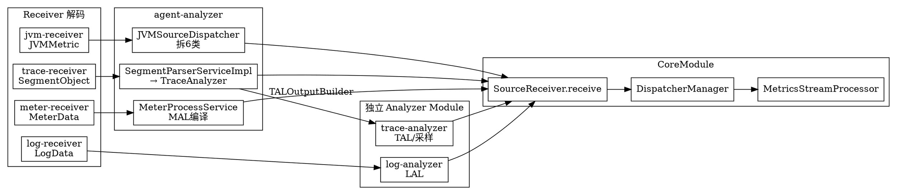

# SkyWalking Analyzer Family

## Introduction

本页深挖 Apache SkyWalking OAP Server 的**分析器族（Analyzer Family）**——即从 Receiver 解码出来的
`Source` 在进入流式聚合管线（`Streaming_Pipeline.md`）之前，各类遥测数据如何被"加工 / 拆分 / 派生"
为更细的 `Source`。它与前序页面的关系是：

- `Module_System.md`：每个 analyzer 都是独立的 `Module`（或 agent 侧的加工服务），通过 ModuleManager 协同；
- `Streaming_Pipeline.md`：所有 analyzer 的**产物**最终都汇入 `CoreModule` 的 `SourceReceiver.receive(source)`，
  再走 DispatcherManager → MetricsStreamProcessor；
- `OAL_Runtime.md` / `LAL_MAL_Script.md`：指标由 OAL 生成、日志/指标脚本由 LAL/MAL 生成，analyzer 是这些脚本的运行时执行场所；
- `LAL_MAL_Script.md`：日志与指标的脚本引擎细节在此页点到为止，详见该页。

> 代码基线：本仓库 HEAD `12ff4613c835c6950ebddb47651c911f2a7d7f9d`（10.x 形态）。
> 本仓库**不含** agent / rover（独立仓库）与 UI（booster-ui 子模块未拉取），analyzer 全部位于 `oap-server/analyzer/` 与各 receiver 之后。

## 模块全景：四类遥测，四个 analyzer 模块

`oap-server/analyzer/` 下并非单块，而是按遥测类型拆分的多个 module：

| Module（NAME） | 目录 | 职责 | 暴露的核心服务 |
| --- | --- | --- | --- |
| `agent-analyzer` | `analyzer/agent-analyzer` | trace 段解析、JVM、原生 meter 编排 | `ISegmentParserService`、`IMeterProcessService`、`MalConverterRegistry`、`UninstrumentedGatewaysConfig`（`AnalyzerModule.java:28,:36-44`） |
| `trace-analyzer` | `analyzer/trace-analyzer` | TAL（Trace Analysis Language）编译与 trace 采样 | `ITraceAnalyzerService`（`TraceAnalyzerModule.java:27,:36`） |
| `log-analyzer` | `analyzer/log-analyzer` | 日志接入 + LAL 脚本引擎 | 见 `LAL_MAL_Script.md`（`LogAnalyzerModule.java`） |
| `meter-analyzer` | `analyzer/meter-analyzer` | MAL 编译器（`MetricConvert` / `MALClassGenerator`） | 被 agent-analyzer 的 `MeterProcessService` 调用，本身不独占总线 |

此外还有 3 个 AI 时代的 analyzer：`ai-agent-conversation`、`ai-evaluation`、`gen-ai-analyzer`
（LLM 对话 / 评估 / GenAI 链路的可观测性，详见 P2-5）。

**统一出口**：无论哪类 analyzer，加工后的数据都通过 `moduleManager.find(CoreModule.NAME).provider().getService(SourceReceiver.class)`
拿到 `SourceReceiver` 并 `receive(source)`，从而接入 P0-2 的流式管线。这是"分析器=Source 生产者"的设计主线。

## Trace 加工：SegmentParser → 监听器组

trace 是最复杂的加工路径。接收端（`trace-receiver-plugin`）解码出 `SegmentObject`
后交给 `agent-analyzer` 的 `ISegmentParserService`：

```java
// SegmentParserServiceImpl.java:38-41
public void send(SegmentObject segment) {
    final TraceAnalyzer traceAnalyzer = new TraceAnalyzer(moduleManager, listenerManager, config);
    traceAnalyzer.doAnalysis(segment);
}
```

`TraceAnalyzer.doAnalysis`（`TraceAnalyzer.java:45-72`）的骨架是**按 span 类型分发到一组监听器**：

- `notifySegmentListener`：整段级（`SegmentListener`）
- 逐 span 按 `SpanType` 分发：`Exit` → `ExitAnalysisListener`、`Entry` → `EntryAnalysisListener`、
  `Local` → `LocalAnalysisListener`、`spanId==0` → `FirstAnalysisListener`
- 最后 `notifyListenerToBuild()` 让每个监听器把累积的产物 `build()` 出去

监听器的装配是**按需 + 按模块依赖**的（`TraceAnalyzer.java:118-129`）：

```java
listenerManager.getSpanListenerFactories().forEach(spanListenerFactory -> {
    for (final String moduleName : spanListenerFactory.requiredModules()) {
        if (!moduleManager.has(moduleName)) return;   // 缺依赖则不装配
    }
    analysisListeners.add(spanListenerFactory.create(moduleManager, config));
});
```

典型监听器及其派生的 `Source`（`build()` 时 `sourceReceiver.receive`）：

- `SegmentAnalysisListener`：生成 Segment 索引记录与标签自动补全
  （`SegmentAnalysisListener.java:182` `sourceReceiver.receive(segment)`、`:193` tagAutocomplete）
- `RPCAnalysisListener`：从 RPC 调用派生 Service / ServiceInstance / Endpoint 及其 Relation
  （`RPCAnalysisListener.java:280-312` 一连串 `sourceReceiver.receive(...)`）
- `EndpointDepFromCrossThreadAnalysisListener`：跨线程端点依赖
  （`:135-137` 三类 `toSourceEndpoint/toEndpoint/toEndpointRelation`）

### TAL 衔接（慢 SQL / 采样）

`trace-analyzer` 模块的 TAL 编译器（`TALClassGenerator`，ANTLR4 + Javassist）把 trace 分析规则
（慢查询、采样）编译成字节码。`agent-analyzer` 侧通过 `TALOutputBuilder` 接口接收 TAL 产物，
例如 `DatabaseSlowStatementBuilder implements LALOutputBuilder, TALOutputBuilder`
（`DatabaseSlowStatementBuilder.java:42`），其 `complete(SourceReceiver)` 把慢 SQL 记录汇入管线
（`:150-163` `sourceReceiver.receive(toDatabaseSlowStatement())`）。即 TAL 在 trace 维度做"按规则提取结构化记录"。

## JVM 加工：一条指标拆六类 Source

JVM 数据由 `jvm-receiver` 解码后调用 `agent-analyzer` 的 `JVMSourceDispatcher`
（注意 JVM 不在 `AnalyzerModule` 的服务清单里，而是 receiver 直接 new 出来使用）。
`sendMetric`（`JVMSourceDispatcher.java:52-70`）把一条 `JVMMetric` 拆成 6 类 OAP Source，
各自 `sourceReceiver.receive`：

- `ServiceInstanceJVMCPU`（`:87`）
- `ServiceInstanceJVMGC`（`:118`，按 GC phase NEW/OLD/NORMAL 映射 `GCPhase`）
- `ServiceInstanceJVMMemory`（`:140`，heap/non-heap 标记）
- `ServiceInstanceJVMMemoryPool`（`:199`，12 种池类型映射 `MemoryPoolType`）
- `ServiceInstanceJVMThread`（`:222`）
- `ServiceInstanceJVMClass`（`:240`）

实体 ID 用 `IDManager.ServiceID/ServiceInstanceID.buildId(...)` 统一构造（`JVMSourceDispatcher.java:55-56`），
保证与 trace 侧的服务拓扑 ID 对齐。

## Meter 加工：MAL 编译 + 运行时热更新

原生 meter（Prometheus 风格指标，来自 meter-receiver / kafka-fetcher）的编排在
`MeterProcessService`（实现 `IMeterProcessService` + `MalConverterRegistry`，`MeterProcessService.java:49`）：

- 启动时 `start(List<Rule>)` 把每条 MAL 规则编译成 `MetricConvert` 并安装（`:72-80`），
  通过 `CoreModule` 的 `MeterSystem` 落库（`:73`）
- 转换器集合用 **copy-on-write volatile map**（`converters`，`:59`）维护，支持运行时热增删单条规则
  （`addOrReplaceConverter` / `removeConverter`，`:99-117`）—— 这正是 `AnalyzerModule.services()`
  暴露 `MalConverterRegistry` 的目的：runtime-rule 插件无需重启即可热换一条 MAL 规则
- MAL 编译器的细节（ANTLR4 + Javassist）见 `LAL_MAL_Script.md`

## Log 加工：独立 log-analyzer 模块 + LAL

日志由 `log-analyzer` 模块（`LogAnalyzerModule`）承载，LAL 脚本引擎在
`RecordSinkListener` / `TrafficSinkListener` 处把脚本处理后的日志 sink 成 `Source`。
完整机制（文法、编译器、运行时）见 `LAL_MAL_Script.md`，本页不再展开。

## 关键设计点

1. **分析器是 Source 的"生产者"，不是存储者**：所有 analyzer 只负责把遥测加工成 `Source`，
   统一交还 `SourceReceiver`，绝不自己写存储——存储是 `Storage_Abstraction.md` 的事。职责边界极清。
2. **trace 用监听器组 + 多分发点**：`AnalysisListener.Point`（Segment/First/Entry/Exit/Local）
   让同一段 trace 被多个关注不同维度的监听器同时消费，互不干扰。
3. **模块解耦靠 `requiredModules()`**：监听器按依赖的 module 是否存在来装配，使 OAP 可按部署裁剪功能。
4. **脚本引擎（OAL/LAL/MAL/TAL）与分析器共生**：OAL 生指标、LAL 生日志衍生、MAL 生指标、TAL 生 trace 衍生，
   而 analyzer 是这些脚本的运行时宿主——P0-3 / P2-2 是脚本侧，本页是宿主侧。



## Links

- [SkyWalking Module System](/docs/CS/SE/SkyWalking/Module_System.md)
- [SkyWalking Streaming Pipeline](/docs/CS/SE/SkyWalking/Streaming_Pipeline.md)
- [SkyWalking OAL Runtime](/docs/CS/SE/SkyWalking/OAL_Runtime.md)
- [SkyWalking LAL and MAL Script Engines](/docs/CS/SE/SkyWalking/LAL_MAL_Script.md)
- [SkyWalking](/docs/CS/SE/SkyWalking/SkyWalking.md)
- [APM](/docs/CS/SE/APM.md)

## References

- 代码基线：Apache SkyWalking `12ff4613c835c6950ebddb47651c911f2a7d7f9d`（10.x 形态）
- `oap-server/analyzer/agent-analyzer/.../module/AnalyzerModule.java`
- `oap-server/analyzer/agent-analyzer/.../provider/trace/parser/SegmentParserServiceImpl.java` / `TraceAnalyzer.java`
- `oap-server/analyzer/agent-analyzer/.../provider/jvm/JVMSourceDispatcher.java`
- `oap-server/analyzer/agent-analyzer/.../provider/meter/process/MeterProcessService.java`
- `oap-server/analyzer/trace-analyzer/.../module/TraceAnalyzerModule.java`
- `oap-server/analyzer/log-analyzer/.../module/LogAnalyzerModule.java`
- 官方文档：<https://skywalking.apache.org/docs/main/latest/en/concepts-and-designs/backend-overview/>
