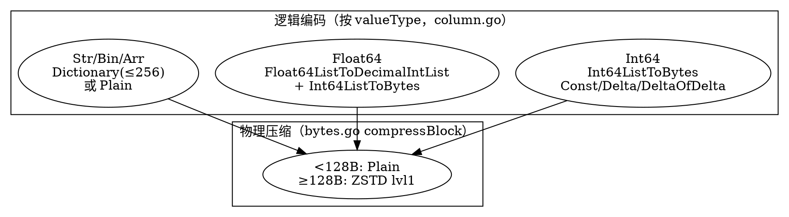

# BanyanDB Columnar Encoding and Compression

## Introduction

BanyanDB 的列式压缩分两层：**逻辑编码**（按列数据类型选择编码方案）与**物理压缩**（字节块级 ZSTD）。前者在 `banyand/measure/column.go` 的 `column.mustWriteTo` 中按 `valueType` 分派，后者在 `pkg/encoding/bytes.go` 的 `compressBlock` 统一施加。两者叠加，使一列数据在落盘前先被「类型感知编码」压到最小，再被「通用字节块压缩」兜底。本篇以 Measure 引擎为范本（Stream/Trace 复用同一套列编码逻辑），并说明 Gorilla-XOR 编解码器在仓库中的真实地位。

## 按值类型分派的逻辑编码

`column.mustWriteTo`（`column.go:257-281`）根据 `c.valueType` 走三条编码路径：

| `valueType` | 编码路径 | 头部前缀 |
| --- | --- | --- |
| `Int64` | `encodeInt64Column` → `Int64ListToBytes` | 1B encodeType + 8B firstValue |
| `Float64` | `encodeFloat64Column` → `Float64ListToDecimalIntList` + `Int64ListToBytes` | 1B encodeType + 2B exp + 8B firstValue |
| 其余（Str/Binary/Array/未知） | `encodeDefault` → Dictionary 或 Plain | 1B encodeType |

### Int64：增量族编码

`Int64ListToBytes`（`int_list.go:27-54`）对一列 int64 做自适应选择：`isConst`（全相等→`Const`）、`isDelta`（等差→`DeltaConst`/`Delta`）、`isIncremental`/`deltaOfDelta`（`DeltaOfDelta`），否则 `Delta`。这些都带 `*WithVersion` 变体用于在 `timestamps.bin` 中同时存版本（`encoding.go:87-98`、`GetVersionType`/`GetCommonType`）。读取侧 `BytesToInt64List`（`int_list.go:57-101`）按 `encodeType` 逆运算。block 层时间戳/版本列正是调用它（`block.go:400-412`）：先编码时间戳列表（`encodeType`/`min` 入 `timestampsMetadata`），再编码版本列表（`versionOffset` 分隔）。

### Float64：十进制缩放 + 增量

浮点不能直接做增量，BanyanDB 先把整列 float64 无损转成「定标 int64」：`Float64ListToDecimalIntList`（`float.go:30-66`）取最小指数 `minExp` 作公共缩放因子，把每个值乘 `10^diff` 变成整数（依赖 `floatToDecimal`，`float.go:104-181`，用最短 round-trip 十进制表示保证无损）。随后对这些整数走与 Int64 相同的 `Int64ListToBytes`，头部额外写 2 字节 `exp`（`column.go:480-535` 解码时 `exp` 反向除回浮点）。若某值无法无损转十进制（如 NaN/Inf），回退 `encodeDefault`/`Plain`。

### 默认（字符串/二进制/数组）：字典编码优先

`encodeDefault`（`column.go:366-378`）先用 `Dictionary.Add` 尝试构建字典（`maxUniqueValues = 256`，`dictionary.go:26`）：

- 若唯一值 ≤ 256 → `Dictionary.Encode`（`dictionary.go:92-100`）：写唯一值块 + `encodeRLE`（run-length，`dictionary.go:194-212`）+ `encodeBitPacking`（按最大值的位宽位打包，`dictionary.go:239-260`），前缀 `EncodeTypeDictionary`；
- 若超过 256 或字典构建失败 → `EncodeBytesBlock`（`bytes.go:44-70`）+ `Plain` 前缀。

解码侧 `decodeDefault`（`column.go:537-551`）据头部 1 字节区分。`Dictionary` 的 `DecodeWithLimit`/`ResetBounded`（`dictionary.go:52-62, 102-149`）支持按行数限流，配合向量化查询的内存预算。

### Null 与版本冲突

任一行为 null（`v == nil || string(v) == "null"`）即整列回退 `encodeDefault`/`Plain`（`column.go:290-297, 336-340`）。合并期若同一列出现类型漂移，写入侧用 `encodeTypedColumn`（`column.go:56-72`）在列名后追加 `#<suffix>`（int/float/str/bin/...）重新命名冲突列，`merger.go` 的 `collectConflictColumns`/`renameConflictColumns`（`merger.go:402-456`）保证合并后列可区分。

## 物理压缩：字节块级 ZSTD

所有「字节块」在写出前统一过 `compressBlock`（`bytes.go:308-321`）：长度 < 128 字节走 `compressTypePlain`（1B 类型 + 1B 长度 + 原文），否则 `compressTypeZSTD`（1B 类型 + VarUint64 长度 + `zstd.Compress(..., 1)`，**固定 level 1**）。该层作用在所有经 `EncodeBytesBlock`/`EncodeUint64Block` 的块上——即字典值块、uint64 长度块、Plain 默认列块。`decompressBlock`/`decompressBlockLimit`（`bytes.go:323-379`）提供对称解压，且带 `limit` 参数供查询按预算截断（超预算返回 `zstd.ErrDecompressionLimit`）。此外，part 的 `meta.bin` 在 `blockWriter.Flush` 时单独以 `zstd.Compress(..., 1)` 压缩（`block_writer.go:280-283`）。

> 注意：本仓库的压缩统一是 **ZSTD level 1**，无 Snappy/LZ4 等多算法切换；`compressType` 枚举只有 `Plain`/`ZSTD`（`bytes.go:303-306`）。

## 向量化解码：typedNumeric 零拷贝路径

读取时 `column.mustReadValues`（`column.go:385-405`）支持 `typedNumeric` 标志：当为 true 且列是 null-free 的 `Int64`/`Float64` 时，整数/浮点直接解到 `column.int64s`/`column.float64s`（`numericFormInt64`/`numericFormFloat64`，`column.go:147-200`），列不再以 `[][]byte` 暂存，查询批量可直接借用这些切片视图（`block.go:469-503`、`loadData` 的 `typedNumeric` 分支）。这是 BanyanDB 向量化查询（见 [BanyanDB Query Engine](/docs/CS/SE/SkyWalking/BanyanDB_Query_Engine.md)）的关键一环：解码结果天然是连续数值数组，省去逐行 re-encode。

## Gorilla-XOR 编解码器的真实地位

`pkg/encoding/xor.go` 实现了标准 Gorilla 浮点 XOR 压缩（`XOREncoder`/`XORDecoder`，`xor.go:29-172`，参考 VLDB'15 论文）。它也定义了 `SeriesEncoder`/`SeriesDecoder` 接口（`encoding.go:21-73`），作为「按时间序列编码数据点」的契约。但**实际生产路径并未把它接入 Measure 列写入**：`column.mustWriteTo` 只按 `valueType` 分派（见上），从不调用 `NewXOREncoder`（全仓仅在 `xor_test.go` 与 `xor.go` 自身引用）。Schema 的 `FieldSpec.encoding`（如 `ENCODING_METHOD_GORILLA`/`ZSTD`）目前只是**提示字段**，在 `banyand/measure` 的列编码中并未被严格采纳——这也印证了 [BanyanDB Data Model](/docs/CS/SE/SkyWalking/BanyanDB_Data_Model.md) 中「GORILLA/ZSTD 仅 hint」的结论。

## 编码/压缩总览

## Links

- [BanyanDB](/docs/CS/SE/SkyWalking/BanyanDB.md)
- [BanyanDB TSDB Engine](/docs/CS/SE/SkyWalking/BanyanDB_TSDB_Engine.md)
- [BanyanDB Data Model](/docs/CS/SE/SkyWalking/BanyanDB_Data_Model.md)
- [BanyanDB Index Subsystem](/docs/CS/SE/SkyWalking/BanyanDB_Index.md)
- [BanyanDB Query Engine](/docs/CS/SE/SkyWalking/BanyanDB_Query_Engine.md)

## References

- `banyand/measure/column.go:32-72,147-281,366-551` — 按值类型编码/解码与 numericForm/向量化路径
- `pkg/encoding/int_list.go:27-101` — Int64 增量族编码与解码
- `pkg/encoding/float.go:30-92,104-181` — 浮点十进制无损缩放
- `pkg/encoding/encoding.go:82-130` — EncodeType 常量与 WithVersion 变体
- `pkg/encoding/dictionary.go:26-100,194-320` — 字典编码、RLE 与位打包
- `pkg/encoding/bytes.go:44-70,185-214,303-379` — 字节块 ZSTD 压缩/解压
- `pkg/encoding/xor.go:29-172` — Gorilla-XOR 编解码器（当前未接入列路径）
- `banyand/measure/block.go:400-412` — 时间戳/版本列编码入口
- `banyand/measure/block_writer.go:280-283` — meta 段 ZSTD 压缩
- `banyand/measure/merger.go:402-456` — 合并期冲突列重命名
