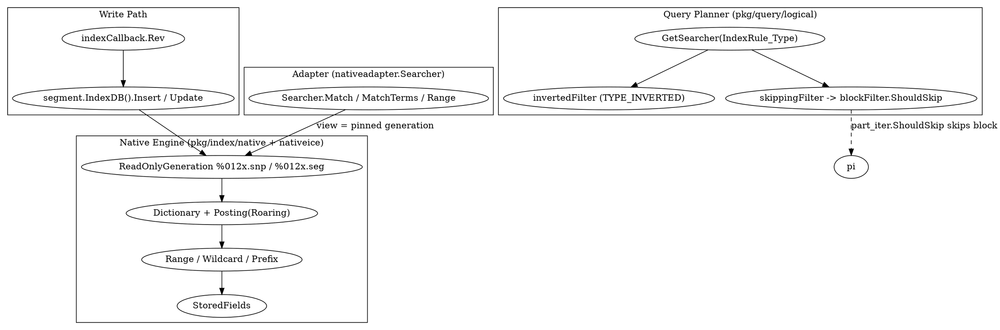

# BanyanDB Index Subsystem

## Introduction

BanyanDB 的索引子系统与列式 TSDB 引擎（[BanyanDB_TSDB_Engine](/docs/CS/SE/SkyWalking/BanyanDB_TSDB_Engine.md)）平行存在，但架构取向截然不同：存储引擎是 per-type（measure/stream/trace）各自实现、无统一抽象，而**索引层则有清晰的分层抽象**——`pkg/index` 定义接口，`pkg/index/native` 提供单一的原生 LSM 风格引擎，`pkg/index/nativeadapter` 把原生原语适配成抽象 `Searcher`，查询规划层（`pkg/query/logical`）再按 `IndexRule` 类型选择算子。

本篇逐层拆解：抽象索引接口与 Roaring 位图代数、IndexRule 三类语义、写入侧索引构建（`indexCallback`）、原生引擎的只读快照与内部结构、适配层统一 searcher，以及查询规划如何把同一查询拆成「inverted 过滤树 + skipping 过滤树」两棵并用于 block 级裁剪。TopN 的写时预聚合在 [BanyanDB_TSDB_Engine](/docs/CS/SE/SkyWalking/BanyanDB_TSDB_Engine.md) 已述，此处只做衔接。

## 1. 抽象索引层（pkg/index）

`pkg/index/index.go` 定义了一组松耦合接口，使上层查询规划与底层引擎实现解耦。核心接口：

- `Writer`（`index.go:790-796`）：`Batch` / `InsertSeriesBatch` / `UpdateSeriesBatch` / `Delete` / `EnableExternalSegments`。`Batch` 是批量写入的载体，内含 `Documents`。
- `Searcher`（`index.go:808-813`）：`Match`（按 term）、`MatchField`（字段存在性/全量）、`MatchTerms`（精确 term 成员）、`Range`（编码序范围）。
- `FieldIterable`（`index.go:799-805`）：`BuildQuery` / `Iterator` / `Sort`，支撑按字段迭代与排序游标。
- `Store`（`index.go:821-830`）：组合 `io.Closer` + `Writer` + `Searcher` + `FieldIterable` + `CollectMetrics` / `Reset` / `TakeFileSnapshot` / `Stats`。
- `SeriesStore`（`index.go:874-886`）：在 `Store` 之上增加 `Search` / `SeriesIterator` / `SeriesSort` / `StoredFields`，处理 series 维度查询与投影取回。
- `Filter`（`index.go:938-942`）：过滤树节点接口，`Execute(getSearcher GetSearcher, seriesID, timeRange)` 与 `ShouldSkip(tagFamilyFilters FilterOp)`——后者正是 SKIPPING 索引做块裁剪的入口。

### 1.1 posting.List：Roaring 位图代数

索引匹配的结算单元是 `posting.List`（`pkg/index/posting/posting.go:25-129`），接口提供 `Intersect` / `Union` / `Difference`，实现对「文档 ID 集合」的集合运算。默认实现位于 `posting/roaring`（基于 `github.com/RoaringBitmap/roaring`），因此多条件 AND/OR/NOT 的合并走 Roaring 位图交集/并集/差集，而非逐文档扫描。空结果用 `postingroaring.DummyPostingList` 表示（`nativeadapter/searcher.go:107`）。

## 2. IndexRule 三类型与语义

`IndexRule` 的 `Type` 枚举定义在 `api/proto/banyandb/database/v1/schema.proto:223-226`：

| 枚举 | 值 | 语义 |
| --- | --- | --- |
| `TYPE_INVERTED` | 1 | 倒排索引：为每个 term 维护 posting list，支撑等式 / `Match` / term 查询 |
| `TYPE_SKIPPING` | 2 | 跳跃索引：记录每个 block 的 min/max 等摘要，用于扫描时整块跳过非命中 block |
| `TYPE_TREE` | 3 | 树索引：面向层级数据（如 trace 的父-子 span 树） |

值得注意的是，**底层原生引擎（`pkg/index/native`）是单一引擎**，三类类型并不对应三套独立存储；它们的差异主要体现在：(1) 建索引时写入哪些结构，(2) 查询规划层（`pkg/query/logical`）选择哪种算子。`TYPE_INVERTED` 在 `index_filter.go:131` 被显式分支；`TYPE_SKIPPING` 则在规划层被独立建树（见 §6）。

## 3. 写入侧：索引如何被构建

索引不是 TSDB 主写入路径的同步附属，而是通过**事件总线 + 回调**异步构建。Measure 侧的 `indexCallback`（`banyand/measure/write_index.go`）监听两个 topic：

- `TopicMeasureSeriesIndexInsert` → `segment.IndexDB().Insert(documents)`
- `TopicMeasureSeriesIndexUpdate` → `segment.IndexDB().Update(documents)`

`Rev` 方法（`write_index.go:50-126`）从总线消息中解出 group、timestamp、以及 `index.Documents`，据此 `loadTSDB(group)` 并 `CreateSegmentIfNotExist(segmentTime)`，再将文档交给该 segment 的 `IndexDB().Insert`（`write_index.go:106-111`）。`Documents` 经 `documents.Unmarshal` 反序列化（`write_index.go:74-78`），每篇 `Document` 携带 `FieldKey`（`seriesID` + `field` + `Analyzer`）与值。

这套解耦意味着：**数据落 TSDB 与建索引是两个独立提交点**，索引写入失败不会回滚主数据；重放/恢复依赖 segment 的 `IndexDB` 自身持久化（见 §4）。

## 4. 原生 LSM 风格引擎（pkg/index/native）

`pkg/index/native` 是索引的「存储引擎」，底层依赖内部包 `pkg/index/internal/nativeice`（一个类 LSM 的不可变段存储）。其关键特征：

### 4.1 只读快照与命名

`ReadOnlyGeneration`（`native.go:53-125`）封装 `nativeice.Reader`，提供 `OpenReadOnlyGeneration`（尽力恢复最新结构完整代际）与 `OpenReadOnlyGenerationStrict`（严格，损坏即报错，用于备份/统计等不容静默回退场景）。代际（generation）由 manifest + segment 组成，磁盘命名固定为 `%012x.snp`（快照 manifest）与 `%012x.seg`（段数据）（`native.go:111-124`，`nativeICEFileName`）。`ReferencedFiles` 只返回当前代际引用的 `.snp`/`.seg`，便于冷索引目录的精准快照/备份（`native.go:97-116`）。

这与 TSDB 的「不可变 snapshot + 单调 epoch」模型（`BanyanDB_TSDB_Engine` §tsTable）同构：**查询拿到一个固定的只读代际视图**，写入通过新代际发布（publish snapshot）推进，从而读写互不阻塞。

### 4.2 内部原语

`pkg/index/native/query.go` 暴露查询原语，全部以「编码字节序 + 字典」为基础，不在索引层做数值解析：

- `TermSetRequest`（`query.go:79-98`）：精确 term 匹配，支持 `Terms` / `Prefix`（字典半开区间展开）/ `Wildcard`（通配展开），`Mode` 取 `MatchAnyTerm`/`MatchAllTerms`（OR/AND）。`MaxTerms`/`MaxCandidates` 强制界限，超预算返回 `ErrQueryLimit`（`query.go:35-38`），避免无界字典展开退化为全文档扫描。
- `RangeRequest`（`query.go:119+`）：按编码字节序选 term，数值调用方自行提供前缀编码的端点字节。
- `FieldRequest`（`query.go:106-111`）：字段存在性，由有界字典展开实现而非解码全部文档。
- `QueryScope`（`query.go:61-66`）：series 与 timestamp 约束，series 以精确编码 term 匹配 `SeriesField`。

`StoredFields`（`native.go:127+`）按 `docID` 取回存储字段（投影过滤），内部簿记字段（`_id`/`_timestamp`）始终排除；找不到返回 `nil, nil`。

## 5. 适配层（pkg/index/nativeadapter）：统一 Searcher

`nativeadapter.Searcher`（`pkg/index/nativeadapter/searcher.go:63`）实现抽象 `index.Searcher`，把接口调用**委托给原生引擎的视图（`s.view`）**，视图即 §4.1 的只读代际快照：

- `Match`（`searcher.go:102-167`）：先用 `analyzeTerms` 按 `Analyzer` 分词，再对每词 `s.view.MatchTermsSet(... TermSetRequest{Mode, Scope})`，多词间做交集（AND operator 时 `MatchAllTerms`）。
- `MatchField`（`searcher.go:186-202`）：走 `Iterator` 全量 scope 扫描——这是「字段存在性/全量」契约，而非严格的字段存在检查（注释明确：字段从未设置的文档仍以 cursor 的 missing 哨兵返回，NOT 过滤依赖此行为）。
- `MatchTerms`（`searcher.go:205-228`）：单值精确成员，同样 `MatchTermsSet`。
- `Range`（`searcher.go:232-255`）：空 range 退化为 `MatchField`；否则经 `nativeRange` 构造 `RangeRequest` 调 `s.view.MatchRange`。

因此「inverted/skip/tree 三类型」并非三套 searcher 实现，而是**同一 `Searcher` 在不同字段类型上的不同请求形态**；类型分派发生在更上层的 `GetSearcher`。

## 6. 查询规划分派（GetSearcher / 双过滤树 / SKIPPING 块裁剪）

`GetSearcher` 是「按 `IndexRule.Type` 取 searcher」的函数类型（`index.go:920-921`：`func(location databasev1.IndexRule_Type) (Searcher, error)`）。规划层据此把过滤树节点绑定到具体字段类型。

关键设计：`pkg/query/logical/stream/stream_plan_tag_filter.go:58-62` 对**同一 criteria 同时构建两棵过滤树**：

- `ctx.invertedFilter = buildLocalFilter(..., IndexRule_TYPE_INVERTED)`
- `ctx.skippingFilter = buildLocalFilter(..., IndexRule_TYPE_SKIPPING)`

`buildLocalFilter`（`index_filter.go:35`）递归解析 `Criteria`，在叶子节点按 `indexRule.Type == TYPE_INVERTED`（`index_filter.go:131`）选择 inverted 语义，SKIPPING 则走另一条分支。`ShouldSkip`（`Filter` 接口，`index.go:941`）把 skipping 过滤结果传递给存储扫描层。

真正的块裁剪发生在 TSDB 扫描器：`banyand/stream/part_iter.go:238-248` 在迭代 block 时调用 `pi.blockFilter.ShouldSkip(tfs)`，命中则整块跳过（不解码、不扫描该 block 内行）。这就是 `TYPE_SKIPPING`「记录 block min/max 摘要 → 扫描时跳过」语义的落点——它与 inverted 的「精确 posting 交集」互补：前者减少扫描的 block 数，后者精确定位文档。

`TYPE_TREE` 面向层级数据，规划层据 `IndexRule` 选择对应的树查询算子；原生引擎侧仍以同一套 posting/字典/段结构承载。

## 7. TopN 衔接

TopN 是写入期预聚合（流式 merge，`BanyanDB_TSDB_Engine` 已述），其结果与普通 measure block 同走列式落盘，并不在 `pkg/index` 抽象内另起一套索引；查询时 TopN 由 data node 本地 map + liaison reduce 完成（见 [BanyanDB](/docs/CS/SE/SkyWalking/BanyanDB.md) §2.3）。索引子系统对 TopN 的贡献仅限于其 series/tag 上的 inverted 过滤，用于定位 TopN 所属分组。

## Links

- [BanyanDB](/docs/CS/SE/SkyWalking/BanyanDB.md)
- [BanyanDB_TSDB_Engine](/docs/CS/SE/SkyWalking/BanyanDB_TSDB_Engine.md)
- [BanyanDB_Data_Model](/docs/CS/SE/SkyWalking/BanyanDB_Data_Model.md)
- [BanyanDB_Write_Path](/docs/CS/SE/SkyWalking/BanyanDB_Write_Path.md)
- [BanyanDB_Query_Engine](/docs/CS/SE/SkyWalking/BanyanDB_Query_Engine.md)

## References

- `pkg/index/index.go`（Store/Writer/Searcher/FieldIterable/SeriesStore/Filter 全套接口、GetSearcher）
- `pkg/index/posting/posting.go`（List 接口：Intersect/Union/Difference，Roaring 实现）
- `api/proto/banyandb/database/v1/schema.proto:223-226`（IndexRule 三类型枚举）
- `banyand/measure/write_index.go:50-126`（indexCallback → segment.IndexDB().Insert/Update）
- `pkg/index/native/native.go:53-125`（ReadOnlyGeneration、%012x.snp/%012x.seg、StoredFields）
- `pkg/index/native/query.go`（TermSetRequest/RangeRequest/FieldRequest/QueryScope 原语）
- `pkg/index/nativeadapter/searcher.go:102-255`（统一 Searcher 委托 native 视图）
- `pkg/query/logical/stream/stream_plan_tag_filter.go:58-62`、`index_filter.go:131`（双过滤树分派）
- `banyand/stream/part_iter.go:238-248`（SKIPPING 块裁剪落点）
