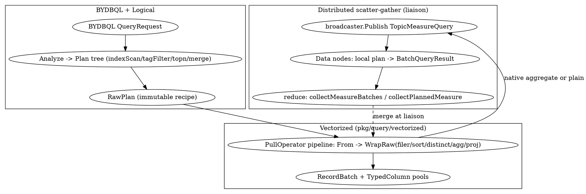

# BanyanDB Query Engine

## Introduction

BanyanDB 的查询引擎是一条**「BYDBQL → 逻辑计划 → 向量化 RecordBatch 执行 → 分布式 scatter-gather」**的链路。其设计重心是把过滤/投影/聚合/排序全部下沉到**列式 RecordBatch** 上做向量化处理，并在 liaison 层对跨 shard 查询做「广播本地计划 + 本地 reduce」，使网络传输的是已下推聚合的批次而非原始行。

本篇分四层拆解：查询语言与逻辑计划、逻辑计划算子树、向量化执行引擎、分布式 scatter-gather，并衔接 [BanyanDB_Index](/docs/CS/SE/SkyWalking/BanyanDB_Index.md)（索引过滤下推）与 [BanyanDB_TSDB_Engine](/docs/CS/SE/SkyWalking/BanyanDB_TSDB_Engine.md)（TopN 下推）。

## 1. BYDBQL 与逻辑计划

查询以 BYDBQL（`api/proto/banyandb/bydbql/v1`）表达，经逻辑层分析成计划树。条件解析把 `modelv1.Condition` 转成字面值或 entity（`ParseExprOrEntity`，`pkg/query/logical/parser.go:28`）——当条件作用于 entity 列且算子为 `EQ`/`IN` 时，直接折叠成 entity 候选集，缩减后续扫描面。

各数据类型有独立 `Analyze` 入口：`stream.Analyze`（`pkg/query/logical/stream/stream_analyzer.go:50`）、`trace.Analyze`（`trace/trace_analyzer.go:36`）。Measure 侧分析产出的核心对象是 `ql.RawPlan`——注释明确定义为「*the immutable bound recipe for a complete native measure scan and QL operators*」（`pkg/query/ql/raw.go:45-46`），字段含 `Slots`（列投影）、`Aggregate`、`Distinct`、`Sort`、`Having`、`Limit`/`Offset`、`Expressions`、`Ranges`/`Residual`/`Empty`。`RawPlan` 是计划与执行之间的**不可变契约**，后续所有 QL 算子都基于它构造 `vectorized.PullOperator`。

## 2. 逻辑计划算子树

分析器把查询拼成算子树，典型节点（以 stream/measure 为例）：

- **indexScanLocal**：本地索引/全表扫描起点，决定从哪些 part/block 读取。
- **tagFilterPlan**：把 `Criteria` 下推为过滤；在向量化路径中，它把 **INDEXED criteria 注入扫描的 `sqo`（invertedFilter / skippingFilter）**，使索引过滤在扫描层完成（见 §3、衔接 [BanyanDB_Index](/docs/CS/SE/SkyWalking/BanyanDB_Index.md)）。
- **topn / merge**：TopN 下推到 data node 本地 map，跨 shard 的 `merge` 在 liaison 做 reduce（衔接 TSDB 引擎的写时预聚合）。
- **distributed**：多 group/shard 的分散-汇聚包装。

计划树顶部通常是一个 `limit` 节点（`stream_plan_indexscan_local_vectorized.go:66` 注释「the analyzer always tops a stream plan with a limit node」），其 `Input` 解析到 `localIndexScan`。

## 3. 向量化执行引擎

`pkg/query/vectorized`（doc.go:18-20）提供「**RecordBatch 列式执行原语**：schema、columns、operator 接口、pipeline 组合、内存追踪」。关键构件：

- **列池**：`column_pool.go:32-40` 为 `decimal.Int128`/`int64`/`float64`/`string`/`[]byte`/数组/`TagValue`/`FieldValue` 各注册 `TypedColumnPool`，避免每批分配。
- **PullOperator pipeline**：`pipeline.go:152` 要求以 `From`（数据源）起手组装算子链；每算子 `Pull` 一批 `RecordBatch` 向上游返回，形成「拉式」向量化流。
- **向量化资格判定**：`VecExecutable(plan)`（`stream_plan_indexscan_local_vectorized.go:50`）判断计划能否走向量化快路径——要求计划顶为 `limit` 且其 `Input` 解析到 `localIndexScan`（无 criteria 直达，或经 `tagFilterPlan` 包裹）。对 tag-filter 情形，内层扫描已在请求中投影 criteria + hidden tags 并把 INDEXED criteria 推入 `sqo`（invertedFilter/skippingFilter）；**调用方随后把 criteria 与 hidden-tag 移除直接作用于「批次列」**，再选响应格式。这就是「零拷贝快路径 + 行合并」：过滤/投影在列批上整批完成，避免逐行物化。多 group 的 merge 计划由 `VecMergeExecutable` 单独处理（不在此单扫描路径）。

QL 层把 `RawPlan` 拆成算子链：`WrapRaw`（`pkg/query/ql/raw.go:94`）之下依次套 `wrapFilterQuery`（时间/条件过滤）、`wrapSortQuery`、`wrapHavingQuery`、`wrapDistinctQuery`（去重桶）、`wrapAggregateQuery`（分组聚合）、`wrapExpressionQuery`（投影/表达式）——每个都返回 `vectorized.PullOperator`，形成扫描→过滤→排序→去重→聚合→投影的列式流水线。

## 4. 分布式查询：scatter-gather

Liaison 的 `measureService.Query`（`banyand/liaison/grpc/measure.go`）是分布式汇聚点：

1. 先 `canUseNativeAggregate(req, rawPlan)` 判定是否走**原生向量化聚合**；是则 `executeNativeAggregate`。
2. 否则 `ms.broadcaster.Publish(ctx, data.TopicMeasureQuery, payload)` 并 `feat.Get()`（`measure.go:593-597`）——把查询广播到**全部 data node**（分布式查询不依赖 shard 映射，直接访问所有节点，见 [BanyanDB](/docs/CS/SE/SkyWalking/BanyanDB.md) §2.3）。
3. 回执经 `measureQueryResponseWithPlan` / `collectMeasureBatches` 还原（`measure.go:607`、`measureQueryResponse` 分支处理 `vmeasure.BatchQueryResult` 与 `*measurev1.QueryResponse`）。

**原生聚合分支**（向量化分布式）：`openNativeAggregateBranch`（`measure_ql_aggregate.go:190-231`）把 `BatchQueryRequest` 经 `broadcaster.Publish(TopicMeasureQuery)` 扇出到各 data node，`future.Get()` 取回 `vmeasure.BatchQueryResult`——它本身就是一个 `vectorized.PullOperator`（RecordBatch 流），而非行集合。Liaison 随后用 `collectPlannedMeasure` 在本地把各节点的批次流经 `vectorized.PullOperator` 合并、聚合，最后 `collectMeasureBatches` 仅序列化最终出口行（`measure.go:633` 注释「serializes only final egress rows after NativeScan consumes batches」）。这条路径把 reduce 也向量化了，网络只搬运聚合后的批次。

Reduce 侧实现位于 `pkg/query/ql`：`aggregate_merge_*` 负责跨分片分组聚合的合并，**map 在数据节点、reduce 在 liaison**，与枢纽页所述 measure 聚合下推一致。

## 5. 与写入/索引的衔接

- **索引过滤下推**：§2/§3 的 `tagFilterPlan` 把 INVERTED/SKIPPING 索引条件注入扫描 `sqo`，由 [BanyanDB_Index](/docs/CS/SE/SkyWalking/BanyanDB_Index.md) 的 invertedFilter/skippingFilter 在扫描层执行；SKIPPING 还在 `part_iter.ShouldSkip` 处做 block 级裁剪。
- **TopN 下推**：写时预聚合（TSDB 引擎）的结果由 data node 本地 map、liaison reduce（[BanyanDB_TSDB_Engine](/docs/CS/SE/SkyWalking/BanyanDB_TSDB_Engine.md)）。
- **内存预算**：向量化执行受 `vectorized.QueryMemoryTracker` 约束（`measure_ql_aggregate.go:157` `Reserve(256<<20)`），超预算即拒绝，与写入侧的内存保护（`protector.StateHigh`）形成全链路资源门控。

## Links

- [BanyanDB](/docs/CS/SE/SkyWalking/BanyanDB.md)
- [BanyanDB_TSDB_Engine](/docs/CS/SE/SkyWalking/BanyanDB_TSDB_Engine.md)
- [BanyanDB_Index](/docs/CS/SE/SkyWalking/BanyanDB_Index.md)
- [BanyanDB_Write_Path](/docs/CS/SE/SkyWalking/BanyanDB_Write_Path.md)
- [BanyanDB_Data_Model](/docs/CS/SE/SkyWalking/BanyanDB_Data_Model.md)

## References

- `pkg/query/logical/parser.go:28`（ParseExprOrEntity：condition→literal/entity）
- `pkg/query/logical/stream/stream_analyzer.go:50`、`trace/trace_analyzer.go:36`（Analyze 入口）
- `pkg/query/ql/raw.go:45-94`（RawPlan 定义、WrapRaw）
- `pkg/query/vectorized/doc.go:18-20`、`pipeline.go:152`、`column_pool.go:32-40`（向量化原语、列池）
- `pkg/query/logical/stream/stream_plan_indexscan_local_vectorized.go:50-75`（VecExecutable 向量化资格判定）
- `banyand/liaison/grpc/measure.go:586-633`（Query 分发、canUseNativeAggregate、collectMeasureBatches）
- `banyand/liaison/grpc/measure_ql_aggregate.go:42-231`（原生向量化聚合、openNativeAggregateBranch、collectPlannedMeasure）
- `pkg/query/ql/{filter,sort,distinct,aggregate,projection}_query.go`（WrapRaw 子算子）
