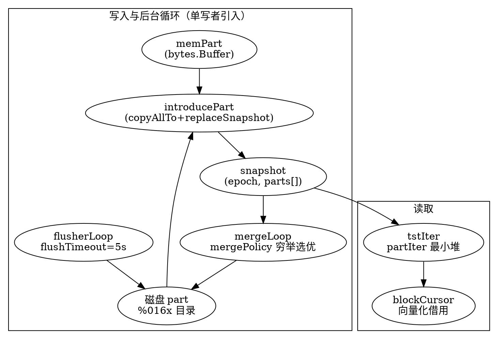

# BanyanDB Columnar TSDB Engine

## Introduction

BanyanDB 不为 Measure/Stream/Trace 提供统一的存储抽象层，而是让三者各自实现一套 `block_writer/block_reader → flusher → merger → gc → snapshot` 的列式 TSDB（参见 [BanyanDB](/docs/CS/SE/SkyWalking/BanyanDB.md) 的「存储引擎设计哲学」）。本篇以 **Measure 引擎** 为范本，逐层剖析这套引擎的物理结构（`block`/`part`/`tsTable`/`snapshot`）与后台循环（`flush`/`merge`/`gc`），并标定它与经典 LSM-Tree 的同与不同。Stream/Trace 复用同一套骨架，仅在 block 列布局与索引粒度上有差异（见 [BanyanDB Data Model](/docs/CS/SE/SkyWalking/BanyanDB_Data_Model.md)）。

引擎的核心创新点不在某个单点，而在 **「单写者 + 单调 epoch 的不可变快照」** 这一并发模型：`introducerLoop` 串行消费 mem/flush/merge 三类事件，每一次都基于当前 `snapshot` 做一次 copy-on-write 的 `replaceSnapshot`，从而把并发读写、崩溃恢复、版本一致性全部收敛到一条无锁主链上。

## 列式 Block：最小写入与读取单元

一个 block 是同一 `seriesID` 下一组按 timestamp 升序排列的数据点，列式存放：

```go
type block struct {
    timestamps  []int64        // 8B/点，单列
    versions    []int64        // 8B/点，单列（乐观锁/乱序版本号）
    tagFamilies []columnFamily // 可索引 tag，按 family 分列族
    field       columnFamily   // 仅 Measure 有，不可索引、仅聚合
}
```
— `banyand/measure/block.go:41-49`

写入侧约束来自 `measure.go`（`banyand/measure/measure.go:43-49`）：

- `maxBlockLength = 8 * 1024`（单 block 最多 8192 行）
- `maxUncompressedBlockSize = 2 * 1024 * 1024`（未压缩上限 2 MiB）
- `maxUncompressedPrimaryBlockSize = 128 * 1024`（primary 索引块 128 KiB 即刷盘）
- `defaultFlushTimeout = 5s`、`defaultSyncInterval = 30s`

`blockWriter.mustWriteBlock`（`block_writer.go:212-258`）在追加 block 时强约束 `sid >= sidLast` 且同 series 内时间戳单调递增，并累加 `primaryBlockData`；当 primary block 累积超过 128 KiB 即调用 `mustFlushPrimaryBlock` 落盘（`block_writer.go:260-269`）。所有数据块在 `Flush` 时把 meta 段用 zstd 压缩后写出（`block_writer.go:280-283`），再 `writers.MustClose`（`block_writer.go:271-290`）。读取侧 `blockReader`/`blockCursor` 走 `mustReadFrom`（`block.go:331-364`）按列族与投影（`tagProjection`/`fieldProjection`）惰性解码，未命中的列填 `NullTagValue`。

## Part：内存与磁盘两种形态

一个 **part** 就是一批已编码好的 block 集合，存在两种载体：

- `memPart`（`part.go:113-124`）：全部由 `bytes.Buffer` 承载（meta/primary/timestamps/fv/各 tagFamily/tagFamilyMetadata/seriesMetadata），是 flush 前的写入缓冲。
- `part`（`part.go:58-70`）：落盘后由一组 `fs.Reader` 打开的只读文件；`partMetadata` 记录 `MinTimestamp/MaxTimestamp/TotalCount/CompressedSizeBytes/BlocksCount` 等概览。

磁盘 part 的目录名是 16 进制 epoch（`partName` → `fmt.Sprintf("%016x", epoch)`，`part.go:390-392`），内部文件布局（`part.go:37-56`）：

| 文件 | 内容 |
| --- | --- |
| `meta.bin` | primary block 元数据（zstd 压缩） |
| `primary.bin` | primary block 索引数据 |
| `timestamps.bin` | 各 block 的时间戳/版本列（编码压缩） |
| `fv.bin` | field 列族值 |
| `tf:<name>` / `tfm:<name>` | 每个 tag family 的值与元数据 |
| `smeta.bin` | series metadata（可选，向后兼容） |
| `tag.type` / `metadata.json` | 列类型映射 / part 概览 |

`partWrapper`（`part.go:275-311`）在 part 之上包了 `ref` 引用计数与 `removable` 标记：`decRef` 归零时，若为 `memPart` 则归还对象池，否则 `p.close()`；若被标记 `removable` 则异步 `MustRMAll` 删除目录（`part.go:290-307`）。这套引用计数是后续「merge 后旧 part 延迟物理删除」与「查询并发读同一 part」安全性的基础。

## tsTable 与不可变 Snapshot

`tsTable`（`tstable.go:182-200`）是引擎的状态机，对应一个 **(segment, shard)** 的存储单元（磁盘布局 `<group>/seg-<YYYYMMDD>/shard-<id>/`，时间戳后缀由 `dayFormat` 决定，`segment.go:917`；前缀模板 `seg-%s` 见 `storage.go:49`）。它持有一个当前 `snapshot`：

```go
type snapshot struct {
    parts   []*partWrapper
    epoch   uint64
    creator snapshotCreator
    ref     int32
}
```
— `snapshot.go:64-70`

`snapshot` 是不可变的 part 列表 + 单调递增 `epoch`。`currentSnapshot()`（`snapshot.go:43-52`）对当前快照 `incRef` 后返回，查询线程据此获得一个稳定视图。`snapshotCreator` 枚举（`snapshot.go:54-62`）标记该快照由谁引入：`MemPart`/`Flusher`/`Merger`/`MergedFlusher`/`Syncer`。

## 单写者循环：Introducer 串起一切

`newTSTable` 启动三条后台 goroutine（`tstable.go:250-269`，或带 sync 变体的 `startLoopWithConditionalMerge`）：

- `introducerLoop`（`introducer.go:116-162`）：**唯一** 修改 `snapshot` 的协程，串行处理 `tst.introductions`(mem)、`flushCh`、`mergeCh`（以及 `syncCh`）三类事件。
- `flusherLoop`（`flusher.go`）：把内存 part 落盘。
- `mergeLoop`（`merger.go:40-92`）：把磁盘 part 合并。

三类事件的引入函数（`introducer.go:223-300`）：

- `introducePart`：`cur.copyAllTo(epoch)` 复制旧快照并把新 mem part 追加进去（`snapshot.copyAllTo` 见 `snapshot.go:110-119`），`replaceSnapshot` 替换；mem 引入**不**持久化快照（由 flush 落盘后补持久化，`introducer.go:240-241`）。
- `introduceFlushed`：`cur.merge(epoch, flushed)` 用新磁盘 part 替换对应 mem part（`snapshot.merge` 见 `snapshot.go:121-134`）。
- `introduceMerged`：`cur.remove(epoch, merged)` 标记旧 part 为 `removable`，再 append 合并后的新 part（`snapshot.remove` 见 `snapshot.go:136-149`）。

`replaceSnapshot`（`introducer.go:302-312`）在 `Lock` 下替换并（按需）`persistSnapshot`。因为所有变更都经过这一条串行主链，**查询永远看到一致的 epoch 快照，写互不阻塞读**。

## Flush：内存 Part → 磁盘 Part

`mustAddMemPart`（`tstable.go:373-395`）把 `memPart` 封装为 `partWrapper(mp, p)`、`curPartID` 自增分配 ID，经 `tst.introductions` 交给 `introducePart` 即返回（同步等 `applied`）。真正落盘由 `flusherLoop` 驱动：`pauseFlusherToPileupMemParts`（`flusher.go`，见前文记录）利用 `option.flushTimeout`（默认 5s）让内存 part 先堆积，再 `mergeMemParts` 合并当前 segment 的 mem part 为磁盘 part；`memPart.mustFlush`（`part.go:214-241`）把各 `bytes.Buffer` 原子刷成上面那组文件，并 `mustWriteMetadata`/`mustWriteTagType`（走 `WriteAtomic` 已 fsync 父目录）。落盘完成后通过 `flushCh` 回到 `introduceFlushed`。

这里有一个与经典 LSM 的关键差异：**mem part 阶段不写 WAL**。mem part 仅在内存中，待 flush 成磁盘 part 后才随快照持久化；若进程在 mem→file 之间崩溃，这批数据随旧快照丢弃——BanyanDB 以「flush 足够频繁 + 上游重试」换取零 WAL 的写入吞吐。

## Merge / Compaction：以最小写放大为目标

`mergeLoop`（`merger.go:40-92`）监听 `flusherWatcher` 的 epoch 通知，每次 epoch 变化调用 `mergeSnapshot`。选 part 的策略在 `merger_policy.go`：

- `newDefaultMergePolicy()`（`merger_policy.go:36-38`）参数 `maxParts=8`、`minMergeMultiplier=1.7`、`maxFanOutSize=MaxInt64`。
- `getPartsToMerge`（`merger_policy.go:53-117`）先按大小过滤、按 `(size, MinTimestamp desc)` 排序（`sortPartsForOptimalMerge`），再做一次**穷举**（`merger_policy.go:85-105`）选出「输出大小 / 最大输入大小」比值最大（即写放大最低）的组合，并拒绝大小相差过大或收益低于阈值的合并。

`mergeParts`/`mergeBlocks`（`merger.go:251-400`）把选中的若干 part 用 `blockReader`（堆，按 `seriesID`+`timestamp` 多路归并，`block_reader.go:146-209`）读出，再用 `blockWriter` 写新 part。归并逻辑在 `mergeTwoBlocks`（`merger.go:458-539`）：

- 同 `seriesID`、时间戳区间重叠时按 `timestamp` 顺序交织；
- **版本冲突**以 `left.versions >= right.versions` 决定保留哪一侧（`merger.go:517-522`），实现乱序写入的后到覆盖/前到保留；
- **TopN block**（`families[0].name == TopNTagFamily`，`merger.go:541-552`）走 `mergeAndAppendTopN` 在合并期直接更新 TopN 预计算结果（`merger.go:554-567`），而不是简单拼接。

合并产出经 `mergePartsThenSendIntroduction` → `merges` 通道 → `introduceMerged`，旧 part 标记 `removable` 等待引用归零后物理删除。`mergeMaxConcurrencyCh`（`merger.go:38`）用 `cgroups.CPUs()` 限制合并并发；`reserveSpace`/`freeDiskSpace`（`merger.go:174-234`）在合并前预留磁盘空间，避免写放大把磁盘打满。

## GC 与 Retention：两层清理

引擎层 GC 在 `garbageCleaner`（`gc.go:24-57`）：

- `registerSnapshot`：把上一 live epoch 的 `.snp` 快照文件登记为可删，更新 `liveEpoch`；
- `clean`：删除所有 `deletableEpochs` 对应的快照文件（`gc.go:45-57`）；
- `removePart`：直接 `MustRMAll` 某 part 目录。

结合 `partWrapper.removable`+`decRef` 的异步删除（`part.go:302-306`），实现「逻辑快照切换立即生效、物理文件等无读者再删」。

**段级 retention** 在 `banyand/internal/storage/segment.go`：每个 segment 按 `TTL` 决定生命周期，`getExpiredSegmentsTimeRange`/`deleteExpiredSegments`（`segment.go:1131-1186`）定期删除过期 `seg-*` 目录；`closeIdleSegments`（`segment.go:891`）回收长期不活动段。

## 崩溃恢复：快照即真相

启动时 `initTSTable`（`tstable.go:49-144`）扫描 root 目录：

1. 解析每个子目录为 epoch（`parseEpoch`），校验 part 元数据（`validatePartMetadata`），无法校验的目录记入 `needToDelete`；
2. 读取所有 `.snp` 快照文件（`snapshotSuffix=".snp"`，`tstable.go:46`），按 epoch 降序尝试 `loadSnapshot`（`tstable.go:202-248`）；
3. `loadSnapshot` 比对快照声明的 part 名与磁盘实际 part，缺失/损坏的 part 交给 `gc.removePart` 删除，最终只采纳**最新一个可完整加载**的快照（`tstable.go:122-138`）；
4. 任何无对应快照的孤儿 part、无对应 part 的快照文件一律删除，保证「快照是权威真相」这一不变量。

`mustWriteSnapshot`（`tstable.go:279-291`）用 `MustFlushAtomic`（写临时文件 → `file.Sync` → rename → 父目录 `Sync`）写快照，因此崩溃只会留下上一个有效快照或孤立的 `.tmp`，永远不会留下「rename 了但没刷盘」的半成品快照——这正是上面孤儿清理逻辑成立的前提。

## 与经典 LSM-Tree 的对照

| 维度 | 经典 LSM（如 RocksDB） | BanyanDB 列式引擎 |
| --- | --- | --- |
| 写前日志 | 必有 WAL | 无 WAL，依赖 flush 持久化 + 上游重试 |
| 分层 | 多级（L0…Ln） | 扁平 part + 单一 merge policy（按写放大选优） |
| 版本/可见性 | memtable 切换 + 多版本 | 不可变 `snapshot` + 单调 epoch，copy-on-write 切换 |
| 读隔离 | snapshot/seqno | `currentSnapshot()` 引用计数快照，天然 MVCC |
| 压缩触发 | 层级 size 阈值 | `flushTimeout` 堆积 + `mergePolicy` 穷举最优组合 |
| 列存 | 列族可选 | block 级天然列式（timestamps/versions/tagFamilies/field） |

BanyanDB 借用 LSM 的「内存缓冲 + 后台合并」思想，但用 **snapshot 替换** 替代了 leveled compaction 与 WAL，换取更简单的崩溃恢复与零写放大下的查询一致性。

## 读取视角（与 P2-2 衔接）

查询入口是 `tstIter`（`tstable.go:397-515`）：基于 `snapshot.getParts`（按 `[minTimestamp, maxTimestamp]` 过滤重叠 part，`snapshot.go:82-93`）构造多个 `partIter`，再用最小堆 `partIterHeap`（`tstable.go:517-542`，按 `curBlock.less` 排序）做跨 part 的块级归并。每个 `blockCursor`（`block.go:477-496`）带引用计数与 `vectorized.Owners`（`block.go:469-503`），供查询向量化批量借用解码后的列缓冲。写入期已完成的 TopN 预聚合、`mergeAndAppendTopN` 的结果，在 `blockCursor.mergeTopNResult`（`block.go:730-804`）被查询直接消费。更深入的分布式查询与向量化细节见 [BanyanDB Query Engine](/docs/CS/SE/SkyWalking/BanyanDB_Query_Engine.md)。



## Links

- [BanyanDB](/docs/CS/SE/SkyWalking/BanyanDB.md)
- [BanyanDB Metadata and Schema Coordination](/docs/CS/SE/SkyWalking/BanyanDB_Metadata.md)
- [BanyanDB Data Model](/docs/CS/SE/SkyWalking/BanyanDB_Data_Model.md)
- [BanyanDB Columnar Encoding and Compression](/docs/CS/SE/SkyWalking/BanyanDB_Columnar_Encoding.md)
- [BanyanDB Index Subsystem](/docs/CS/SE/SkyWalking/BanyanDB_Index.md)
- [BanyanDB Write Path](/docs/CS/SE/SkyWalking/BanyanDB_Write_Path.md)

## References

- `banyand/measure/block.go:41-49` — 列式 block 结构定义
- `banyand/measure/measure.go:43-49` — 块/flush/sync 约束常量
- `banyand/measure/part.go:37-124` — 磁盘与内存 part 文件布局及 `partWrapper` 引用计数
- `banyand/measure/tstable.go:49-144,182-200,250-269,279-353` — tsTable 生命周期、循环、快照持久化与崩溃恢复
- `banyand/measure/introducer.go:116-312` — introducer 单写者串行引入三类事件
- `banyand/measure/merger.go:40-117,251-400` — 合并循环、策略选优与块级归并
- `banyand/measure/merger_policy.go:36-138` — 最小写放大合并策略
- `banyand/measure/gc.go:24-57` — 引擎层垃圾清理
- `banyand/measure/snapshot.go:43-93,110-149` — 不可变快照与 part 过滤
- `banyand/internal/storage/segment.go:911-941,1131-1186` — 段时间布局与 TTL 过期删除
