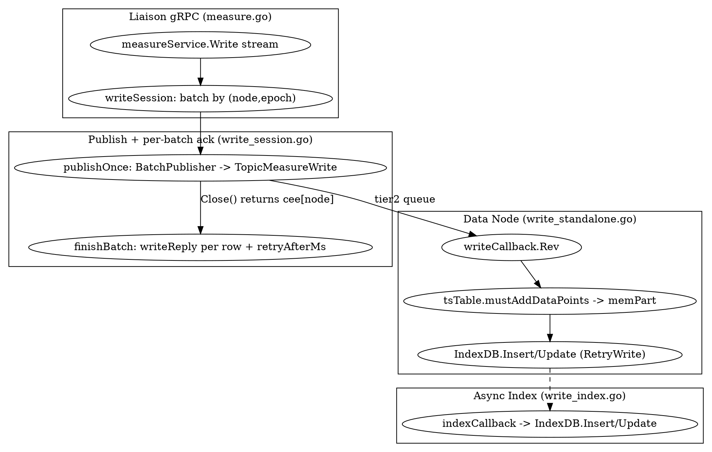

# BanyanDB Write Path

## Introduction

BanyanDB 的写入路径是一条**「gRPC 流式入口 → 按节点分批 → 跨节点发布 → 数据节点本地落盘 → 索引异步构建」**的流水线。其最具辨识度的设计是 **per-batch ack**：客户端与 liaison 之间是 gRPC 服务端流式 `Write`，liaison 把行按「目标节点 + epoch（批边界）」聚成批次，每批发布到数据节点并等回执，再以**逐行 `writeReply`（携带 status 与 `retryAfterMs`）** 沿流回写给客户端。这与「每条消息单独 ack」相比，显著降低了跨节点往返与回执开销。

本篇以 Measure 为例（Stream/Trace 同构，仅 `write_standalone.go` 的 `processDataPoint` 列布局不同）逐层拆解：gRPC 流式入口与分批、per-batch ack 与背压、数据节点消费端、索引异步构建，以及用于迁移/备份的 chunked sync 旁路。

## 1. 端到端写路径总览

```
Client ──gRPC stream Write──▶ Liaison.measureService.Write
        ◀── per-row writeReply (ack) ──┘
                                  │ writeSession: 按 (node, epoch) 分批
                                  ▼
                          BatchPublisher → TopicMeasureWrite (tier2)
                                  │
                                  ▼
              Data Node writeCallback.Rev (write_standalone.go)
                                  │ processDataPoint → tsTable.mustAddDataPoints
                                  ▼
                   memPart → introducer → flush → part (TSDB 引擎)
                                  │ 同时异步
                                  ▼
            indexCallback → segment.IndexDB().Insert/Update (见 BanyanDB_Index)
```

写入与索引是两个**解耦的提交点**：主数据走 `tsTable.mustAddDataPoints` 落 TSDB；索引由独立 `indexCallback` 监听 `TopicMeasureSeriesIndexInsert/Update` 异步构建（[BanyanDB_Index](/docs/CS/SE/SkyWalking/BanyanDB_Index.md)）。索引失败不回滚主数据。

## 2. 入口：gRPC 流式 Write 与分批

`measureService.Write`（`banyand/liaison/grpc/measure.go:125`）是一个**服务端流式 RPC**（`measurev1.MeasureService_WriteServer`）。它创建 `writeSession`（`measure.go:132-141`），把 `TopicMeasureWrite` 与「回写响应」的闭包注入；随后 `receiveWrites`（`measure.go:158`）在自己的 goroutine 里 `Recv()` 客户端行，并按批交给 session。

分批的边界由 `epoch` 决定（`measure.go:206-224`）：当客户端切换 `metadata` 或 `DataPointSpec`（`proto.Equal` 不成立）时 `epoch++`，从而**开启一个新批次**。每行经 `navigateWithRetry` 解析 entity/shard 后交给 `appendRow`（`measure.go:274-301`），后者用 `nodeRegistry.Locate(group, name, shardID)` 定位目标 data node，并 `session.Append(nodeID, group, epoch, writeAck{metadata, id: MessageId}, marshal)`——`writeAck.id` 即客户端 `MessageId`，用于回执对账。

版本/幂等：`DataPoint.Version==0` 且 `MessageId==0` 时以 `MessageId` 充当版本号（`measure.go:247-252`）；`MessageId` 由客户端或 liaison 用 `UnixNano` 生成，是**at-least-once 重试**的天然去重键。

## 3. 批次与 per-batch ack

`writeSession` 为每个 `(node, epoch)` 维护一个 `writeBatch`（`banyand/liaison/grpc/write_session.go`）。核心循环：

- **封口与发送**：批次达到阈值/超时或被 `Finish` 触发封口后，`runBatch`（`write_session.go:415`）调用 `publishOnce`（`write_session.go:467`）：用 `BatchPublisher` 把 batch 内每行 `bus.NewBatchMessageWithNodeAndGroup(...)` 经 `publisher.Publish(ctx, TopicMeasureWrite, msg)` 发出，再 `publisher.Close()`——`Close` 返回的 `cee[node]` 就是**数据节点对该批的回执状态**（`common.Error`）。
- **per-batch ack 回写**：`finishBatch`（`write_session.go:517-534`）对 batch 内**每一行**推入 `writeReply{metadata, id, status, retryAfterMs}`，并经响应队列回写给客户端。`retryAfterMs` 仅在可重试失败时附上，供客户端退避。指标 `writeBatchAckLatency` 记录「封口→ack」时延（`write_session.go:531-532`）。
- **背压与重试**：若数据节点回 `STATUS_DISK_FULL` / `STATUS_SERVER_BUSY`（`isNotAppliedStatus`，`write_session.go:512-514`），batch 进入抖动退避重试，上限 `pressureLimit`（`write_session.go:502-510`，取配置/流截止时间/默认）；持续不可接受则整条流以 `codes.ResourceExhausted` 失败（`write_session.go:441`）。

这正是枢纽页（[BanyanDB](/docs/CS/SE/SkyWalking/BanyanDB.md)）所述 commit「*acknowledge writes per batch*」的落点：回执以**批**为粒度，而非逐消息。

## 4. 背压：CheckHealth

两个写回调都实现 `CheckHealth`，在 `Rev` 前由总线框架调用，返回非 nil `common.Error` 即拒绝整批：

- `writeCallback.CheckHealth`（`write_standalone.go:66` 区域）：内存保护 `protector.StateHigh` → `STATUS_SERVER_BUSY`；磁盘占用 ≥ `maxDiskUsagePercent`（retention high-watermark）→ `STATUS_DISK_FULL`。
- `writeQueueCallback.CheckHealth`（`write_liaison.go:66-79`）：同构，另在 watermark=0 时直接 `DISK_FULL`（只读）。

这些状态正是 §3 中 `isNotAppliedStatus` 识别并触发退避的来源，形成「数据节点拒绝 → liaison 退避 → 客户端 retryAfterMs」的整链路背压。

## 5. 数据节点消费端

数据节点以 `setUpWriteCallback`（`write_standalone.go`，经 `svc_data.go:353-354` 订阅 `TopicMeasureWrite`）落地写入。`writeCallback.Rev`（`write_standalone.go:474-540`）的逻辑：

1. **解码**：对每个 event `decodeWriteEvent`（区分 `InternalWriteRequest` 与 `[]byte` 编码），并 `common.RecordRowFailure` 记录解码失败行。
2. **构建**：`w.handle` → `processDataPoint` 把 `WriteRequest` 转成列式 `dataPoints`、series 元数据文档（`metadataDocs`）与 index-mode 文档（`indexModeDocs`），按 `(group, shard, segment)` 聚合。
3. **落 TSDB**：`dps.tsTable.mustAddDataPoints(dps.dataPoints)`（`write_standalone.go:514`）——进入 memPart，随后由 introducer 刷盘成 part（见 [BanyanDB_TSDB_Engine](/docs/CS/SE/SkyWalking/BanyanDB_TSDB_Engine.md)）。
4. **建索引**：`segment.IndexDB().Insert(dps.metadataDocs)` / `Update(dps.indexModeDocs)`，均以 `common.RetryWrite` 包裹（`write_standalone.go:521-531`）——series 元数据插入是 no-op 幂等、index 文档是 upsert，故可安全重试。
5. **失败记录**：`common.RecordRowFailure` / `RecordWriteFailure` 标记被丢弃的行；`write_import_test.go:87`（*TestImportedBatchIsAnsweredWithTheRowsTheWriteDropped*）印证「批次回执携带被丢弃的行」。

幂等性小结：写入以 `(group, entity, timestamp, version/MessageId)` 定位，乱序/重试的重复写由 TSDB 的 version 冲突合并（TSDB 引擎 `mergeTwoBlocks` 的 `left.versions >= right.versions`）吸收；索引以 upsert/插入 no-op 吸收。

Liaison 侧也注册了 `writeQueueCallback`（`write_liaison.go`，经 `svc_liaison.go:203-204` 订阅同 topic），它在把事件转为列式数据点后**既写本地 `tsTable.mustAddDataPointsWithSegmentID`（`write_liaison.go:138`），又经 `tire2Client.Publish` 把 index 文档转发到数据节点**（`sendDocuments`，`write_liaison.go:146-178`）。即 liaison 侧处理器承担「本地 TSDB + 跨节点 index 转发」的桥接职责，与 data 节点「本地 TSDB + 本地 `IndexDB().Insert`」形成对照。

## 6. 索引的异步构建（衔接）

索引不是主写路径的同步步骤。`indexCallback`（`banyand/measure/write_index.go:50-126`）监听 `TopicMeasureSeriesIndexInsert/Update`，从总线消息解出 group/timestamp/`index.Documents`，`loadTSDB(group)` → `CreateSegmentIfNotExist` → `segment.IndexDB().Insert/Update`（`write_index.go:106-111`）。详情见 [BanyanDB_Index](/docs/CS/SE/SkyWalking/BanyanDB_Index.md)。

## 7. 跨节点文件同步：Chunked Sync（旁路）

除常规写路径外，`write_data.go` 提供 `ChunkedSyncHandler`（`syncCallback` / `syncSeriesCallback`），注册在 `TopicMeasurePartSync` / `TopicMeasureSeriesSync`（svc_data.go:336-337）。它把**已落盘的 part 文件块**或 **series 索引段**以流式分片（`HandleFileChunk` → `writers.MustWrite`）跨节点搬运，用于迁移/备份/重建。`FinishSync`（`write_data.go:59-73`）刷元数据并 `mustAddFilePart`；`syncer.go:238-280` 的 `observeAcknowledgedFileSyncParts` 记录同步队列时延。这条路不走 `mustAddDataPoints`，是「整块文件搬运」而非「逐行写入」。



## Links

- [BanyanDB](/docs/CS/SE/SkyWalking/BanyanDB.md)
- [BanyanDB_TSDB_Engine](/docs/CS/SE/SkyWalking/BanyanDB_TSDB_Engine.md)
- [BanyanDB_Index](/docs/CS/SE/SkyWalking/BanyanDB_Index.md)
- [BanyanDB_Query_Engine](/docs/CS/SE/SkyWalking/BanyanDB_Query_Engine.md)
- [BanyanDB_Data_Model](/docs/CS/SE/SkyWalking/BanyanDB_Data_Model.md)

## References

- `banyand/liaison/grpc/measure.go:125-301`（流式 Write、epoch 分批、appendRow）
- `banyand/liaison/grpc/write_session.go:384-540`（Finish / runBatch / publishOnce / finishBatch / isNotAppliedStatus）
- `banyand/measure/write_standalone.go:474-540`（数据节点 writeCallback.Rev、RetryWrite、RecordRowFailure）
- `banyand/measure/write_liaison.go:43-182`（liaison writeQueueCallback、本地落盘 + tier2 index 转发）
- `banyand/measure/write_index.go:50-126`（indexCallback → IndexDB.Insert/Update）
- `banyand/measure/write_data.go:39-349`（ChunkedSyncHandler：part/series 文件块同步）
- `banyand/measure/svc_data.go:353-363`、`svc_liaison.go:203-221`、`svc_standalone.go:333-359`（写/同步接线）
- `banyand/queue/pub/pub.go:541,698`（BatchPublisher.Publish / future.Get）
