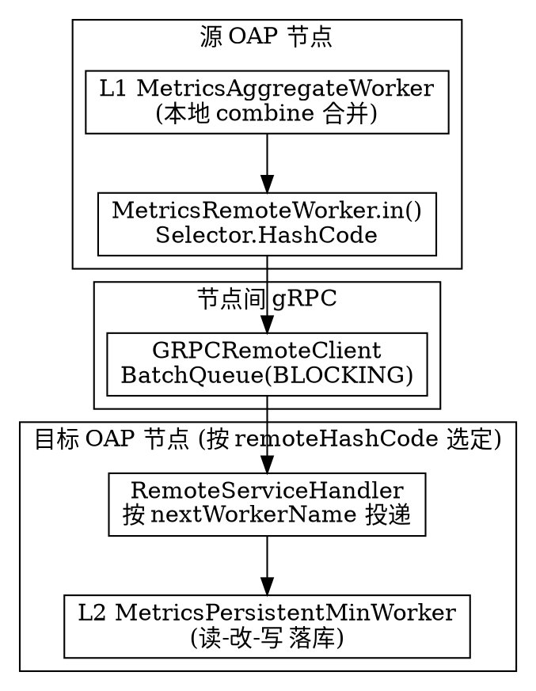

# SkyWalking Cluster and Cross-node Aggregation

## Introduction

本页深挖 Apache SkyWalking OAP Server 的**集群与跨节点聚合**机制：在多个 OAP 节点组成的集群里，如何做节点注册与发现、节点间如何通信、以及指标聚合如何借助哈希路由把同一实体的增量送到固定节点完成「单点权威合并」。

它与系列其它页的衔接关系：

- **模块系统**（`Module_System.md`）：`cluster` 是第一个被加载的核心 Module，远程通信能力被封装在 `CoreModule` 的 `RemoteClientManager`/`RemoteSenderService` 里，而非由业务模块直接 `find(ClusterModule)`。
- **流式聚合管线**（`Streaming_Pipeline.md`）：P0-2 的 `MetricsStreamProcessor` 建链 `L1 Aggregate → Remote → L2 PersistentMin`，其中「Remote」这环正是本页的主角——跨节点把增量推到目标 OAP 做 L2 合并。
- **存储抽象层**（`Storage_Abstraction.md`）：L2 合并后在本节点批量落库，落库路径见存储页。

代码基线：`12ff4613c835c6950ebddb47651c911f2a7d7f9d`（仓库 `E:/Projects/skywalking`，10.x 形态）。

## Cluster Module: 注册与发现

`ClusterModule` 只声明三个服务契约（`ClusterModule.java:32-38`）：

```java
public Class[] services() {
    return new Class[] {
        ClusterRegister.class,     // 本节点注册
        ClusterNodesQuery.class,   // 查询其它节点
        ClusterCoordinator.class   // 注册+查询+watch 的抽象基类
    };
}
```

具体实现分散在 6 个 plugin 子模块：`cluster-zookeeper-plugin`、`cluster-kubernetes-plugin`、`cluster-nacos-plugin`、`cluster-consul-plugin`、`cluster-etcd-plugin`、`cluster-standalone-plugin`。它们各自把注册中心的「临时节点 + watch」语义适配成同一套接口：

- `ClusterRegister.registerRemote(RemoteInstance)` —— 把本节点（`host:port`）注册进注册中心（`ClusterRegister.java:25`）。
- `ClusterNodesQuery.queryRemoteNodes()` —— 列出当前所有存活 OAP 节点的 `RemoteInstance`。

`ClusterCoordinator` 是一个抽象基类，同时实现 `ClusterRegister` + `ClusterNodesQuery` + `ClusterWatcherRegister`，并通过 `notifyWatchers` 在节点列表变化时回调所有 `ClusterWatcher`（`ClusterCoordinator.java:27-46`）。以最简单的 `StandaloneManager` 为例：注册时把地址标记为 `self`，查询时只返回自己（`StandaloneManager.java:30-57`）；生产环境的 ZK/K8s/Nacos 实现则是把注册中心事件翻译成同样的 `notifyWatchers` 调用。

`RemoteInstance` 仅包裹一个 `Address` 并实现 `Comparable`；`Address` 是 `host:port` + `isSelf` 标记，其 `compareTo`/`hashCode`/`equals` 都基于 `host:port` 字符串，保证所有节点对节点列表的**排序完全一致**（`Address.java:26-65`、`RemoteInstance.java:25-42`）。这个排序一致性是后面哈希路由正确性的前提。

## Remote Communication: 节点间 gRPC 通道

`RemoteClientManager`（实现 `Service` 与 `ClusterWatcher`）负责维护「本节点 → 其它节点」的 gRPC 客户端集合，其核心行为：

1. **双触发刷新**：`start()` 后启动一个单线程调度，每 10 秒 `refresh()` 一次（轮询兜底）；同时作为 `ClusterWatcher`，注册中心变化会被 `onClusterNodesChanged` 立即推送到 `refresh()`（`RemoteClientManager.java:95-113`）。
2. **重建客户端**：`reBuildRemoteClients` 对列表中 `isSelf()` 的节点用 `SelfRemoteClient`（进程内短路，零网络开销），对其余节点创建 `GRPCRemoteClient` 并 `connect()` 建立 gRPC 通道；尽量复用旧通道避免抖动（`RemoteClientManager.java:202-262`）。
3. **节点变更副作用**：列表真正变化时会调 `ServerStatusService.rebalancedCluster(...)` 通知状态机（`RemoteClientManager.java:147-150`）。

`GRPCRemoteClient` 内部用一条 `BatchQueue`（策略 `BLOCKING`）+ gRPC 流式 `stub`：数据先 `produce` 进队列，后台消费者批量 `onNext` 发送；并发未完成的 stream 上限为 10，超出则阻塞，并对 `RESOURCE_EXHAUSTED` 做 120 秒节流日志（`GRPCRemoteClient.java:101-242`）。

## Hash-code Routing: 跨节点指标聚合（核心）

这是 OAP 分布式聚合最精妙的设计。回顾 P0-2：`MetricsStreamProcessor` 把流处理链建成 **L1 本地合并 → 跨节点 Remote → L2 目标节点落库**。`Remote` 这一环由 `MetricsRemoteWorker` 承担：

```java
// MetricsRemoteWorker.java:46
public final void in(Metrics metrics) {
    remoteSender.send(remoteReceiverWorkerName, metrics, Selector.HashCode);
}
```

`RemoteSenderService.send` 按选择器挑一个目标客户端，再 `push`（`RemoteSenderService.java:61-85`）。三类选择器：

- `HashCode`：`Math.abs(streamData.remoteHashCode() % size)` —— **确定性哈希**（`HashCodeSelector.java:30`）。
- `Rolling`：轮询，依赖 `usingClients` 排序稳定。
- `ForeverFirst`：永远选第一个。

指标聚合**默认且必须使用 `HashCode`**。原因是：`Metrics` 实现的 `StreamData.remoteHashCode()`（接口声明于 `StreamData.java:29`，基于实体 ID `id0()` 计算，`Metrics.java:167`）对同一实体返回稳定值，于是**同一实体的所有增量永远被哈希到同一个目标 OAP 节点**。该目标节点上的 `MetricsPersistentMinWorker`（L2）成为该实体的**唯一权威合并者**——无需分布式锁即可保证合并正确，因为不存在任何其它节点会并发写同一实体的中间态。

目标节点收到数据后，`RemoteServiceHandler`（gRPC 服务端）按 `nextWorkerName` 找回 worker、反序列化、再调 `nextWorker.in(streamData)`，从而**在目标节点继续 L2 合并与落库**（`RemoteServiceHandler.java:104-155`）。若 worker 找不到（常见于集群内 OAL 脚本不一致），数据被丢弃并告警。



## Role and Deployment Topology

`CoreModuleConfig.Role` 支持三种角色，由 `application.yml` 的 `role: ${SW_CORE_ROLE:Mixed}` 选择（默认 `Mixed`，`server-tools/data-generator/.../application.yml:25`）：

- **Mixed**：既接收 Agent 数据、又参与聚合与落库（单机/小集群默认）。
- **Receiver**：只接收并做 L1，不把自己注册为 remote 节点（`OAPNodeChecker.java:58` `if (!Receiver.equals(ROLE))` 才注册），因此它的 L2 增量全部被推到其它 Aggregator。
- **Aggregator**：只做 L2 合并与落库，不直接接收 Agent 流量。

这种分离在大规模部署中用于把「高吞吐接收」与「重聚合+存储写」解耦，但**哈希路由逻辑与角色无关**——无论哪种角色，跨节点合并都遵循 `remoteHashCode % size` 的确定性映射。

## Key Design Points

1. **无锁的分布式聚合**：靠「同一实体 → 同一目标节点」的确定性哈希，把并发竞态化解为单点合并，是 OAP 横向扩展的基石。
2. **集群能力内聚于 Core**：业务 Worker 通过 `CoreModule` 的 `RemoteSenderService` 发数据，`RemoteClientManager` 内部才 `find(ClusterModule)` 取 `ClusterNodesQuery`。这呼应 P0-1 的「集群能力走 Core 而非直接 find(ClusterModule)」约定，业务模块不直接耦合具体注册中心。
3. **排序一致性是正确性前提**：所有节点必须按相同顺序对 `Address`/`RemoteInstance` 排序（`Comparable` 基于 `host:port` 字符串），否则 `HashCode`/`Rolling` 选择器会选中不同目标，导致实体被重复或漏合并。
4. **双触发 + 自愈**：注册中心 watch 事件即时推送 + 10 秒兜底轮询，节点上下线时 `reBuildRemoteClients` 增量复用通道；`self` 节点用进程内 `SelfRemoteClient` 短路，省去网络往返。
5. **背压守恒**：跨节点发送侧 `GRPCRemoteClient` 用 `BLOCKING` 队列 + 10 并发上限，与 P0-2 L2 落库「宁可阻塞不丢」的承诺一致；L1 则可丢（IF_POSSIBLE），代价放在可恢复层。

## Links

- [SkyWalking Module System](/docs/CS/SE/SkyWalking/Module_System.md)
- [SkyWalking Streaming Pipeline](/docs/CS/SE/SkyWalking/Streaming_Pipeline.md)
- [SkyWalking OAL Runtime](/docs/CS/SE/SkyWalking/OAL_Runtime.md)
- [SkyWalking Storage Abstraction](/docs/CS/SE/SkyWalking/Storage_Abstraction.md)
- [SkyWalking](/docs/CS/SE/SkyWalking/SkyWalking.md)

## References

- Apache SkyWalking 源码，commit `12ff4613c835c6950ebddb47651c911f2a7d7f9d`，`E:/Projects/skywalking`
- `oap-server/server-core/.../cluster/ClusterModule.java`、`ClusterRegister.java`、`ClusterCoordinator.java`
- `oap-server/server-core/.../remote/client/RemoteClientManager.java`、`GRPCRemoteClient.java`、`Address.java`
- `oap-server/server-core/.../remote/RemoteSenderService.java`、`RemoteServiceHandler.java`
- `oap-server/server-core/.../remote/selector/HashCodeSelector.java`
- `oap-server/server-core/.../analysis/worker/MetricsRemoteWorker.java`
- `oap-server/server-cluster-plugin/cluster-standalone-plugin/.../StandaloneManager.java`
- 官方文档：https://skywalking.apache.org/docs/main/latest/en/setup/backend/backend-cluster-management/
