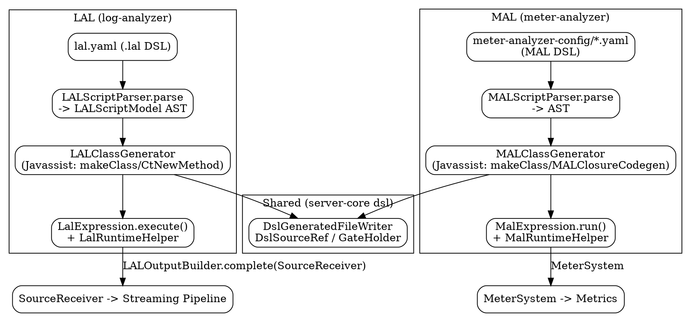

# SkyWalking LAL and MAL Script Engines

## Introduction

LAL（Log Analysis Language）与 MAL（Meter Analysis Language）是 SkyWalking 10.x 中两套**脚本化的 DSL 引擎**，分别作用于「日志」与「指标」两种遥测数据：LAL 把原始日志（或任何 `LogData` / protobuf Message / 实现 `ToJson` 的 POJO）解析、抽取、打标、采样后再 sink 成 OAP 的 Source；MAL 把 Prometheus 等来源的原始 sample 经方法链（聚合、rate、retag、histogram…）变换后喂给 MeterSystem 生成指标。

本页与既有页面的关系：
- 与 [SkyWalking OAL Runtime](/docs/CS/SE/SkyWalking/OAL_Runtime.md) 同源：**底层都是 Javassist 运行时字节码织入**（`ClassPool.makeClass` + `CtNewMethod.make` + `ctClass.toClass`），并共用 `server-core` 下的 DSL 调试底座（`DslGeneratedFileWriter`、`DslSourceRef`、`GateHolder`）。但三者的 parser/codegen 框架相互独立：OAL 用 `OALParser.g4` + `OALClassGeneratorV2`，LAL 用 `LALParser.g4` + `LALClassGenerator`，MAL 用 `MALParser.g4` + `MALClassGenerator`。
- 与 [SkyWalking Streaming Pipeline](/docs/CS/SE/SkyWalking/Streaming_Pipeline.md) 的关系：脚本最终 sink 出的 Source（LAL 的 `Log`/自定义 source；OAL 的指标）都通过 `SourceReceiver` 进入流式聚合管线，LAL 的 sink 路径即 `RecordSinkListener → LALOutputBuilder.complete(sourceReceiver)`。
- 与 [SkyWalking Module System](/docs/CS/SE/SkyWalking/Module_System.md) 的关系：LAL 由 `LogAnalyzer` 模块在 `start()` 阶段编译（`LogFilterListener.Factory.loadStaticRules`），MAL 由指标接收方（`MetricConvert`/`Analyzer`）在启动时编译并注册入 `MeterSystem`。

> 交付基线：Apache SkyWalking 仓库 HEAD `12ff4613c8`（10.x 形态）。本页所有结论均通过 Read / Grep 真源码核验。

## LAL 文法与编译器架构

LAL 文法由 ANTLR4 定义（`LALParser.g4`）。顶层结构是一个 `filter` 块，块内由若干语句组成；解析入口 `LALScriptParser.parse(String)` 把脚本文本编译成不可变的 `LALScriptModel` AST（`LALScriptParser.java:86`）。

DSL 支持的顶层结构与语句（`LALParser.g4`）：

- 顶层：`root : filterBlock EOF`（`LALParser.g4:37-39`）—— 一条 LAL 脚本就是一个 `filter { ... }`。
- `filterStatement` 的备选（`LALParser.g4:51-58`）：`parserBlock | extractorBlock | sinkBlock | ifStatement | abortBlock | defStatement`。即 `filter` 块内可声明解析器、抽取器、sink、条件分支、abort、局部变量。
- 解析器 `parserBlock`（`LALParser.g4:62-66`）：三选一 `textBlock`（正则 `text { regexp $/…/$ }`）、`jsonBlock`、`yamlBlock`，并可选 `abortOnFailure`。
- 抽取器 `extractorBlock`（`LALParser.g4:111-133`）：`def`（局部变量）、`service`/`instance`/`endpoint`/`layer`/`traceId`/`segmentId`/`spanId`（实体字段映射）、`timestamp`、`tag`（打标签）、`metrics`（内联产出指标）、`outputField`（任意输出字段）。
- 指标块 `metricsBlock`（`LALParser.g4:186-223`）：`name` / `timestamp` / `labels` / `value`，用于从一条日志直接产出一条指标（如计数）。
- sink 块 `sinkBlock`（`LALParser.g4:227-268`）：`samplerBlock`（按 `rateLimit("id") { rpm N }` 限流）、`enforcerStatement`（`enforcer {}` 强制保留）、`dropperStatement`（`dropper {}` 丢弃）、`ifStatement`。
- 表达式 / 类型转换：`valueAccess`（`LALParser.g4:327-389`）支持 `parsed.x`、`log.x`、`tag("K")`、`?.` 安全导航、算术、函数调用，以及 `as String|Long|Integer|Double|Float|Boolean`（或任意 FQCN）的类型转换。

也就是说，LAL 的语义是**命令式管道**：`parser` 把输入转成结构化数据 → `extractor` 把字段映射/打标/产出指标 → `sink` 决定采样/保留/丢弃，全程可被 `if/else` 与 `abort` 控制流切分。这与 OAL 的「声明式 `from(...).func().filter()`」语义模型不同。

## LAL → Java / Javassist 代码生成与加载

LAL 的代码生成与 OAL V2 同源，都是「运行时字节码织入」，而非生成 `.java` 文本后再 javac：

1. `DSL.of(...)` 在启动时（或运行时热更新）被调用，内部 `new LALClassGenerator(pool, targetClassLoader).compile(dsl)`（`DSL.java:110-121`）。
2. `LALClassGenerator.compile` 先 `LALScriptParser.parse(dsl)` 得到 `LALScriptModel`，再 `compileFromModel`（`LALClassGenerator.java:364-369`）。
3. 生成阶段用 Javassist 直接拼类：`classPool.makeClass(className)`（`LALClassGenerator.java:397`），`ctClass.addInterface(LalExpression)`（`LALClassGenerator.java:398`），把生成的 `execute()` 方法体与若干 private helper 用 `CtNewMethod.make(body, ctClass)` 编译进去（`LALClassGenerator.java:409,418`）。
4. 加载：默认用邻类形式（`LalExpressionPackageHolder`）落进 OAP 应用类加载器；运行时热更新路径则把生成的 `LalExpression` 类 `ctClass.toClass(loader, null)` 定义进每文件的 `RuleClassLoader`，整族类随 unregister 一起卸载（`LALClassGenerator.java:74,234-235`）。

运行时辅助由 `LalRuntimeHelper` 提供：它持有每次 `execute()` 的 `ExecutionContext`，暴露 `mapVal`（JSON/YAML 取值，`LalRuntimeHelper.java:129`）、`group`（正则命名组，`LalRuntimeHelper.java:173`）、`tagValue`（日志 tag 查找，`LalRuntimeHelper.java:189`）、以及 `toStr/toLong/toInt/toDouble/toBool` 等 null-safe 类型转换（`LalRuntimeHelper.java:413-495`）。编译器把 `parsed.x as String`、`tag("K")`、`?.` 等 DSL 片段翻译成对这些 helper 方法的调用。

## LAL 运行时（filter / unparse / tag / sink 语义）

入口在 `LogAnalyzer` 模块：`LogFilterListener.Factory` 在 `start()` 时 `loadStaticRules()` 把 YAML 里的每条 LAL 规则编译成 `DSL` 并按下层（`Layer`）与规则名注册（`LogFilterListener.java:241-304`）。每条日志到达时：

- `Factory.create(Layer)` 取出该层所有 `DSL`，构造 `LogFilterListener`（`LogFilterListener.java:561-591`）；
- 两阶段执行（`LogFilterListener.java:97-105`）：`parse(metadata, input)` 为每条规则建 `ExecutionContext` 并做输入类型守卫（无 parser 的规则用 `effectiveInputType` 过滤，避免 proto 强转抛 `ClassCastException`），`build()` 逐条 `dsl.evaluate(ctx)` 调用编译后的 `LalExpression`。
- 编译后的 `execute()` 按脚本顺序执行 `parser → extractor → sink`：`extractor` 设 `ctx.setOutput(new OutputType())`（默认 `LogBuilder`，或自定义 `LALOutputBuilder`）；`sink` 通过 sampler/enforcer/dropper 决定该条是否保留。

真实配置样例（`dist-material/config-examples/lal.yaml:17-50`）：一个 `filter { if (log.service == "TestService") { abort {} } text { regexp $/…/$ } extractor { metrics { … } } sink { sampler { rateLimit(...) { rpm 18000 } } } }`——先用正则解析文本日志，抽取 `log_count` 指标，再按服务名做 RPM 限流采样。`extract` 的 `outputType` 由 YAML → `LALSourceTypeProvider` SPI → 默认 `LogBuilder` 三级解析（`LogFilterListener.java:483-559`），自定义 builder（如 `DatabaseSlowStatementBuilder`、`SampledTraceBuilder`，见 `agent-analyzer/.../META-INF/services/...LALOutputBuilder`）即可把日志 sink 成**任意自定义 Source**。

最终落盘：`RecordSinkListener.build()` 调 `ctx.outputAsBuilder().complete(sourceReceiver)`（`RecordSinkListener.java:71,91-95`），由 `LALOutputBuilder`（多态）把产出对象经 `SourceReceiver` 送入流式管线——与 OAL 指标的 `SourceDispatcher` 一样，都汇入 [SkyWalking Streaming Pipeline](/docs/CS/SE/SkyWalking/Streaming_Pipeline.md)。

## MAL 的真实形态（脚本引擎，而非代码方式）

**核验结论（与「MAL 很薄 / 由 SampleBuilder/MeterProcessor 代码处理」的假设相反）**：本仓库 10.x 中 MAL 是一套**与 LAL 同源、独立文法的完整 Javassist 脚本引擎**，并非以代码方式硬编码处理。

- 文法同样由 ANTLR4 定义：`MALParser.g4` 的顶层是 `expression : additiveExpression EOF`（`MALParser.g4:36-38`）——一个 MAL 规则是「指标引用的算术树 + 后缀方法链」；另有独立的 `filterExpression : closureExpression EOF`（`MALParser.g4:41-43`）。方法链支持内置 `.sum(['tag'])`、`.rate('PT1M')`、`.service(...)`、`.tag({...})`、`.histogram_percentile(...)` 等（`MALParser.g4:64-81`），以及扩展 `.ns::method()`（`:79`）；闭包 `{ tags -> ... }` 用于 `tag`/`forEach`/filter（`MALParser.g4:126-283`，支持 if/return/赋值/三元/正则匹配等）。
- 编译器 `MALClassGenerator` 的流水线（`MALClassGenerator.java:43-53`）与 LAL 同构：① `MALScriptParser.parse` 出 AST → ② `MALClosureCodegen` 收集闭包生成伴生类 → ③ `MALExprCodegen` 生成 `run()` 方法体 → ④ `MALMetadataExtractor` 抽取编译期元数据 → ⑤ Javassist 建类加载（`MALBytecodeHelper`）。其 `createClassPool()` 同样 `new ClassPool(true)` 并 append `LoaderClassPath`（`MALClassGenerator.java:83-89`），加载同样走 `ctClass.toClass(loader, null)`（`MALClassGenerator.java:69-74`），并复用 `DslGeneratedFileWriter.writeClassFile` 落盘字节码（`MALBytecodeHelper.java:136-137`）。
- 运行时入口：每个 MAL 配置 YAML（`meter-analyzer-config/*.yaml`）由 `MetricConvert` 加载，**每个 `metricsRules` 条目建一个 `Analyzer`**（`MetricConvert.java:50-59`）；`Analyzer.build()` 把 MAL 表达式经 ANTLR4 + Javassist 编译成 `MalExpression`，抽取 `ExpressionMetadata`，并注册进 `MeterSystem`（生成指标存储类）。运行时 `expr.run(samples)` 即执行编译后的字节码（`MALClassGenerator.java:58-59`）。运行时辅助由 `MalRuntimeHelper` / `MalExtensionRegistry` 提供。

> 注：`agent-analyzer` 里的 `MeterProcessor` / `MeterProcessService`（`oap-server/analyzer/agent-analyzer/.../meter/process/`）处理的是**原生 meter 协议上报**，与 MAL 脚本引擎不是一回事；MAL 仅负责「Prometheus 等来源 sample → 指标」的脚本化变换。任务假设中的「MAL 由 SampleBuilder/MeterProcessor 代码处理」在本基线不成立。

## 与 OAL 的代码生成异同

| 维度 | OAL V2 | LAL | MAL |
|---|---|---|---|
| 文法 | `OALParser.g4`（声明式 `from().func().filter()`） | `LALParser.g4`（`filter{parser/extractor/sink}` 命令式） | `MALParser.g4`（算术树 + 方法链 + 闭包） |
| 生成物 | Metrics 子类 + Builder + Dispatcher（多类） | 单个 `LalExpression`（execute + private 方法） | 单个 `MalExpression`（run）+ 闭包伴生类 |
| 加载 | `ClassPool`+`CtNewMethod`+`toClass` | 同 | 同 |
| 产物归宿 | `MetricsStreamProcessor`（经 Dispatcher） | `SourceReceiver`（经 `LALOutputBuilder`） | `MeterSystem` |

共同底座：三者都用 Javassist 运行时织入字节码（OAL 见 `OAL_Runtime.md:13,63-71`；LAL/MAL 见上文 `LALClassGenerator.java:397-418`、`MALClassGenerator.java:83-89`），并共用 `server-core` 的 `DslGeneratedFileWriter`、`DslSourceRef`、`GateHolder` 这套 dsl-debugging 基础设施（源码位于 `oap-server/server-core/src/main/java/org/apache/skywalking/oap/server/core/dsl/`）。差异在于：OAL 面向「指标聚合」（生成 `@Stream` 的 Metrics + Dispatcher），LAL 面向「日志→Source 的抽取与路由」，MAL 面向「sample→指标的流式变换」；三者 parser 与 generator 各自独立，但字节码生成技术与调试底座同源。

## Links
- [SkyWalking Module System](/docs/CS/SE/SkyWalking/Module_System.md)
- [SkyWalking Streaming Pipeline](/docs/CS/SE/SkyWalking/Streaming_Pipeline.md)
- [SkyWalking OAL Runtime](/docs/CS/SE/SkyWalking/OAL_Runtime.md)
- [SkyWalking Receiver Protocol](/docs/CS/SE/SkyWalking/Receiver_Protocol.md)
- [SkyWalking](/docs/CS/SE/SkyWalking/SkyWalking.md)
- [APM](/docs/CS/SE/APM.md)

## References
- Apache SkyWalking 仓库 HEAD `12ff4613c8`（10.x 形态）。
- LAL 源码：`oap-server/analyzer/log-analyzer/src/main/java/org/apache/skywalking/oap/log/analyzer/v2/compiler/`（LALScriptParser / LALClassGenerator / LALBlockCodegen / LALDefCodegen / LALValueCodegen / rt/LalRuntimeHelper），文法 `oap-server/analyzer/log-analyzer/src/main/antlr4/org/apache/skywalking/lal/rt/grammar/LALParser.g4`。
- LAL 运行时：`oap-server/analyzer/log-analyzer/src/main/java/org/apache/skywalking/oap/log/analyzer/v2/provider/log/listener/LogFilterListener.java`、`RecordSinkListener.java`、`dsl/DSL.java`；样例 `dist-material/config-examples/lal.yaml`。
- MAL 源码：`oap-server/analyzer/meter-analyzer/src/main/java/org/apache/skywalking/oap/meter/analyzer/v2/compiler/`（MALScriptParser / MALClassGenerator / MALClosureCodegen / MALExprCodegen / MALBytecodeHelper），文法 `oap-server/analyzer/meter-analyzer/src/main/antlr4/org/apache/skywalking/mal/rt/grammar/MALParser.g4`。
- MAL 运行时：`oap-server/analyzer/meter-analyzer/src/main/java/org/apache/skywalking/oap/meter/analyzer/v2/Analyzer.java`、`MetricConvert.java`。
- 共享 DSL 调试底座：`oap-server/server-core/src/main/java/org/apache/skywalking/oap/server/core/dsl/`（DslGeneratedFileWriter / DslSourceRef / debug/GateHolder）。
- 官方文档：LAL https://skywalking.apache.org/docs/main/latest/en/concepts-and-designs/lal/ ；MAL https://skywalking.apache.org/docs/main/latest/en/concepts-and-designs/mal/ 。
