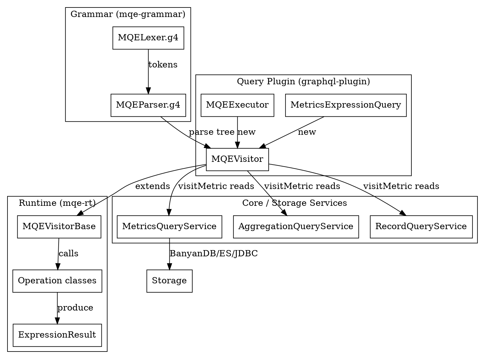

# SkyWalking MQE Query Engine

## Introduction

MQE（Metrics Query Engine，指标查询表达式引擎）是 SkyWalking OAP Server 在查询侧提供的一套**查询期计算 DSL**：用户在 V3 API 上以字符串形式提交表达式，OAP 在把数据从存储读出之后、返回 UI 之前，于内存中完成二元运算、聚合、趋势、TopN、排序、标签重命名等计算。它不涉及指标的"生产"，只做"消费期加工"，因此与另外三块是上下游关系：

- 与 [OAL Runtime](/docs/CS/SE/SkyWalking/OAL_Runtime.md) 的关系：MQE 计算的输入是 OAL 在流处理聚合阶段（见 [Streaming Pipeline](/docs/CS/SE/SkyWalking/Streaming_Pipeline.md)）落库后的指标，即 `MetricsCondition` 指向的那张模型表；MQE 并不关心指标是怎么算出来的。
- 与 [Storage](/docs/CS/SE/SkyWalking/Module_System.md) 的关系：MQE 的叶子节点（指标引用）通过 `MetricsQueryService` / `AggregationQueryService` / `RecordQueryService` 反向走存储抽象层（BanyanDB / ES / JDBC 三选一）把值拉回内存，再在内存里套运算。
- 与查询插件的关系：GraphQL 插件暴露 `execExpression` 字段，PromQL 插件暴露兼容的 HTTP 查询接口，两者最终都落到同一套 MQE 文法与运行时（PromQL 路径为并行实现，见下文）。

> 版本基线：源码仓库 `E:/Projects/skywalking` 的 HEAD 为 commit `12ff4613c8`（10.x 形态代码）。本文所有结论均经真源码 Read / Grep 核验，引用一律标注 `file:line`（路径相对 `oap-server/`）。

## MQE 文法（表达式类型与函数）

MQE 的文法由 ANTLR4 描述，分两个文件，作为独立 Maven 模块 `mqe-grammar` 存在：

- 词法：`mqe-grammar/src/main/antlr4/org/apache/skywalking/mqe/rt/grammar/MQELexer.g4`
- 语法：`mqe-grammar/src/main/antlr4/org/apache/skywalking/mqe/rt/grammar/MQEParser.g4`

语法入口为 `root: expression EOF;`，`expression` 是最上层递归规则（`MQEParser.g4:23-44`）。**关键纠偏**：本版 MQE 并**没有**独立的 `Expression / BinaryOp / FunctionCall / Metric / Scalar` 节点类体系——它直接使用 ANTLR 生成的 parse tree，配合一个统一的值容器 `ExpressionResult` 和一组"操作类"完成求值。这与任务预设的"节点类"想象不同，是源码核验后的真实结构。

文法支持的表达式类型（均已在 `MQEParser.g4` 与 `MQELexer.g4` 中逐一核对）：

- **指标引用**：`metricName` 或带标签选择 `metricName{label='value',...}`（`MQEParser.g4:55-62`）。标签名还可以是通配 `_`（`MQELexer.g4:23`）。
- **标量字面量**：`INTEGER | DECIMAL`（`MQEParser.g4:66`，`MQELexer.g4:107-108`），只作为运算右值，本身被解析成 `SINGLE_VALUE` 类型（`MQEVisitorBase.java:157-175`）。
- **二元运算**：`+ - * / %`（`MQELexer.g4:37-41`，`addSub / mulDivMod` 规则 `MQEParser.g4:51-52`）。
- **比较运算**：`== != <= < >= >`，可带 `bool` 后缀（`compare` 规则 `MQEParser.g4:53`）。
- **布尔运算**：`&& ||`，仅作用于比较结果（`bool_operator` 规则 `MQEParser.g4:87-88`，`BoolOp.java`）。
- **聚合运算**：`avg / count / latest / sum / max / min`（`aggregation` 规则 `MQEParser.g4:68-69`），把时序化简为 `SINGLE_VALUE`。
- **数学函数**：`abs / ceil / floor`（0 参数）、`round`（1 参数，保留小数位）（`mathematical_operator0/1` 规则 `MQEParser.g4:72-76`）。
- **趋势函数**：`rate / increase`，紧跟指标与整数时间窗 `rate(metric, N)`（`trend` 规则 `MQEParser.g4:78-79`）。`increase` 求窗口增量，`rate` 在增量基础上除以窗口秒数（`TrendOp.java:30-105`）。
- **TopN 系列**：`top_n(metric, N, order, [attrs])` 与 `top_n_of(top_n(...), ..., N, order)` 合并多路 TopN（`MQEParser.g4:81-82`）。`attrs` 支持 `attr0..attr5` 的等值/不等值过滤（`MQEParser.g4:110-113`）。
- **逻辑函数**：`view_as_seq(...)`（短路取第一个非空）、`is_present(...)`（任一非空返回 1）（`logical_operator` 规则 `MQEParser.g4:84-85`）。
- **标签函数**：`relabels(expr, target='...', new='...')` 重命名标签（`MQEParser.g4:90`），`aggregate_labels(expr, sum/avg/max/min([label...]))` 按标签聚合（`MQEParser.g4:96-102`）。
- **排序函数**：`sort_values(expr, limit, order, agg)` 与 `sort_label_values(expr, order, label...)`（`MQEParser.g4:104-108`）。
- **基线函数**：`baseline(metric, value|upper|lower)`，需开启 AI 管线的基线预测（`baseline` 规则 `MQEParser.g4:115-116`，`MQEVisitorBase.java:502-510`）。

> 注意：任务举例中提到的 `irate()`、`histogram_quantile()`、`sort()`、`aggregate()` 在本 commit（`12ff4613c8`）的 MQE 文法中**并不存在**——本文以源码实查为准。官方文档 `docs/en/api/metrics-query-expression.md` 的函数清单与上文完全一致，可作交叉印证。

`ExpressionResult` 的可能类型（`ExpressionResultType.java:22-46`）有五种：`UNKNOWN`、`SINGLE_VALUE`（标量）、`TIME_SERIES_VALUES`（时序，可带标签）、`SORTED_LIST`（TopN 排序结果）、`RECORD_LIST`（采样记录）。二元运算在两端的类型组合上有明确矩阵（`LROp.java:38-58` 与官方文档 `Binary Operation Rules`）：标量对时序按"广播"逐点运算，时序对时序按时间点对齐（带标签时需标签一致，否则置空）。

## 运行时求值架构

MQE 运行时位于独立模块 `mqe-rt`（依赖 `mqe-grammar`、`server-core`），其核心是一对 Visitor：

1. **抽象基类 `MQEVisitorBase`**（`mqe-rt/.../MQEVisitorBase.java:64`）——继承 ANTLR 生成的 `MQEParserBaseVisitor<ExpressionResult>`。它实现了除"指标取值"之外的所有节点 visit 方法：`visitAddSubOp` / `visitMulDivModOp` 调 `BinaryOp`（`MQEVisitorBase.java:109-155`），`visitCompareOp` 调 `CompareOp`（`MQEVisitorBase.java:372-401`），`visitBoolOP` 调 `BoolOp`，`visitTrendOP` 调 `TrendOp`（`MQEVisitorBase.java:403-430`），`visitAggregationOp` 调 `AggregationOp`，`visitAggregateLabelsOp` 调 `AggregateLabelsOp`，以及 `visitSortValuesOP` / `visitSortLabelValuesOP` / `visitLogicalOperatorOP` / `visitRelablesOP` 等。它的 `visitMetric` 是抽象方法（`MQEVisitorBase.java:513`）：**留给具体子类去绑定存储**。
2. **具体子类 `MQEVisitor`**（`query-graphql-plugin/.../mqe/rt/MQEVisitor.java:70`）——实现 `visitMetric`，是 MQE 接入存储的关键。它先通过 `ValueColumnMetadata.INSTANCE.readValueColumnDefinition(metricName)` 校验指标是否存在（`MQEVisitor.java:131-137`），再按指标的数据类型分支查询：
   - `COMMON_VALUE`：普通指标走 `MetricsQueryService.readMetricsValues`（时序）或 `AggregationQueryService.sortMetrics`（TopN）或 `RecordQueryService.readRecords`（采样记录），见 `queryMetrics` / `querySortMetrics` / `queryRecords`（`MQEVisitor.java:275-355`）。
   - `LABELED_VALUE`：多标签指标走 `MetricsQueryService.readLabeledMetricsValues`（`MQEVisitor.java:357-400`），结果标记 `isLabeledResult = true`。
   - `SAMPLED_RECORD`：必须套 `top_n` 才能查（`MQEVisitor.java:211-224`）。

求值过程可概括为"**深度优先遍历 parse tree，叶子从存储取数，内部节点套运算，统一装箱进 `ExpressionResult`**"。每个 visit 方法都包了一层 `DebuggingTraceContext` 的 `DebuggingSpan`，因此 MQE 原生支持查询链路追踪（`MQEVisitorBase.java:111-130` 等处）。除 `visitMetric` 走存储外，其余所有运算都在内存中对 `ExpressionResult` 做纯计算，没有 I/O。

## 与 PromQL 的关系与差异

SkyWalking 另有一个 `promql-plugin`（位于 `server-query-plugin/promql-plugin`），对外暴露 Prometheus 兼容的 HTTP 查询接口（instant/range/query）。它与 MQE 的关系需要厘清：

- **不是"PromQL 翻译成 MQE"**。PromQL 插件拥有**自己独立的 ANTLR4 文法**（`PromQLLexer.g4` / `PromQLParser.g4`）和**独立 Visitor**（`PromQLExprQueryVisitor.java`），并不复用 `MQEVisitorBase` 或 `MQEVisitor`。
- **共享后端存储服务**。两者最终都调用同一套 `MetricsQueryService` / `AggregationQueryService` / `RecordQueryService`（`PromQLApiHandler.java:156-169, 485, 548`），所以查的是同一份由 OAL 算出来的指标。
- **能力差异**：本 commit 下 PromQL 文法支持的算子明显更小——只覆盖二元运算（`+ - * / %`）、比较、`avg/sum/max/min` 聚合、字面量与带 `[]` 时间窗的 range 选择器（`PromQLParser.g4:30-44`）；而 MQE 额外支持 `increase/rate`、`top_n`、`view_as_seq/is_present`、`relabels`、`aggregate_labels`、`sort_values`、`baseline` 等。换言之，MQE 是 SkyWalking 自有、功能更丰富的查询 DSL，PromQL 是面向生态兼容的"子集式"入口。两者形态不同、各走各的文法，但殊途同归到同一存储查询服务。

## 接入 Query 插件的方式

GraphQL 插件是 MQE 的主入口，接入点有两处：

1. **`MetricsExpressionQuery`**（`query-graphql-plugin/.../resolver/MetricsExpressionQuery.java:44`）——实现 `GraphQLQueryResolver`，在 GraphQL schema 中暴露 `execExpression(expression, entity, duration, debug, dumpStorageRsp)` 字段（`MetricsExpressionQuery.java:53-57`）。其方法体做三件事：建 `MQELexer` + `MQEParser` 对字符串做语法分析（`MetricsExpressionQuery.java:67-84`），`new MQEVisitor(moduleManager, entity, duration)` 后 `visitor.visit(tree)` 执行（`MetricsExpressionQuery.java:64,85`），最后把 `double` 值格式化回字符串（`MetricsExpressionQuery.java:86-92`）。
2. **`MQEExecutor`**（`query-graphql-plugin/.../mqe/rt/MQEExecutor.java:52`）——从 `MetricsExpressionQuery` 抽出的**同步**求值入口，供告警调试（admin inspect）等不走 `queryAsync` ForkJoinPool 的路径复用同一引擎（`MQEExecutor.java:71-110`）。`MQEExecutor` 同样 `new MQEVisitor(...)` 并 `visitor.visit(tree)`（`MQEExecutor.java:82,96`）。

此外，MQE 还被**告警模块**复用：告警表达式用独立的 `AlarmMQEVisitor` / `AlarmMQEVerifyVisitor`（`server-alarm-plugin/.../expr/rt/`）继承同一 `MQEVisitorBase`，只是把 `visitMetric` 换成告警上下文的取值逻辑——这印证了 `MQEVisitorBase` 把"取数"与"运算"解耦的设计价值：换一个 `visitMetric` 实现即可让同一套运算服务于不同场景。

## 关键设计点

- **取数与运算解耦**：`MQEVisitorBase` 持有全部运算逻辑，`visitMetric` 抽象化，具体子类注入存储访问能力。同一引擎因此可被 GraphQL 查询、告警判定、调试 inspect 多场景复用。
- **统一值容器 + 类型矩阵**：所有节点产出/消费的都是 `ExpressionResult`（内含 `List<MQEValues>`，每个 `MQEValues` 含 `List<MQEValue>` 与标签、`type`、`isLabeledResult`、`isBoolResult`）。二元/比较运算的合法组合由 `LROp` 与 `CompareOp` 内部的类型矩阵严格约束（`LROp.java:38-58`），非法组合直接抛 `IllegalExpressionException`。
- **零 I/O 内存计算**：除叶子 `visitMetric` 读存储外，所有函数/运算都在内存做纯值计算，并把每一步包成 `DebuggingSpan`，天然可追踪。
- **标签是一等公民**：自 v10.0.0 起支持多标签指标，文法与运行时对带标签时序（labeled result）有专门分支（`queryLabeledMetrics`、`aggregate_labels`、`relabels`、`sort_label_values`），这是 MQE 相对早期版本最大的增量能力。
- **与 OAL/存储的契约边界清晰**：MQE 通过 `ValueColumnMetadata` 校验指标名、通过 `MetricsCondition` + 三大 QueryService 读数，完全复用 OAL 生成的指标模型与存储 DAO，自身不触碰流式聚合逻辑。

## Links

- [SkyWalking Module System](/docs/CS/SE/SkyWalking/Module_System.md)
- [SkyWalking Streaming Pipeline](/docs/CS/SE/SkyWalking/Streaming_Pipeline.md)
- [SkyWalking OAL Runtime](/docs/CS/SE/SkyWalking/OAL_Runtime.md)
- [SkyWalking](/docs/CS/SE/SkyWalking/SkyWalking.md)
- [APM](/docs/CS/SE/APM.md)
- [Architecture](/docs/CS/SE/Architecture.md)

## References

- 源码基线：Apache SkyWalking 仓库 `E:/Projects/skywalking`，HEAD commit `12ff4613c8`（10.x 形态）。
- 关键源码路径：
  - `oap-server/mqe-grammar/src/main/antlr4/org/apache/skywalking/mqe/rt/grammar/MQELexer.g4`
  - `oap-server/mqe-grammar/src/main/antlr4/org/apache/skywalking/mqe/rt/grammar/MQEParser.g4`
  - `oap-server/mqe-rt/src/main/java/org/apache/skywalking/mqe/rt/MQEVisitorBase.java`
  - `oap-server/mqe-rt/src/main/java/org/apache/skywalking/mqe/rt/operation/BinaryOp.java`（`MQEVisitorBase.java:124` 调用）
  - `oap-server/mqe-rt/src/main/java/org/apache/skywalking/mqe/rt/operation/LROp.java`
  - `oap-server/mqe-rt/src/main/java/org/apache/skywalking/mqe/rt/operation/TrendOp.java`
  - `oap-server/server-core/src/main/java/org/apache/skywalking/oap/server/core/query/mqe/ExpressionResult.java`
  - `oap-server/server-core/src/main/java/org/apache/skywalking/oap/server/core/query/mqe/ExpressionResultType.java`
  - `oap-server/server-query-plugin/query-graphql-plugin/src/main/java/org/apache/skywalking/oap/query/graphql/resolver/MetricsExpressionQuery.java`
  - `oap-server/server-query-plugin/query-graphql-plugin/src/main/java/org/apache/skywalking/oap/query/graphql/mqe/rt/MQEExecutor.java`
  - `oap-server/server-query-plugin/query-graphql-plugin/src/main/java/org/apache/skywalking/oap/query/graphql/mqe/rt/MQEVisitor.java`
  - `oap-server/server-query-plugin/promql-plugin/src/main/antlr4/org/apache/skywalking/promql/rt/grammar/PromQLParser.g4`
  - `oap-server/server-query-plugin/promql-plugin/src/main/java/org/apache/skywalking/oap/query/promql/handler/PromQLApiHandler.java`
- 官方文档：SkyWalking MQE 语法 `https://skywalking.apache.org/docs/main/latest/en/api/metrics-query-expression/`（仓库内镜像 `docs/en/api/metrics-query-expression.md`）。
- PromQL 兼容接口文档：`https://skywalking.apache.org/docs/main/latest/en/api/promql-service/`。
