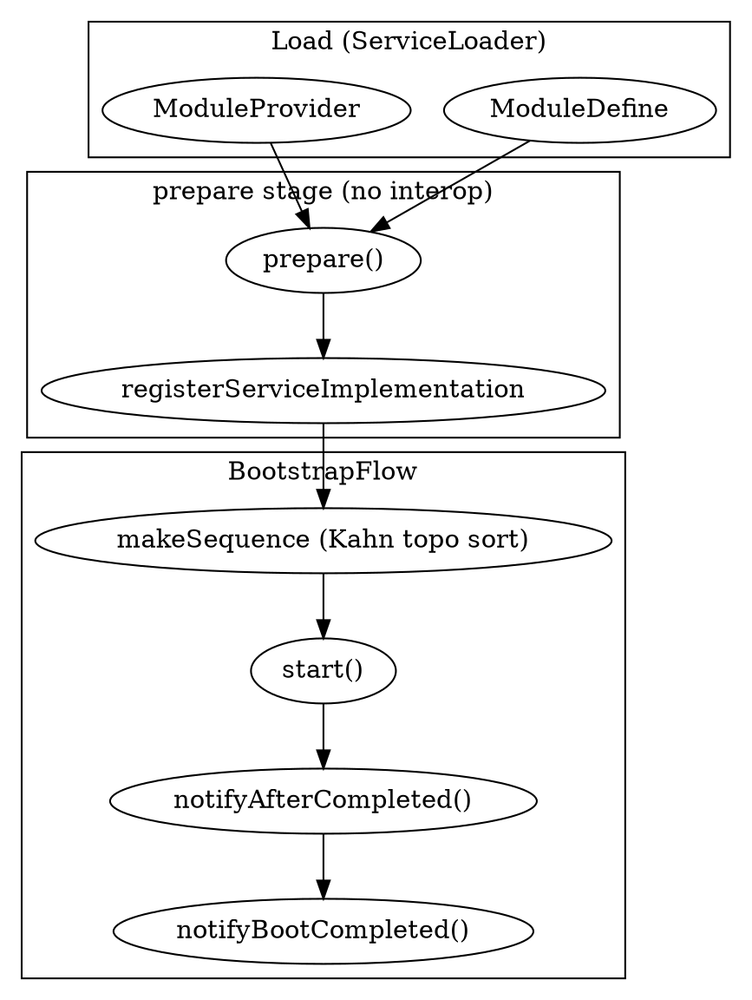

## Introduction

SkyWalking OAP 不是一个用 Spring 之类的 DI 框架拼装出来的单体应用，而是一套**自研的模块化运行平台**：每一个能力（存储、接收、查询、告警、集群协调……）都被建模为一个 `ModuleDefine`，并由一个或多个 `ModuleProvider` 提供具体实现，模块之间通过声明式依赖与"服务"接口解耦。读懂这套机制，是读懂 OAP 任何其它子系统的前提。

> 版本基线：源码仓库 HEAD `12ff4613c8`，见 [SkyWalking](/docs/CS/SE/SkyWalking/SkyWalking.md)。

三个反直觉的关键点：

1. **加载靠 Java SPI（`ServiceLoader`），不是 Spring**。所有 Module/Provider 通过 `META-INF/services` 注册，由 `ModuleManager` 用 `ServiceLoader.load(...)` 在启动时扫描。
2. **启动严格分四个阶段**（`prepare` → `start` → `notifyAfterCompleted` → `notifyBootCompleted`）。在 `prepare` 阶段**不能**依赖其它模块——跨模块服务只能在 `start` 及之后才可用。
3. **Provider 必须"精确"实现 Module 声明的全部 Service**：少实现一个、或多实现一个都会直接启动失败（`requiredCheck` 双向校验）。

## Module / Provider / Service 三元模型

三者构成 OAP 的模块化基石，全部位于 `oap-server/server-library/library-module`：

- **`ModuleDefine`**（`ModuleDefine.java:31`）：抽象类，每个模块有一个 `name()`（`CoreModule` 为 `"core"`，见 `CoreModule.java:83`）和一组对外暴露的服务 `Class[] services()`（`CoreModule.java:90`）。它自身只负责在 `prepare` 阶段挑出匹配的 Provider。
- **`ModuleProvider`**（`ModuleProvider.java:31`）：Module 的具体实现。核心抽象方法包括 `name()`、`module()`（声明自己实现哪个 Module）、`requiredModules()`（声明依赖的其它模块）、以及四个生命周期钩子 `prepare()` / `start()` / `notifyAfterCompleted()` / `notifyBootCompleted()`（`ModuleProvider.java:84,89,94,101`）。
- **`Service`**（`Service.java:26`）：一个**空标记接口**。每个 Provider 通过 `registerServiceImplementation(ServiceType, impl)` 把自己提供的服务注册进一个 `Map<Class, Service>`（`ModuleProvider.java:113`），其它模块通过 `getService(ServiceType)` 按类型取出（`ModuleProvider.java:145`）。

```java
// ModuleProvider.java:113 —— 服务注册；必须是 Service 的子类型，否则抛异常
public final void registerServiceImplementation(Class<? extends Service> serviceType, Service service)
    throws ServiceNotProvidedException {
    if (serviceType.isInstance(service)) {
        this.services.put(serviceType, service);
    } else {
        throw new ServiceNotProvidedException(serviceType + " is not implemented by " + service);
    }
}
```

## SPI 注册与 Provider 选择

OAP 没有用任何 IoC 容器。`ModuleManager.init` 启动时直接委托 JDK 的 `ServiceLoader` 扫描 classpath 上所有 `META-INF/services/...ModuleDefine` 与 `...ModuleProvider`：

```java
// ModuleManager.java:50 —— 纯 JDK SPI，无第三方 DI
ServiceLoader<ModuleDefine> moduleServiceLoader = ServiceLoader.load(ModuleDefine.class);
ServiceLoader<ModuleProvider> moduleProviderLoader = ServiceLoader.load(ModuleProvider.class);
```

一个 Module 可以有多个 Provider 实现（例如存储模块有 `storage-banyandb` / `storage-elasticsearch` / `storage-jdbc` 多个 provider），但**运行时只激活 `application.yml` 里 `selector` 选中的那一个**。`ModuleDefine.prepare` 在选择时做了两道匹配（`ModuleDefine.java:67-86`）：

1. `configuration.has(provider.name())` —— 该 provider 名出现在本模块的 YAML 配置中；
2. `provider.module().equals(getClass())` —— provider 声明的 `module()` 必须等于当前 Module 类。

两者同时命中且唯一，才会被设为 `loadedProvider`；若出现第二个匹配则抛 `DuplicateProviderException`。选好后立即 `loadedProvider.prepare()`（`ModuleDefine.java:112`）。

Provider 的 SPI 注册文件就是一行实现类全限定名，例如 Core 模块：

```text
# server-core/.../META-INF/services/...module.ModuleProvider
org.apache.skywalking.oap.server.core.CoreModuleProvider
```

## 启动流水线（BootstrapFlow）

启动流程由 `OAPServerBootstrap.start` 串起（`OAPServerBootstrap.java:38`）：

1. 用 `ApplicationConfigLoader` 加载 `application.yml`，生成 `ApplicationConfiguration`（模块 → provider → `Properties` 的内存模型）；
2. `manager.init(applicationConfiguration)` 完成全部模块加载与启动；
3. 启动后调 `ServerStatusService.bootedNow(...)` 记录启动完成时间。

`ApplicationConfigLoader` 的解析有几个值得注意的规则（`ApplicationConfigLoader.java:64-159`）：

- **`selector` 机制**：每个模块在 YAML 里有 `selector` 字段，决定启用哪个 provider；未匹配的 provider 配置会被整体删除（`selectConfig`，`ApplicationConfigLoader.java:128`）。
- **`-` 禁用**：若 `selector` 解析为 `-`，该模块被整体从配置中移除（`ApplicationConfigLoader.java:147-157`）—— 这是 OAP "按需裁剪模块"的主要开关。
- **系统属性覆盖**：形如 `moduleName.providerName.settingKey` 的 JVM `-D` 参数或环境变量会覆盖 YAML 中的同名设置（`overrideModuleSettings`，`ApplicationConfigLoader.java:161`）。

`ModuleManager.init`（`ModuleManager.java:45`）随后做两件事：先遍历所有已配置模块调用 `prepare`（此时 `isInPrepareStage=true`），置位后再交给 `BootstrapFlow` 跑 `start` 与 `notifyAfterCompleted`。

`BootstrapFlow` 的精髓是**拓扑排序**（`BootstrapFlow.java:61 makeSequence`）：它以 `requiredModules()` 为依赖边，反复把"依赖已全部入序"的 provider 推进 `startupSequence`，直到全部排好；若某轮没有任何 provider 能推进（即存在环），则抛 `CycleDependencyException`（`BootstrapFlow.java:113-122`）。这是经典的 Kahn 算法，保证 `start()` 时每个 provider 所 `require` 的模块一定已经 `start` 完毕。



`start` 阶段先对每个 provider 执行 `requiredCheck(services())`（见下节），再调 `provider.start()`（`BootstrapFlow.java:40-48`）；`notifyAfterCompleted` 则依次调 `notifyAfterCompleted()` 与 `notifyBootCompleted()`（`BootstrapFlow.java:50-59`）。

## 四阶段生命周期语义

每个 Provider 的四个钩子有严格的时间窗口约定，跨模块协作全靠它：

| 阶段 | 能做什么 | 不能做什么 |
| :--- | :--- | :--- |
| `prepare()` | 初始化**不依赖其它模块**的资源（建对象、注册 Service、加载本地配置） | 调用 `moduleManager.find(...)` 取别的模块的服务 |
| `start()` | 模块间可互操作，可 `find` 已 `require` 的模块并取其 Service，启动网络/线程 | —— |
| `notifyAfterCompleted()` | 所有模块都已 `start`，做需要全局就绪的收尾（如注册 gRPC handler） | —— |
| `notifyBootCompleted()` | 启动彻底完成的尾部钩子；**Core 在此才打开 gRPC / HTTP 端口**（源码注释 `ModuleProvider.java:97-99`），保证端口开放前没有模块还在 `notifyAfterCompleted` 里做启动工作 | —— |

因此一个常见错误是：在 `prepare()` 里就去 `find` 别的模块——此时 `isInPrepareStage=true`，`ModuleManager.find` 会直接抛 `AssertionError("Still in preparing stage.")`（`ModuleManager.java:93-96`）。

## 严格服务契约（requiredCheck）

`ModuleDefine.services()` 声明的服务数组，就是该 Module 对 Provider 的**契约**。`ModuleProvider.requiredCheck`（`ModuleProvider.java:128-141`）做**双向**校验：

- 任一声明过的 Service 没有 `registerServiceImplementation` → 抛 `ServiceNotProvidedException("Service:... not provided")`；
- Provider 注册的 Service 数量与声明**不等**（多注册了）→ 同样抛异常（"provide more service implementations than ModuleDefine requirements"）。

这条强约束带来一个工程上的硬规则（见 [SkyWalking](/docs/CS/SE/SkyWalking/SkyWalking.md) 仓库 `CLAUDE.md`）：**给 `CoreModule.services()` 增删一个 Service，必须同步改掉所有 `CoreModuleProvider` 实现**——包括 `server-tools/profile-exporter` 里的 `MockCoreModuleProvider`，否则启动即失败。

## 依赖声明与运行时查找

模块间"我要用谁"靠 `requiredModules()` 声明，`CoreModuleProvider` 的真实声明只有两个（`CoreModuleProvider.java:553`）：

```java
public String[] requiredModules() {
    return new String[] {
        TelemetryModule.NAME,
        ConfigurationModule.NAME,
    };
}
```

运行时查找一律走 `moduleManager.find(Module.NAME).provider().getService(ServiceType)`。这里有一个极易踩的坑（仓库 `CLAUDE.md` 第 13 条）：**每一个 `find(X.NAME)` 的目标模块名，都必须出现在调用方 Provider 的 `requiredModules()` 数组里**，否则不会在 `prepare` 报错，而是在该代码路径**第一次执行时**才抛运行时异常。因此审计分支时要 `grep "moduleManager.find("` 并逐一核对目标名是否在 `requiredModules()` 中。

需要集群协调能力（如 `ClusterRegister` / `ClusterNodesQuery`）的模块，**不应直接 `find(ClusterModule.NAME)`**（多数 receiver/analyzer 并未声明它），而应通过 `CoreModule` 的 `RemoteClientManager` 服务——它已由集群模块填充好对等节点列表（`CLAUDE.md` 第 14 条）。

## 设计取舍

- **为何用 SPI 而非 DI 框架**：OAP 把"模块装配"本身做成一等公民，配合 `application.yml` 的 `selector` 做到**同一份代码、不同部署裁剪不同模块/provider**（例如只跑 `receiver` 角色、或只跑 `aggregator` 角色），这对一个要适配多种存储后端与部署拓扑的可观测平台至关重要。
- **为何分四阶段**：把"自初始化"与"跨模块协作"在时间上彻底分开，既避免启动期循环依赖，又让"端口开放"这一对外承诺点精确可控（只在 `notifyBootCompleted` 打开）。
- **为何严格契约**：分布式平台的稳定性高度依赖"声明即契约"，少了任何 Service 都意味着某功能静默缺失，不如在启动期 fail-fast。

## Links

- [SkyWalking](/docs/CS/SE/SkyWalking/SkyWalking.md)
- [APM](/docs/CS/SE/APM.md)
- [Distributed Tracing](/docs/CS/Distributed/Tracing/Tracing.md)
- [K8s Observability](/docs/CS/Container/k8s/Observability.md)

## References

- [ModuleManager.java (commit 12ff4613c8)](https://github.com/apache/skywalking/blob/12ff4613c8/oap-server/server-library/library-module/src/main/java/org/apache/skywalking/oap/server/library/module/ModuleManager.java)
- [ModuleProvider.java](https://github.com/apache/skywalking/blob/12ff4613c8/oap-server/server-library/library-module/src/main/java/org/apache/skywalking/oap/server/library/module/ModuleProvider.java)
- [ModuleDefine.java](https://github.com/apache/skywalking/blob/12ff4613c8/oap-server/server-library/library-module/src/main/java/org/apache/skywalking/oap/server/library/module/ModuleDefine.java)
- [BootstrapFlow.java](https://github.com/apache/skywalking/blob/12ff4613c8/oap-server/server-library/library-module/src/main/java/org/apache/skywalking/oap/server/library/module/BootstrapFlow.java)
- [ApplicationConfigLoader.java](https://github.com/apache/skywalking/blob/12ff4613c8/oap-server/server-starter/src/main/java/org/apache/skywalking/oap/server/starter/config/ApplicationConfigLoader.java)
- [CoreModule.java](https://github.com/apache/skywalking/blob/12ff4613c8/oap-server/server-core/src/main/java/org/apache/skywalking/oap/server/core/CoreModule.java)
- [CoreModuleProvider.java](https://github.com/apache/skywalking/blob/12ff4613c8/oap-server/server-core/src/main/java/org/apache/skywalking/oap/server/core/CoreModuleProvider.java)
- [SkyWalking Module Management (official docs)](https://skywalking.apache.org/docs/main/next/en/setup/backend/backend-module-management/)
