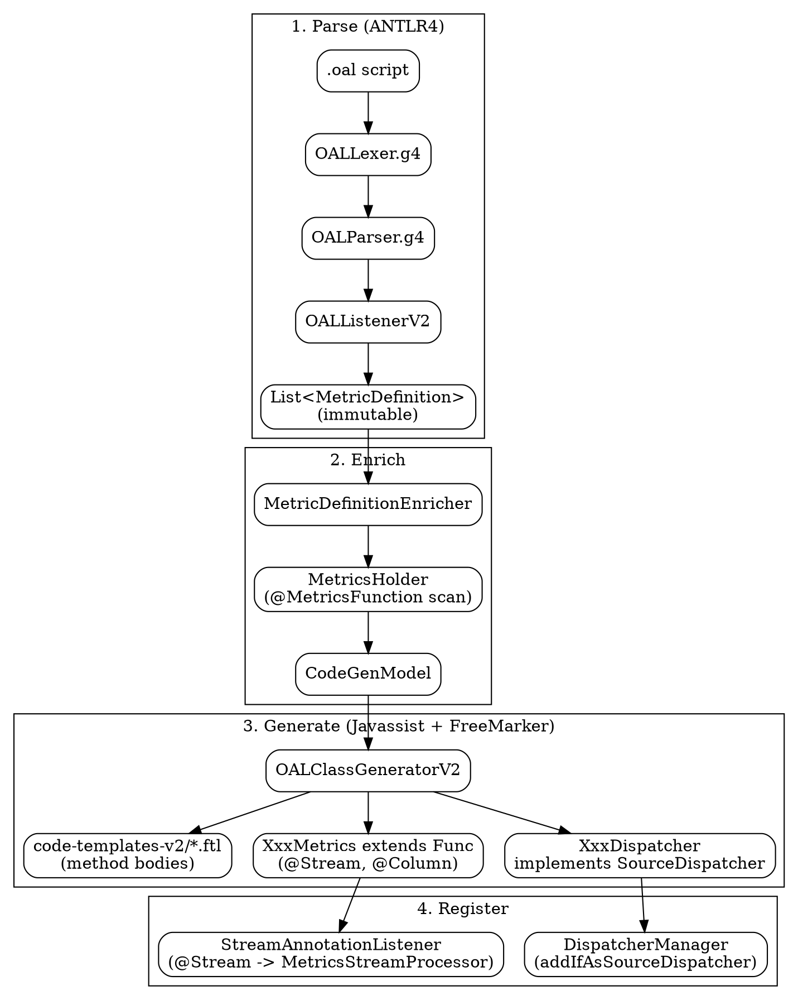

# SkyWalking OAL Runtime and Code Generation

## Introduction

OAL（Observability Analysis Language）是 SkyWalking 让用户用 DSL 声明「从哪类遥测 Source 取哪些字段、套哪个聚合函数、过滤哪些样本、算出哪些指标」的语言。OAP 在**启动期**把 `.oal` 脚本编译成 Java 字节码（Metrics 子类 + Dispatcher 类），运行期零干预即拥有新的指标定义。

OAL 生成的类正是前一篇 [SkyWalking Streaming Pipeline](/docs/CS/SE/SkyWalking/Streaming_Pipeline.md) 的入口：[SkyWalking Module System](/docs/CS/SE/SkyWalking/Module_System.md) 完成启动后，Core 模块驱动 OAL 引擎；每个 `XxxMetrics extends AbstractFunction` 是 `@Stream` 标注的流，每个 `XxxDispatcher implements SourceDispatcher<Source>` 把 Source 路由到对应 Metrics。本页基于 HEAD `12ff4613c8` 的 **OAL V2** 实现核验。

## 关键纠偏（与 8.x 及 P0-1 旧描述的差异）

本仓库（10.x 形态）的 OAL V2 **不是**「生成 `.java` 文本再用 javac 编译」：

- 代码生成主体由 **Javassist** 在运行时直接拼字节码：`classPool.makeClass(...)` + `CtNewMethod.make(body, ...)` + `CtClass.toClass(holder)` 加载（`OALClassGeneratorV2.java:210,284,323`）。
- **FreeMarker 只负责生成「方法体」字符串**（如 `id`/`hashCode`/`serialize`/`doMetrics`），这些字符串再交给 Javassist 编译成字节码方法（`OALClassGeneratorV2.java:282`）。
- 生产环境下（`SW_DYNAMIC_CLASS_ENGINE_DEBUG` 环境变量未设置）**完全不落盘 `.java`**；仅 debug 开关开启时，才把 Javassist 的「java 源文本」写盘供 IDE 源码映射（`writeGeneratedSourceFile`，`OALClassGeneratorV2.java:706-715`）。

因此 OAL 的「编译期生成 Java」本质是**运行时字节码织入**，而非传统模板代码生成。P0-1 枢纽页旧描述已据实修正。

## 编译流水线（四阶段）

### 阶段 1：解析（ANTLR4）
`OALScriptParserV2.parse(script)`（`OALScriptParserV2.java:99-128`）用 `OALLexer` + `OALParser`（文法 `OALLexer.g4` / `OALParser.g4`）解析，再用 `ParseTreeWalker` 走 `OALListenerV2` 遍历 AST。`OALListenerV2` 在 `enterAggregationStatement` 建 `MetricDefinition.Builder`（`OALListenerV2.java:88-102`），在 `exitAggregationStatement` 收口并保存（`OALListenerV2.java:123-135`），把 `from(...)`、`.filter(...)`、`.func()` 全部落成不可变 `MetricDefinition`（含 source 名/属性、聚合函数名/参数、filter 表达式、`SourceLocation` 源码行号）。语法错误被 `OALErrorListener` 收集，失败抛 `IllegalArgumentException`（`OALScriptParserV2.java:118-120`）。

### 阶段 2：丰富（Enrich）
`MetricDefinitionEnricher.enrich()`（`MetricDefinitionEnricher.java:96-164`）把 `MetricDefinition` 丰富成 `CodeGenModel`：
- `MetricsHolder.find(funcName)` 用 `@MetricsFunction` 注解定位函数父类（如 `longAvg` → `LongAvgMetrics`）。`MetricsHolder` 首次调用时用 Guava `ClassPath` 扫描 `org.apache.skywalking` 下所有带 `@MetricsFunction` 的类注册成映射表（`MetricsHolder.java:35-63`）。
- `SourceColumnsFactory.getColumns(sourceName)` 提取 source 的 `@Column` 字段；`DefaultScopeDefine.valueOf(sourceName)` 取 scopeId。
- 反射 `findEntranceMethod` 找 `@Entrance` 注解方法（`MetricDefinitionEnricher.java:193-204`），按参数注解 `@SourceFrom`/`@ConstOne`/`@Arg`/`@Expression`/`@DefaultValue` 生成入参表达式——含类型 cast、`isXxx`/`getXxx` 访问器、嵌套属性（如 `sideCar.internalRequestLatencyNanos`）、map 表达式（如 `tag["transmission.latency"]` → `getTag(...)`）。
- 收集函数父类的 `@Column` 持久化字段及序列化字段列表；把 filter 表达式转成 matcher 类 + left/right（`FilterMatchers` 表，`mapOperatorToExpressionType` 按运算符/值类型选 `numberMatch`/`stringMatch`/`greaterMatch`/`inMatch` 等）。

### 阶段 3：生成（Javassist + FreeMarker）
`OALClassGeneratorV2.generateClassAtRuntime()`（`OALClassGeneratorV2.java:146-170`）逐模型生成三类类并 `toClass()` 加载：
- **Metrics 子类**：`class ServiceRespTimeMetrics extends LongAvgMetrics implements WithMetadata`。`CtClass.makeClass(name, parent)` 继承函数父类（`OALClassGeneratorV2.java:210`）；用 `CtField.make` + `AnnotationsAttribute` 加 `@Column` 字段，ID 字段额外加 `@BanyanDB.SeriesID` / `@ElasticSearch.EnableDocValues`，分片键加 `@BanyanDB.ShardingKey`（`OALClassGeneratorV2.java:232-274`）；加 `@Stream`（name=table、scopeId、builder、processor=`MetricsStreamProcessor`）（`OALClassGeneratorV2.java:295-305`）；逐方法用 ftl 生成方法体字符串后 `CtNewMethod.make` 编译（`id`/`hashCode`/`remoteHashCode`/`equals`/`serialize`/`deserialize`/`getMeta`/`toHour`/`toDay`/`appendDebugFields`）（`OALClassGeneratorV2.java:279-292`）。
- **Builder 子类**：实现 `StorageBuilder`（entity2Storage / storage2Entity），模板路径随存储插件通过 `StorageBuilderFactory` 切换（BanyanDB / ES / JDBC）（`OALClassGeneratorV2.java:356-409`）。
- **Dispatcher 子类**：按 source 分组（一个 scope 一个 Dispatcher），`implements SourceDispatcher<Source>`，带泛型签名（`OALClassGeneratorV2.java:414-444`）。`dispatch(Source)` 路由到各 `do<Metric>(Source)`；`doMetrics.ftl` 先判 filter（不满足即 return），再 `new XxxMetrics()` → `setTimeBucket` → 设各 source 字段 → 调 entrance 方法（如 `combine`）→ `MetricsStreamProcessor.getInstance().in(metrics)`（`doMetrics.ftl:1-33`）。
- **dsl-debugging 可选注入**：`DSLDebugCodegenSwitch.isInjectionEnabled()`（默认 **false**，`DSLDebugCodegenSwitch.java:55-69`）开启时，Dispatcher 额外实现 `DebugHolderProvider`，每个 metric 生成 `GateHolder` 字段 + `debugHolder(name)` / `debugRuleNames()`（`OALClassGeneratorV2.java:455-520`）。生产字节码与未开 debug 时完全一致（`doMetrics.ftl` 与 `doMetricsWithDebug.ftl` 二选一）。

### 阶段 4：注册（notifyAllListeners）
`OALEngineV2.notifyAllListeners()`（`OALEngineV2.java:134-149`）：对每个 Metrics 类调 `streamAnnotationListener.notify(metricsClass)`（即 `StreamAnnotationListener` 反射读 `@Stream` 注册到 `MetricsStreamProcessor`），对每个 Dispatcher 类调 `dispatcherDetectorListener.addIfAsSourceDispatcher(dispatcherClass)`（注册到 `DispatcherManager`）。至此 OAL 定义的指标与分发逻辑并入流式聚合管线。

## 入口与配置
- 引擎入口：`OALEngineV2 implements OALEngine`，`start(ClassLoader)`（`OALEngineV2.java:90-131`）由 Core 模块在 prepare/start 阶段驱动；配置从 `ResourceUtils.read(oalDefine.getConfigFile())` 读取。
- 配置来源：`OALDefine` 抽象类（`OALDefine.java:36-59`）声明 `configFile`（如 `oal/core.oal`）、`sourcePackage`（如 `org.apache.skywalking.oap.server.core.source.`）、动态类包名前缀（`...source.oal.rt.metrics` / `.builder` / `.dispatcher`）。不同 receiver 插件提供各自 `OALDefine` 子类：`CoreOALDefine`、`BrowserOALDefine`、`JVMOALDefine`、`EBPFOALDefine`、`CiliumOALDefine`、`TCPOALDefine`、`GenAIOALDefine` 等。
- 真实样例（`core.oal:20-26`）：
  - `service_resp_time = from(Service.latency).longAvg().decorator("ServiceDecorator");`
  - `service_sla = from(Service.*).percent(status == true);`
  - `service_mq_consume_latency = from((str->long)Service.tag["transmission.latency"]).filter(type == RequestType.MQ).longAvg();`
  - 支持 `filter(...)`、`(type)cast` 类型转换、`tag["k"]` map 表达式、`percentile2(10)` 多值函数、`disable(SourceName)` 禁用整个 source。

## FreeMarker 模板清单（code-templates-v2）
- `metrics/`：`id` / `hashCode` / `remoteHashCode` / `equals` / `serialize` / `deserialize` / `getMeta` / `toHour` / `toDay` / `appendDebugFields` —— 生成 Metrics 子类核心方法体。
- `metrics-builder/`：`entity2Storage` / `storage2Entity` —— 与存储插件绑定的序列化（模板路径随 `StorageBuilderFactory` 变化）。
- `dispatcher/`：`dispatch` / `doMetrics` / `doMetricsWithDebug` —— 生成分发逻辑。

## 设计要点
- **编译期 DSL → 运行时 Java**：指标语义完全数据驱动，改 `.oal` 即换指标，无需写 Java、无需运行时重编译（重启 OAP 生效）。
- **函数注册表自举**：`@MetricsFunction` + `MetricsHolder` 扫描，新增聚合函数只需写一个带注解的 Metrics 子类，OAL 立即可用。
- **存储插件感知**：Builder 模板随 `StorageBuilderFactory` 切换，同一套 OAL 适配 BanyanDB / ES / JDBC 三套存储。
- **source 级 Dispatcher 聚合**：一个 scope 的所有指标共用一个 Dispatcher 类，减少类数量且贴近「一个源 → 一组指标」的语义。
- **dsl-debugging 零侵入**：默认关闭，开启仅在 Dispatcher 上多织入 `GateHolder` 元数据（携带每条规则的逐字 ANTLR 源码切片），不影响主路径字节码。

## Links
- [SkyWalking Module System](/docs/CS/SE/SkyWalking/Module_System.md)
- [SkyWalking Streaming Pipeline](/docs/CS/SE/SkyWalking/Streaming_Pipeline.md)
- [APM](/docs/CS/SE/APM.md)
- [Architecture](/docs/CS/SE/Architecture.md)

## References
- Apache SkyWalking 仓库 HEAD `12ff4613c8`（10.x 形态）。
- OAL V2 源码：`oap-server/oal-rt/src/main/java/org/apache/skywalking/oal/v2/`（parser / generator / metadata / model）。
- OAL 文法：`oap-server/oal-grammar/src/main/antlr4/.../OALParser.g4`、`OALLexer.g4`。
- 配置样例：`oap-server/server-starter/src/main/resources/oal/core.oal`。
- 官方 OAL 文档：https://skywalking.apache.org/docs/main/latest/en/concepts-and-designs/oal/
