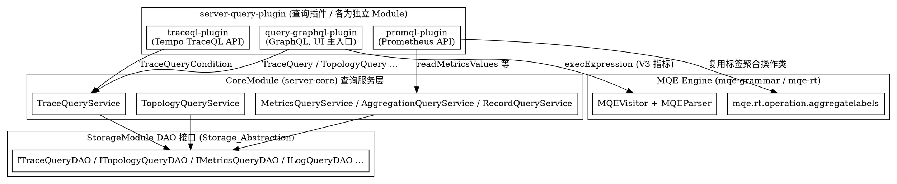

# SkyWalking Query Plugins

## Introduction

查询插件（Query Plugins）是 SkyWalking OAP Server 在**查询侧**对外暴露数据访问能力的模块集合，统一位于 `oap-server/server-query-plugin` 下。它们把不同查询协议（GraphQL / PromQL / TraceQL / LogQL / Zipkin）适配到 OAP 内部的查询服务与存储抽象之上。本页定位如下关系：

- 与 [Storage_Abstraction](/docs/CS/SE/SkyWalking/Storage_Abstraction.md) 的关系：查询插件**不直接碰存储**。它们调用 `CoreModule`（`server-core` 包 `org.apache.skywalking.oap.server.core.query` 下）的各类 `*QueryService`（`TraceQueryService`、`TopologyQueryService`、`MetricsQueryService`、`LogQueryService`、`MetadataQueryService`、`AlarmQueryService` 等），而这些 Service 内部通过 `StorageModule` 暴露的 DAO 接口（`ITraceQueryDAO`、`ITopologyQueryDAO`、`IMetricsQueryDAO`、`ILogQueryDAO`、`IManagementService` 等）落到具体存储（BanyanDB / ES / JDBC）。插件 ↔ DAO 之间是"插件 → 核心查询服务 → 存储 DAO"的两跳间接关系。
- 与 [MQE_Engine](/docs/CS/SE/SkyWalking/MQE_Engine.md) 的关系：MQE 是查询期指标求值 DSL。GraphQL 插件的 V3 指标查询（`execExpression`）**直接**复用 MQE 文法与运行时（`MQEVisitor`）；PromQL 插件则**自带** PromQL 文法，仅复用 MQE 运行时的标签聚合操作类（`mqe.rt.operation.aggregatelabels`），并不走 `MQEVisitor` 表达式求值；TraceQL 与 MQE 无关。
- 与 [Module_System](/docs/CS/SE/SkyWalking/Module_System.md) 的关系：每个查询插件都是一个独立的 `Module`，通过 `ModuleProvider` 注册 HTTP 处理器（`HTTPHandlerRegister`）或 GraphQL schema，依赖 `CoreModule` 暴露的查询服务。例如 GraphQL 插件所属模块为 `QueryModule`（`GraphQLQueryProvider.java:82-84`），PromQL / TraceQL 各有自己的 `Module` 定义。

> 版本基线：源码仓库 `E:/Projects/skywalking` 的 HEAD 为 commit `12ff4613c8`（10.x 形态代码）。本文所有结论均经真源码 Read / Grep 核验，引用一律标注 `file:line`（路径相对 `oap-server/`）。

## 查询插件总览

`server-query-plugin` 下的子模块（均已逐一 `ls` / `find` 核验）：

| 子模块 | 暴露的查询能力 | 接入协议 / 入口 |
| --- | --- | --- |
| `query-graphql-plugin` | SkyWalking 原生查询协议全集（trace / metric V1~V3 / topology / log / alarm / metadata / profile 等），是 UI 主入口 | GraphQL over HTTP（POST） |
| `promql-plugin` | Prometheus 兼容的 instant / range / query 接口、metadata / labels | Prometheus HTTP API（`/api/v1/...`） |
| `traceql-plugin` | Grafana Tempo 兼容的 TraceQL 查询（`/api/search`、`/api/traces/{id}`） | Tempo HTTP API |
| `logql-plugin` | Grafana Loki 兼容的 LogQL 查询（labels / range query） | Loki HTTP API |
| `zipkin-query-plugin` | Zipkin 兼容的 trace 查询接口 | Zipkin HTTP API |

本页聚焦前三个（GraphQL / PromQL / TraceQL），即任务点名的查询插件；LogQL / Zipkin 仅作总览罗列，不展开。

## GraphQL 接入与 resolver

### Schema 定义（.graphqls）

GraphQL 插件不手写 schema 字符串，而是用 `graphql-kickstart` 的 `SchemaParserBuilder` 按文件逐个挂载 `.graphqls` 与对应的 resolver 类。`GraphQLQueryProvider.prepare()` 里依次 `file(...).resolvers(...)` 挂载了 `query-protocol/` 下二十余个 `.graphqls` 文件（`GraphQLQueryProvider.java:104-172`），例如：

- `common.graphqls` + `Query` / `Mutation` / `HealthQuery`
- `trace.graphqls` + `TraceQuery`，`trace-v2.graphqls` + `TraceQueryV2`
- `metrics-v3.graphqls` + `MetricsExpressionQuery`（MQE 入口）
- `topology.graphqls` + `TopologyQuery`、`log.graphqls` + `LogQuery` 等

`.graphqls` 用标准 SDL 描述类型与字段，`extend type Query` 把所有查询入口汇聚到根 `Query` 类型。例如 `trace-v2.graphqls:38-44`：

```graphql
extend type Query {
    queryTraces(condition: TraceQueryCondition, debug: Boolean): TraceList
    hasQueryTracesV2Support: Boolean!
}
```

### Resolver 把查询转成对 CoreModule 查询服务的调用

每个 resolver 是 `GraphQLQueryResolver` 实现类，构造时持有 `ModuleManager`，并在首次调用时通过 `moduleManager.find(CoreModule.NAME).provider().getService(XxxQueryService.class)` 取出核心查询服务——**并不是直接拿 DAO**。以 `TraceQuery` 为例（`TraceQuery.java:59-64`）：

```java
private TraceQueryService getQueryService() {
    if (queryService == null) {
        this.queryService = moduleManager.find(CoreModule.NAME).provider().getService(TraceQueryService.class);
    }
    return queryService;
}
```

其 `queryBasicTraces` 最终落到 `getQueryService().queryBasicTraces(...)`（`TraceQuery.java:142`），由 `TraceQueryService`（core 包）内部再调用 `StorageModule` 的 `ITraceQueryDAO`。拓扑查询同理：`TopologyQuery.java:51-53` 取 `TopologyQueryService`，而 `TopologyQueryService.java:71` 在 core 包内通过 `getService(ITopologyQueryDAO.class)` 拿到底层 DAO。形成了"插件 resolver → CoreModule `*QueryService` → StorageModule DAO"的稳定两跳结构。

schema 最终由 `GraphQLQueryHandler` 注册为 HTTP POST 处理器（`GraphQLQueryProvider.java:177-183`）：

```java
HTTPHandlerRegister service = getManager().find(CoreModule.NAME).provider().getService(HTTPHandlerRegister.class);
service.addHandler(new GraphQLQueryHandler(getManager(), config, schemaBuilder.build().makeExecutableSchema()),
                   Collections.singletonList(HttpMethod.POST));
```

### V3 指标查询走 MQE

`MetricsExpressionQuery`（`metrics-v3.graphqls` 的 `execExpression` 字段）是 GraphQL 接入 MQE 引擎的关键：`MetricsExpressionQuery.java:64-85` 直接构造 `MQEVisitor`（传入 `moduleManager`/`Entity`/`Duration`），并用 `MQELexer` / `MQEParser` 解析表达式字符串后 `visitor.visit(tree)` 求值。因此 GraphQL 的 V3 指标查询复用的是 [MQE_Engine](/docs/CS/SE/SkyWalking/MQE_Engine.md) 的同一套文法与运行时。

## PromQL 接入（是否复用 MQE）

结论先行：**PromQL 插件拥有自己独立的 ANTLR4 文法与 Visitor，并不把 PromQL 翻译成 MQE 表达式交给 `MQEVisitor` 求值；但它复用了 MQE 运行时里的标签聚合操作类（`mqe.rt.operation.aggregatelabels`）。**

核验证据：

1. 自有文法：`promql-plugin/src/main/antlr4/.../PromQLLexer.g4` 与 `PromQLParser.g4`（`find` 已确认存在）。
2. 自有 Visitor：`PromQLExprQueryVisitor extends PromQLParserBaseVisitor<ParseResult>`（`PromQLExprQueryVisitor.java:79`），并非继承 `MQEVisitorBase`。
3. 直接走核心查询服务：它持有 `MetricsQueryService` / `RecordQueryService` / `AggregationQueryService`（`PromQLExprQueryVisitor.java:81-83`），在 `visitMetricInstant` 中按指标数据类型分支调用 `metricsQueryService.readMetricsValues`（`PromQLExprQueryVisitor.java:388`）、`readLabeledMetricsValues`（`:432`）、`aggregationQueryService.sortMetrics`（`:350`）、`recordQueryService.readRecords`（`:369`）。这些服务与 GraphQL / MQE 共用，故查的是同一份由 OAL 落库的数据（见 [OAL_Runtime](/docs/CS/SE/SkyWalking/OAL_Runtime.md)）。
4. 部分复用 MQE 操作类：PromQL 的 `sum/avg/min/max` 聚合（`visitAggregationOp` → `PromOpUtils.matrixAggregateOp`）直接 import 并实例化 MQE 的 `AggregateLabelsFunc` / `AggregateLabelsFuncFactory` / `AvgAggregateLabelsFunc` / `SumAggregateLabelsFunc` / `MaxAggregateLabelsFunc` / `MinAggregateLabelsFunc`（`PromOpUtils.java:28-33, 119-159`）。换句话说，PromQL 借用了 MQE **运行时的"按标签聚合"实现**，但语法解析与整体求值管线完全自建。

因此 PromQL 与 MQE 的关系是"**存储服务共享 + 标签聚合操作类共享，但文法与表达式引擎各自独立**"，而非"PromQL 翻译成 MQE"。

## TraceQL 接入

结论先行：**TraceQL 插件拥有自己独立的文法（基于 Grafana Tempo 的 TraceQL 文法），把 TraceQL 查询解析成 `TraceQLQueryParams`，再转换为 SkyWalking 的 `TraceQueryCondition` 交给 `TraceQueryService` 执行；属于"先结构化解析、后复用核心 trace 查询服务 + 内存补过滤"的模式，与 MQE 无关。**

核验证据：

1. 自有文法：位于 `org.apache.skywalking.oap.query.tempo.grammar` 的 `TraceQLLexer` / `TraceQLParser`（Tempo 文法，非 MQE）。`TraceQLQueryParser.parse()` 用这两个类做词法/语法分析，并显式移除默认错误恢复、改为收集语法错误后失败（`TraceQLQueryParser.java:46-63`）。
2. 解析产出参数：`TraceQLQueryParser.extractParams()` 构造 `TraceQLQueryVisitor` 遍历语法树，产出 `TraceQLParseResult` / `TraceQLQueryParams`（`TraceQLQueryParser.java:89-97`）。
3. 落到核心 trace 服务：`SkyWalkingTraceQLApiHandler` 在构造时取出 `TraceQueryService` / `TagAutoCompleteQueryService` / `MetadataQueryService`（`SkyWalkingTraceQLApiHandler.java:77-96`）；`search` 路径把 `TraceQLQueryParams` 经 `toCondition(...)` 转成 `TraceQueryCondition` 后调用 `traceQueryService.queryTraces(condition)`（`SkyWalkingTraceQLApiHandler.java:197`）；按 traceId 查则调用 `traceQueryService.queryTrace(...)`（`:128`）。
4. 内存补过滤：TraceQL 的 span 级属性条件（`{span.foo="bar"}` 之类）存储层无法全部下推，于是由 `SkyWalkingSpanMatcher` 在已返回的 trace 上做内存匹配（`SkyWalkingTraceQLApiHandler.java:301` 返回 `new Sample(traceQueryService.queryTraces(condition), new SkyWalkingSpanMatcher(params, namingControl))`）。TraceQL 的 metrics 端点（`/api/metrics/query_range`、`/api/metrics/query`）明确返回 501 不支持（`TraceQLApiHandler.java:385-419`），因为 trace 存储不提供时序聚合。

> TraceQL 插件还提供了 `OTLPTraceQLApiHandler` / `ZipkinTraceQLApiHandler` 等子类，针对 OTLP / Zipkin 数据源做 ID 解码与结果转换，但底层 trace 检索仍统一走 `TraceQueryService`。

## 三者差异与统一点



统一点：

- 三者都是 OAP 的查询 `Module`，都通过 `HTTPHandlerRegister`（GraphQL / PromQL / TraceQL 各自的 HTTP 处理器）挂到同一 Armeria HTTP 服务上，都依赖 `CoreModule`。
- 三者**最终都复用 `CoreModule` 的查询服务与 `StorageModule` 的 DAO 接口**，所以查的是同一份由 [OAL_Runtime](/docs/CS/SE/SkyWalking/OAL_Runtime.md) 落库的数据，存储选型（BanyanDB / ES / JDBC）对插件透明。
- 指标语义上，GraphQL 的 V3 路径与 MQE 完全一致；PromQL 是面向生态兼容的"子集式"入口，仅复用 MQE 的标签聚合操作实现；TraceQL 专注 trace 检索，不与指标引擎耦合。

差异点：

- 协议与入口不同：GraphQL（SkyWalking 自有 SDL）/ Prometheus HTTP API / Tempo HTTP API。
- 表达式引擎不同：GraphQL V3 直用 MQE；PromQL 自带文法 + 复用部分 MQE 操作类；TraceQL 自带文法且不碰 MQE。
- 数据域不同：GraphQL 覆盖最全（trace / metric / topology / log / alarm / profile 等）；PromQL 仅指标；TraceQL 仅 trace。

## Links

- [Module System](/docs/CS/SE/SkyWalking/Module_System.md)
- [Storage Abstraction](/docs/CS/SE/SkyWalking/Storage_Abstraction.md)
- [MQE Engine](/docs/CS/SE/SkyWalking/MQE_Engine.md)
- [OAL Runtime](/docs/CS/SE/SkyWalking/OAL_Runtime.md)
- [SkyWalking](/docs/CS/SE/SkyWalking/SkyWalking.md)
- [APM](/docs/CS/SE/APM.md)

## References

- commit `12ff4613c8`（`E:/Projects/skywalking`，10.x 形态代码）。
- 关键源码路径（`oap-server/server-query-plugin/`）：
  - `query-graphql-plugin/src/main/java/org/apache/skywalking/oap/query/graphql/GraphQLQueryProvider.java`
  - `query-graphql-plugin/src/main/java/org/apache/skywalking/oap/query/graphql/resolver/TraceQuery.java`
  - `query-graphql-plugin/src/main/java/org/apache/skywalking/oap/query/graphql/resolver/MetricsExpressionQuery.java`
  - `query-graphql-plugin/src/main/resources/query-protocol/trace-v2.graphqls`
  - `promql-plugin/src/main/antlr4/org/apache/skywalking/promql/rt/grammar/PromQLLexer.g4`、`PromQLParser.g4`
  - `promql-plugin/src/main/java/org/apache/skywalking/oap/query/promql/rt/PromQLExprQueryVisitor.java`
  - `promql-plugin/src/main/java/org/apache/skywalking/oap/query/promql/rt/PromOpUtils.java`
  - `traceql-plugin/src/main/java/org/apache/skywalking/oap/query/traceql/rt/TraceQLQueryParser.java`
  - `traceql-plugin/src/main/java/org/apache/skywalking/oap/query/traceql/handler/SkyWalkingTraceQLApiHandler.java`
  - 核心查询服务（复用层）：`server-core/src/main/java/org/apache/skywalking/oap/server/core/query/TopologyQueryService.java`、`TraceQueryService.java`
- 官方文档：
  - SkyWalking Query Protocol：`https://skywalking.apache.org/docs/main/latest/en/api/`
  - Metrics Query Expression：`https://skywalking.apache.org/docs/main/latest/en/api/metrics-query-expression/`
  - Prometheus Querying API：`https://prometheus.io/docs/prometheus/latest/querying/api/`
  - Grafana Tempo TraceQL：`https://grafana.com/docs/tempo/latest/traceql/`
