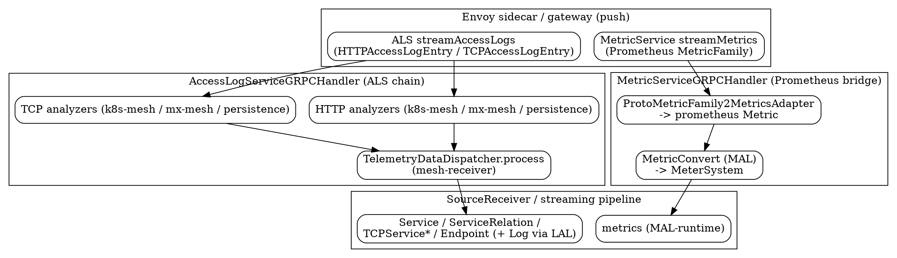

# SkyWalking Envoy Receiver Decode (ALS & MetricService)

## Introduction

本页深挖 Apache SkyWalking OAP 后端 `envoy-metrics-receiver-plugin`（模块名 `envoy-metric`）对 Envoy 两类遥测数据的解码全流程：**ALS（Access Log Service）** 与 **MetricService**。该插件是 OAP 做 K8s 服务网格可观测的核心桥接：Envoy 把访问日志（ALS）与 Prometheus 格式指标（MetricService）通过 gRPC 推给 OAP，OAP 再分别重建服务网格拓扑（`Service`/`ServiceRelation`/`TCPService*` 等 Source）与汇聚指标类 metrics。

> 源码基线：commit `12ff4613c8`（10.x 形态代码）。所有结论均通过 `Read` / `Grep` / `Bash` 真源码核验。挂载与协议层（独立入口、gRPC 注册、`SourceReceiver` 单一出口）已在 [Receiver_Protocol](/docs/CS/SE/SkyWalking/Receiver_Protocol.md) 覆盖，本页只聚焦「Envoy 协议数据 → 内部 Source/Metrics」的具体转换逻辑。



## ALS gRPC 入口：Envoy 推模式

ALS 入口是标准 Envoy ALS 协议（`io.envoyproxy.envoy.service.accesslog.v3`）。V3 handler 只是薄委托，真正的逻辑在 `AccessLogServiceGRPCHandler`：

```java
// AccessLogServiceGRPCHandlerV3.java:28
public class AccessLogServiceGRPCHandlerV3 extends AccessLogServiceGrpc.AccessLogServiceImplBase {
    private final AccessLogServiceGRPCHandler delegate;
    // :32 streamAccessLogs(responseObserver) -> delegate.streamAccessLogs(responseObserver)
}
```

`AccessLogServiceGRPCHandler` 构造时通过 Java SPI 加载所有 `ALSHTTPAnalysis` 与 `TCPAccessLogAnalyzer` 实现，再按配置名（`config.getAlsHTTPAnalysis()` / `getAlsTCPAnalysis()`）过滤启用哪些分析器（`AccessLogServiceGRPCHandler.java:60-79`）：

```java
// AccessLogServiceGRPCHandler.java:60-67
ServiceLoader<ALSHTTPAnalysis> alshttpAnalyses = ServiceLoader.load(ALSHTTPAnalysis.class);
for (String httpAnalysisName : config.getAlsHTTPAnalysis()) {
    for (ALSHTTPAnalysis httpAnalysis : alshttpAnalyses) {
        if (httpAnalysisName.equals(httpAnalysis.name())) {
            httpAnalysis.init(manager, config);
            envoyHTTPAnalysisList.add(httpAnalysis);
        }
    }
}
```

收到 `StreamAccessLogsMessage` 后，每帧首条消息按其 `Identifier.node.id` 前缀判定 `Role`（`AccessLogServiceGRPCHandler.java:115-122`），再按 `LogEntriesCase` 分流 HTTP / TCP 日志，逐条把消息喂给整条分析器链，最后把聚合结果交给 `TelemetryDataDispatcher.process`（`AccessLogServiceGRPCHandler.java:135-175`）：

```java
// AccessLogServiceGRPCHandler.java:142-151 (HTTP_LOGS 分支)
for (final HTTPAccessLogEntry httpLog : httpLogs.getLogEntryList()) {
    AccessLogAnalyzer.Result result = AccessLogAnalyzer.Result.builder().build();
    for (ALSHTTPAnalysis analysis : envoyHTTPAnalysisList) {
        result = analysis.analysis(result, identifier, httpLog, role);
    }
    if (result.hasResult()) {
        httpMetrics.addAllMetrics(result.getMetrics().getHttpMetrics().getMetricsList());
    }
}
// :175
TelemetryDataDispatcher.process(sourceResult.build());
```

**为何推而非拉**：Envoy 的访问日志是「每个请求一产生就落盘」的高频事件流，且 sidecar 数量随网格弹性伸缩。若由 OAP 拉取，需为每个 Envoy 维护轮询状态、难以应对短生命周期实例；而 gRPC 双向流（`StreamAccessLogs`）让 Envoy 在连接建立后持续上推，OAP 作为服务端被动接收，天然适配 sidecar 规模与故障重连（handler 在 `onError` 对 `CANCELLED` 静默处理，`AccessLogServiceGRPCHandler.java:182-191`）。这正是 [Receiver_Protocol](/docs/CS/SE/SkyWalking/Receiver_Protocol.md) 所述「独立入口 + 桥接」形态之一。

## 分析器链与 Role / ServiceMetaInfo

所有 ALS 分析器实现 `AccessLogAnalyzer<E>` 接口，其 `analysis(Result, Identifier, E entry, Role role)` 把上一条分析器的 `Result`（含已识别的 `ServiceMetaInfo service` 与累积的 `ServiceMeshMetrics.Builder metrics`）作为入参，形成**链式 fast-success**：一旦前序已产出 up/down-stream 指标便就近返回（`AccessLogAnalyzer.java:32-96`、`Result.hasResult` 为 `hasDownstreamMetrics || hasUpstreamMetrics`，`:93-95`）。

`Role` 枚举决定分析路径，由 node id 前缀推导（`AccessLogAnalyzer.identify` 默认实现，`AccessLogAnalyzer.java:55-72`）：

```java
// AccessLogAnalyzer.java:64-71
if (id.startsWith("router~"))   return Role.PROXY;
else if (id.startsWith("sidecar~"))  return Role.SIDECAR;
else if (id.startsWith("waypoint~")) return Role.WAYPOINT;
```

```java
// Role.java:24-41  —— 注意本版本为 NONE/PROXY/SIDECAR/WAYPOINT，非 Server/Client
public enum Role { NONE, PROXY, SIDECAR, WAYPOINT }
```

`ServiceMetaInfo`（`ServiceMetaInfo.java:34-46`）是「服务名推断」的统一载体，携带 `serviceName`、`serviceInstanceName` 与 `tags`（pod/namespace 等标签）。每个分析器的目标就是把一条访问日志的源/目的地址翻译成一对 `ServiceMetaInfo`，再交给适配器构造 `HTTPServiceMeshMetric` / `TCPServiceMeshMetric`。

## 服务名推断策略一：K8s Service Registry

`K8sALSServiceMeshHTTPAnalysis`（name=`k8s-mesh`）根据 `Role` 分发（`K8sALSServiceMeshHTTPAnalysis.java:69-90`）。以 sidecar 为例，它读 `upstreamCluster` 的 `inbound|` / `outbound|` 前缀区分服务端/客户端，并用 `Addresses.getAddressIP` 取出对端 pod IP（`K8sALSServiceMeshHTTPAnalysis.java:102-138`）：

```java
// K8sALSServiceMeshHTTPAnalysis.java:106-111
final ServiceMetaInfo downstreamService = find(Addresses.getAddressIP(downstreamRemoteAddress));
final Address downstreamLocalAddress = properties.getDownstreamLocalAddress();
final ServiceMetaInfo localService = find(Addresses.getAddressIP(downstreamLocalAddress));
// :138  outbound 时反查对端
final ServiceMetaInfo destService = find(Addresses.getAddressIP(upstreamRemoteAddress));
```

`find` 先查 Istio `ServiceEntry` 注册表，再回退到 K8s service 注册表（`K8sALSServiceMeshHTTPAnalysis.java:259-266`）：

```java
// K8sALSServiceMeshHTTPAnalysis.java:259-266
protected ServiceMetaInfo find(String ip) {
    final var istioService = istioServiceRegistry.findService(ip);
    if (!Objects.equals(config.serviceMetaInfoFactory().unknown(), istioService)) return istioService;
    return k8sServiceRegistry.findService(ip);
}
```

`K8SServiceRegistry` 是反推服务名的关键：它持有 `LookupCache`，**从不阻塞等待 API Server**——首次出现的 IP 先返回 unknown，后台异步读取 Endpoints/Pod/Service 后再填充（`K8SServiceRegistry.java:92-96`、`:185-190`）。`readServiceMetaInfo` 据 IP 找到 Pod，再由 Endpoints 反查 `ObjectID(namespace,name)`，最后由 `composeServiceMetaInfo` 组装（`K8SServiceRegistry.java:113-141`、`:192-213`）。服务名由 `ServiceNameFormatter` 按规则拼装，默认依次取 `service.istio.io/canonical-name` → `app.kubernetes.io/name` → `app` 标签（`K8SServiceRegistry.java:73`、`ServiceNameFormatter.java:39-51`）：

```java
// ServiceNameFormatter.java:38-51  —— 默认规则，可被 k8sServiceNameRule 覆盖
rule = StringUtils.defaultIfBlank(rule,
  "${pod.metadata.labels.(service.istio.io/canonical-name),"
  + "pod.metadata.labels.(app.kubernetes.io/name),pod.metadata.labels.app}");
```

`Addresses` 负责从 Envoy `Address` 中抽取 IP，兼容普通 socket 地址与 `envoy_internal_address`（ambient 网格，`Addresses.java:27-52`）。

## 服务名推断策略二：Metadata Exchange

`MetaExchangeALSHTTPAnalyzer`（name=`mx-mesh`）不查 K8s，而是直接从 Envoy 通过 `filter_state_objects` 注入的 metadata exchange 注解里读取对端服务名（`MetaExchangeALSHTTPAnalyzer.java:77-120`）：

```java
// MetaExchangeALSHTTPAnalyzer.java:96-110
final var stateMap = properties.getFilterStateObjectsMap();
// 新版本 key: upstream_peer / downstream_peer；旧版本(<=1.24) key: wasm.upstream_peer / wasm.downstream_peer
// :187-209 解析出对端 svc，用 newAdapter(entry, currSvc, svc).adaptToUpstreamMetrics() / adaptToDownstreamMetrics()
// :111-118 PROXY 且无 downstream 时，以 unknown 为源构造 server 端指标
```

`ServiceMetaInfoAdapter` 把 Envoy 注入的 FlatBuffer `FlatNode`（或 `Struct`）转换成 `ServiceMetaInfo`（`ServiceMetaInfoAdapter.java:48-108`）：`extractStructFromNodeFlatBuffer` 重建 `NAME`/`NAMESPACE`/`CLUSTER_ID`/`LABELS`，再用 `FieldsHelper` 按 `metadata-service-mapping.yaml` 把字段 inflate 到 `serviceName`/`serviceInstanceName`/`tags`（`ServiceMetaInfoAdapter.java:93-108`、`:115-142`）。当前节点自身的服务名则由 `identifier.getNode().getMetadata()` 经 `ServiceMetaInfoFactory.fromStruct` 得到（`MetaExchangeALSHTTPAnalyzer.java:222-224`）。

**双策略并存的原因**：`k8s-mesh` 依赖 OAP 能访问 K8s API Server（list Pod/Service/Endpoints），适合标准 sidecar 注入、OAP 有集群读权限的部署；`mx-mesh` 只依赖 Envoy 在请求链路里携带的 metadata，无需 OAP 触达 K8s，适合 ambient 网格、跨集群、或 OAP 无 K8s 权限的场景。两条链都实现同一 `ALSHTTPAnalysis` 接口，分析器顺序由配置名决定，彼此 fast-success 互不冲突。

## HTTP vs TCP 分析差异

HTTP 与 TCP 访问日志走各自的分析器接口（`ALSHTTPAnalysis` / `TCPAccessLogAnalyzer`）与适配器：

- **HTTP**：`LogEntry2MetricsAdapter` 除源/目的服务外，还抽取 **endpoint（`METHOD:path`，`LogEntry2MetricsAdapter.java:181-188`）、responseCode、status、protocol（HTTP/gRPC）、tlsMode、internalErrorCode** 等丰富维度（`LogEntry2MetricsAdapter.java:106-179`）。`adaptToDownstreamMetrics`/`adaptToUpstreamMetrics` 分别置 `DetectPoint.server`/`client` 并计算 latency（`:70-104`）。
- **TCP**：`TCPLogEntry2MetricsAdapter` 只关心连接级指标——**`receivedBytes` / `sentBytes`**（来自 `ConnectionProperties`，`TCPLogEntry2MetricsAdapter.java:107-108`），没有 endpoint、响应码、协议等概念（`:86-147`）。

二者都通过 `AbstractALSAnalyzer.newAdapter` / `AbstractTCPAccessLogAnalyzer.newAdapter` 创建适配器，构造出 `HTTPServiceMeshMetric` / `TCPServiceMeshMetric` 并累积进 `Result.metrics`（`AbstractALSAnalyzer.java:36-41`、`AbstractTCPAccessLogAnalyzer.java:38-43`）。TCP 同样有两套实现：`K8sALSServiceMeshTCPAnalysis`（k8s-mesh）与 `MetaExchangeTCPAccessLogAnalyzer`（mx-mesh）。

## ALS → SkyWalking Source 落点

分析器链产出的 `ServiceMeshMetrics`（HTTP+TCP 两类 metric builder）最终由 handler 交 `TelemetryDataDispatcher.process`（`AccessLogServiceGRPCHandler.java:175`）。该分发器位于 **mesh-receiver 插件**（`TelemetryDataDispatcher.java:90-93`），对每条 metric 做 `NamingControl` 规范化后转成具体 Source 并 `SOURCE_RECEIVER.receive(...)`（`TelemetryDataDispatcher.java:63-72`）：

```java
// TelemetryDataDispatcher.java:71-72
public static void init(ModuleManager moduleManager) {
    SOURCE_RECEIVER = moduleManager.find(CoreModule.NAME).provider().getService(SourceReceiver.class);
}
// 例如 HTTP 的 Service / ServiceRelation：
//   toService        -> new Service()        + SOURCE_RECEIVER.receive(service)   (:215-231)
//   toServiceRelation-> new ServiceRelation()+ SOURCE_RECEIVER.receive(...)        (:250-271)
//   toServiceInstanceRelation                                       (:360-383)
//   toEndpoint                                                   (:406-424)
// TCP 的 TCPService / TCPServiceRelation / TCPServiceInstance / TCPServiceInstanceRelation /
//     TCPServiceInstanceUpdate                                    (:234-404)
```

**HTTP 维度最终产出的 Source**：`Service`、`ServiceInstance`、`ServiceRelation`、`ServiceInstanceRelation`、`Endpoint`（均由 `Layer.MESH` 标记，`TelemetryDataDispatcher.java:191-213`）。

**TCP 维度最终产出的 Source**：`TCPService`、`TCPServiceRelation`、`TCPServiceInstance`、`TCPServiceInstanceRelation`、`TCPServiceInstanceUpdate`（`:165-186`）。

除指标 Source 外，配置里名为 `persistence` 的分析器（`LogsPersistence` / `TCPLogsPersistence`，实现的正是 `ALSHTTPAnalysis` / `TCPAccessLogAnalyzer`）会把原始访问日志交给 LAL 引擎，从而产出 `Log` 明细用于后续 LAL 过滤/告警（`LogsPersistence.java:57-82`、`TCPLogsPersistence.java:57-82`）：

```java
// LogsPersistence.java:71-77
final LogMetadata metadata = LogMetadata.builder()
    .service(service.getServiceName()).serviceInstance(service.getServiceInstanceName())
    .timestamp(metrics.getEndTime()).layer(Layer.MESH.name()).build();
logAnalyzerService.doAnalysis(metadata, entry);   // 交给 LogAnalyzerModule 的 LAL
```

`EnvoyAccessLogBuilder`（name=`EnvoyAccessLog`）作为 LAL 输出构建器，把原始 ALS proto 序列化为 JSON 内容（`EnvoyAccessLogBuilder.java:39-105`）；`EnvoyHTTPLALSourceTypeProvider` 则通过 SPI 声明 `HTTPAccessLogEntry` 为 `Layer.MESH` 层的 LAL 输入类型、输出类型为 `EnvoyAccessLogBuilder`（`EnvoyHTTPLALSourceTypeProvider.java:38-53`），从而支持在 LAL 规则里直接写 `ctx.input()` 访问 Envoy 字段。

> 注：本版本**没有** `AbstractALSAnalyzer.sendToSourceReceiver` 方法；ALS 的 Source 出口统一是 `TelemetryDataDispatcher` → `SourceReceiver.receive`（与 mesh-receiver 共用）。这与任务提示的旧形态不同，已按真源码核实修正。

## MetricService 链路：Prometheus 格式桥接

`MetricServiceGRPCHandlerV3` 同样是薄委托，逻辑在 `MetricServiceGRPCHandler`（`MetricServiceGRPCHandlerV3.java:28-34`）。构造时加载 envoy 指标 MAL 规则并预建 `MetricConvert` 转换器（`MetricServiceGRPCHandler.java:76-82`）：

```java
// MetricServiceGRPCHandler.java:76-81
final MeterSystem meterSystem = moduleManager.find(CoreModule.NAME).provider().getService(MeterSystem.class);
converters = config.rules().stream()
                      .map(rule -> new MetricConvert(rule, meterSystem))
                      .collect(Collectors.toList());
```

`onNext` 先从 node metadata 解析出当前服务（`MetricServiceGRPCHandler.java:97-101`），再对每条 `MetricFamily` 用 `ProtoMetricFamily2MetricsAdapter` 转成内部 `prometheus Metric`，并补 `app`/`instance` 标签（`:109-125`）：

```java
// MetricServiceGRPCHandler.java:114-125
final ProtoMetricFamily2MetricsAdapter adapter = new ProtoMetricFamily2MetricsAdapter(
    metricFamily, config.getClusterManagerMetricsAdapter(), config.getListenerMetricsAdapter());
adapter.adapt().forEach(it -> {
    it.getLabels().putIfAbsent("app", service.getServiceName());
    it.getLabels().putIfAbsent("instance", service.getServiceInstanceName());
    ... groupingMetrics.computeIfAbsent(it.getName(), name -> new ArrayList<>()).add(it);
});
```

`ProtoMetricFamily2MetricsAdapter.adapt` 把 Prometheus 的 `COUNTER`/`GAUGE`/`HISTOGRAM` 类型映射为内部 `Counter`/`Gauge`/`Histogram`（`ProtoMetricFamily2MetricsAdapter.java:40-74`）。指标名/标签处理按前缀委托给特化适配器：`cluster.*` → `ClusterManagerMetricsAdapter`（统一重命名为 `envoy_cluster_metrics` 并解析出 `cluster_name`，`ClusterManagerMetricsAdapter.java:38-60`），`listener.*` → `ListenerMetricsAdapter`（统一重命名为 `envoy_listener_metrics`，`ListenerMetricsAdapter.java:26-35`）。

最后按指标名分组，经 `PrometheusMetricConverter.convertPromMetricToSampleFamily` 转成 `SampleFamily`，交给各 MAL `converter.toMeter(...)` 汇入 `MeterSystem`（`MetricServiceGRPCHandler.java:128-134`）。也就是说 **MetricService 链路不再产出 ALS 那种 `ServiceMesh` Source，而是走 MAL 运行时 → `MeterSystem` → metrics**，规则定义在 `oap-server/server-starter/src/main/resources/envoy-metrics-rules/*.yaml`。

> 为何 metric 走 Prometheus 格式桥接而非自定义协议：Envoy 原生暴露的就是 Prometheus 指标端点（含 `cluster.*`/`listener.*` 等 Envoy 专属系列），OAP 直接复用这套已成事实标准的 expose 格式与 MAL 引擎，避免为 Envoy 另造一套指标协议与聚合规则，部署侧也只需让 Envoy 把 `/stats` 的 Prometheus 形态通过 `MetricsService` 推流即可。

## 桥接本质与 OAL / MAL 分治

envoy 插件在 OAP 里扮演「网桥」：把 Envoy 的私有协议（ALS proto、Prometheus 指标流）翻译成 SkyWalking 内部模型。其聚合引擎分两类：

1. **ALS 指标类**：HTTP 维度交 mesh-receiver 的 `TelemetryDataDispatcher` 产出 `Service*`/`Endpoint` 等 Source，由 **mesh.oal**（mesh-receiver 加载）聚合；TCP 维度产出 `TCPService*` 等 Source，需 envoy 插件自行加载 **TCPOALDefine**（数据集 `EnvoyTCP`，规则文件 `oal/tcp.oal`，`TCPOALDefine.java:25-34`）。Provider 在 `start()` 中当配置了 TCP 分析器时才加载它（`EnvoyMetricReceiverProvider.java:115-120`）：

```java
// EnvoyMetricReceiverProvider.java:115-120
if (!config.getAlsTCPAnalysis().isEmpty()) {
    getManager().find(CoreModule.NAME).provider()
                .getService(OALEngineLoaderService.class)
                .load(TCPOALDefine.INSTANCE);
}
```

2. **MetricService 指标类**：完全走 **MAL**（`MetricConvert` + `MeterSystem`），规则来自 `envoy-metrics-rules`，不经过 OAL。

3. **ALS 原始日志**：走 **LAL**（`LogsPersistence` → `EnvoyAccessLogBuilder` → `Log`），属于 [OAL_Runtime](/docs/CS/SE/SkyWalking/OAL_Runtime.md) 所述「MAL/LAL 运行时」范畴。

这与 [Receiver_Protocol](/docs/CS/SE/SkyWalking/Receiver_Protocol.md) 对 envoy 的「独立入口 + 桥接」定位完全吻合：它自建可选 gRPC 端口（`EnvoyMetricReceiverProvider.java:82-110`、`:154-159`），但 ALS 指标的下游出口仍复用 mesh-receiver 的 `TelemetryDataDispatcher` 与 `SourceReceiver`，保证「只认 Source、不认协议」。

## 设计取舍总结

- **推模式 ALS**：适配 sidecar 规模与弹性伸缩，省去 OAP 对每实例的轮询状态；双向流天然支持重连与背压。
- **K8s registry vs metadata exchange 双策略**：分别覆盖「OAP 可触达 K8s API」与「仅依赖 Envoy 注入元数据（ambient/跨集群/无 K8s 权限）」两类部署形态，二者同接口、可并存、fast-success 互不干扰。
- **HTTP/TCP 分治**：HTTP 保留 endpoint/status/protocol 等丰富维度以支撑细粒度拓扑与错误率；TCP 仅需 bytes/total 还原连接级拓扑。
- **MetricService 走 Prometheus+MAL**：复用 Envoy 原生指标暴露格式与成熟 MAL 引擎，零新协议成本。
- **出口统一**：ALS 指标最终仍收敛到 `SourceReceiver.receive`（经 mesh-receiver 的 `TelemetryDataDispatcher`），与全平台「单一 Source 出口」原则一致。

## Links

- [Receiver_Protocol](/docs/CS/SE/SkyWalking/Receiver_Protocol.md)
- [Streaming_Pipeline](/docs/CS/SE/SkyWalking/Streaming_Pipeline.md)
- [OAL_Runtime](/docs/CS/SE/SkyWalking/OAL_Runtime.md)
- [Receiver_Otel_Decode](/docs/CS/SE/SkyWalking/Receiver_Otel_Decode.md)
- [Receiver_Zipkin_Decode](/docs/CS/SE/SkyWalking/Receiver_Zipkin_Decode.md)
- [SkyWalking](/docs/CS/SE/SkyWalking/SkyWalking.md)

## References

- [AccessLogServiceGRPCHandlerV3.java](https://github.com/apache/skywalking/blob/12ff4613c8/oap-server/server-receiver-plugin/envoy-metrics-receiver-plugin/src/main/java/org/apache/skywalking/oap/server/receiver/envoy/AccessLogServiceGRPCHandlerV3.java)
- [AccessLogServiceGRPCHandler.java](https://github.com/apache/skywalking/blob/12ff4613c8/oap-server/server-receiver-plugin/envoy-metrics-receiver-plugin/src/main/java/org/apache/skywalking/oap/server/receiver/envoy/AccessLogServiceGRPCHandler.java)
- [als/AccessLogAnalyzer.java](https://github.com/apache/skywalking/blob/12ff4613c8/oap-server/server-receiver-plugin/envoy-metrics-receiver-plugin/src/main/java/org/apache/skywalking/oap/server/receiver/envoy/als/AccessLogAnalyzer.java)
- [als/Role.java](https://github.com/apache/skywalking/blob/12ff4613c8/oap-server/server-receiver-plugin/envoy-metrics-receiver-plugin/src/main/java/org/apache/skywalking/oap/server/receiver/envoy/als/Role.java)
- [als/ServiceMetaInfo.java](https://github.com/apache/skywalking/blob/12ff4613c8/oap-server/server-receiver-plugin/envoy-metrics-receiver-plugin/src/main/java/org/apache/skywalking/oap/server/receiver/envoy/als/ServiceMetaInfo.java)
- [als/LogEntry2MetricsAdapter.java](https://github.com/apache/skywalking/blob/12ff4613c8/oap-server/server-receiver-plugin/envoy-metrics-receiver-plugin/src/main/java/org/apache/skywalking/oap/server/receiver/envoy/als/LogEntry2MetricsAdapter.java)
- [als/k8s/K8sALSServiceMeshHTTPAnalysis.java](https://github.com/apache/skywalking/blob/12ff4613c8/oap-server/server-receiver-plugin/envoy-metrics-receiver-plugin/src/main/java/org/apache/skywalking/oap/server/receiver/envoy/als/k8s/K8sALSServiceMeshHTTPAnalysis.java)
- [als/k8s/K8SServiceRegistry.java](https://github.com/apache/skywalking/blob/12ff4613c8/oap-server/server-receiver-plugin/envoy-metrics-receiver-plugin/src/main/java/org/apache/skywalking/oap/server/receiver/envoy/als/k8s/K8SServiceRegistry.java)
- [als/k8s/Addresses.java](https://github.com/apache/skywalking/blob/12ff4613c8/oap-server/server-receiver-plugin/envoy-metrics-receiver-plugin/src/main/java/org/apache/skywalking/oap/server/receiver/envoy/als/k8s/Addresses.java)
- [als/k8s/ServiceNameFormatter.java](https://github.com/apache/skywalking/blob/12ff4613c8/oap-server/server-receiver-plugin/envoy-metrics-receiver-plugin/src/main/java/org/apache/skywalking/oap/server/receiver/envoy/als/k8s/ServiceNameFormatter.java)
- [als/mx/MetaExchangeALSHTTPAnalyzer.java](https://github.com/apache/skywalking/blob/12ff4613c8/oap-server/server-receiver-plugin/envoy-metrics-receiver-plugin/src/main/java/org/apache/skywalking/oap/server/receiver/envoy/als/mx/MetaExchangeALSHTTPAnalyzer.java)
- [als/mx/ServiceMetaInfoAdapter.java](https://github.com/apache/skywalking/blob/12ff4613c8/oap-server/server-receiver-plugin/envoy-metrics-receiver-plugin/src/main/java/org/apache/skywalking/oap/server/receiver/envoy/als/mx/ServiceMetaInfoAdapter.java)
- [als/tcp/TCPLogEntry2MetricsAdapter.java](https://github.com/apache/skywalking/blob/12ff4613c8/oap-server/server-receiver-plugin/envoy-metrics-receiver-plugin/src/main/java/org/apache/skywalking/oap/server/receiver/envoy/als/tcp/TCPLogEntry2MetricsAdapter.java)
- [als/tcp/k8s/K8sALSServiceMeshTCPAnalysis.java](https://github.com/apache/skywalking/blob/12ff4613c8/oap-server/server-receiver-plugin/envoy-metrics-receiver-plugin/src/main/java/org/apache/skywalking/oap/server/receiver/envoy/als/tcp/k8s/K8sALSServiceMeshTCPAnalysis.java)
- [als/tcp/mx/MetaExchangeTCPAccessLogAnalyzer.java](https://github.com/apache/skywalking/blob/12ff4613c8/oap-server/server-receiver-plugin/envoy-metrics-receiver-plugin/src/main/java/org/apache/skywalking/oap/server/receiver/envoy/als/tcp/mx/MetaExchangeTCPAccessLogAnalyzer.java)
- [persistence/LogsPersistence.java](https://github.com/apache/skywalking/blob/12ff4613c8/oap-server/server-receiver-plugin/envoy-metrics-receiver-plugin/src/main/java/org/apache/skywalking/oap/server/receiver/envoy/persistence/LogsPersistence.java)
- [persistence/EnvoyAccessLogBuilder.java](https://github.com/apache/skywalking/blob/12ff4613c8/oap-server/server-receiver-plugin/envoy-metrics-receiver-plugin/src/main/java/org/apache/skywalking/oap/server/receiver/envoy/persistence/EnvoyAccessLogBuilder.java)
- [EnvoyHTTPLALSourceTypeProvider.java](https://github.com/apache/skywalking/blob/12ff4613c8/oap-server/server-receiver-plugin/envoy-metrics-receiver-plugin/src/main/java/org/apache/skywalking/oap/server/receiver/envoy/EnvoyHTTPLALSourceTypeProvider.java)
- [MetricServiceGRPCHandler.java](https://github.com/apache/skywalking/blob/12ff4613c8/oap-server/server-receiver-plugin/envoy-metrics-receiver-plugin/src/main/java/org/apache/skywalking/oap/server/receiver/envoy/MetricServiceGRPCHandler.java)
- [metrics/adapters/ProtoMetricFamily2MetricsAdapter.java](https://github.com/apache/skywalking/blob/12ff4613c8/oap-server/server-receiver-plugin/envoy-metrics-receiver-plugin/src/main/java/org/apache/skywalking/oap/server/receiver/envoy/metrics/adapters/ProtoMetricFamily2MetricsAdapter.java)
- [metrics/adapters/ClusterManagerMetricsAdapter.java](https://github.com/apache/skywalking/blob/12ff4613c8/oap-server/server-receiver-plugin/envoy-metrics-receiver-plugin/src/main/java/org/apache/skywalking/oap/server/receiver/envoy/metrics/adapters/ClusterManagerMetricsAdapter.java)
- [EnvoyMetricReceiverProvider.java](https://github.com/apache/skywalking/blob/12ff4613c8/oap-server/server-receiver-plugin/envoy-metrics-receiver-plugin/src/main/java/org/apache/skywalking/oap/server/receiver/envoy/EnvoyMetricReceiverProvider.java)
- [TCPOALDefine.java](https://github.com/apache/skywalking/blob/12ff4613c8/oap-server/server-receiver-plugin/envoy-metrics-receiver-plugin/src/main/java/org/apache/skywalking/oap/server/receiver/envoy/TCPOALDefine.java)
- [TelemetryDataDispatcher.java (mesh-receiver)](https://github.com/apache/skywalking/blob/12ff4613c8/oap-server/server-receiver-plugin/skywalking-mesh-receiver-plugin/src/main/java/org/apache/skywalking/aop/server/receiver/mesh/TelemetryDataDispatcher.java)
- [tcp.oal (server-starter)](https://github.com/apache/skywalking/blob/12ff4613c8/oap-server/server-starter/src/main/resources/oal/tcp.oal)
