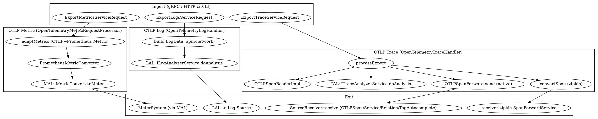

# OpenTelemetry / OTLP Receiver Decode Flow

## Introduction

本页是 [Receiver_Protocol](/docs/CS/SE/SkyWalking/Receiver_Protocol.md) 中"桥接型"一节在 `otel-receiver-plugin` 上的展开：聚焦 **OTLP trace / metric / log 进入 handler 之后，如何被解码、转换成 SkyWalking 内部模型，最终汇入出口** 的具体逻辑。协议层（apm-network proto 与 `SharingServerModule` 挂载）已在 [Receiver_Protocol](/docs/CS/SE/SkyWalking/Receiver_Protocol.md) 覆盖，本文不再重复，只讲"协议 → 内部模型 → 出口"的转换链，所有结论均通过 `Read` / `Grep` 真源码核验（commit `12ff4613c8`，10.x 形态）。

> 一个必须先澄清的反直觉点：**在 10.x 中，OTLP trace 不再转成 SkyWalking `SegmentObject` 复用 native agent 的 `SegmentParser`**。默认 `otlpTraceStorage: otlp` 模式下，它把 OTLP `Span` 直接构造为 `OTLPSpan` 等 **Source**，经 `SourceReceiver.receive()` 落库；仅在 `otlpTraceStorage: zipkin` 模式下才转成 Zipkin `Span` 委托给 receiver-zipkin。整包 `Grep` 验证：`otel-receiver-plugin` 内**不存在** `ISegmentParserService` / `SegmentObject` 的引用（对比 trace-receiver-plugin 才走 `SegmentParserService`）。

模块装配要点（仅作落点上下文）：`OtelMetricReceiverProvider.prepare()` 用 `ServiceLoader.load(Handler.class)` 发现三个 handler，`start()` 中逐个 `init()/active()`：

```java
// OtelMetricReceiverProvider.java:96 —— SPI 发现 handler（trace/metric/log 各一个）
for (final var handler: ServiceLoader.load(Handler.class)) {
    if (enabledHandlers.contains(handler.type())) {
        handlers.add(handler);
    }
}
// OtelMetricReceiverProvider.java:107 —— start 阶段初始化并激活（挂 gRPC/HTTP）
for (Handler h : handlers) {
    h.init(getManager(), config);
    h.active();
}
```

三种数据的存储后端由配置 `receiver-otel.default.otlpTraceStorage` 决定（`OtelMetricReceiverConfig.java:59`，默认 `otlp`，可选 `zipkin`），trace handler 据此切换 native Source 落库或 Zipkin 委托（`:140` 仅在 zipkin 模式声明依赖 `ZipkinReceiverModule`）。

## OTLP Trace Decode（native 模式：直接构造 Source）

入口是 gRPC `OpenTelemetryTraceHandler.export()`（`OpenTelemetryTraceHandler.java:174`），它直接转发到共享方法 `processExport()`（`:187`，HTTP 入口同样调用它，见后文双入口）。`processExport` 遍历 OTLP 的三层结构 `ResourceSpans → ScopeSpans → Span`：

```java
// OpenTelemetryTraceHandler.java:193-289（节选）
for (final ResourceSpans resourceSpans : request.getResourceSpansList()) {
    final Resource resource = resourceSpans.getResource();
    final List<ScopeSpans> scopeSpansList = resourceSpans.getScopeSpansList();
    final Map<String, String> resourceTags = OTLPValues.toStringMap(resource.getAttributesList());
    final String serviceName = nativeStorage ? resolveServiceName(resourceTags) : ...;
    ...
    for (ScopeSpans scopeSpans : scopeSpansList) {
        for (io.opentelemetry.proto.trace.v1.Span span : scopeSpans.getSpansList()) {
            final OTLPSpanReaderImpl reader = new OTLPSpanReaderImpl(span);   // :236 协议无关的 span 视图
            // Phase 1 通知 OTLP SpanListener
            getSpanListenerManager().notifyOTLPPhase(reader, groupedServiceName, resourceTags, scopeName, scopeVersion);
            // TAL 规则分析（trace-analyzer v2 模块，非 SegmentParser）
            final SpanAnalysisResult analysis = analyze(span, groupedServiceName, analyzedResourceTags, scopeTags, ...);  // :244
            ...
            if (nativeStorage) {                       // :262 默认分支
                storeNative(storedResource, ..., span, groupedServiceName, resourceTags, injectedTags, analysis.isEnforced());
            }
        }
    }
}
```

关键点一：**逐 span 调用 TAL（Trace Analysis Language，v2）**。`analyze()`（`:326`）通过 `ITraceAnalyzerService.doAnalysis(...)`（`:337`，来自 `trace-analyzer` 模块）对 span 跑规则，返回 `SpanAnalysisResult`（是否持久化、是否需要强制保留、注入的附加标签）。这是 10.x 里 OTLP 的"分析"环节——它**独立于** 旧版的 `SegmentParserServiceImpl`，后者是 native agent `SegmentObject` 的专属分析器。

关键点二：**native 模式直接构造 Source 落库**。`storeNative()`（`:674`）在通知完 native 阶段 `SpanListener`（phase 2）后，调用 `OTLPSpanForward.send(...)`（`:692`）。

```java
// OTLPSpanForward.java:112-194（节选）—— 真正的转换落点
public boolean send(final Resource resource, final String resourceSchemaUrl,
                    final InstrumentationScope scope, final String scopeSchemaUrl,
                    final Span span, final String serviceName,
                    final Map<String, String> resourceTags,
                    final Map<String, String> additionalTags, final boolean enforced) {
    ...
    final OTLPSpan source = new OTLPSpan();           // :129 直接构造 SkyWalking Source
    source.setTraceId(OTLPValues.hexId(stored.getTraceId()));
    source.setSpanId(OTLPValues.hexId(stored.getSpanId()));
    source.setParentSpanId(OTLPValues.hexId(stored.getParentSpanId()));
    source.setServiceName(formattedServiceName);
    source.setServiceInstance(...);                   // 来自 resource 的 service.instance.*
    source.setScopeName(scope.getName());             // instrumentation scope 名
    source.setName(getNamingControl().formatEndpointName(...));
    source.setKind(stored.getKindValue());
    source.setStatusCode(stored.getStatus().getCodeValue());
    source.setDataBinary(ResourceSpans.newBuilder()...toByteArray());  // :163 原样存整段 ResourceSpans
    getReceiver().receive(source);                    // :172 SourceReceiver.receive —— 出口

    final OTLPService service = new OTLPService();     // :174 服务目录
    final OTLPServiceSpan serviceSpan = new OTLPServiceSpan();  // :180 服务-操作
    ...
    getReceiver().receive(service);                    // :178
    getReceiver().receive(serviceSpan);               // :184
    if (StringUtil.isNotEmpty(source.getPeerService())) {
        final OTLPServiceRelation relation = new OTLPServiceRelation();  // :187 服务间关系
        getReceiver().receive(relation);              // :191
    }
    // 以及 TagAutocomplete（:330）用于 TraceQL 下拉
}
```

即 OTLP trace 的真实转换落点是 **`OTLPSpanForward.send()`（`OTLPSpanForward.java:112`）→ 构造 `OTLPSpan` / `OTLPService` / `OTLPServiceSpan` / `OTLPServiceRelation` / `TagAutocomplete` 等 Source → `SourceReceiver.receive()`（`:172`/`:178`/`:184`/`:191`/`:330`）**。这串 Source 经 [Streaming_Pipeline](/docs/CS/SE/SkyWalking/Streaming_Pipeline.md) 的 `DispatcherManager` 流入 `otlp_span` 等存储（scope 见 `OTLPSpan.java:48` `@ScopeDeclaration(id = OTLP_SPAN, name = "OTLPSpan")`）。

### OTLP Span 模型 ↔ SkyWalking 字段映射

OTLP `Span`（`io.opentelemetry.proto.trace.v1.Span`）与 SkyWalking `OTLPSpan` 字段对照：

| OTLP Span 字段 | 落点 | 说明 |
| --- | --- | --- |
| `trace_id` / `span_id` / `parent_span_id` | `OTLPSpan.traceId/spanId/parentSpanId`（`:130-132`） | 以 hex 字符串保存（`OTLPValues.hexId`） |
| `name` | `OTLPSpan.name`（`:141`） | 经 `NamingControl.formatEndpointName` |
| `kind`（CLIENT/SERVER/PRODUCER/CONSUMER/INTERNAL） | `OTLPSpan.kind`（`:142`，`getKindValue()`） | SkyWalking 用 int 枚举 |
| `status.code` | `OTLPSpan.statusCode`（`:143`） | int 枚举，错误/未设置/OK |
| `start_time_unix_nano` / `end_time_unix_nano` | `startTime` + `Duration`（`:144-145`） | 毫秒起、纳秒差计时长 |
| `attributes`（span 级） | `OTLPSpan.tags`（前缀 `span.`，`:151`） | 与 resource 属性合并为 `key=value` 检索索引 |
| `events` / `links` | 仅 zipkin 模式转成标签（`:463`/`:485`）；native 模式存于 `dataBinary` | native 模式保留原始 protobuf |
| resource 属性 | `OTLPSpan.tags`（前缀 `resource.`，`:149`）+ `serviceName`/`serviceInstance` | 两级元数据分别落列 |
| instrumentation scope（name/version） | `OTLPSpan.scopeName`（`:140`）+ 自动补全标签（`:157`） | OTLP 特有的"埋点库作用域"概念 |

与 native agent `SpanObject` 的关键差异：SkyWalking 原生 span 用 `SegmentObject` 聚合、用 `SegmentReference` 表达跨进程 `refs`（链路上下游）、有 `layer`（纵深层级）等字段；OTLP 没有 segment 概念（每个 span 独立、靠 `trace_id`+`parent_span_id` 关联），也没有显式的 segment 引用，因此 10.x 选择**不强行塞进 `SegmentObject`**，而是以 `OTLPSpan` Source 原样存储并在 `dataBinary` 保留整段 `ResourceSpans`，把跨进程关系交给 `OTLPServiceRelation`（由 `peer.service` 推断，`:153`）。

### Zipkin 兜底模式（非默认）

当 `otlpTraceStorage: zipkin` 时，不走 `OTLPSpanForward`，而是把每个 OTLP span 用 `convertSpan()`（`:418`）转成 `zipkin2.Span`，再批量交给 receiver-zipkin 的 `SpanForwardService.send(result)`（`:296`）：

```java
// OpenTelemetryTraceHandler.java:287,296（zipkin 分支）
Span zipkinSpan = convertSpan(span, groupedServiceName, spanTags, analysis.isEnforced());
result.add(zipkinSpan);
...
final var processedSpans = getForwardService().send(result);  // 委托给 receiver-zipkin
```

因此该模式下 OTLP 复用的是 **Zipkin receiver 的链路**，而非 native `SegmentParser`。

## OTLP Metric Decode（走 MAL 引擎）

gRPC 入口 `OpenTelemetryMetricHandler.export()` 把请求直接交给 processor（`OpenTelemetryMetricHandler.java:74-77`）：

```java
// OpenTelemetryMetricHandler.java:74
public void export(final ExportMetricsServiceRequest requests, final StreamObserver<...> responseObserver) {
    metricRequestProcessor.processMetricsRequest(requests);   // 与 HTTP 共用
    responseObserver.onNext(ExportMetricsServiceResponse.getDefaultInstance());
    responseObserver.onCompleted();
}
```

真实转换落点在 `OpenTelemetryMetricRequestProcessor.processMetricsRequest()`（`:149`）。它把 OTLP `ResourceMetrics → ScopeMetrics → Metric` 适配成 SkyWalking 的 Prometheus 风格 `Metric`（Gauge/Counter/Histogram/Summary），再喂给 **MAL（Meter Analysis Language，v2）** 引擎：

```java
// OpenTelemetryMetricRequestProcessor.java:149-176（节选）
public void processMetricsRequest(final ExportMetricsServiceRequest requests) {
    requests.getResourceMetricsList().forEach(request -> {
        final Map<String, String> nodeLabels = nodeLabels(request.getResource().getAttributesList());  // :156 resource 属性→labels
        final Map<Long, List<Metric>> byMinute = new TreeMap<>();
        request.getScopeMetricsList().stream()
               .flatMap(scopeMetrics -> scopeMetrics.getMetricsList().stream())
               .flatMap(metric -> adaptMetrics(nodeLabels, metric))    // :165 OTLP 指标→SkyWalking Metric
               .forEach(metric -> byMinute.computeIfAbsent(
                   TimeBucket.getMinuteTimeBucket(metric.getTimestamp()), k -> new ArrayList<>()).add(metric));
        for (final List<Metric> minute : byMinute.values()) {
            final ImmutableMap<String, SampleFamily> sampleFamilies =
                PrometheusMetricConverter.convertPromMetricToSampleFamily(minute.stream()...);  // :170 转 SampleFamily
            converters.values().forEach(convert -> convert.toMeter(sampleFamilies));            // :175 MAL 执行
        }
    });
}
```

- `adaptMetrics()`（`:367-492`）是 OTLP→SkyWalking 指标模型的核心：按 `Gauge`/`Sum`/`Histogram`/`ExponentialHistogram`/`Summary` 分别映射（如 delta `Sum` 当 `Gauge`、monotonic `Sum` 当 `Counter`，`:384-431`），标签由 `nodeLabels`（resource）+ `buildLabels`（datapoint 属性，点号转下划线，`:282`）合并（`:292`）。
- MAL 引擎实例是 `MetricConvert`，在 `start()` 里从 `otel-rules` 目录加载规则（`Rules.loadRules("otel-rules", enabledRules)`，`OpenTelemetryMetricRequestProcessor.java:233`），构造 `new MetricConvert(rule, meterSystem)`（`:244`）。运行时也通过 `MalConverterRegistry.addOrReplaceConverter/removeConverter`（`:200`/`:214`）由 runtime-rule 插件热更新。
- `convert.toMeter(sampleFamilies)`（`:175`）经 MAL DSL 求值后写入 `MeterSystem`（在 `start()` 里 `manager.find(CoreModule.NAME).getService(MeterSystem.class)` 取得，`:241`）。

结论：**OTLP metric 的真实落点是 MAL 引擎（`MetricConvert.toMeter`，`OpenTelemetryMetricRequestProcessor.java:175`）→ `MeterSystem`，中间经过 Prometheus 风格 `Metric`/`SampleFamily` 适配，而非直接构造 Source。**

## OTLP Log Decode（走 LAL 引擎）

gRPC 入口 `OpenTelemetryLogHandler.export()` 直接调 `processExport()`（`OpenTelemetryLogHandler.java:110-115`）。`processExport()` 遍历 `ResourceLogs → ScopeLogs → LogRecord`，对每个 record 调用 `doAnalysisQuietly()`（`:120-152`）：

```java
// OpenTelemetryLogHandler.java:154-170
private void doAnalysisQuietly(String service, String layer, String serviceInstance,
                               Map<String, String> resourceAttributes, LogRecord logRecord) {
    try {
        final LogData.Builder builder = LogData
            .newBuilder()
            .setService(service)
            .setServiceInstance(serviceInstance)
            .setTimestamp(logRecord.getTimeUnixNano() / 1_000_000)
            .setTags(buildTags(logRecord))     // OTLP attributes → apm-network LogTags
            .setBody(buildBody(logRecord))     // log body → TextLog
            .setLayer(layer);
        logAnalyzerService().doAnalysis(
            LogMetadataUtils.fromLogData(builder, resourceAttributes), builder);  // :165 委托 LAL
    } catch (Exception e) {
        log.error("Failed to analyze logs", e);
    }
}
```

注意 OTLP log **不经过 `SourceReceiver`，而是构造 SkyWalking apm-network 的 `LogData`（logging v3 proto），交给 `ILogAnalyzerService.doAnalysis(...)`（`:165`）**——即 **LAL（Log Analysis Language，v2，log-analyzer 模块）**。后续由 LAL 规则/解析器决定产出何种 `Log`/`LogRecord` Source 并落库。`buildBody`/`buildTags`（`OpenTelemetryLogHandler.java:172`/`:180`）完成 OTLP `LogRecord.body` 与 `attributes` 到 `LogDataBody`/`LogTags` 的字段映射。

结论：**OTLP log 的真实落点是 LAL 引擎（`ILogAnalyzerService.doAnalysis`，`OpenTelemetryLogHandler.java:165`），输入是 apm-network `LogData`；与 metric 的 MAL 一样属于"分析引擎消费"路径，而非直接 Source。**

## gRPC + HTTP 双入口：共享转换逻辑

三种数据都是同一套"gRPC handler（`*ServiceImplBase`）+ Armeria HTTP handler"双入口，差异仅在序列化入口，**解码/转换逻辑完全共用**：

- **Trace**：gRPC `OpenTelemetryTraceHandler.export()`（`OpenTelemetryTraceHandler.java:174`）→ `processExport()`；HTTP `OpenTelemetryTraceHTTPHandler`（Armeria `@Post("/v1/traces")`，`:45`）解析 protobuf（`:47`）或 OTLP/JSON（`:62`，id 先做 hex→base64 转换 `OTLPValues.hexIdsToBase64`）后，调 `traceHandler.processExport(exportRequest)`（`:51`/`:72`）。
- **Metric**：gRPC `OpenTelemetryMetricHandler.export()`（`:74`）→ `processMetricsRequest`；HTTP `OpenTelemetryMetricHTTPHandler`（`@Post("/v1/metrics")`，`:48`）解析后调 `metricProcessor.processMetricsRequest(exportRequest)`（`:54`/`:74`）。
- **Log**：gRPC `OpenTelemetryLogHandler.export()`（`:110`）→ `processExport`；HTTP `OpenTelemetryLogHTTPHandler`（`@Post("/v1/logs")`，`:48`）调 `logHandler.processExport(...)`（`:54`/`:74`）。

挂载也在各 handler 的 `active()` 内统一完成——gRPC handler 用 `grpcHandlerRegister.addHandler(this)`，HTTP 包裹成对应 `*HTTPHandler` 用 `httpHandlerRegister.addHandler(...)`（例如 trace：`OpenTelemetryTraceHandler.java:154-166`，注册自身 + `new OpenTelemetryTraceHTTPHandler(this)`）。HTTP handler 持有 gRPC handler 的实例引用，因此二者共用同一份 `processExport` / `processMetricsRequest` 等转换代码，无重复实现。

## Bridging Essence and Comparison

"桥接"的本质：otel-receiver 把第三方 OTLP 数据翻译成 SkyWalking 内部模型，三条数据走三条不同的下游：

| 数据类型 | 中间模型 | 出口引擎 | 真实落点（file:line） |
| --- | --- | --- | --- |
| trace（默认 `otlp`） | `OTLPSpan` 等 Source（直接构造） | `SourceReceiver.receive` → `otlp_span` 等 | `OTLPSpanForward.send`（`:112`）→ `:172` |
| trace（`zipkin` 模式） | `zipkin2.Span` | receiver-zipkin `SpanForwardService` | `OpenTelemetryTraceHandler.java:296` |
| trace（分析附加） | `SpanMetadata` | TAL（`ITraceAnalyzerService`） | `OpenTelemetryTraceHandler.java:337` |
| metric | Prometheus `Metric`/`SampleFamily` | MAL（`MetricConvert.toMeter`）→ `MeterSystem` | `OpenTelemetryMetricRequestProcessor.java:175` |
| log | apm-network `LogData` | LAL（`ILogAnalyzerService`） | `OpenTelemetryLogHandler.java:165` |

对照 [Receiver_Protocol](/docs/CS/SE/SkyWalking/Receiver_Protocol.md) 的"桥接型"描述：

- **vs trace-receiver（native agent）**：native agent 把 `SegmentObject` 交给 `SegmentParserService` 做分析（这是 [Receiver_Protocol](/docs/CS/SE/SkyWalking/Receiver_Protocol.md) 所谓"委托 SegmentParser"）。OTLP trace **不复用** `SegmentParser`/`SegmentObject`——10.x 用 `OTLPSpan` Source 直接落库 + 独立的 TAL 分析，原因是 OTLP 没有 segment/refs 概念，强行映射会丢信息。
- **vs jvm-receiver**：jvm-receiver 直接构造 `JVMMetric` 等 Source 走 `SourceReceiver`，OTLP trace（native）同样"直接 Source"，但多了一层 TAL 分析；而 OTLP metric / log **不**直接 Source，而是分别交给 MAL / LAL 引擎——这是 OTLP "桥接"区别于"直采"的最显著特征。

### resource / scope 两级元数据如何落 service / instance

OTLP 的 `Resource` 与 `InstrumentationScope`（scope）两级元数据映射到 SkyWalking 的 service / instance：

- **service 名**：从 resource 属性按优先级 `service.name → faas.name → k8s.deployment.name → process.executable.name` 解析（`OpenTelemetryTraceHandler.java:620` `resolveServiceName`；log 用 `attributes.get("service.name")`）。缺省则整段丢弃并计入 `partial_success`（`:208`/`:303`）。
- **服务分组**：`receiver-otel.otlpServiceGroupKeys` 指定的 resource 属性作为分组键，拼成 `group::name`（`OTLPServiceGroup.apply`，`OTLPServiceGroup.java:43`），使 trace 分析、存储 span、日志归属同一服务。
- **instance**：trace 取 resource 的 `service.instance.id` / `service.instance`（`OTLPSpanForward.java:134`）；log 同样（`OpenTelemetryLogHandler.java:137-140`）。
- **scope**：instrumentation scope 的 `name`/`version` 落到 `OTLPSpan.scopeName`（`OTLPSpanForward.java:140`）并发布为 TagAutocomplete（`:157`），供 TraceQL 按 `otel.scope.name` 检索。

## Design Trade-offs

- **为何 OTLP trace 不复用 native `SegmentParser`**：`SegmentParser` 是为 native agent 的 `SegmentObject`（含 segment、refs、layer 等）量身定做的分析器；OTLP 的每个 span 是独立实体，靠 `trace_id`+`parent_span_id` 关联、无 segment 聚合、无 `SegmentReference`。10.x 改为直接构造 `OTLPSpan` Source 并原样保留 `dataBinary`（整段 `ResourceSpans`，`OTLPSpanForward.java:163`），使 TraceQL 能直接检索 OTLP 的 resource/scope 两级属性，同时把"分析"职责交给更通用的 TAL（v2）。这与历史版本（曾把 OTLP 转 `SegmentObject`）已不同。
- **为何 metric / log 走 MAL / LAL 而非直接 Source**：metrics 天然是"指标家族 + 标签 + 时间"，与 MAL 的 `SampleFamily` DSL 模型契合，由 `otel-rules` 目录的规则决定如何聚合进 `MeterSystem`；logs 则由 LAL 规则决定解析/抽取/落库策略。把这两类交给分析引擎，能让用户用 MAL/LAL 脚本定制，而不必改 Java 代码。
- **为何 trace 仍可切回 zipkin 模式**：`otlpTraceStorage: zipkin` 提供向后兼容——把 OTLP span 转成 `zipkin2.Span` 后交给 receiver-zipkin，复用其成熟的链路落库与采样（`OpenTelemetryTraceHandler.java:418`/`:296`），代价是失去原生 `otlp_span` 对 OTLP 属性的细粒度检索。



## Links

- [Receiver_Protocol](/docs/CS/SE/SkyWalking/Receiver_Protocol.md)
- [Receiver_Zipkin_Decode](/docs/CS/SE/SkyWalking/Receiver_Zipkin_Decode.md)
- [Receiver_Envoy_Decode](/docs/CS/SE/SkyWalking/Receiver_Envoy_Decode.md)
- [Streaming_Pipeline](/docs/CS/SE/SkyWalking/Streaming_Pipeline.md)
- [Analyzer_Family](/docs/CS/SE/SkyWalking/Analyzer_Family.md)
- [SkyWalking](/docs/CS/SE/SkyWalking/SkyWalking.md)

## References

- [OtelMetricReceiverProvider.java (commit 12ff4613c8)](https://github.com/apache/skywalking/blob/12ff4613c8/oap-server/server-receiver-plugin/otel-receiver-plugin/src/main/java/org/apache/skywalking/oap/server/receiver/otel/OtelMetricReceiverProvider.java)
- [OpenTelemetryTraceHandler.java](https://github.com/apache/skywalking/blob/12ff4613c8/oap-server/server-receiver-plugin/otel-receiver-plugin/src/main/java/org/apache/skywalking/oap/server/receiver/otel/otlp/OpenTelemetryTraceHandler.java)
- [OTLPSpanForward.java](https://github.com/apache/skywalking/blob/12ff4613c8/oap-server/server-receiver-plugin/otel-receiver-plugin/src/main/java/org/apache/skywalking/oap/server/receiver/otel/otlp/OTLPSpanForward.java)
- [OTLPServiceGroup.java](https://github.com/apache/skywalking/blob/12ff4613c8/oap-server/server-receiver-plugin/otel-receiver-plugin/src/main/java/org/apache/skywalking/oap/server/receiver/otel/otlp/OTLPServiceGroup.java)
- [OpenTelemetryMetricHandler.java](https://github.com/apache/skywalking/blob/12ff4613c8/oap-server/server-receiver-plugin/otel-receiver-plugin/src/main/java/org/apache/skywalking/oap/server/receiver/otel/otlp/OpenTelemetryMetricHandler.java)
- [OpenTelemetryMetricRequestProcessor.java](https://github.com/apache/skywalking/blob/12ff4613c8/oap-server/server-receiver-plugin/otel-receiver-plugin/src/main/java/org/apache/skywalking/oap/server/receiver/otel/otlp/OpenTelemetryMetricRequestProcessor.java)
- [OpenTelemetryLogHandler.java](https://github.com/apache/skywalking/blob/12ff4613c8/oap-server/server-receiver-plugin/otel-receiver-plugin/src/main/java/org/apache/skywalking/oap/server/receiver/otel/otlp/OpenTelemetryLogHandler.java)
- [OTLPSpan.java (core source)](https://github.com/apache/skywalking/blob/12ff4613c8/oap-server/server-core/src/main/java/org/apache/skywalking/oap/server/core/otlp/source/OTLPSpan.java)
