# SkyWalking Receiver and Protocol

## Introduction

本页深挖 Apache SkyWalking OAP 后端的「接收层与协议（Receiver & Protocol）」：即从探针 / 网桥 / 第三方系统通过网络把遥测数据送进 OAP 时所依赖的 **gRPC / HTTP 协议定义（apm-network proto）** 与 **接收插件体系（server-receiver-plugin）**。

定位与关系：

- 与 [Module_System](/docs/CS/SE/SkyWalking/Module_System.md) 的关系：每个 receiver 都是一个独立的 `Module`，其 `*ReceiverProvider` 继承 `ModuleProvider`，在 `start()` 中通过 `SharingServerModule` 暴露的 `GRPCHandlerRegister` / `HTTPHandlerRegister` 把 handler 挂到统一的 gRPC / HTTP server 上。
- 与 [Streaming_Pipeline](/docs/CS/SE/SkyWalking/Streaming_Pipeline.md) 的关系：所有 receiver 在解码后最终都调用 `SourceReceiver.receive(source)`（见 `SourceReceiver.java:28`），而 `SourceReceiver` 本身只是 [Streaming_Pipeline](/docs/CS/SE/SkyWalking/Streaming_Pipeline.md) 中 `DispatcherManager` 的薄封装（`SourceReceiver.java:25` 注释明确「delegates to DispatcherManager」）。
- 与 [OAL_Runtime](/docs/CS/SE/SkyWalking/OAL_Runtime.md) 的关系：部分 receiver（jvm、mesh 等）在 `start()` 里通过 `OALEngineLoaderService` 加载专属 OAL 定义（`JVMOALDefine` / `MeshOALDefine`），另一些（meter / otel / log）则由 MAL / LAL 引擎在流式处理阶段消费 Source。

> 源码基线：commit `12ff4613c8`（10.x 形态代码）。所有结论均通过 `Read` / `Grep` / `Bash` 真源码核验。

## 协议层：apm-network 的 gRPC service 定义

协议契约集中在 `apm-protocol/apm-network/src/main/proto`，按业务域分子目录（language-agent、management、logging、service-mesh-probe、browser、profile、ebpf、event、pprof、asyncprofiler）。全部使用 `proto3`，`package` 统一为 `skywalking.v3`。每个 `.proto` 既定义 `service`（gRPC 接口），也定义传输用的 `message`。

核心 service 与 RPC 形态（均已 Read 核验）：

| 协议文件 | service | RPC（流/一元） | 关键 message |
| --- | --- | --- | --- |
| `language-agent/Tracing.proto` | `TraceSegmentReportService` | `collect (stream SegmentObject) returns (Commands)`（流式，推荐）；`collectInSync (SegmentCollection) returns (Commands)`（一元） | `SegmentObject`（`Tracing.proto:54`）、`SpanObject`（`:113`）、`SegmentReference`（`:80`） |
| `language-agent/Tracing.proto` | `SpanAttachedEventReportService` | `collect (stream SpanAttachedEvent) returns (Commands)` | `SpanAttachedEvent`（`:246`，Rover 附着的 OS 级事件） |
| `language-agent/JVMMetric.proto` | `JVMMetricReportService` | `collect (JVMMetricCollection) returns (Commands)`（一元） | `JVMMetricCollection`（`:37`）、`JVMMetric`（`:43`） |
| `language-agent/Meter.proto` | `MeterReportService` | `collect (stream MeterData)`、`collectBatch (stream MeterDataCollection)` | `MeterData`（MAL 输入） |
| `logging/Logging.proto` | `LogReportService` | `collect (stream LogData) returns (Commands)`（流式） | `LogData` |
| `management/Management.proto` | `ManagementService` | `reportInstanceProperties` / `keepAlive`（一元） | `InstanceProperties`、`InstancePingPkg` |
| `service-mesh-probe/service-mesh.proto` | `ServiceMeshMetricService` | `collect (stream ServiceMeshMetrics) returns (MeshProbeDownstream)` | `ServiceMeshMetrics`（`oneof` HTTP/TCP） |
| `browser/BrowserPerf.proto` | `BrowserPerfService` | `collectPerfData` / `collectWebVitalsPerfData` 等 | `BrowserPerfData`、`BrowserErrorLog` |
| `profile/Profile.proto` | `ProfileTask` | `getProfileTaskCommands`、`collectSnapshot (stream ThreadSnapshot)`、`goProfileReport` | `ThreadSnapshot`、`GoProfileData` |
| `ebpf/profiling/Profile.proto` | `EBPFProfilingService` | `queryTasks`、`collectProfilingData (stream)` | `EBPFProfilingData` |
| `event/Event.proto` | `EventService` | `collect (stream Event)` | `Event` |
| `pprof/Pprof.proto` | `PprofTask` | `collect (stream PprofData)`（双向流）、`getPprofTaskCommands` | `PprofData` |

观察几点协议设计规律：

1. **流式为主、一元兜底**：Trace / Meter / Log / Mesh / Event / Profile 等高频数据走 `stream` 以获得吞吐（注释明确 `gRPC streaming provides better performance`，见 `Tracing.proto:34-36`）；JVM、Management、Browser 这类低频或控制面数据用一元 RPC。
2. **统一响应 `Commands`**：几乎所有 service 的返回值都是 `Commands`（`common/Command.proto`），用于 OAP 反向给探针下发命令（如配置变更、 profiling 任务、下采样指令），形成双向通道。
3. **Compat 兼容层**：仓库中存在大量 `*Compat.proto`（如 `TracingCompat.proto`、`JVMMetricCompat.proto`、`BrowserPerfCompat.proto`），其 RPC 签名退化为引用 `skywalking.v3.*` 的 message（例如 `collect (stream skywalking.v3.SegmentObject)`）。对应的 receiver 会注册一个 `*HandlerCompat` 来同时兼容新旧客户端（见下文 Trace 章节）。

## 接收插件体系与挂载机制

`oap-server/server-receiver-plugin` 下每个子模块都是一个独立 `Module`：

```
skywalking-trace-receiver-plugin   skywalking-jvm-receiver-plugin
skywalking-meter-receiver-plugin   skywalking-log-receiver-plugin
skywalking-mesh-receiver-plugin    skywalking-browser-receiver-plugin
skywalking-management-receiver-plugin (register)  skywalking-clr-receiver-plugin
skywalking-ebpf-receiver-plugin    skywalking-event-receiver-plugin
skywalking-profile-receiver-plugin  skywalking-pprof-receiver-plugin
skywalking-async-profiler-receiver-plugin  skywalking-zabbix-receiver-plugin
otel-receiver-plugin   zipkin-receiver-plugin   envoy-metrics-receiver-plugin
configuration-discovery-receiver-plugin  skywalking-telegraf-receiver-plugin
skywalking-sharing-server-plugin   aws-firehose-receiver-plugin
```

### 统一挂载：SharingServerModule + GRPCServer / HTTPServer

所有 receiver 都不自己起网络端口，而是复用 `CoreModule` 提供的 `GRPCServer` / `HTTPServer`，经由 `SharingServerModule` 暴露的注册服务挂载 handler。核验链路如下：

- `SharingServerModuleProvider` 在 `prepare()` 里创建 `GRPCServer`（`:110-137`）与 `HTTPServer`（`:77-98`），并用它们构造 `GRPCHandlerRegisterImpl`（`:139`）、`HTTPHandlerRegisterImpl`（`:100`），然后 `registerServiceImplementation(GRPCHandlerRegister.class, ...)`（`:143`）/`HTTPHandlerRegister.class`（`:100`、`:103`）。
- 每个 receiver 的 `start()` 通过 `getManager().find(SharingServerModule.NAME).provider().getService(GRPCHandlerRegister.class)` 取到注册器，再 `addHandler(handler)`（`TraceModuleProvider.java:63-71`）。
- `ReceiverGRPCHandlerRegister.addHandler(BindableService)`（`ReceiverGRPCHandlerRegister.java:37`）把 handler 最终转交给底层 `GRPCServer`。

handler 约定：gRPC handler 继承自动生成的 `XxxServiceGrpc.XxxServiceImplBase` 并 `implements GRPCHandler`（如 `TraceSegmentReportServiceHandler extends ...TraceSegmentReportServiceImplBase implements GRPCHandler`，`TraceSegmentReportServiceHandler.java:39`）；HTTP handler 继承 Armeria 的 `AbstractHttpHandler` 并通过 `HTTPHandlerRegister.addHandler(handler, methods)` 挂载（如 `TraceSegmentReportHandler` 以 `HttpMethod.POST` 注册，`TraceModuleProvider.java:75-77`）。

> 例外：`zipkin-receiver-plugin` / `aws-firehose` / `envoy-metrics` 等少数插件会**自建** `HTTPServer` 或直连 Kafka（`ZipkinReceiverProvider.java:94` 自建 `HTTPServer`，`:104` `KafkaHandler`），不走 SharingServer 的共享端口，属于「独立入口」变体。

### 代表 receiver 的挂载与解码

**Trace（skywalking-trace-receiver-plugin）**
- `TraceModuleProvider.start()` 注册 `TraceSegmentReportServiceHandler`、`TraceSegmentReportServiceHandlerCompat`、`SpanAttachedEventReportServiceHandler`（gRPC）以及 `TraceSegmentReportHandler`（HTTP Post）（`TraceModuleProvider.java:70-77`）。
- `TraceSegmentReportServiceHandler.collect(stream)` 收到每个 `SegmentObject` 后交给 **AnalyzerModule** 的 `ISegmentParserService.send(segment)`（`TraceSegmentReportServiceHandler.java:73`），由 `agent-analyzer` 完成 span 解析、拓扑与各类 Source 构建。即 trace 的「解码成 Source」发生在 Analyzer 而非 receiver 内。

**JVM（skywalking-jvm-receiver-plugin）**
- `JVMModuleProvider.start()` 先 `OALEngineLoaderService.load(JVMOALDefine.INSTANCE)`（`:56-59`），再注册 `JVMMetricReportServiceHandler`（`:64-66`）。
- handler 的 `collect(JVMMetricCollection)`（`JVMMetricReportServiceHandler.java:44`）用 `NamingControl` 规范化 service / instance 名，逐条调用 `JVMSourceDispatcher.sendMetric(...)`（`:58`）。
- `JVMSourceDispatcher` 从 `CoreModule` 取 `SourceReceiver`（`JVMSourceDispatcher.java:49`），把每个指标转成 `ServiceInstanceJVMCPU` / `ServiceInstanceJVMMemory` / `ServiceInstanceJVMGC` / `ServiceInstanceJVMMemoryPool` / `ServiceInstanceJVMThread` / `ServiceInstanceJVMClass` 等 Source，并 `sourceReceiver.receive(...)`（`:87`、`:118`、`:140`、`:199`、`:222`、`:240`）。

**Meter（skywalking-meter-receiver-plugin）**
- `MeterReceiverProvider.start()` 取 AnalyzerModule 的 `IMeterProcessService`（`:59-61`），注册 `MeterServiceHandler` / `MeterServiceHandlerCompat`（`:65-67`）。
- handler 的 `collect(stream MeterData)` 创建 `MeterProcessor` 并 `processor.read(meterData)`（`MeterServiceHandler.java:65-70`），`collectBatch` 同理（`:100-107`）。MAL 引擎消费后经 `SourceReceiver` 产出指标 Source。

**Log（skywalking-log-receiver-plugin）**
- `LogModuleProvider.start()` 注册 `LogReportServiceGrpcHandler`（gRPC）与 `LogReportServiceHTTPHandler`（HTTP Post）（`LogModuleProvider.java:60-71`）。
- gRPC handler 的 `collect(stream LogData)`（`LogReportServiceGrpcHandler.java:70`）调用 **LogAnalyzerModule** 的 `ILogAnalyzerService.doAnalysis(...)`（`:96`），LAL 引擎处理后落地为 `Log` / `ErrorLog` 等 Source。

**Mesh（skywalking-mesh-receiver-plugin）**
- `MeshReceiverProvider.start()` 加载 `CoreOALDefine` + `MeshOALDefine`（`:55-63`），注册 `MeshGRPCHandler`（`:69-70`）。
- `MeshGRPCHandler.collect(stream ServiceMeshMetrics)` 直接转交 `TelemetryDataDispatcher.process(metrics)`（`MeshGRPCHandler.java:46`）。
- `TelemetryDataDispatcher` 持有 `SourceReceiver`（`TelemetryDataDispatcher.java:41`、`:72` 取自 CoreModule），把 mesh 数据翻译成 `Service` / `ServiceRelation` / `ServiceInstance` / `TCPService` 等 Source 并 `receive`。

**Management / Register（skywalking-management-receiver-plugin）**
- `ManagementServiceHandler` 持有 `SourceReceiver`（`ManagementServiceHandler.java:41`、`:45`），在 `reportInstanceProperties` / `keepAlive` 中构造 `ServiceInstanceUpdate`、`ServiceMeta` 并 `sourceReceiver.receive(...)`（`:82`、`:97`、`:103`）。这是「注册 / 心跳」类 Source 的典型路径。

**Otel / Zipkin（桥接第三方协议）**
- `OtelMetricReceiverProvider` 用 `ServiceLoader.load(Handler.class)` 发现 `OpenTelemetryTraceHandler` / `OpenTelemetryMetricHandler` / `OpenTelemetryLogHandler`（`OtelMetricReceiverProvider.java:96`），在 `start()` 对每个 handler 调 `init()` + `active()`（`:107-110`）。各 handler 在 `active()` 内自行向 `SharingServerModule` 的 `GRPCHandlerRegister` / `HTTPHandlerRegister` 注册（如 `OpenTelemetryTraceHandler.active()` 中 `grpcHandlerRegister.addHandler(this)`，`OpenTelemetryTraceHandler.java:155-163`），解码后同样汇入 `SourceReceiver`。
- `ZipkinReceiverProvider` 自建 `HTTPServer` 并 `addHandler(new ZipkinSpanHTTPHandler(...))`（`ZipkinReceiverProvider.java:94-101`），Kafka 模式另起 `KafkaHandler`（`:104-106`）；span 经 `SpanForward` 转成 SkyWalking Source。

桥接型 receiver 的解码细节已下钻到独立笔记：[Receiver_Otel_Decode](/docs/CS/SE/SkyWalking/Receiver_Otel_Decode.md)（OTLP trace/metric/log 三路转换）、[Receiver_Zipkin_Decode](/docs/CS/SE/SkyWalking/Receiver_Zipkin_Decode.md)（Zipkin span → Source）、[Receiver_Envoy_Decode](/docs/CS/SE/SkyWalking/Receiver_Envoy_Decode.md)（Envoy ALS / MetricService 桥接）。

## 解码成 Source 的共性路径

尽管各 receiver 协议与解码逻辑不同，进入 OAP 之后的「出口」高度统一：

```
protobuf / JSON  ──►  *Handler.{collect|onNext}  ──►  Dispatcher/Analyzer(MAL/LAL/SegmentParser)
                                                         │
                                                         ▼
                                              SourceReceiver.receive(source)   (CoreModule)
                                                         │
                                                         ▼
                                              DispatcherManager  ──►  MetricsStreamProcessor
                                              （见 Streaming_Pipeline）
```

- `SourceReceiver` 接口只有 `void receive(ISource source)`（`SourceReceiver.java:29`），其实现把 Source 转交给 `DispatcherManager`（接口注释见 `SourceReceiver.java:25`）。
- 各 receiver 取 `SourceReceiver` 的方式一致：`moduleManager.find(CoreModule.NAME).provider().getService(SourceReceiver.class)`（如 `JVMSourceDispatcher.java:49`、`ManagementServiceHandler.java:45`）。

数据进入 OAP 之后的去向（[Streaming_Pipeline](/docs/CS/SE/SkyWalking/Streaming_Pipeline.md) 已深挖，此处点到为止）：`DispatcherManager` 按 Source 类型找到对应 `SourceDispatcher` → 进入 `MetricsStreamProcessor` 做 L1/L2 聚合 → 经 [OAL_Runtime](/docs/CS/SE/SkyWalking/OAL_Runtime.md) 的 OAL 定义落到存储。本页不展开该链路。

## 各 receiver 的共性与差异

共性骨架（除 Zipkin / 自建入口外）：

1. 都是 `ModuleProvider`，`requiredModules()` 至少包含 `CoreModule.NAME` 与 `SharingServerModule.NAME`。
2. `start()` 内从 `SharingServerModule` 取 `GRPCHandlerRegister` / `HTTPHandlerRegister`，`addHandler` 挂载 gRPC / HTTP handler。
3. handler 把 protobuf 解码后，统一通过 `SourceReceiver.receive(source)` 汇入流式管线。

差异点：

| 维度 | trace | jvm | meter | log | mesh | otel | zipkin |
| --- | --- | --- | --- | --- | --- | --- | --- |
| 协议入口 | gRPC stream + 一元 + HTTP | gRPC 一元 | gRPC stream / batch | gRPC stream + HTTP | gRPC stream | gRPC + HTTP（OTLP） | HTTP（自建）/ Kafka |
| 解码归属 | AnalyzerModule（SegmentParser） | 本 receiver（JVMSourceDispatcher） | AnalyzerModule（MAL） | LogAnalyzerModule（LAL） | 本 receiver（TelemetryDataDispatcher） | 本 receiver（OTLP 转换） | 本 receiver（SpanForward） |
| 目标 Source 类型 | Segment / TopN / Relation 等 | ServiceInstanceJVM* 系列 | 指标类（Meter / 各类 Metrics） | Log / ErrorLog | Service / ServiceRelation / TCP* | 视 trace/metric/log 而定 | Segment（转 SkyWalking 模型） |
| OAL 加载 | 否（分析在 Analyzer） | 是（JVMOALDefine） | 否（MAL 运行时） | 否（LAL 运行时） | 是（MeshOALDefine） | 否 | 否 |

要点：

- **直接解码型**（jvm、mesh、register）：receiver 内部就能把 protobuf 直接映射成 Source（`JVMSourceDispatcher` / `TelemetryDataDispatcher`）。
- **委托分析型**（trace → SegmentParser、meter → MAL、log → LAL）：receiver 仅做「收包 + 转发到 Analyzer/LogAnalyzer 模块」，真正的 Source 构建在下游引擎完成。
- **桥接型**（otel、zipkin）：把第三方协议（OTLP、Zipkin v1/v2 JSON）翻译成 SkyWalking 内部模型后再 `receive`。

## 关键设计点

1. **端口与协议收敛**：绝大多数 receiver 共用 `SharingServerModule` 暴露的单一 gRPC / HTTP 端口（`SharingServerModuleProvider.java:110-143`），降低运维复杂度；只有 Zipkin / AWS Firehose / Envoy 等因协议形态差异走独立入口。
2. **命令回传双向通道**：所有 gRPC service 以 `Commands` 作为返回值（`common/Command.proto`），OAP 可借此下发配置、profiling 任务、下采样等指令，构成「上报 + 控制」闭环。
3. **Compat 双栈兼容**：`*Compat.proto` + `*HandlerCompat` 让新 OAP 同时兼容老探针（message 命名空间回退到 `skywalking.v3.*`），升级无需强制同步客户端。
4. **Source 单一出口**：无论协议如何多样，全部收敛到 `SourceReceiver.receive(source)` 一条出口（核验：`JVMSourceDispatcher.java:87`、`:118`、`:140`、`:199`、`:222`、`:240`；`ManagementServiceHandler.java:82`、`:97`、`:103`），保证下游流式管线「只认 Source、不认协议」。
5. **OAL/MAL/LAL 分治**：jvm / mesh 等确定性指标在 `start()` 预加载静态 OAL；meter / log / otel 等则由 MAL / LAL 运行时引擎解释规则，二者都通过 `SourceReceiver` 汇入 [Streaming_Pipeline](/docs/CS/SE/SkyWalking/Streaming_Pipeline.md)。

```dot
digraph ReceiverProtocol {
    rankdir=TB;
    node [shape=box, style="rounded"];

    subgraph cluster_proto {
        label="apm-network proto (gRPC services)";
        Trace [label="TraceSegmentReportService\n(SegmentObject stream)"];
        JVM [label="JVMMetricReportService\n(JVMMetricCollection)"];
        Meter [label="MeterReportService\n(MeterData stream)"];
        Log [label="LogReportService\n(LogData stream)"];
        Mesh [label="ServiceMeshMetricService\n(ServiceMeshMetrics stream)"];
        Mgmt [label="ManagementService\n(InstanceProperties/keepAlive)"];
        Otel [label="OTLP (gRPC+HTTP)"];
        Zipkin [label="Zipkin (HTTP/Kafka)"];
    }

    subgraph cluster_receiver {
        label="server-receiver-plugin (ModuleProvider + Handler)";
        RTrace [label="TraceModuleProvider\n-> SegmentParser(Analyzer)"];
        RJvm [label="JVMModuleProvider\n-> JVMSourceDispatcher"];
        RMeter [label="MeterReceiverProvider\n-> MAL(IMeterProcessService)"];
        RLog [label="LogModuleProvider\n-> LAL(ILogAnalyzerService)"];
        RMesh [label="MeshReceiverProvider\n-> TelemetryDataDispatcher"];
        RMgmt [label="ManagementServiceHandler\n(register/keepAlive)"];
        ROtel [label="OtelMetricReceiverProvider\n(OpenTelemetry*Handler)"];
        RZipkin [label="ZipkinReceiverProvider\n(SpanForward)"];
    }

    Source [label="SourceReceiver.receive(source)\n(CoreModule)", shape=box, style="filled", color="lightblue"];
    Dispatcher [label="DispatcherManager\n-> MetricsStreamProcessor", shape=box, style="filled", color="lightyellow"];

    Trace -> RTrace;
    JVM -> RJvm;
    Meter -> RMeter;
    Log -> RLog;
    Mesh -> RMesh;
    Mgmt -> RMgmt;
    Otel -> ROtel;
    Zipkin -> RZipkin;

    RTrace -> Source;
    RJvm -> Source;
    RMeter -> Source;
    RLog -> Source;
    RMesh -> Source;
    RMgmt -> Source;
    ROtel -> Source;
    RZipkin -> Source;

    Source -> Dispatcher [label="delegate (SourceReceiver.java:25)"];
}
```



## Links

- [Module_System](/docs/CS/SE/SkyWalking/Module_System.md)
- [Streaming_Pipeline](/docs/CS/SE/SkyWalking/Streaming_Pipeline.md)
- [OAL_Runtime](/docs/CS/SE/SkyWalking/OAL_Runtime.md)
- [SkyWalking](/docs/CS/SE/SkyWalking/SkyWalking.md)
- [APM](/docs/CS/SE/APM.md)
- [Architecture](/docs/CS/SE/Architecture.md)

## References

- 源码基线：Apache SkyWalking `12ff4613c8`（10.x 形态）。
- 协议定义：`apm-protocol/apm-network/src/main/proto/`（language-agent/Tracing.proto、JVMMetric.proto、Meter.proto；management/Management.proto；logging/Logging.proto；service-mesh-probe/service-mesh.proto；browser/BrowserPerf.proto；profile/Profile.proto；ebpf/profiling/Profile.proto；event/Event.proto；pprof/Pprof.proto）。
- 接收插件：`oap-server/server-receiver-plugin/`（skywalking-trace-receiver-plugin、skywalking-jvm-receiver-plugin、skywalking-meter-receiver-plugin、skywalking-log-receiver-plugin、skywalking-mesh-receiver-plugin、skywalking-management-receiver-plugin、otel-receiver-plugin、zipkin-receiver-plugin、skywalking-sharing-server-plugin 等）。
- 关键核验点：`SourceReceiver.java:28-29`、`SharingServerModuleProvider.java:110-143`、`TraceModuleProvider.java:62-78`、`TraceSegmentReportServiceHandler.java:39,73`、`JVMSourceDispatcher.java:49,87,118,140,199,222,240`、`MeterServiceHandler.java:65,70`、`LogReportServiceGrpcHandler.java:70,96`、`MeshGRPCHandler.java:46`、`TelemetryDataDispatcher.java:41,72`、`OtelMetricReceiverProvider.java:96,107`、`OpenTelemetryTraceHandler.java:155-163`、`ZipkinReceiverProvider.java:94-106`、`ManagementServiceHandler.java:45,82,97,103`。
- 官方协议文档：https://skywalking.apache.org/docs/main/latest/en/protocols/
- 官方 OAP 后端文档：https://skywalking.apache.org/docs/main/latest/en/setup/backend/backend-receivers/
