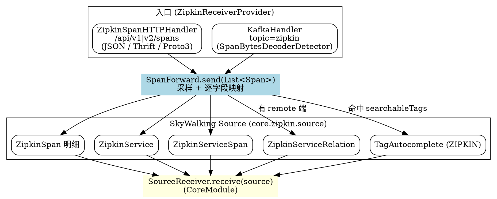

## Introduction

本文是 [`Receiver_Protocol.md`](/docs/CS/SE/SkyWalking/Receiver_Protocol.md) 中"桥接型"一节对 Zipkin 一笔带过的展开：聚焦 Zipkin v1/v2 的 JSON / thrift / protobuf 数据 **进入 `ZipkinSpanHTTPHandler`（或 `KafkaHandler`）之后，如何被解析、如何经 `SpanForward` 直接转成 SkyWalking 内部 Source** 的完整链路。

核心结论先放这里：Zipkin 接收器属于"直接解码型"——它**不经过 `SegmentParser`、不产出 `SegmentObject`**，而是把每条 zipkin span 直接映射成一组**服务级聚合 Source**（`ZipkinService` / `ZipkinServiceSpan` / `ZipkinServiceRelation`）外加一条 `ZipkinSpan` 明细，并通过 `SourceReceiver.receive()` 单一出口汇入流式管线。查询时由 `zipkin-query-plugin` 用这些 Source 还原 zipkin 视图。这一点与 `Receiver_Protocol.md` 中 OTEL / Mesh 等"直接解码型"同类，而与 native trace（gRPC `v3` / Kafka `v3` trace 协议走 `SegmentParser` 生成 `SegmentObject`）形成对照。

> 版本基线：源码仓库 `E:/Projects/skywalking`，HEAD `12ff4613c8`（10.x 形态）。

## HTTP 入口与协议协商

Zipkin 接收器的 HTTP 入口是一个自建 `HTTPServer`（`ZipkinReceiverProvider.java:94-101`，不共享 SharingServer 端口），其上挂一个 Armeria 注解式 handler `ZipkinSpanHTTPHandler`。协议版本与编码格式靠**路由路径 + 注解**协商，而非解析 body 内部：

```java
// ZipkinSpanHTTPHandler.java:71-109 —— 同一路径 /api/v2/spans、/api/v1/spans 下按编码分派
@Post("/api/v2/spans")
public HttpResponse collectV2Spans(HttpRequest req) {                       // 71
    return doCollectSpans(SpanBytesDecoder.JSON_V2, req);                    // 73
}
@Post("/api/v2/spans") @ConsumesJson
public HttpResponse collectV2JsonSpans(HttpRequest req) { ... JSON_V2 }      // 78
@Post("/api/v2/spans") @ConsumesProtobuf
public HttpResponse collectV2ProtobufSpans(HttpRequest req) { ... PROTO3 }   // 85
@Post("/api/v2/spans") @Consumes("application/x-protobuf")
public HttpResponse collectV2XProtobufSpans(HttpRequest req) { ... PROTO3 }  // 91
@Post("/api/v1/spans")
public HttpResponse collectV1Spans(HttpRequest req) { ... JSON_V1 }          // 96
@Post("/api/v1/spans") @ConsumesThrift
public HttpResponse collectV1ThriftSpans(HttpRequest req) { ... THRIFT }     // 108
```

所有分支最终都汇聚到 `doCollectSpans`，用 Armeria 自带的 `SpanBytesDecoder`（zipkin 官方库）把字节反序列化成 zipkin 内部表示 `List<zipkin2.Span>`——注意**无论 v1 还是 v2，反序列化结果都是同一类型 `zipkin2.Span`**，v1 的 `binaryAnnotations` / `annotations` 在解码阶段就被 zipkin 库归一化进 `Span.tags()` / `Span.annotations()`：

```java
// ZipkinSpanHTTPHandler.java:111-123 —— 统一反序列化成 List<Span>，再交给 SpanForward
HttpResponse doCollectSpans(final SpanBytesDecoder decoder, final HttpRequest req) {
    ... decoder.decodeList(httpData.byteBuf().nioBuffer());      // 116  → List<zipkin2.Span>
    final var processedSpans = spanForward.send(spanList);       // 117  → 进入核心转换
    if (processedSpans.size() < spanList.size()) droppedCounter.inc(...);  // 118-119 限流丢弃计数
    return HttpResponse.of(HttpStatus.ACCEPTED);                 // 121
}
```

- `ConsumesThrift.java:32-34` 只是一个 `@Consumes("application/x-thrift")` 的派生注解，让 `@Post` 方法绑定 thrift content-type。
- `SpanEncode.java:21-41` 是一组**已被弃用/冗余**的静态常量（`PROTO3/JSON_V2/THRIFT/JSON_V1` + 判定方法）。当前 handler 直接用 `SpanBytesDecoder` 枚举，并未调用 `SpanEncode`；它存在只是历史遗留，不要被它误导成"编码标识在 body 里"。

## Kafka 入口

Kafka 模式（`ZipkinReceiverProvider.java:104-106`）由 `KafkaHandler` 另起一套消费者，但**复用同一个 `SpanForward` 实例**（`KafkaHandler.java:61-63`，`spanForward` 来自 Provider 的 `prepare` 阶段构造）。

`KafkaHandler` 不依赖 Armeria 的注解路由，而是从 `config.getKafkaTopic()` 拉取字节数组，靠 zipkin 官方的 `SpanBytesDecoderDetector` **嗅探**编码格式（Kafka 没有 content-type），再解码成 `List<Span>` 后同样交给 `spanForward.send`：

```java
// KafkaHandler.java:151-157 —— 嗅探解码，出口与 HTTP 完全一致
private void handleRecord(byte[] bytes) {
    BytesDecoder<Span> decoder = SpanBytesDecoderDetector.decoderForListMessage(bytes); // 153
    final List<Span> spanList = decoder.decodeList(bytes);                              // 154
    spanForward.send(spanList);                                                        // 155
}
```

两条入口在 `SpanForward.send` 处汇合，下游转换逻辑零分支差异。`KafkaHandler.java:134-138` 还会丢弃长度 `< 2` 的空/非法消息，并在 `enableKafkaMessageAutoCommit=false` 时手动 `commitAsync`。

## 核心转换 SpanForward：Zipkin Span → SkyWalking Source

`SpanForward`（实现 `SpanForwardService`，接口定义见 `SpanForwardService.java:26-33`）是整条链路的转换核心。HTTP 与 Kafka 入口都只调用 `send(List<Span>)`，下文逐段拆解。

### 采样与过滤

进入转换前先做采样（`SpanForward.java:77-81` → `getSampledTraces` `:219-250`）。`sampleRate`（0~10000，见 `ZipkinReceiverConfig.java:44`）按比例对 `traceId` 哈希取模决定是否保留；`maxSpansPerSecond`（`ZipkinReceiverConfig.java:45`）用 `RateLimiter` 做速率上限；`debug` 标记的 span 一律保留（`:226-229`）。被丢弃的 span 不进入转换，只在 HTTP 入口侧记 `droppedCounter`（`:118-119`）。

### ZipkinSpan 明细（逐字段映射）

`send` 方法（`SpanForward.java:82-183`）对每条采样后的 zipkin span 构造一个 `ZipkinSpan`（scope = `ZIPKIN_SPAN`，声明见 `ZipkinSpan.java:31`），逐字段映射：

```java
// SpanForward.java:83-122 —— Zipkin span 字段 → ZipkinSpan 字段
ZipkinSpan zipkinSpan = new ZipkinSpan();
String serviceName = span.localServiceName();                       // 84  localEndpoint.serviceName
if (StringUtil.isEmpty(serviceName)) serviceName = "Unknown";        // 85-87  缺省兜底
zipkinSpan.setSpanId(span.id());                                    // 88  zipkin span id
zipkinSpan.setTraceId(span.traceId());                              // 89  traceId
zipkinSpan.setParentId(span.parentId());                            // 91  parentId（仅作为明细字段，不推导拓扑）
zipkinSpan.setName(getNamingControl().formatEndpointName(serviceName, span.name())); // 92  operation name
zipkinSpan.setDuration(span.duration() == null ? 0 : span.duration());               // 93  微秒
if (span.kind() != null) zipkinSpan.setKind(span.kind().name());    // 94-96  CLIENT/SERVER...
zipkinSpan.setLocalEndpointServiceName(getNamingControl().formatServiceName(serviceName)); // 97
if (span.localEndpoint() != null) {                                 // 98-105  ipv4/ipv6/port
    zipkinSpan.setLocalEndpointIPV4(span.localEndpoint().ipv4());   // 99
    zipkinSpan.setLocalEndpointIPV6(span.localEndpoint().ipv6());   // 100
    ... zipkinSpan.setLocalEndpointPort(localPort);                 // 103
}
if (span.remoteEndpoint() != null) {                                // 106-114  remote 端
    zipkinSpan.setRemoteEndpointServiceName(getNamingControl().formatServiceName(span.remoteServiceName())); // 107
    ... ipv4/ipv6/port                                              // 108-113
}
zipkinSpan.setTimestamp(span.timestampAsLong());                    // 115  原始时间戳
zipkinSpan.setDebug(span.debug());                                  // 116
zipkinSpan.setShared(span.shared());                                // 117
long timestampMillis = span.timestampAsLong() / 1000;               // 119  转毫秒
zipkinSpan.setTimestampMillis(timestampMillis);                     // 120
zipkinSpan.setTimeBucket(TimeBucket.getRecordTimeBucket(timestampMillis)); // 121-122  秒级时间桶
long minuteTimeBucket = TimeBucket.getMinuteTimeBucket(timestampMillis);  // 124  分钟级时间桶
```

要点：

- `localEndpoint.serviceName` + `span.name()` 经 `NamingControl` 规整（`formatServiceName` / `formatEndpointName`，`:252-257`）后分别成为服务名与 operation 名；`name` 为空时由 endpoint 推断，服务名缺失时回退 `"Unknown"`。
- `parentId`（`SpanForward.java:91`）只作为 `ZipkinSpan` 的明细字段保存，**并不用于推导服务依赖**——这是与 native trace 的又一个关键差异（见下文）。
- 时间字段：`timestamp` 为 zipkin 原始微秒，`timestampMillis` 为毫秒，`timeBucket` 用秒级、`minuteTimeBucket` 用分钟级，供聚合 Source 复用（`:119-124`）。

### 标签与 annotations → 检索字段 / TagAutocomplete

`tags` 与 `annotations` 被序列化成 `JsonObject` 并拼出 `query` 列表（供 UI 全文检索），同时把命中 `searchableTracesTags`（默认仅 `http.method`，见 `ZipkinReceiverConfig.java:43,47-50`）的 tag key/value 写入 `TagAutocomplete`（`:126-158`）：

```java
// SpanForward.java:126-158 —— tags/annotations → query 字符串 + 可检索 tag 补全
if (!span.tags().isEmpty() || !span.annotations().isEmpty()) {
    ... annotationsJson / tagsJson 序列化，过长则丢弃（:132-138, :144-149）
    for (Map.Entry<String, String> tag : span.tags().entrySet()) {
        ... query.add(tag.getKey()); query.add(tagString);          // 150-151
        if (searchTagKeys.contains(tag.getKey())) {                 // 153 命中可检索 tag
            addAutocompleteTags(minuteTimeBucket, tag.getKey(), tag.getValue()); // 154
        }
    }
}
```

随后还有一段 `SpanListenerManager.notifyZipkinPhase` 钩子（`SpanForward.java:160-174`），允许其它模块给 `ZipkinSpan` 追加自定义 tag——这是一处可扩展点，不影响下述聚合 Source 的产出。

### 服务级聚合 Source（Service / ServiceSpan / ServiceRelation）

转换最关键的一步：**从单条 span 派生出服务拓扑级 Source**，而非逐条 trace segment。完成 `ZipkinSpan` 后，`send` 依次调用三个 `toXxx` 方法（`:176-182`）：

```java
// SpanForward.java:176-182 —— 明细 + 服务级聚合，全部经 getReceiver().receive(...)
getReceiver().receive(zipkinSpan);                                  // 176  ZipkinSpan 明细
toService(zipkinSpan, minuteTimeBucket);                            // 178  ZipkinService
toServiceSpan(zipkinSpan, minuteTimeBucket);                        // 179  ZipkinServiceSpan
if (!StringUtil.isEmpty(zipkinSpan.getRemoteEndpointServiceName())) {
    toServiceRelation(zipkinSpan, minuteTimeBucket);                // 181  ZipkinServiceRelation（仅当有 remote 端）
}
```

四个 Source 类型与字段映射：

| SkyWalking Source | scope 声明 | 关键字段 | 来源 | 行号 |
|---|---|---|---|---|
| `ZipkinSpan` | `ZIPKIN_SPAN` (`ZipkinSpan.java:31`) | `traceId`/`parentId`/`spanId`/`name`/`duration`/`kind`/`localEndpoint*`/`remoteEndpoint*`/`tags`/`annotations`/`query` | 整条 span 明细 | `SpanForward.java:83-158` |
| `ZipkinService` | `ZIPKIN_SERVICE` (`ZipkinService.java:28`) | `serviceName` = `localEndpointServiceName` | 仅本地服务 | `:196-201` |
| `ZipkinServiceSpan` | `ZIPKIN_SERVICE_SPAN` (`ZipkinServiceSpan.java:29`) | `serviceName` + `spanName`(=`name`) | 服务下的 operation | `:203-209` |
| `ZipkinServiceRelation` | `ZIPKIN_SERVICE_RELATION` (`ZipkinServiceRelation.java:29`) | `serviceName`(=`localEndpointServiceName`) → `remoteServiceName`(=`remoteEndpointServiceName`) | 仅当 span 含 remote 端 | `:211-217` |
| `TagAutocomplete` | 通用 scope (`SpanForward.java:188`) | `tagKey`/`tagValue`/`tagType=ZIPKIN` | 命中 `searchableTracesTags` 的 tag | `:187-194` |

```java
// SpanForward.java:196-217 —— 三个聚合 Source 的构造（都很轻量）
private void toService(ZipkinSpan zipkinSpan, long minuteTimeBucket) {
    ZipkinService service = new ZipkinService();
    service.setServiceName(zipkinSpan.getLocalEndpointServiceName());  // 198
    service.setTimeBucket(minuteTimeBucket);                          // 199
    getReceiver().receive(service);                                   // 200
}
private void toServiceSpan(ZipkinSpan zipkinSpan, long minuteTimeBucket) {
    ZipkinServiceSpan serviceSpan = new ZipkinServiceSpan();
    serviceSpan.setServiceName(zipkinSpan.getLocalEndpointServiceName()); // 205
    serviceSpan.setSpanName(zipkinSpan.getName());                    // 206  operation
    serviceSpan.setTimeBucket(minuteTimeBucket);                      // 207
    getReceiver().receive(serviceSpan);                               // 208
}
private void toServiceRelation(ZipkinSpan zipkinSpan, long minuteTimeBucket) {
    ZipkinServiceRelation relation = new ZipkinServiceRelation();
    relation.setServiceName(zipkinSpan.getLocalEndpointServiceName());   // 213  调用方
    relation.setRemoteServiceName(zipkinSpan.getRemoteEndpointServiceName()); // 214  被调方
    relation.setTimeBucket(minuteTimeBucket);                          // 215
    getReceiver().receive(relation);                                   // 216
}
```

注意：`ServiceRelation` 由 **local 端 → remote 端** 推出（`ZipkinServiceRelation.java:38-40` 的 `entityId = serviceName + connector + remoteServiceName`），表达的是"客户端服务调用了某远程服务"的依赖边；`parentId` 只是 `ZipkinSpan` 的明细字段，**不**参与依赖推导（zipkin 自身未强制 client/server span 的 parent 对齐，SW 用 endpoint 语义更稳）。

## SourceReceiver.receive() 单一出口

所有转换产物统一通过 `SourceReceiver.receive(ISource)` 汇入流式管线（与 [`Receiver_Protocol.md`](/docs/CS/SE/SkyWalking/Receiver_Protocol.md) 所述"Source 单一出口"一致）：

```java
// SpanForward.java:259-264 —— 延迟取 CoreModule 的 SourceReceiver
private SourceReceiver getReceiver() {
    if (receiver == null) {
        receiver = moduleManager.find(CoreModule.NAME).provider().getService(SourceReceiver.class); // 261
    }
    return receiver;
}
// SpanForward.java:176/193/200/208/216 —— 五处 receive 调用
getReceiver().receive(zipkinSpan);        // ZipkinSpan
getReceiver().receive(tagAutocomplete);   // TagAutocomplete  (SpanForward.java:193)
getReceiver().receive(service);           // ZipkinService    (SpanForward.java:200)
getReceiver().receive(serviceSpan);       // ZipkinServiceSpan(:208)
getReceiver().receive(relation);          // ZipkinServiceRelation(:216)
```

`SourceReceiver` 本身是空壳接口（`SourceReceiver.java:28-32`），实际把 Source 转交给 `DispatcherManager` 路由到对应 `ZipkinSpanRecordDispatcher` / `ZipkinServiceDispatcher` / `ZipkinServiceSpanDispatcher` / `ZipkinServiceRelationDispatcher` 等 dispatcher，最终落地各类存储（见 `oap-server/server-core/.../core/zipkin/dispatcher/` 与 `ZipkinSpanRecord.java` 等）。这对接 [`Streaming_Pipeline.md`](/docs/CS/SE/SkyWalking/Streaming_Pipeline.md)。

## 与 native trace 的差异（转 Source 而非 SegmentObject）

Zipkin 数据在 SkyWalking 里**不走 `SegmentParser`、不生成 `SegmentObject`**。实证：

1. `SpanForward` 的 import 列表（`SpanForward.java:24-46`）只引用 `core.source.*` 与 `core.zipkin.source.*` 的 Source 类型，**没有任何 `SegmentObject` / `SegmentParser` / `SpanObject` 引用**。
2. 在 `zipkin-receiver-plugin` 包内 Grep `buildSegment` / `SegmentObject` 均为空（仅 `ZipkinSpanHTTPHandler` 与 `SpanForward` 涉及解码），证明不存在 segment 构造路径。
3. 产出的 4 类自有 Source（`ZipkinSpan` / `ZipkinService` / `ZipkinServiceSpan` / `ZipkinServiceRelation`，均位于 `core.zipkin.source`，`ZipkinSpan.java:31` 等）是 zipkin 专用的独立 scope，与 native trace 的 `Segment` / `Span` / `ProcessRelation` 等 scope 完全平行、互不通用。

由此得到 Zipkin 在 SW 中的存储与查询模型：

- **存储**：以"服务拓扑/依赖 + 逐条 span 明细"为主，而非完整的 segment 树。拓扑由 `ZipkinServiceRelation` 直接表达，服务端无需再按 parentId 重建调用链。
- **查询**：UI/查询侧由独立的 `zipkin-query-plugin` 基于 `ZipkinSpan`（含 `traceId`/`parentId`/`tags`/`annotations`/`query`）还原 zipkin 视图，把"明细 Source"重新拼成 zipkin 的 trace 列表/详情——native trace 则走 `TraceQuery` 直接读 `Segment` 存储。

## 设计取舍

- **为何"直接转 Source"而非复用 `SegmentObject`**：zipkin 的模型是"扁平 span 列表 + endpoint 语义"，没有 SW native 的 segment/segmentId/span layer 体系；若强行塞进 `SegmentObject`，要么丢失 zipkin 独有的 `kind`/`annotations`/`binaryAnnotations` 语义，要么需要大量特殊分支。直接落地为 zipkin 自有 Source，既保真又让拓扑/检索/查询各自独立演进，代价是查询视图要由 `zipkin-query-plugin` 自行还原。
- **为何自建 `HTTPServer` 而非共享 SharingServer 端口**：`ZipkinReceiverProvider.java:94-101` 显式 `new HTTPServer(...)`（host/port/contextPath/TLS 全部来自 `ZipkinReceiverConfig`）。原因有二：① zipkin 的 RESTful 路由（`/api/v1/spans`、`/api/v2/spans`）与 SW 内部 gRPC/HTTP 协议的路径与 content-type 协商方式不同，独立端口避免路由冲突；② zipkin 需要独立的 TLS（`restSSLEnabled`/`restSSLKeyPath`，`ZipkinReceiverConfig.java:40-42`）与限流/采样策略（`sampleRate`/`maxSpansPerSecond`），独立 server 更易配置与隔离。
- **v1/v2 归一化**：尽管暴露了 v1/v2 多个路由，解码后都是 `zipkin2.Span`，差异在 zipkin 库内被吸收，SW 侧转换代码零版本分支，便于长期维护。



## Links

- [Receiver_Protocol](/docs/CS/SE/SkyWalking/Receiver_Protocol.md)
- [Receiver_Otel_Decode](/docs/CS/SE/SkyWalking/Receiver_Otel_Decode.md)
- [Receiver_Envoy_Decode](/docs/CS/SE/SkyWalking/Receiver_Envoy_Decode.md)
- [Streaming_Pipeline](/docs/CS/SE/SkyWalking/Streaming_Pipeline.md)
- [Module_System](/docs/CS/SE/SkyWalking/Module_System.md)
- [SkyWalking](/docs/CS/SE/SkyWalking/SkyWalking.md)

## References

- https://github.com/apache/skywalking/blob/12ff4613c8/oap-server/server-receiver-plugin/zipkin-receiver-plugin/src/main/java/org/apache/skywalking/oap/server/receiver/zipkin/ZipkinReceiverProvider.java
- https://github.com/apache/skywalking/blob/12ff4613c8/oap-server/server-receiver-plugin/zipkin-receiver-plugin/src/main/java/org/apache/skywalking/oap/server/receiver/zipkin/handler/ZipkinSpanHTTPHandler.java
- https://github.com/apache/skywalking/blob/12ff4613c8/oap-server/server-receiver-plugin/zipkin-receiver-plugin/src/main/java/org/apache/skywalking/oap/server/receiver/zipkin/handler/ConsumesThrift.java
- https://github.com/apache/skywalking/blob/12ff4613c8/oap-server/server-receiver-plugin/zipkin-receiver-plugin/src/main/java/org/apache/skywalking/oap/server/receiver/zipkin/handler/SpanEncode.java
- https://github.com/apache/skywalking/blob/12ff4613c8/oap-server/server-receiver-plugin/zipkin-receiver-plugin/src/main/java/org/apache/skywalking/oap/server/receiver/zipkin/kafka/KafkaHandler.java
- https://github.com/apache/skywalking/blob/12ff4613c8/oap-server/server-receiver-plugin/zipkin-receiver-plugin/src/main/java/org/apache/skywalking/oap/server/receiver/zipkin/trace/SpanForward.java
- https://github.com/apache/skywalking/blob/12ff4613c8/oap-server/server-receiver-plugin/zipkin-receiver-plugin/src/main/java/org/apache/skywalking/oap/server/receiver/zipkin/SpanForwardService.java
- https://github.com/apache/skywalking/blob/12ff4613c8/oap-server/server-receiver-plugin/zipkin-receiver-plugin/src/main/java/org/apache/skywalking/oap/server/receiver/zipkin/ZipkinReceiverConfig.java
- https://github.com/apache/skywalking/blob/12ff4613c8/oap-server/server-core/src/main/java/org/apache/skywalking/oap/server/core/zipkin/source/ZipkinSpan.java
- https://github.com/apache/skywalking/blob/12ff4613c8/oap-server/server-core/src/main/java/org/apache/skywalking/oap/server/core/zipkin/source/ZipkinService.java
- https://github.com/apache/skywalking/blob/12ff4613c8/oap-server/server-core/src/main/java/org/apache/skywalking/oap/server/core/zipkin/source/ZipkinServiceSpan.java
- https://github.com/apache/skywalking/blob/12ff4613c8/oap-server/server-core/src/main/java/org/apache/skywalking/oap/server/core/zipkin/source/ZipkinServiceRelation.java
- https://github.com/apache/skywalking/blob/12ff4613c8/oap-server/server-core/src/main/java/org/apache/skywalking/oap/server/core/source/SourceReceiver.java
