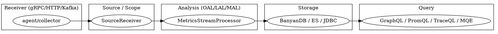

## Introduction

Apache SkyWalking 是面向云原生、微服务与容器架构的 **APM（应用性能监控）系统**，提供分布式追踪、服务网格遥测分析、指标聚合、告警与可观测能力。它的部署形态由三部分组成：

- **Agent**（各语言探针，独立仓库 `skywalking-java` / `skywalking-rover` 等）—— 埋点采集；
- **OAP Server**（本仓库 `E:/Projects/skywalking` 的内容）—— 观测数据分析平台；
- **UI**（`skywalking-booster-ui` 子模块）—— 可视化。

> 版本基线：OAP Server 后端源码仓库 HEAD `12ff4613c8`（`git describe` 落在标签 `v8.3.0.2` 之后 2517 个提交，实为 8.x 末 / 10.x 形态代码；非官方发布 tag，故以 commit SHA 引用源码）。**Agent 探针侧**为独立仓库 `skywalking-java`（本地 `E:/Projects/skywalking-java`），HEAD `6840d74`，相关笔记会单独注明其 SHA。

本分区是一组**源码级深挖笔记**，聚焦 OAP Server 后端——它本质上是一个"模块化平台"：存储、接收、查询、告警等所有能力都挂在自研的 Module 系统上，而非一个单体应用。理解这套 Module 机制是读懂其它一切的前提。

## Architecture Spine

OAP 的数据主脉是一条清晰的流水线，所有环节都被 Module 系统装配起来：

数据从 Agent/Collector 经 gRPC/HTTP/Kafka 进入 **Receiver**，转成 **Source/Scope** 数据模型，再经 **OAL/LAL/MAL** 分析进入流式聚合（`MetricsStreamProcessor` 的 L1/L2 Worker），合并后经批量队列落 **Storage**（BanyanDB / Elasticsearch / JDBC 三选一），最后由 **Query** 插件（GraphQL / PromQL / TraceQL / MQE）向上层 UI/API 提供数据。整条链路与跨 OAP 集群协调、动态配置、告警都运行在 Module 系统之上。

## Deep Dive Roadmap

按"地基 → 心脏 → 精华 → 子系统"的顺序逐篇深挖，每完成一篇落一页笔记（主人以「继续」驱动下一轮）：

- **P0 — 地基与心脏**
  - [Module System and Bootstrap](/docs/CS/SE/SkyWalking/Module_System.md)（已完成）—— 自研 Module/Provider/Service 三元模型、SPI 加载、四阶段生命周期、Kahn 拓扑排序启动、严格服务契约。
  - [Streaming Pipeline (流处理聚合管线)](/docs/CS/SE/SkyWalking/Streaming_Pipeline.md)（已完成）—— Source/Scope、`SourceDispatcher`、L1/L2 Worker、`MergableBufferedData` 合并、`BatchQueue` 落库。
  - [OAL Runtime and Code Generation](/docs/CS/SE/SkyWalking/OAL_Runtime.md)（已完成）—— ANTLR4 解析 `.oal` + **Javassist 运行时字节码织入**（FreeMarker 仅生成方法体）+ `@MetricsFunction`/`MetricsHolder` 函数注册表 + 按 source 聚合的 Dispatcher 生成。
- **P1 — 子系统**
  - [Storage Abstraction (存储抽象层)](/docs/CS/SE/SkyWalking/Storage_Abstraction.md)（已完成）—— `StorageModule` DAO 契约 + `StorageDAO` 工厂、BanyanDB/ES/JDBC 三套 `Provider` 绑定、`Model`/`@Column`/`@Stream` 注解驱动 Schema、`ModelInstaller` 策略化安装（init/no-init 模式 + BanyanDB 本地 schema 缓存与删除栅栏）。
  - [BanyanDB Native Storage Engine (BanyanDB 原生存储引擎)](/docs/CS/SE/SkyWalking/BanyanDB.md)（已完成）—— 独立仓库 `skywalking-banyandb` 的源码级深挖：整体架构/节点角色、元数据协调（property 同步）、数据模型、列式 TSDB 引擎、编码压缩、索引子系统、写入路径（per-batch ack）、向量化查询引擎（BYDBQL + 分布式 scatter-gather）；子页导航见枢纽页。[^banyandb]
  - [Receiver and Protocol (接收层与协议)](/docs/CS/SE/SkyWalking/Receiver_Protocol.md)（已完成）—— `apm-network` gRPC 协议与 20+ receiver 挂载、解码成 Source。
    - [Receiver Otel Decode (OTLP 解码)](/docs/CS/SE/SkyWalking/Receiver_Otel_Decode.md)（已完成）—— OTLP trace 直落 `OTLPSpan` Source + TAL、metric 走 MAL、log 走 LAL；不复用 `SegmentParser`。
    - [Receiver Zipkin Decode (Zipkin 解码)](/docs/CS/SE/SkyWalking/Receiver_Zipkin_Decode.md)（已完成）—— Zipkin span 经 `SpanForward` 直转 `ZipkinService`/`ZipkinServiceRelation`/`ZipkinSpan` Source。
    - [Receiver Envoy Decode (Envoy 解码)](/docs/CS/SE/SkyWalking/Receiver_Envoy_Decode.md)（已完成）—— ALS 重建 Service Mesh 拓扑（`TelemetryDataDispatcher`）、MetricService 经 MAL 汇指标。
  - [MQE Query Engine (MQE 查询引擎)](/docs/CS/SE/SkyWalking/MQE_Engine.md)（已完成）—— 服务端指标查询 DSL（类 PromQL），ANTLR4 文法 + rt 求值。
  - [Cluster and Cross-node Aggregation (集群与跨节点聚合)](/docs/CS/SE/SkyWalking/Cluster_Aggregation.md)（已完成）—— `ClusterModule` 注册发现 + `RemoteClientManager` 哈希路由与单点权威 L2 合并。
- **P2 — 外围**
  - [Analyzer Family (分析器族)](/docs/CS/SE/SkyWalking/Analyzer_Family.md)（已完成）—— 四类遥测（trace/JVM/meter/log）的 Source 加工差异；trace 走 `TraceAnalyzer` 监听器组、JVM 走 `JVMSourceDispatcher` 拆 6 类、meter 走 `MeterProcessService`+MAL 热更新、log 走独立 `log-analyzer`+LAL。
  - [LAL and MAL Script Engines (LAL/MAL 脚本引擎)](/docs/CS/SE/SkyWalking/LAL_MAL_Script.md)（已完成）—— 日志/指标脚本 DSL，ANTLR4 + Javassist 字节码织入（与 OAL 同源底座），`MetricConvert`/`Analyzer` 流水线。
  - [Query Plugins (查询插件)](/docs/CS/SE/SkyWalking/Query_Plugins.md)（已完成）—— GraphQL（V3 复用 MQE）/ PromQL（复用 MQE 标签聚合）/ TraceQL / LogQL / Zipkin 各自接入 `CoreModule` 查询服务与 `StorageModule` DAO。
  - [Alarm and Dynamic Configuration (告警与动态配置)](/docs/CS/SE/SkyWalking/Alarm_Config.md)（已完成）—— `server-alarm-plugin`（Metrics 派生 + 9 类通知回调）+ `server-configuration`（多后端 + ConfigWatcher 机制 + runtime-rule 热更新，是告警/MAL 规则热更底座）。
  - [AI Pipeline (AI 管线)](/docs/CS/SE/SkyWalking/AI_Pipeline.md)（已完成）—— 三个 LLM 可观测性 analyzer 模块：`ai-agent-conversation`（长会话落盘，走 LAL 输出构造器）、`gen-ai-analyzer`（GenAI 链路指标，走 SpanListener + `virtual-gen-ai.oal`）、`ai-evaluation`（LLM-as-Judge 评审，分数回灌 MAL 指标流）。
- **Agent Side — 探针侧（独立仓库 `skywalking-java`，HEAD `6840d74`）**
  - [Agent 启动引导与字节码织入](/docs/CS/SE/SkyWalking/Agent_Bootstrap_Plugin.md)（已完成）—— `premain` 四步流水线、ByteBuddy `AgentBuilder` 字节码 transform、`skywalking-plugin.def` 插件发现、`AgentClassLoader` child-first 隔离、`WitnessClass/Method` 版本门控、`BootService` SPI。
  - [Agent ContextManager 与 Span 模型](/docs/CS/SE/SkyWalking/Agent_Context_Span.md)（已完成）—— `ContextManager` 门面 + `ThreadLocal` 上下文、`TracingContext`/`TraceSegment`、Entry/Exit/Local Span 栈式模型、全局 trace id 与 segment id、`SamplingService` 采样。
  - [Agent Context 传播（跨进程 / 跨线程）](/docs/CS/SE/SkyWalking/Agent_Context_Propagation.md)（已完成）—— `ContextCarrier`（SW8 头 `sw8`/`sw8-correlation`/`sw8-x`）、`inject`/`extract`、`ContextSnapshot`、`capture`/`continued`/`asyncFinish`、`TraceSegmentRef`、关联上下文。
  - [Agent 插件拦截器范式（Plugin Define 与 Span 创建）](/docs/CS/SE/SkyWalking/Agent_Plugin_Interceptor.md)（已完成）—— 插件声明式 Define + 拦截器成对范式、`NameMatch`/`HierarchyMatch` 匹配、三种 Span 在 HTTP/DB/RPC 插件里的真实用法、`agent.ignore_suffix` 后缀忽略机制、`AgentConfig`/`PluginConfig` 配置优先级。
  - [Agent 遥测上报与配置（gRPC 上行 / 注册 / agent.config）](/docs/CS/SE/SkyWalking/Agent_Telemetry_Config.md)（已完成）—— `GRPCChannelManager` 通道托管、`TraceSegment` 经 `DataCarrier` 流式上报、`ServiceManagementClient` 注册心跳、`JVMService` 指标采集、`agent.config` 四来源覆盖优先级。

[^banyandb]: BanyanDB 是 SkyWalking 默认且深度优化的原生可观测性数据库，独立仓库 `skywalking-banyandb`；其与 OAP `StorageModule` 的对接见 [SkyWalking Storage Abstraction](/docs/CS/SE/SkyWalking/Storage_Abstraction.md)。

## Links

- [SkyWalking Module System](/docs/CS/SE/SkyWalking/Module_System.md)
- [SkyWalking Streaming Pipeline](/docs/CS/SE/SkyWalking/Streaming_Pipeline.md)
- [SkyWalking OAL Runtime](/docs/CS/SE/SkyWalking/OAL_Runtime.md)
- [SkyWalking Storage Abstraction](/docs/CS/SE/SkyWalking/Storage_Abstraction.md)
- [BanyanDB Native Storage Engine](/docs/CS/SE/SkyWalking/BanyanDB.md)
- [SkyWalking Analyzer Family](/docs/CS/SE/SkyWalking/Analyzer_Family.md)
- [Agent 启动引导与字节码织入](/docs/CS/SE/SkyWalking/Agent_Bootstrap_Plugin.md)
- [Agent ContextManager 与 Span 模型](/docs/CS/SE/SkyWalking/Agent_Context_Span.md)
- [Agent Context 传播（跨进程/跨线程）](/docs/CS/SE/SkyWalking/Agent_Context_Propagation.md)
- [Agent 插件拦截器范式（Plugin Define 与 Span 创建）](/docs/CS/SE/SkyWalking/Agent_Plugin_Interceptor.md)
- [Agent 遥测上报与配置（gRPC 上行 / 注册 / agent.config）](/docs/CS/SE/SkyWalking/Agent_Telemetry_Config.md)
- [APM](/docs/CS/SE/APM.md)

## References

- [Apache SkyWalking GitHub (commit 12ff4613c8)](https://github.com/apache/skywalking/tree/12ff4613c8)
- [SkyWalking Backend Setup Documentation](https://skywalking.apache.org/docs/main/next/en/setup/backend/backend-setup/)
- [SkyWalking Module Management (official docs)](https://skywalking.apache.org/docs/main/next/en/setup/backend/backend-module-management/)
