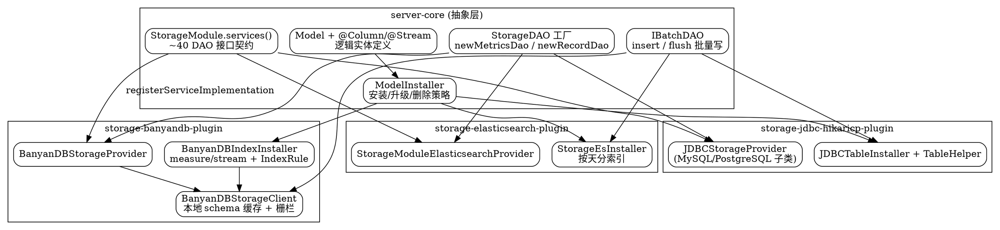

# SkyWalking Storage Abstraction

## Introduction

本页深挖 Apache SkyWalking OAP Server 的**存储抽象层**——它是 [SkyWalking Streaming Pipeline](/docs/CS/SE/SkyWalking/Streaming_Pipeline.md) 的落库终点，也是 [SkyWalking OAL Runtime](/docs/CS/SE/SkyWalking/OAL_Runtime.md) 生成的 `Metrics`/`Record` 类最终持久化的地方。所有结论核验于仓库 `E:/Projects/skywalking`，commit 基线 `12ff4613c835c6950ebddb47651c911f2a7d7f9d`（10.x 形态）。

存储层的核心设计是：**一套由 `StorageModule.services()` 声明的 DAO 接口契约，被任意一种后端 Provider（`banyandb` / `elasticsearch` / `jdbc`）在 `prepare()` 阶段通过 `registerServiceImplementation` 绑定到具体实现**。换数据库 = 换 Provider，核心分析代码无需改动。三套实现共享同一套安装控制器 `ModelInstaller`、同一套 `Model`/`@Column`/`@Stream` 注解驱动的 Schema 定义。

## Storage Module 契约

`StorageModule` 本身不读写数据，它只声明"存储能力即一组 `Service` 接口"：

```java
public class StorageModule extends ModuleDefine {
    public static final String NAME = "storage";
    @Override public Class[] services() {
        return new Class[] {
            StorageBuilderFactory.class, IBatchDAO.class, StorageDAO.class, IHistoryDeleteDAO.class,
            ITopologyQueryDAO.class, IMetricsQueryDAO.class, ITraceQueryDAO.class,
            IMetadataQueryDAO.class, IAggregationQueryDAO.class, IAlarmQueryDAO.class,
            IRecordsQueryDAO.class, ILogQueryDAO.class,
            IGenAIEvaluationRecordQueryDAO.class, IAIAgentConversationQueryDAO.class, // AI 新接口
            IEBPFProfilingTaskDAO.class, IContinuousProfilingPolicyDAO.class, ...
            ModelInstaller.class, RuntimeRuleManagementDAO.class, // 为 runtime-rule 热更新暴露
        };
    }
}
```

—— `StorageModule.java:72-121`。契约约 40 个 DAO 接口，覆盖指标/追踪/日志/拓扑/元数据/告警/Profiling/事件，以及 10.x 新增的 GenAI 评估与 AI Agent 会话查询。`ModelInstaller` 与 `RuntimeRuleManagementDAO` 被显式暴露，供 runtime-rule reconciler 在热应用指标后回查 DDL 是否落地。

所有 DAO 都继承自标记接口 `DAO extends Service`（`DAO.java:26`），`AbstractDAO<C extends Client>` 统一持有底层连接客户端（`AbstractDAO.java:23`）。

## DAO 接口体系与工厂

存储 DAO 分两类：

- **读/查询 DAO**：`IMetricsQueryDAO`、`ITraceQueryDAO`、`ILogQueryDAO`、`ITopologyQueryDAO`、`IAggregationQueryDAO`、`IMetadataQueryDAO` 等——面向 [SkyWalking OAL Runtime](/docs/CS/SE/SkyWalking/OAL_Runtime.md) 与 query 插件查询。
- **写 DAO**：`IBatchDAO` 是流式落库的唯一批量入口；`StorageDAO` 是**工厂**，按 `StorageBuilder` 创建"指标/记录/无流/管理"四类具体 DAO：

```java
public interface StorageDAO extends Service {
    IMetricsDAO newMetricsDao(StorageBuilder storageBuilder);
    IRecordDAO newRecordDao(StorageBuilder storageBuilder);
    INoneStreamDAO newNoneStreamDao(StorageBuilder storageBuilder);
    IManagementDAO newManagementDao(StorageBuilder storageBuilder);
}
```

—— `StorageDAO.java:27-36`。`IBatchDAO` 提供两种语义（`IBatchDAO.java:30-57`）：`insert(InsertRequest)` 单条异步入队，`flush(List<PrepareRequest>)` 批量 insert/update（`endOfFlush()` 钩子用于收尾清理）。这正是 [SkyWalking Streaming Pipeline](/docs/CS/SE/SkyWalking/Streaming_Pipeline.md) 中 `MetricsPersistentWorker` 周期驱动落库的底层通道。

## 三套后端实现对比

| 维度 | BanyanDB（`banyandb`） | Elasticsearch（`elasticsearch`） | JDBC（`jdbc`，MySQL/PG 子类） |
| :--- | :--- | :--- | :--- |
| Provider 类 | `BanyanDBStorageProvider` | `StorageModuleElasticsearchProvider` | `JDBCStorageProvider`（抽象，MySQL/PostgreSQL 继承） |
| 连接客户端 | `BanyanDBStorageClient` | `ElasticSearchClient` | `JDBCClient`（HikariCP） |
| 安装器 | `BanyanDBIndexInstaller` | `StorageEsInstaller` | `JDBCTableInstaller` |
| 数据模型 | 原生 **measure**（指标）+ **stream**（trace/log/record） | 索引 + 按天分索引（`IndexNames.configure`） | 表 + `TableHelper` 分表/合并表 |
| 本地 schema 缓存 | **有**（删除需栅栏） | 无 | 无 |
| AI 原生支持 | `BanyanDBAIAgentConversationQueryDAO` 等 | `AIAgentConversationQueryEsDAO` 等 | `JDBCAIAgentConversationQueryDAO` 等 |

三者的 `prepare()` 形态高度一致——`BanyanDBStorageProvider.java:152-221`、`StorageModuleElasticsearchProvider.java:161-200`、`JDBCStorageProvider.java:147-200` 都做三件事：① `registerServiceImplementation(StorageBuilderFactory.class, new StorageBuilderFactory.Default())`；② `registerServiceImplementation(ModelInstaller.class, ...)`；③ 几十行 `registerServiceImplementation(IXxxDAO.class, new XxxImpl(client, ...))` 把每个接口绑到具体类。`BanyanDBStorageProvider` 还附带 `watchSecretsManagementFile()` 热更新凭证；`StorageModuleElasticsearchProvider` 用 `MultipleFilesChangeMonitor` 热更新账号密码。

注意 `JDBCStorageProvider` 是抽象基类，把"如何建表"留给 `protected abstract ModelInstaller createModelInstaller()`（`JDBCStorageProvider.java:125`），由 `MySQLStorageProvider` / `PostgreSQLStorageProvider` 各实现一套 installer + `TableHelper`。

## Model 与 @Column / @Stream 注解驱动

逻辑实体由 `Model` 表达（`Model.java:36-64`）：

```java
public class Model {
    private final String name;
    private final List<ModelColumn> columns;
    private final int scopeId;
    private final DownSampling downsampling;
    private final boolean superDataset;
    private final Class<?> streamClass;
    private final boolean allowBootReshape;     // BanyanDB 允许启动时增量改形
    private final SQLDatabaseModelExtension sqlDBModelExtension;
    private final BanyanDBModelExtension banyanDBModelExtension;
    private final ElasticSearchModelExtension elasticSearchModelExtension;
    // isMetric / isRecord / isTimeSeries 延迟判定
}
```

字段来自实体类上的 `@Column` 注解（`storage/annotation/Column.java`），实体归属哪个流由 `@Stream` 注解声明（`Stream.java:45,57,87`：`name()`、`builder()`、`allowBootReshape()` default false）。`Model` 持有一组**后端专属扩展**（`BanyanDBModelExtension` / `SQLDatabaseModelExtension` / `ElasticSearchModelExtension`），同一份 `@Column` 元数据被翻译成三种后端各自的物理 schema——这就是"一次声明、多后端落地"的关键。

`StorageBuilderFactory` 是衔接 [SkyWalking OAL Runtime](/docs/CS/SE/SkyWalking/OAL_Runtime.md) 的入口：`builderTemplate()` 返回 `BuilderTemplateDefinition(StorageBuilder.class, "metrics-builder")`，后者对应 `metrics-builder/entity2Storage.ftl` 与 `storage2Entity.ftl` 模板（`StorageBuilderFactory.java:34-79`）。OAL 代码生成阶段就是用这些模板产生把 `Metrics` 对象与 `HashMap`（默认）或后端原生格式互转的 builder。

## ModelInstaller 安装控制器

`ModelInstaller` 是安装/升级/删除 Schema 的策略中枢，实现 `ModelRegistry.CreatingListener`——每个被注册的 `Model` 触发 `whenCreating`（`ModelInstaller.java:45-169`）。`whenCreating` 按 `StorageManipulationOpt.Flags` 走不同分支：

1. **local-cache-only**（peer 节点）：零后端 RPC，仅从声明模型重算本地 schema 缓存后返回——分布式中"非权威节点不碰 DDL"。
2. **failOnAbsence / failOnShapeMismatch**：严格校验、fail-fast（k8s pod crash-loop 让运维先对齐 init OAP）。
3. **deferDDLToInitNode**：`no-init` 模式的 OAP 不拥有 schema，轮询等待 init OAP 建表（3s 重试），仅在静态启动路径生效；runtime-rule 热应用不受此限。
4. **常规**：`isExists(model)` → 缺失则 `createTable(model)`。

`isExists` / `createTable` / `dropTable` 为抽象方法，由各后端实现。`IBatchDAO` 之上的批量写与 `ModelInstaller` 之上的建表，共同构成存储层的"运行期 + 启动期"双通道。

### BanyanDB 原生安装细节

`BanyanDBIndexInstaller extends ModelInstaller`（`BanyanDBIndexInstaller.java:102`），建表即对 BanyanDB 定义三类物理对象并登记索引规则：

```java
opt.recordModRevision(client.define(trace));      // stream 模型
defineIndexRule(...); defineIndexRuleBinding(...);
opt.recordModRevision(client.define(stream));     // stream 模型
opt.recordModRevision(client.define(measure));    // measure 模型
```

—— `BanyanDBIndexInstaller.java:389-449`。写路径上 `BanyanDBStorageClient` 把数据切成 `createStreamBulkProcessor` / `createMeasureBulkProcessor` 两类 bulk 处理器（`BanyanDBStorageClient.java:456,470`），分别对应 stream 与 measure 的物理写入。

BanyanDB 是三套中唯一带**本地 schema 缓存**的后端：`ModelInstaller` 注释明确提到 `SchemaBarrierService.AwaitSchemaDeleted` 栅栏——删除一个 `Model` 时需栅栏等待本地缓存失效后再让删除对其他读路径可见（该服务定义位于 BanyanDB 客户端库，本仓库仅以引用形式出现）。`allowBootReshape` 允许 BanyanDB 在启动时对 measure/stream 做纯增量的 shape 变更（新增 tag/field），JDBC 与 ES 忽略该标志。



## 关键设计点

- **换库零侵入**：核心分析/查询代码只依赖 `StorageModule` 暴露的 DAO 接口，选库只是 `application.yml` 里 `storage.selector` 选 Provider。
- **注解即 Schema**：`@Column` + `@Stream` 声明一次，`Model` 携带三套后端扩展各自落地物理表/索引/measure-stream。
- **Schema 归属分层**：init OAP 拥有 DDL，`no-init` OAP 等待；BanyanDB 因本地缓存需 `SchemaBarrierService` 删除栅栏，ES/JDBC 无此负担。
- **读/写两条专用通道**：写走 `IBatchDAO`（流式批量，衔接 P0-2 落库），建/改/删走 `ModelInstaller`，二者策略解耦。
- **AI 原生贯通**：GenAI 评估、AI Agent 会话等 10.x 新实体在三个后端都有对称 DAO，证明存储抽象对新型遥测的可扩展性。

## Links

- [SkyWalking Module System](/docs/CS/SE/SkyWalking/Module_System.md)
- [SkyWalking Streaming Pipeline](/docs/CS/SE/SkyWalking/Streaming_Pipeline.md)
- [SkyWalking OAL Runtime](/docs/CS/SE/SkyWalking/OAL_Runtime.md)
- [SkyWalking](/docs/CS/SE/SkyWalking/SkyWalking.md)
- [APM](/docs/CS/SE/APM.md)

## References

- Apache SkyWalking 仓库 `E:/Projects/skywalking`，commit `12ff4613c835c6950ebddb47651c911f2a7d7f9d`（10.x 形态）。
- 核心源码：`oap-server/server-core/src/main/java/org/apache/skywalking/oap/server/core/storage/`（`StorageModule.java`、`DAO.java`、`AbstractDAO.java`、`StorageDAO.java`、`IBatchDAO.java`、`model/Model.java`、`model/ModelInstaller.java`、`StorageBuilderFactory.java`）。
- 三套实现：`oap-server/server-storage-plugin/{storage-banyandb-plugin,storage-elasticsearch-plugin,storage-jdbc-hikaricp-plugin}`。
- 官方文档：<https://skywalking.apache.org/docs/main/latest/en/setup/backend/backend-storage/>
- BanyanDB 原生存储模型：<https://skywalking.apache.org/docs/main/latest/en/storage/banyandb/>
