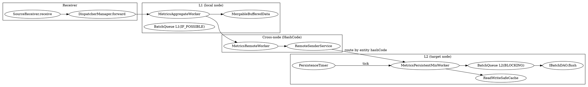

## Introduction

如果说模块系统是 OAP 的"骨架"，那么**流式聚合管线（Streaming Pipeline）就是它的"心脏"**。所有从 Agent/Collector 汇聚上来的遥测数据（trace、metric、log、profile……），在被 `SourceReceiver` 接收后，都要经过一条"分发 → 两级聚合 → 批量落库"的实时计算链路，最终写入存储后端。

这条链路最反直觉的三点是：

1. **聚合分两级（L1 / L2）且跨节点**：同一条实体（如某个 Service 的某分钟指标）的原始数据可能分散在多个 OAP 节点，OAP 先在每个节点本地做 L1 合并，再按实体 ID 哈希路由到唯一的目标节点做 L2 权威合并——既压低网络/内存，又保证最终一致。
2. **背压策略按环节分层**：L1 队列满了**直接丢弃**（`IF_POSSIBLE`），L2 队列满了**阻塞**（`BLOCKING`）。因为 L1 丢的数据后续还会再聚合，而 L2 是落库前的最后一关，不能丢。
3. **落库是"读-改-写"而非"覆盖"**：指标在内存里多次 `combine` 增量合并，周期性批量刷盘时先 `multiGet` 读回 DB 已有值、再 `combine`、再 `calculate`、最后批量 insert/update。

> 版本基线：源码仓库 HEAD `12ff4613c8`，见 [SkyWalking](/docs/CS/SE/SkyWalking/SkyWalking.md)。

## 数据模型：Source / Scope / Metrics / StorageID

### Source 与 Scope

遥测数据的"输入载体"是 `Source` 抽象基类（`Source.java:24`），它只带一个 `timeBucket` 时间桶字段（`Source.java:28`）；具体字段（如 `latency`、`serviceId`）由子类声明，并携带 `@ScopeDeclaration` 注解：

```java
// ScopeDeclaration.java:43 —— 标记一个 Source 实体，id 对应 DefaultScopeDefine，name 用于 OAL
@Target({ElementType.TYPE})
@Retention(RetentionPolicy.RUNTIME)
public @interface ScopeDeclaration {
    int id();              // 对应 DefaultScopeDefine 的整型 scope id
    String name();         // OAL 中 from(Service.latency) 的 "Service"
    String catalog() default "";  // 顶层 scope 名称，用于告警
}
```

`ISource` 接口暴露 `scope()`（整型），`DispatcherManager` 正是按这个 `scope()` 把 Source 路由到对应的 dispatcher。

### Metrics 与 StorageID

"输出载体"是 `Metrics` 抽象基类（`Metrics.java:41`），核心是一组由子类实现的抽象方法：

- `combine(Metrics)`（`Metrics.java:68`）：增量合并，幂等、可交换、可结合——这是流式聚合的数学基础。
- `calculate()`（`Metrics.java:73`）：在需要时算出最终值（如 `value = summation / count`）。
- `toHour()` / `toDay()`（`Metrics.java:80,87`）：降采样克隆。
- `id0()`（`Metrics.java:167`）：返回 `StorageID`，标识存储中的唯一键。

`StorageID`（`StorageID.java:47`）由若干 `Fragment` 组成，`build()` 时用 `Const.ID_CONNECTOR`（下划线）把各片段拼接成字符串 ID（`StorageID.java:115-121`）；BanyanDB 后端会把 time series 与 entity ID（SeriesID）分别对待。`@Stream` 注解（`Stream.java:41`）则把类标记为某种"流"，声明 `name` / `scopeId` / `builder` / `processor`（决定走 `MetricsStreamProcessor` 还是 `RecordStreamProcessor` 等）。

## 分发入口：Receiver → Dispatcher

数据流的第一跳是 `SourceReceiver.receive(ISource)`（`SourceReceiver.java:28`），它只是把活儿委托给 `DispatcherManager.forward`（`SourceReceiverImpl.java:42`）：

```java
// DispatcherManager.java:46 —— 按 scope 路由到 dispatcher 列表，先 prepare 再 dispatch
public void forward(ISource source) {
    if (source == null) return;
    List<SourceDispatcher<ISource>> dispatchers = dispatcherMap.get(source.scope());
    if (dispatchers != null) {
        source.prepare();                       // 触发 Source 内部字段就绪
        for (SourceDispatcher<ISource> dispatcher : dispatchers) {
            dispatcher.dispatch(source);        // 交给具体 dispatcher（硬编码 / OAL 生成）
        }
    }
}
```

dispatcher 分两类（见 `SourceDispatcher.java:32` 注释）：**硬编码**的和 **OAL 脚本生成的**。所有 dispatcher 在启动时通过 Guava `ClassPath` 扫描 `org.apache.skywalking` 包、由 `addIfAsSourceDispatcher` 反射注册进 `dispatcherMap`（`SourceReceiverImpl.java:51-59`、`DispatcherManager.java:115-154`）——同一个 scope 下可以有多个 dispatcher（一个 Source 往往产出多个指标）。

## 聚合总览：MetricsStreamProcessor 编排 worker 链

`MetricsStreamProcessor` 是 metrics 流式计算的**入口与编排者**（单例，`MetricsStreamProcessor.java:65`）。热路径 `in(Metrics)` 直接查 `entryWorkers`（`ConcurrentHashMap<Class, MetricsAggregateWorker>`，`MetricsStreamProcessor.java:78`），命中即交给 L1 worker；未注册的 metric 类会被丢弃并累加 `unroutableSampleCount`（`MetricsStreamProcessor.java:141-156`）——因为写入全部发生在启动期，运行期新增的 metric 类（如热加载 OAL）才走这条兜底。

`create(...)`（`MetricsStreamProcessor.java:195-307`）为每个 metrics 类构建完整的 worker 链：

```
MetricsAggregateWorker (L1, 本地合并)
   └─> MetricsRemoteWorker (跨节点路由)
          └─> [目标节点] MetricsPersistentMinWorker (L2, minute 落库)
                 └─> AlarmNotifyWorker / ExportMetricsWorker（旁路）
若 supportDownSampling：
   MetricsPersistentMinWorker 还会把数据交给 MetricsTransWorker
          └─> MetricsPersistentWorker (hour) / (day)（L2 降采样落库）
```

关键默认参数：`l1FlushPeriod = 500ms`（`MetricsStreamProcessor.java:129`）、`storageSessionTimeout = 70_000ms`（`MetricsStreamProcessor.java:134`）。

## L1 本地聚合（MetricsAggregateWorker）

L1 在一个 OAP 节点内完成轻量合并，压低后续网络与内存开销。它基于一个**自适应分区**的 `BatchQueue`（`METRICS_L1_AGGREGATION`，`bufferSize = 20_000`，策略 `IF_POSSIBLE`，`MetricsAggregateWorker.java:59-68`）：

- 同一个 metric 类通过 `typeHash()` 落到同一分区，保证每个分区的 `MergableBufferedData` 只被一个 drain 线程访问（`MetricsAggregateWorker.java:54-55,142`）。
- 进入 `onWork` 后，每条 metrics 通过 `mergeDataCache.accept(metrics)` 写入 `MergableBufferedData`（`MetricsAggregateWorker.java:152-156`）。
- `flush()` 每隔 `l1FlushPeriod`（默认 500ms）把合并结果一次性发给下游 `nextWorker`（L2，`MetricsAggregateWorker.java:178-184`）。

`MergableBufferedData`（`MergableBufferedData.java:34`）是合并的核心缓冲：以 `StorageID` 为键，`accept` 时若键已存在就 `existed.combine(data)`，否则 `put`（`MergableBufferedData.java:49-57`）；`read()` 返回全部值并清空（`MergableBufferedData.java:60-66`）。它**不是线程安全的**——单 drain 线程的约定恰好满足了这一点。

> **为何 L1 用 `IF_POSSIBLE`（满了丢）**：L1 只是"预聚合"，丢掉的增量数据之后还会随后续同一实体的数据再次到达并被合并；而 L1 满往往意味着下游（L2 / 存储）已跟不上，优先保住不丢核心数据比保住全部本地增量更划算。

## 跨节点路由（MetricsRemoteWorker + RemoteSenderService）

L1 的结果并不是本地落库，而是被 `MetricsRemoteWorker` 发往"持有该实体最终合并权"的目标节点：

```java
// MetricsRemoteWorker.java:44 —— 按实体 ID 的 HashCode 选目标 OAP 节点
public final void in(Metrics metrics) {
    remoteSender.send(remoteReceiverWorkerName, metrics, Selector.HashCode);
}
```

`RemoteSenderService.send`（`RemoteSenderService.java:61`）的 `Selector.HashCode` 会把 metrics 按 `id()` 哈希到集群中唯一的目标节点。这一步是**分布式最终一致**的关键：无论原始数据落在哪个 OAP 节点，同一实体（service + timeBucket 等）的所有分片最终都会汇聚到同一节点做 L2 权威合并。目标节点上以 `name + "_rec"` 命名的 `MetricsPersistentMinWorker` 通过 `IWorkerInstanceSetter` 注册（`MetricsStreamProcessor.java:297-303`），使跨节点的 `send` 能精确找到接收方。

（集群选举、节点发现、哈希环一致性等细节见 P1-4 集群深挖。）

## L2 落库（MetricsPersistentWorker / MetricsPersistentMinWorker）

L2 是目标节点上做**最终合并 + 持久化**的环节，直接面向存储后端。

- L2 同样基于 `BatchQueue`（`METRICS_L2_PERSISTENCE`，`bufferSize = 2_000`，策略 **`BLOCKING`**，`MetricsPersistentMinWorker.java:59-68`）——落库前的最后一关，宁可阻塞也不丢数据。
- 写入 `ReadWriteSafeCache`（`MetricsPersistentWorker.java:112`），这是一个**双缓冲**结构：读指针与写指针周期性互换（加 `ReentrantLock` 保护切换，读操作在锁外执行，`ReadWriteSafeCache.java:81-93`），两个缓冲底层都是 `MergableBufferedData`，因此在落库前还能再做一次合并。
- `in(Metrics)` 入口会先做 TTL 过期判断（`MetricsPersistentMinWorker.java:133-142`），过期数据直接丢弃，不进缓冲。

真正把数据刷进存储的是 `PersistenceTimer`（单例定时任务，`PersistenceTimer.java:46`）：它以 `persistentPeriod` 秒为周期（首次延迟 5s，`PersistenceTimer.java:99-105`），收集所有 persistentWorkers，并行执行 `buildBatchRequests()` 再通过 `IBatchDAO.flush` 批量下发（`PersistenceTimer.java:119-153`）：

```java
// MetricsPersistentWorker.java:188 —— 频率闸门：minute 每 tick 执行，降采样每 4 tick 执行
public List<PrepareRequest> buildBatchRequests() {
    if (persistentCounter++ % persistentMod != 0) return Collections.emptyList();
    return buildBatchRequestsUnconditionally();
}
```

`prepareFlushDataToStorage`（`MetricsPersistentWorker.java:246-301`）是落库的"读-改-写"核心：

1. `loadFromStorage`（`MetricsPersistentWorker.java:312-354`）：对不在 `sessionCache` 的 metrics，批量 `multiGet` 从 DB 读回已有值（`maxBatchGetSize = 2000`，`MetricsPersistentWorker.java:213`）。
2. 命中 `sessionCache`：对缓存对象 `combine(metrics)` 再 `calculate()`，生成 `prepareBatchUpdate`。
3. 未命中：先 `calculate()`，生成 `prepareBatchInsert`。
4. 同时把数据交给 `transWorker`（转存 hour/day 降采样）与 `nextWorker`（触发告警 / 导出）。

`MetricsSessionCache`（`storageSessionTimeout` 默认 70s，降采样 worker 放大 4 倍至 280s，`MetricsPersistentWorker.java:115,163`）缓存近期的合并结果，使同一实体在同一时间窗内的多次刷新无需每次都回查 DB——这是高吞吐的关键缓冲。

## 合并数学示例：LongAvgMetrics

以最常见的 `longAvg`（均值）为例，看 `combine` / `calculate` 如何保证"多次增量合并后结果正确"：

```java
// LongAvgMetrics.java:57 —— 增量 combine：sum 与 count 分别累加（可交换、可结合）
public final void combine(@SourceFrom long summation, @ConstOne long count) {
    this.summation += summation;
    this.count += count;
}
// LongAvgMetrics.java:70 —— 除法只在 calculate 时做一次
public final void calculate() {
    this.value = this.summation / this.count;
}
```

关键在于：`summation` 与 `count` 是**分别累积**的，无论 L1、跨节点、L2 多少次 `combine`，都只是把各自的 sum/count 累加；真正的除法（求和÷计数）只在 `calculate()` 执行一次。这正是流式增量聚合能跨多级、跨节点保持数学正确性的根本原因——OAL 生成的所有聚合函数（sum / count / avg / percentile / histogram …）都遵循这一 `combine` 增量、`calculate` 终算的模式。

## 其它 StreamProcessor

`MetricsStreamProcessor` 只是四种流处理器之一，体系内还有：

- **`RecordStreamProcessor`**：trace segment、log 等"记录型"数据，不聚合，直接落库。
- **`ManagementStreamProcessor`**：instance 心跳、网络地址等管理数据。
- **`NoneStreamProcessor`**：无存储流（如 `ProfileTask` 配置下发）。
- **`TopNStreamProcessor`**：TopN 采样（如慢端点 Top N）。

它们共享同一套 `Source → Dispatcher → Worker` 骨架，差异只在 Worker 内部是否做合并、是否走 `PersistenceTimer`。

## 设计取舍

- **两级聚合 + 跨节点哈希**：本地先合并把"同一实体的海量原始增量"压成一个点，再按实体哈希到单一节点做权威合并。相比"每节点独立落库再查询时汇总"，它把合并成本放在写入期、且避免了查询期的跨节点 fan-out；相比"全局单点聚合"，它把合并并行化到多个目标节点。
- **背压策略分层**：L1 可丢（会再聚合）、L2 阻塞（落库不可丢）——把"丢"的代价放在可恢复环节，"保"的承诺放在不可恢复环节。
- **读-改-写 + sessionCache**：以内存合并 + 周期批量刷盘，换取相比"逐条写"数量级的吞吐提升；代价是秒级（而非毫秒级）的指标可见性延迟，这对监控场景完全可接受。



## Links

- [SkyWalking](/docs/CS/SE/SkyWalking/SkyWalking.md)
- [Module System](/docs/CS/SE/SkyWalking/Module_System.md)
- [APM](/docs/CS/SE/APM.md)
- [Distributed Tracing](/docs/CS/Distributed/Tracing/Tracing.md)
- [K8s Observability](/docs/CS/Container/k8s/Observability.md)

## References

- [Source.java (commit 12ff4613c8)](https://github.com/apache/skywalking/blob/12ff4613c8/oap-server/server-core/src/main/java/org/apache/skywalking/oap/server/core/source/Source.java)
- [ScopeDeclaration.java](https://github.com/apache/skywalking/blob/12ff4613c8/oap-server/server-core/src/main/java/org/apache/skywalking/oap/server/core/source/ScopeDeclaration.java)
- [DispatcherManager.java](https://github.com/apache/skywalking/blob/12ff4613c8/oap-server/server-core/src/main/java/org/apache/skywalking/oap/server/core/analysis/DispatcherManager.java)
- [MetricsStreamProcessor.java](https://github.com/apache/skywalking/blob/12ff4613c8/oap-server/server-core/src/main/java/org/apache/skywalking/oap/server/core/analysis/worker/MetricsStreamProcessor.java)
- [MetricsAggregateWorker.java](https://github.com/apache/skywalking/blob/12ff4613c8/oap-server/server-core/src/main/java/org/apache/skywalking/oap/server/core/analysis/worker/MetricsAggregateWorker.java)
- [MergableBufferedData.java](https://github.com/apache/skywalking/blob/12ff4613c8/oap-server/server-core/src/main/java/org/apache/skywalking/oap/server/core/analysis/data/MergableBufferedData.java)
- [MetricsRemoteWorker.java](https://github.com/apache/skywalking/blob/12ff4613c8/oap-server/server-core/src/main/java/org/apache/skywalking/oap/server/core/analysis/worker/MetricsRemoteWorker.java)
- [MetricsPersistentWorker.java](https://github.com/apache/skywalking/blob/12ff4613c8/oap-server/server-core/src/main/java/org/apache/skywalking/oap/server/core/analysis/worker/MetricsPersistentWorker.java)
- [MetricsPersistentMinWorker.java](https://github.com/apache/skywalking/blob/12ff4613c8/oap-server/server-core/src/main/java/org/apache/skywalking/oap/server/core/analysis/worker/MetricsPersistentMinWorker.java)
- [ReadWriteSafeCache.java](https://github.com/apache/skywalking/blob/12ff4613c8/oap-server/server-core/src/main/java/org/apache/skywalking/oap/server/core/analysis/data/ReadWriteSafeCache.java)
- [PersistenceTimer.java](https://github.com/apache/skywalking/blob/12ff4613c8/oap-server/server-core/src/main/java/org/apache/skywalking/oap/server/core/storage/PersistenceTimer.java)
- [LongAvgMetrics.java](https://github.com/apache/skywalking/blob/12ff4613c8/oap-server/server-core/src/main/java/org/apache/skywalking/oap/server/core/analysis/metrics/LongAvgMetrics.java)
- [StorageID.java](https://github.com/apache/skywalking/blob/12ff4613c8/oap-server/server-core/src/main/java/org/apache/skywalking/oap/server/core/storage/StorageID.java)
