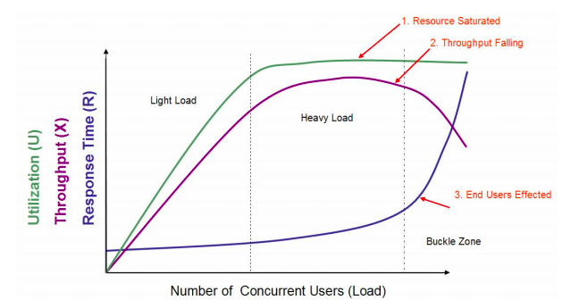

## Introduction

Stress testing is a software testing activity that determines the robustness of software by testing beyond the limits of normal operation. 
Stress testing is particularly important for "mission critical" software, but is used for all types of software. 
Stress tests commonly put a greater emphasis on robustness, availability, and error handling under a heavy load,
than on what would be considered correct behavior under normal circumstances.

一句话概括它与常规功能测试的分野：**压测关心的是"超出容量之后系统怎么崩"，而不是"正常情况下行为对不对"**。因此它的价值不在跑出一个漂亮的数字，而在于回答三个问题——容量上限在哪、超过之后是优雅降级还是雪崩、以及瓶颈落在哪个资源上。指标口径见 [Performance](/docs/CS/SE/Performance.md)，常规的功能与集成覆盖见 [Test](/docs/CS/SE/Test.md)。

## Metrics

- RT
- Throughput TPS QPS
- 资源利用率 CPU 内存 磁盘 负载 网络IO
- 并发用户数
- 错误率

## Capacity Model

Fig.1. 

在这个图中，定义了三条曲线、三个区域、两个点以及三个状态描述。

- 三条曲线：吞吐量的曲线（紫色）、利用率（绿色）、响应时间曲线（深蓝色）。
- 三个区域：轻负载区（Light Load）、重负载区（Heavy Load）、塌陷区（Buckle Zone）。
- 两个点：最优并发用户数（The Optimum Number of Concurrent Users）、最大并发用户数（The Maximum Number of Concurrent Users）。
- 三个状态描述：资源饱和（Resource Saturated）、吞吐下降（Throughput Falling）、用户受影响（End Users Effected）

首先，很多时候，重负载区的资源饱和，和 TPS 达到最大值之间都不是在同样的并发用户数之下的。比如说，当 CPU 资源使用率达到 100% 之后，随着压力的增加，队列慢慢变长，响应时间增加，但是由于用户数增加的幅度大于响应时间增加的幅度之前，TPS 仍然会增加，也就是说资源使用率达到饱和之后还有一段时间 TPS 才会达到上限。
大部分情况下，响应时间的曲线都不会像图中画得这样陡峭，并且也不一定是在塌陷区突然上升，更可能的是在重负载区突然上升。
另外，吞吐量曲线不一定会出现下降的情况，在有些控制较好的系统中会维持水平。

这张图真正的工程价值是两个"点"给出的运行区间：**应把系统常态压力控制在最优并发用户数附近**，留出到最大并发用户数之间的余量吸收突发；一旦长期贴着最大值跑，任何一次依赖抖动都会直接把系统推进 Buckle Zone。

## Tooling

常见选择按用途分：JMeter 胜在图形化编排与插件生态，适合接口级场景串联；Gatling、k6、Locust 用代码描述场景，便于进 CI 做回归；`wrk`、`ab` 则是单机快速探 HTTP 吞吐上限的轻量工具。选型时应以**能否表达真实业务模型**（参数化、思考时间、依赖顺序）为先，其次才是工具本身的性能。

## Distributed Load Generation

单机压不了大流量时必须分布式施压，这不是简单地"多开几台机器"，难点在四处：

- **施压机自身会成为瓶颈**：客户端可用端口数（`TIME_WAIT` 堆积）、CPU、网卡带宽都可能先于被测系统打满，从而把"压不上去"伪装成"被测系统容量就这么大"。判断方法是同步看施压机的资源水位。
- **结果必须集中聚合**：由控制机分发脚本、回收数据；各施压机需要 NTP 时钟同步，否则 RT 的时间序列无法对齐。
- **网络位置要受控**：压测机应靠近被测服务部署（同机房或就近地域），否则公网抖动与跨地域时延会淹没被测系统的真实表现。
- **施压要渐进并做好隔离**：先小流量预热（JIT、连接池、缓存都需要暖机），再阶梯加压；数据要落到影子库/挡板环境，避免污染生产数据与统计口径。

## How to Read the Results

- 看**分位数而不是平均值**：P99 变坏往往早于平均值变坏；平均值会把少数极慢请求藏起来。
- **误差率优先于响应数据**：压测后期一旦出现明显的错误率上升，吞吐数字就失去了可比性。
- 瓶颈定位按 USE 方法逐层排查资源（使用率、饱和度、错误数），再决定是否回到代码层做 [Optimize](/docs/CS/SE/Optimize.md)；线上真实流量下的对照要靠 [APM](/docs/CS/SE/APM.md)。

## Links

- [Performance](/docs/CS/SE/Performance.md)
- [Test](/docs/CS/SE/Test.md)
- [APM](/docs/CS/SE/APM.md)
- [Optimize](/docs/CS/SE/Optimize.md)
- [Engineering](/docs/CS/SE/Engineering.md)
