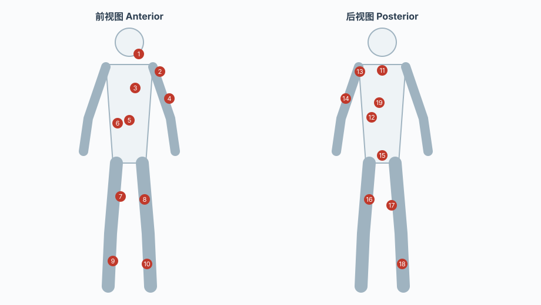

## Anatomy

## Introduction

解剖学（anatomy）研究人体的**结构**：器官长什么样、位于哪里、由什么构成、与周围结构什么关系。它是医学最古老的观察传统——在显微镜、X 射线与基因测序出现之前，人类对自身的可靠知识几乎全部来自解剖刀；直到今天，「结构决定功能」仍是整个基础医学的第一信条：生理学的每个功能陈述都预设一个解剖结构，病理学的每次损伤定位都依赖一个解剖坐标，外科学的每一刀都落在解剖层次上。

本页是系统解剖学（systematic anatomy）的知识地图：先给出描述结构共用的**位置语言**，再按系统走遍人体，最后说明解剖学如何向微观（组织学、胚胎学）延伸、如何与临床（查体、影像、外科）对接。

> [!NOTE]
>
> 解剖学描述的是**典型结构**。人体变异（血管走行异常、副肌束、器官位置转位）远比教科书呈现的丰富，临床上「按书长」的患者只是多数而非全部——这一点在最后一节展开。

## The Language of Structure

解剖学的第一项基础设施是一套**与当前姿势无关的位置语言**。所有描述都锚定在标准姿势（anatomical position）：身体直立、面向前方、掌心向前、双足并拢。有了这个锚，方位词才可能无歧义。

| 方位术语 | 英文 | 含义 |
| :--- | :--- | :--- |
| 上 / 下 | superior / inferior | 朝向或背离头顶 |
| 前 / 后 | anterior (ventral) / posterior (dorsal) | 朝向或背离腹侧 |
| 内侧 / 外侧 | medial / lateral | 距正中矢状面的远近 |
| 浅 / 深 | superficial / deep | 距体表或体腔的远近 |
| 近端 / 远端 | proximal / distal | 距躯干或附着点的远近（四肢专用） |

三个标准剖面（plane）则给出二维切片语言，是现代断面影像的读片基础：

- **矢状面**（sagittal plane）：前后方向纵切；其中**正中矢状面**（median plane）把人体分成左右两半
- **冠状面**（coronal / frontal plane）：左右方向纵切，分成前、后两部分
- **水平面**（transverse / axial plane，又称横断面）：与地平面平行，分成上、下两部分

解剖学术语的国际化由 Terminologia Anatomica 统一：以拉丁名为准，各语言译名向它对齐——这是跨语言、跨世代阅读文献时避免「同物异名」混乱的锚。

## Systems of the Body

系统解剖学按功能把人体分成若干系统。每个系统的核心问题都是同一个：**用什么结构实现什么功能**。

| 系统 | 核心结构 | 功能要点 |
| :--- | :--- | :--- |
| 运动系统 | 骨、骨骼肌、关节 | 杠杆与牵引：骨为杠杆、关节为支点、肌为动力 |
| 消化系统 | 消化道 + 消化腺 | 摄入、机械与化学分解、吸收 |
| 呼吸系统 | 气道 + 肺 | 气体交换的场所与通路 |
| 泌尿系统 | 肾、输尿管、膀胱、尿道 | 滤过、排泄与水盐平衡 |
| 生殖系统 | 性腺、生殖道、外生殖器 | 物种延续 |
| 循环系统 | 心、血管、淋巴系 | 封闭的运输网络：物质与细胞的干线 |
| 神经系统 | 脑、脊髓、脑神经、脊神经 | 快速的信息采集与调控 |
| 感觉器 | 眼、耳、前庭、嗅 / 味 / 皮肤感受器 | 把物理与化学刺激转成神经信号 |
| 内分泌系统 | 垂体、甲状腺、肾上腺等 | 缓慢而持久的化学调控 |

几个值得注意的咬合关系：

- **循环系统是内脏的公共服务设施**。每个器官的剖面都能看到「动脉进、静脉出、淋巴归」三件套，解剖学上用「门」（肝门、肺门、肾门）这类结构描述管线进出器官的入口。
- **神经系统与内分泌系统是两大调控系统**，一个快一个慢，共同维持稳态。神经系统的解剖——大脑皮质的功能分区、脊髓节段与皮节分布、外周神经走行——同时是[生理心理学](/docs/Psychology/Biological_Psychology.md)研究行为与认知的物质基础，两套笔记共享同一套结构语言。
- **内脏的位置描述依赖体腔划分**：颅腔、椎管、胸腔（内含心包腔、胸膜腔）、腹腔、盆腔。浆膜（胸膜、腹膜）把内脏摩擦与感染扩散同时限制在局部范围内。

## Skeletal Muscle

骨骼肌（skeletal muscle）是运动系统的**动力部分**：附着于骨、跨过关节，受躯体运动神经支配而随意收缩，将化学能转为机械功。它与骨骼、关节共同构成「骨为杠杆、关节为支点、肌为动力」的杠杆系统——这也是运动系统在上一节只列了「骨、肌、关节」三要素的原因。下面先给出一张浅层肌群的**体表分布索引图**，再用表格把图中编号对应到具体肌肉与功能。

> [!NOTE]
>
> 图为**浅层肌群索引示意图**，只标出体表可见或浅层的代表性肌肉，深层肌（如多裂肌、腰方肌、肩胛下肌）未纳入；图中编号的精确定位以本节表格为准，肌纤维起止的细节以专业图谱（见 References）为准。

### Construction and Terms

一块典型骨骼肌由两部分构成：**肌腹**（belly，富含血管神经的收缩主体）与**肌腱**（tendon，致密的胶原纤维束，将肌腹固定于骨）。肌腱截面积小而抗拉，是力的传递通道；这也是跟腱拉伤比肌腹撕裂更常见的原因。

描述一块肌时有一套固定术语：

- **起点**（origin）与**止点**（insertion）：起点通常是更固定、更靠近躯干的一端，止点是随收缩移动的一端；但「固定端」会随动作改变——引体向上时胸大肌的止点反而成了固定端。
- **拮抗肌**（antagonist）与**协同肌**（synergist）：肱二头肌屈肘、肱三头肌伸肘，二者互为拮抗；肱二头肌与肱肌同向屈肘，则是协同。
- **固定肌**（fixator）：稳定起点所在骨，使原动肌能高效发力，如做手臂弯举时斜方肌稳定肩胛骨。

### Classification

按形态大致可分四类：**长肌**（梭形，多见于四肢，如肱二头肌）、**短肌**（短小，多位于躯干深层）、**扁肌**（薄片状，构成腹壁如腹外斜肌）、**轮匝肌**（环状，围绕孔裂如眼轮匝肌）。

按「头数」命名则直接反映起点肌腱的束数：**二头肌**（两个起点）、**三头肌**（三个起点）、**股四头肌**（四个起点）。

### Superficial Muscle Map

下表把上图编号对应到部位、主要肌与功能要点，覆盖全身主要的浅层肌群。

| # | 部位 | 主要肌 | 功能要点 |
| :--- | :--- | :--- | :--- |
| 1 | 颈 | 胸锁乳突肌 sternocleidomastoid | 屈颈、侧屈、向对侧转头 |
| 2 | 肩 | 三角肌 deltoid | 肩关节外展（中段最有力） |
| 3 | 胸 | 胸大肌 pectoralis major | 臂内收、旋内、屈肩 |
| 4 | 上臂前 | 肱二头肌 biceps brachii | 屈肘、前臂旋后 |
| 5 | 腹前壁 | 腹直肌 rectus abdominis | 脊柱前屈、骨盆后倾 |
| 6 | 腹外侧 | 腹外斜肌 external oblique | 躯干旋转、侧屈 |
| 7 | 大腿 | 缝匠肌 sartorius | 屈髋屈膝、大腿旋外（人体最长肌） |
| 8 | 大腿前 | 股四头肌 quadriceps femoris | 伸膝（经髌腱） |
| 9 | 小腿前 | 胫骨前肌 tibialis anterior | 足背屈、内翻 |
| 10 | 小腿 | 腓肠肌 gastrocnemius | 屈膝、足跖屈（快肌、爆发力） |
| 11 | 上背 | 斜方肌 trapezius | 肩胛骨上提 / 后缩 / 下压、抬头 |
| 12 | 背 | 背阔肌 latissimus dorsi | 臂内收、后伸、旋内（引体向上） |
| 13 | 肩后 | 冈下肌 / 小圆肌（肩袖 rotator cuff） | 肱骨外旋、稳定肩关节 |
| 14 | 上臂后 | 肱三头肌 triceps brachii | 伸肘 |
| 15 | 臀 | 臀大肌 gluteus maximus | 伸髋、外旋（登阶、奔跑） |
| 16 | 大腿后 | 股二头肌 biceps femoris | 伸髋、屈膝、小腿旋外 |
| 17 | 大腿后 | 半腱肌 / 半膜肌 semitendinosus / semimembranosus | 伸髋、屈膝、小腿旋内 |
| 18 | 小腿后 | 腓肠肌 / 比目鱼肌（小腿三头肌 triceps surae） | 足跖屈、维持站立 |
| 19 | 脊柱旁 | 竖脊肌 erector spinae | 脊柱后伸、侧屈（抗重力） |

### Naming Conventions

肌肉命名几乎都遵守可预测的规则，记住这几条就能反推大部分肌肉的位置与形态：

- **按形态**：三角肌（三角形）、斜方肌（梯形）、二头肌 / 三头肌（起点腱束数）、缝匠肌（裁缝盘腿姿势）
- **按位置**：胸大肌（胸部）、颞肌（颞部）、冈下肌（肩胛冈下方）
- **按起止**：胸锁乳突肌（胸骨 + 锁骨 + 乳突）、肱桡肌（肱骨 → 桡骨）
- **按功能**：收肌（内收）、展肌（外展）、屈肌 / 伸肌、旋前肌 / 旋后肌
- **按大小或层次**：臀大肌 / 臀中肌、腹外斜肌 / 腹内斜肌（深浅层）

运动科学视角下的肌群训练、发力顺序与动作解剖学依据，见体育目录下的[解剖条目](/docs/Sports/Anatomy.md)——那篇与本页的分工是：本页讲结构本身，那篇讲结构在力量训练中如何被使用。

---

## Skeletal System

如果说骨骼肌是杠杆的动力，骨就是杠杆本身，关节是支点——三者构成运动系统的力学基础。成年人共有 **206 块骨**，按位置分为轴骨与附肢骨两部分。

| 分组 | 数量 | 组成 |
| :--- | :--- | :--- |
| 轴骨 axial | 80 | 颅骨 22 + 听小骨 6 + 舌骨 1 + 椎骨 26 + 肋骨 24 + 胸骨 1 |
| └ 颅骨 cranium | 22 | 脑颅骨 8（保护脑）+ 面颅骨 14（构成面容与口腔鼻腔） |
| └ 椎骨 vertebrae | 26 | 颈椎 7 + 胸椎 12 + 腰椎 5 + 骶骨 1 + 尾骨 1 |
| 附肢骨 appendicular | 126 | 上肢骨 64（每侧 32）+ 下肢骨 62（每侧 31） |
| └ 上肢骨 | 64（每侧 32） | 锁骨 1、肩胛骨 1、肱骨 1、桡骨 1、尺骨 1、腕骨 8、掌骨 5、指骨 14 |
| └ 下肢骨 | 62（每侧 31） | 髋骨 1、股骨 1、髌骨 1、胫骨 1、腓骨 1、跗骨 7、跖骨 5、趾骨 14 |

⚠️ **206 不是从出生就稳定的数字**。新生儿约有 270 块骨，部分骨尚未骨化或未融合（髂骨、坐骨、耻骨三块独立，骶尾椎各由多块小骨组成）；融合多在青春期至成年早期完成（骶椎 5 块融为 1 块、髋骨三块融为 1 块），成年后稳定在 206。因此**儿童骨折与成人骨折的机制不同**——软骨与骨痂的力学性质不同，影像判读也不同。

骨按形态可分四类：**长骨**（股骨、肱骨，杠杆作用明显）、**短骨**（腕骨、跗骨，承重稳定）、**扁骨**（颅骨、肩胛骨、肋骨，保护腔隙）、**不规则骨**（椎骨）。

骨是活组织而非惰性支架。骨外膜（periosteum）内层有成骨细胞，参与骨折愈合；骨质内部由骨小梁按受力方向排列（Wolff 定律，机械刺激下骨沿受力方向重建）；骨髓腔内是血细胞生成的主要场所。骨的六大功能是支撑、运动、保护、造血、矿物质储存（钙磷库）以及**内分泌调节**（骨钙素等参与代谢信号）——最后一项是近几十年才被充分认识的功能。

## Joints

骨与骨之间的连接装置叫关节（articulation / joint）。关节的结构直接决定运动的**自由度与范围**，与骨骼本身无关。

按连接方式可分三大类：

| 类型 | 连接组织 | 活动度 | 例子 |
| :--- | :--- | :--- | :--- |
| 纤维关节 fibrous | 致密纤维组织 | 几乎不动（微动） | 颅缝、椎体间韧带联合 |
| 软骨关节 cartilaginous | 软骨 | 小范围滑动 | 椎间盘、耻骨联合 |
| 滑膜关节 synovial | 关节囊 + 关节腔（滑膜） | 大范围、多自由度 | 肩、髋、膝、肘 |

滑膜关节（synovial joint）是真正「动得了」的关节，其五个基本结构是：

1. **关节面**（articular surface）：覆盖关节软骨，减少摩擦、分散压力
2. **关节囊**（capsule）：外层纤维囊提供稳固，内层滑膜分泌滑液
3. **关节腔**（cavity）：滑液填充，滑液是滑膜衬里（synovial lining）分泌的，不是关节囊内自行生成
4. **韧带**（ligament）：连接两骨，限制过度位移、提供本体感觉输入
5. **关节盘 / 半月板**（disc / meniscus）：部分关节内的纤维软骨垫，缓冲震荡并使关节面贴合

滑膜关节按运动轴数目分类：**铰链关节**（单轴，如膝关节的屈伸）、**车轴关节**（单轴旋转，如寰枢关节）、**平面关节**（滑动，如椎间小关节）、**椭圆关节**（两轴，如桡腕关节）、**鞍状关节**（两轴且互嵌，如拇指腕掌关节）、**球窝关节**（三轴，最自由，如肩关节与髋关节）。

滑膜衬里不是一层被动膜。它是**内分泌活跃的组织**——滑膜细胞分泌滑液中的透明质酸与润滑素，也介导炎症反应（滑膜炎）。关节软骨本身无血管，其营养来自滑液与骨端渗液，因此损伤后修复极其缓慢。

## Viscera and Body Cavities

内脏（viscera）指位于体腔内的器官，按与外界相通的方式可分为两大类，这一分类决定了它们的结构规律：

- **管道器官**（与外界相通）：消化道、呼吸道、泌尿道、阴道。共同结构是**管壁分层**——黏膜（上皮 + 基质）、肌层（平滑肌或横纹肌）、外膜；黏膜表面积常靠褶襞、绒毛或微绒毛扩大以提高交换效率。
- **实质性器官**（不通外界）：肝、肾、脾、胰腺、脑、腺体。共同结构是**被膜 + 实质 + 门（hilum）**，血管神经与导管经门进出，因此门部是手术与影像定位的关键。

体腔把内脏分区，不同体腔壁的来源与病变扩散路径不同：

| 体腔 | 内容 | 壁层 |
| :--- | :--- | :--- |
| 颅腔 | 脑、颅内血管 | 硬脑膜 / 蛛网膜 / 软脑膜三层膜 |
| 椎管 | 脊髓、马尾神经 | 同上三层延续 |
| 胸腔 | 纵隔（心、大血管、气管、食管）+ 左右胸膜腔（肺） | 胸膜（壁层 + 脏层） |
| 腹腔 | 消化器官、肝、胰、脾、肾 | 腹膜 |
| 盆腔 | 膀胱、直肠、生殖器官 | 腹膜（部分覆盖） |

浆膜（serous membrane）的结构是理解炎症扩散的关键：壁层衬于腔壁，脏层覆盖脏器表面，两层之间是潜在腔隙。**胸膜腔、腹腔、心包腔都是潜在腔隙而非真正的腔**——正常时两层贴合、腔内仅有少量浆液；炎症导致浆液渗出时才形成积液，积液量与分布取决于体位和重力。

---

## From Gross to Microscopic

解剖学自身也有分辨率梯度，三层递进：

1. **大体解剖**（gross anatomy）：肉眼可见的器官与结构，靠解剖刀与影像呈现，是临床解剖的主体。
2. **组织学**（histology）：显微镜下，细胞如何排列成**四大基本组织**——上皮组织（被覆与分泌）、结缔组织（支持与连接，骨、软骨、血液皆属此门）、肌组织（收缩）、神经组织（信号传导）。
3. **胚胎学**（embryology）：从受精卵到成体的发育过程。三胚层分工是理解结构来源的钥匙——外胚层发育为神经系统与表皮，中胚层发育为肌肉、骨骼与循环系统，内胚层发育为消化与呼吸道的上皮。

胚胎学的价值在于解释「为什么长成这样」：睾丸为何下降、膈肌如何拼合、弓动脉为何改造为大血管——这些成人结构里看似怪异的设计，只有放回发育时间线才说得通。先天畸形也多数能定位到某个发育步骤的失败。

## Anatomy in the Clinic

解剖结构最终在三个临床场景中被使用：

- **体表标志**（surface anatomy）。临床查体用体表可触及的骨性标志、肌性标志与投影线定位深部结构——心肺听诊区、肝脾触诊、神经干压痛点都建立在这套「体外坐标 → 体内结构」的映射上，也是护理评估中视触叩听的基本功，见[护理学](/docs/Medicine/Nursing/Nursing.md)。
- **断面解剖**（sectional anatomy）。CT 与 MRI 输出的是逐层断面图像，读片能力本质是「在标准剖面上认出器官与间隙」的解剖功力，[临床医学](/docs/Medicine/Clinical_Medicine.md)的影像诊断直接建立在这层之上。
- **外科层次**。手术入路按筋膜与间隙逐层进入，「层次清楚」既是效率也是安全——知道血管神经走在哪一层，才知道刀锋可以再进一寸还是必须收手。

运动科学视角的肌群应用笔记（肌纤维类型、发力顺序、训练动作的解剖学依据）见体育目录下的[解剖条目](/docs/Sports/Anatomy.md)，那篇与本页的分工是：本页讲结构本身，那篇讲结构在力量训练中如何被使用。

## Links

- [医学总纲](/docs/Medicine/Medicine.md)
- [基础医学](/docs/Medicine/Basic_Medicine.md)
- [生理心理学](/docs/Psychology/Biological_Psychology.md)
- [护理学](/docs/Medicine/Nursing/Nursing.md)

## References

1. [Gray's Anatomy: The Anatomical Basis of Clinical Practice](https://www.elsevier.com/books/grays-anatomy/susan-standring/978-0-7020-7705-0)
2. [OpenStax Anatomy and Physiology](https://openstax.org/subjects/science/anatomy-and-physiology)
3. [OpenStax Anatomy and Physiology（教科书分章正文）](https://openstax.org/books/anatomy-and-physiology/pages/1-introduction)
4. [TeachMeAnatomy](https://teachmeanatomy.info/)
